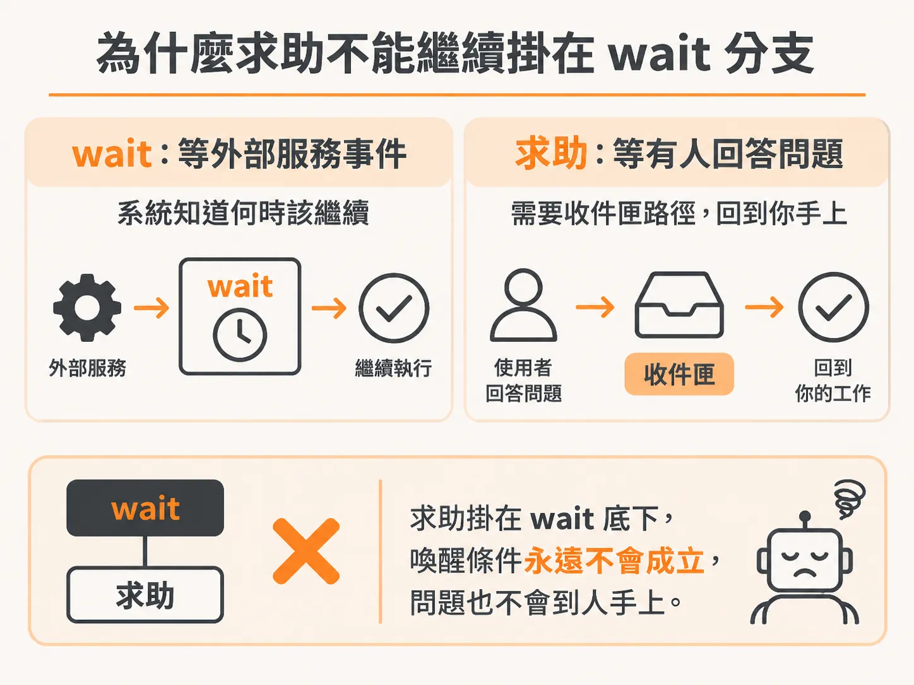
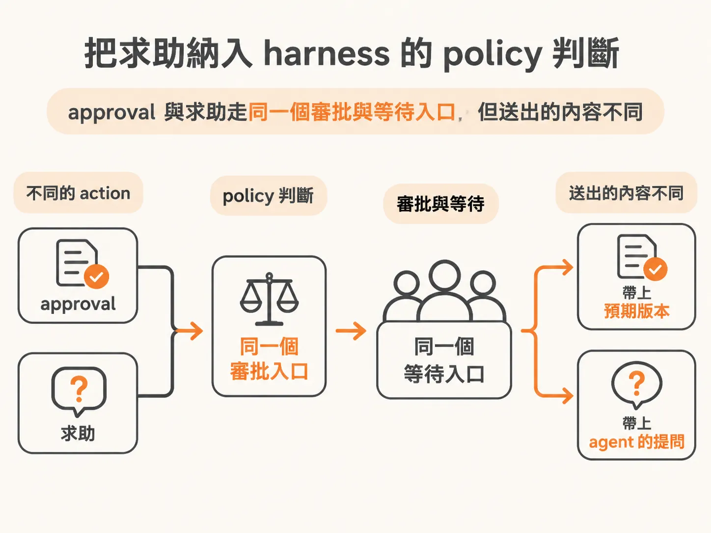

# 把 `request_help` 從 wait 分支拉出來，接上 harness 的 policy 判斷

想像你的背景 agent 在處理一次事故：付款閘道掛了。它檢查日誌、檢查變更，發現把自家功能停用或回滾版本都沒用——這種依賴服務的故障，不是本地工具修得好的。這時它該做的是舉手求助，把一個具體問題送到你的收件匣。但在目前未完成的狀態下，求助請求會掉回「等待服務事件」的路徑，永遠到不了任何人手上。現在要做的事，就是把求助從 wait 分支裡拆出來，給它自己的處理路徑。

## 為什麼不能繼續沿用 wait 分支

先看舊的結構問題在哪。之前 `request_help` 被塞在 wait 處理的底下，和「agent 以為自己做完了、其實還沒做完」的那個 handle 綁在一起。也就是說，求助在系統眼裡只是等待的一種變形：系統等一個服務事件回來，順便等你的求助被回覆。

但這兩件事根本不是同一種等待。wait 是在等一個外部服務事件，系統自己會知道什麼時候該繼續；求助是在等一個人回答問題，這需要收件匣路徑，讓沒人看管的工作回到你手上。收件匣不只是排隊批准的地方，是無人值守的工作回到你面前的地方。把求助混在 wait 底下，它就只會一直等下去，不會有人被通知到。



所以這次改動的方向很明確：`request_help` 要有自己的 handle，不再寄生在 wait 底下。

## 動手改 workflow

改動從原本做 wait 的地方開始。打開 `server/agent-workflow.ts`，找到處理 wait 的那段。

首先要清掉舊的殘留。原本那裡有一段「如果 action 等於 `request_help` 就……」的程式碼，但它現在什麼事都沒做，只是占著位置。這一段直接刪掉。

接著，那裡本來還有一個三元運算式（ternary），把幾種情況混在一起判斷。保留 `action` 等於 `wait` 的那個決策——reason 也留著，verify 就不用在這裡做了——但把三元運算式整個拆掉，讓這段只負責 wait 自己的事。

原則就是一個：把 `request_help` 從這個區域全面清乾淨。因為接下來要為它建一個獨立的 policy handle，舊的殘留只會妨礙新的路徑生效。

## 把 `help` 加進 policy 判斷

清完之後，輪到 harness 的 policy 層。harness 讀的是 policy 中繼資料，而不是去判斷結帳故障旗標之類的業務細節。每個 action 都對應一種 policy 類別，`request_help` 現在有自己的歸屬：

<!-- source: sources/background-agent/20261109/supplement/server/tool-policy.ts#L1-L15 -->

```typescript
import type { ActionName } from '../shared/types'

// The harness reads policy metadata; it does not branch on checkout fault flags.
export const actionPolicy: Record<
  ActionName,
  'read' | 'write' | 'approval' | 'help' | 'terminal' | 'wait'
> = {
  inspect_logs: 'read',
  inspect_changes: 'read',
  disable_feature: 'write',
  rollback_release: 'approval',
  request_help: 'help',
  complete: 'terminal',
  wait: 'wait',
}
```

也就是說，policy 表裡新增了 `help` 這個類別，`request_help` 就歸在它底下，和 `read`、`write`、`approval`、`terminal`、`wait` 並列。

接著 harness 在 decisions 落地時，要用這個 policy 來分流。原本只判斷 `approval`，現在要把 `help` 加進同一個判斷：



<!-- source: sources/background-agent/20261109/supplement/server/agent-workflow.ts#L141-L147 -->

```typescript
      const actionId = `${runId}:${cycle}:${decision.action}`
      const policy = actionPolicy[decision.action]
      if (policy === 'approval' || policy === 'help') {
        const input =
          policy === 'help'
            ? { question: decision.detail }
            : { expectedVersion: state.world.version }
```

這裡的重點是分流之後的輸入內容不一樣：如果 policy 是 `help`，帶入的是 `question`——也就是 agent 想問的那個具體問題；如果是 `approval`，帶入的才是 `expectedVersion`，用來比對目前的 world 狀態。這正是為什麼求助不能繼續借用 wait 或 approval 的舊輸入——它要送出去的不是版本號，是一個問題。

## 改完之後你的系統多了什麼

從這一步之後，agent 遇到「本地工具修不了」的狀況，就不再落到無止盡的等待。它會帶著一個具體問題走進收件匣路徑，由你自己決定怎麼回覆。事故演練裡的依賴故障——那種停用功能或回滾都救不了的付款閘道問題——終於有了一條通往人的路。

路打通了，但求助走的還是另一套寫法。下一步就是把它併回核准那條既有的流程。
