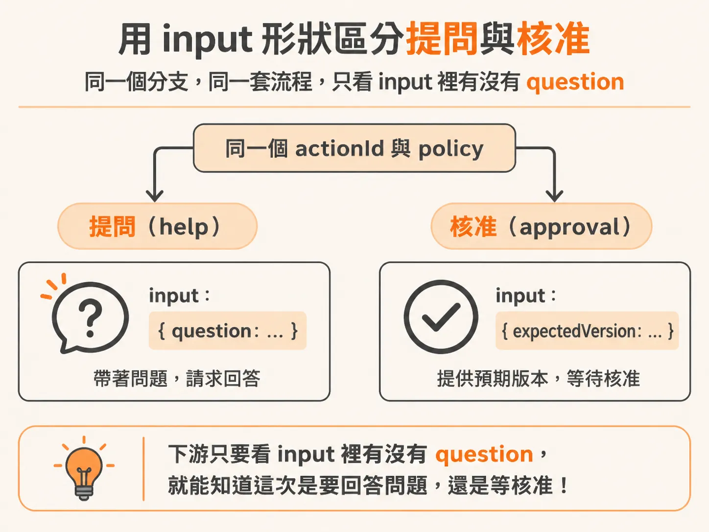
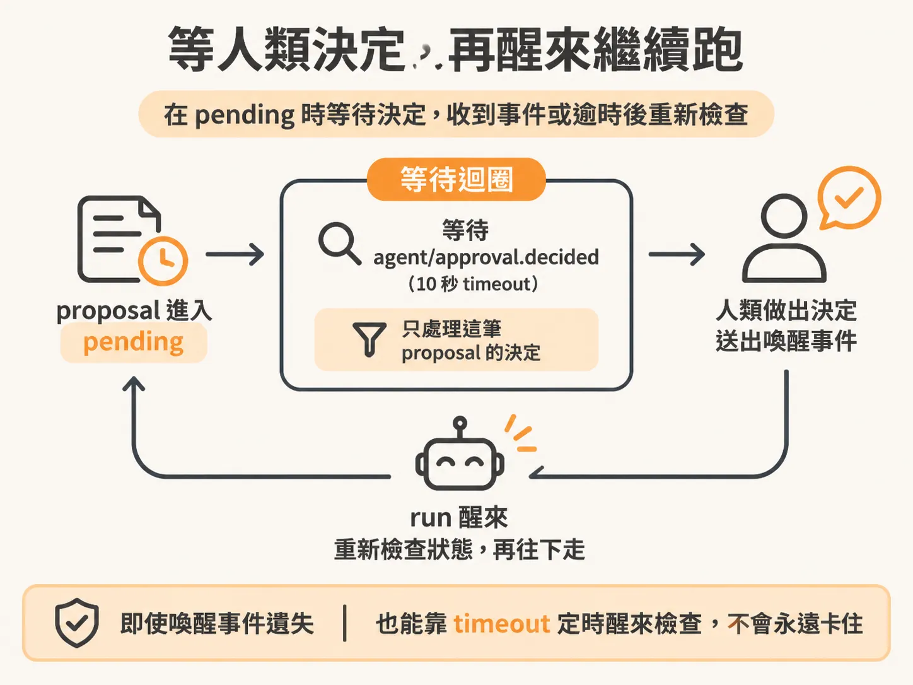

# 讓 help 重用 proposal 與 human-decision wait

背景 agent 每個循環結束時都會產生一個 decision，而不同的 action 有不同的 policy。「核准」（approval）已經有一套完整的流程：先建立 proposal，等人類決定，再醒來繼續跑。但「求助」（help）走的卻是另一套寫法。兩件事本質上很像——都是要停下來等人回覆——卻各自維護一份邏輯，等於同一件事要做兩次維護。目標就是把 help 併進原本的 approval 流程，並用 input 的形狀來區分兩者。

## 先清掉舊的 request for help 路徑

動手合併之前，得先把舊路徑拆乾淨。程式裡到處都有針對 request for help 的專門處理，這些全都要拿掉，因為要為它建立自己的 policy handle，讓它走和 approval 一樣的管道。

有一段要留下來：action 等於 `wait` 的那個決策判斷照舊保留，`reason` 也照舊保留，而且不在那裡做驗證。`wait` 和 `help` 是兩回事——`wait` 不需要人類回覆某個問題，所以它不在這次要合併的範圍內。

## 把 help 的 policy 放進同一個分支

程式裡原本只有 approval policy。要做的是讓 help 的 policy 長得跟它一樣，把兩者放進同一個地方處理。

具體改法：原本判斷「這個 policy 是不是 approval」，改成判斷「policy 是 approval 或是 help」。這兩者非常相似，可以被同一段程式碼接手。

## 用 input 形狀區分問題與核准

兩種 action 都會進入同一個分支，但要能分辨進來的是哪一個。做法是看 input 的形狀——如果 `policy === 'help'`，input 就是一個問題；否則就是核准用的版本。

help 的 input 很簡單，就是那個 `question`。問題的內容就寫在 detail 裡，所以直接取 `decision.detail` 填進去。

改完之後的程式碼長這樣：

<!-- source: sources/background-agent/20261109/supplement/server/agent-workflow.ts#L141-L165 -->

```typescript
      const actionId = `${runId}:${cycle}:${decision.action}`
      const policy = actionPolicy[decision.action]
      if (policy === 'approval' || policy === 'help') {
        const input =
          policy === 'help'
            ? { question: decision.detail }
            : { expectedVersion: state.world.version }
        const proposalId = await step.run(`propose-action-${cycle}`, async () => {
          const proposal = await proposeAction(
            environmentId,
            runId,
            actionId,
            decision.action,
            input,
...
        let proposal = await step.run(`read-human-${cycle}`, () => getProposal(proposalId))
        let check = 0
        while (proposal.status === 'pending') {
          check++
          await step.waitForEvent(`wait-for-human-${cycle}-${check}`, {
            event: 'agent/approval.decided',
            if: `async.data.proposalId == "${proposalId}"`,
            timeout: '10s',
          })
```

可以看到，兩種 action 共用同一個 `actionId`、同一個 policy 表、同一套 propose 與等待的步驟。唯一的差異就是進 `proposeAction` 的 `input`：help 帶的是 `{ question: decision.detail }`，approval 帶的是 `{ expectedVersion: state.world.version }`。下游要判斷這是問題還是核准，只要看 input 裡有沒有 `question` 就知道。



## proposal 是怎麼被存起來的

`proposeAction` 的職責是把這次的提案寫進資料庫。它收環境 ID、run ID、`actionId`、action 名稱和 `input`，然後插入一筆 `approvals` 紀錄，狀態是 `pending`，並設下一個十分鐘的過期時間：

<!-- source: sources/background-agent/20261109/supplement/server/agent-data.ts#L175-L212 -->

```typescript
export async function proposeAction(
  environmentId: string,
  runId: string,
  actionId: string,
  action: ActionName,
  input: Record<string, unknown>,
) {
  const [proposal] = await db
    .insert(approvals)
    .values({
      id: randomUUID(),
      environmentId,
      runId,
      actionId,
      action,
      input,
      status: 'pending',
      expiresAt: new Date(Date.now() + 10 * 60_000),
    })
    .returning()
...
  return proposal
}
```

這裡沒有對 input 的形狀做任何假設——它就是一個任意的 `Record<string, unknown>`。用 input 形狀區分兩者之所以可行，道理就在這裡：儲存層不在乎裡面放的是問題還是版本號，形狀的意義由讀的那一端解讀。

## 等人類決定，然後醒來

proposal 進入 `pending` 之後，workflow 就進入等待迴圈：只要狀態還是 pending，就不斷用 `step.waitForEvent` 等 `agent/approval.decided` 這個事件，並且用 `async.data.proposalId` 過濾，確保醒來是因為這一筆 proposal 被決定了，而不是別筆。每次等待設 10 秒的 timeout，等不到就再檢查一次狀態，如此反覆。



人類那端的決定有一條和 help 相關的規則：如果這筆 proposal 是 `request_help`、狀態要改成 approved、但 `reason` 是空的或全是空白，就直接擋下來，因為 agent 要繼續跑之前必須有答案。通過檢查的決定會更新資料庫，並發出 `agent/approval.decided` 事件把 wait 中的 run 叫醒；萬一事件送出失敗，資料已經存好，run 會在 timeout 時自行 reconciliation：

<!-- source: sources/background-agent/20261109/supplement/server/agent-data.ts#L244-L273 -->

```typescript
  if (proposal.action === 'request_help' && status === 'approved' && !reason?.trim()) {
    throw new Error('An answer is required before the agent can continue')
  }
  const [updated] = await db
    .update(approvals)
    .set({ status, reason, decidedAt: new Date() })
    .where(and(eq(approvals.id, proposalId), eq(approvals.status, 'pending')))
    .returning()
  if (!updated) return getProposal(proposalId)
  await logAgentActivity(
...
  try {
    await inngest.send({
      name: 'agent/approval.decided',
      data: { proposalId, environmentId: proposal.environmentId, runId: proposal.runId },
    })
  } catch (error) {
    console.warn('Approval saved; wake event failed and the run will reconcile on timeout', error)
  }
  return updated
}
```

## 收攏起來看

改完之後，help 和 approval 走的是同一條路：

1. 進入同一個 `policy === 'approval' || policy === 'help'` 分支。
2. 用同一個 `proposeAction` 建立 proposal，`input` 的形狀決定它是問題還是核准。
3. 用同一個 `waitForEvent` 的迴圈等人類決定，靠 `proposalId` 對齊事件。
4. 人類那端統一用同一個決定流程，`request_help` 額外要求答案不可為空。

原本兩套各自維護的邏輯，現在只剩 input 形狀上的一個分岔。之後不管是加新的 action 類型，還是調整等待行為，都只需要改一個地方。
