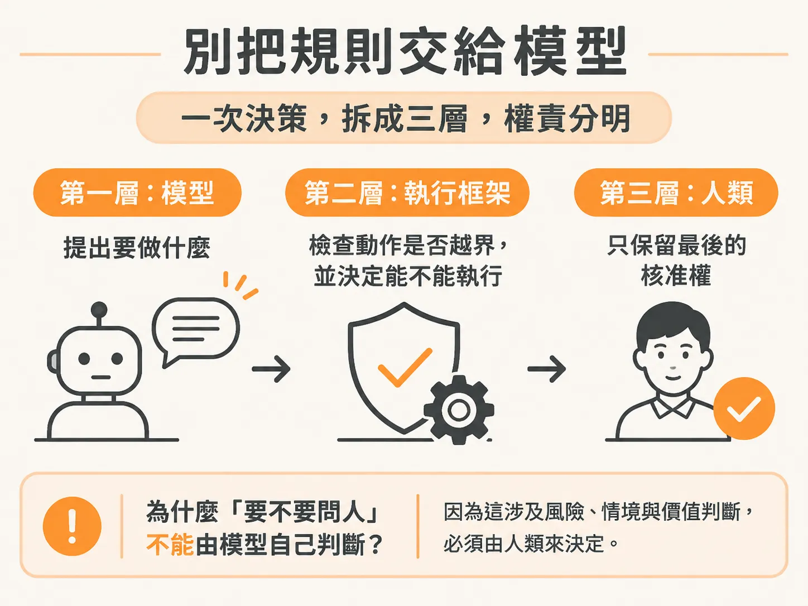
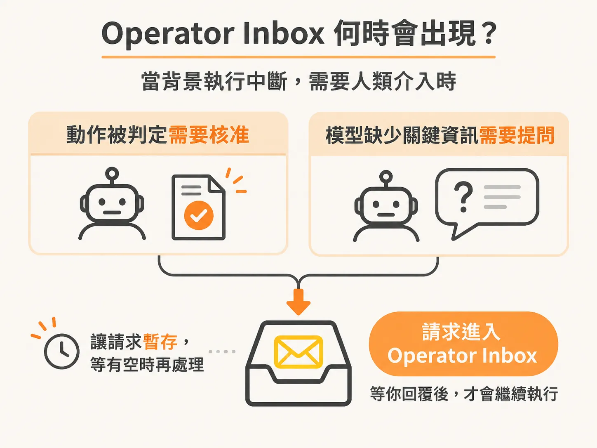

# 誰有權做什麼？

迴圈跑起來之後，下一個問題不是它會不會動，而是它憑什麼動。在一般的聊天介面中，AI 助理每一次動作都有你看著。如果不給提示詞，它什麼也不會做；如果它打算呼叫工具，系統通常能設定要全自動執行，還是每一步都停下來等你確認。

但當 Agent 移到背景執行，情境就完全不同了。你可以設定好目標後直接關掉電腦去海邊度假，Agent 會在背景持續監聽事件、嘗試完成任務。這時最關鍵的問題出現了：當系統獨自運作時，誰到底有權限決定下一步？

### 別把規則交給模型把關

很多人的直覺是直接在 Prompt 裡交代模型：「如果你要做危險動作，記得先問我。」

這樣做往往會出問題。大型語言模型本質上具備隨機性，也難免會產生幻覺。如果連輸出內容都可能出現幻覺，它自然也可能在關鍵時刻「忘記」這項操作需要審批，甚至誤判破壞性動作的影響。把「判斷是否需要授權」的責任推給模型，等於把系統安全性建立在不可靠的機率上。

在背景 Agent 的架構裡，權責必須清楚切分為三個層次：

1. **模型（LLM）**：負責處理需要智慧與推理的模糊任務。它負責理解情境、規劃達成目標的路徑，並提出「我認為現在應該做這件事」的建議。
2. **Harness（執行框架）**：負責確定性的硬性規則與防護。Harness 負責觀察當前狀態、驗證模型選擇的動作，並決定哪些工具可以執行。遇到破壞性或敏感操作時，Harness 會直接把動作攔截下來，而不是由模型自律。
3. **人類（Operator）**：擁有最終的核准權與關鍵決策權。當系統遇到無法自動化越過的門檻，決定權必須交回人類手上。

### Operator Inbox 何時會出現？

因為背景 Agent 是非同步運作的，當它需要人類介入時，不可能停在終端機前空等。這時系統需要一個 Operator Inbox（操作者收件匣），讓請求能妥善保存，等你有空時再處理。

在日常運作中，Inbox 主要會在兩種情況下收到通知：

第一種是**審批請求（Approvals）**。模型可能判定解決問題的最佳方案是重開伺服器或刪除資料，但 Harness 的規則明確標註這項操作具有破壞性。Harness 會直接將該動作卡住，丟進 Inbox 進入待審狀態，直到人類點擊批准或拒絕。

第二種是**補充脈絡（Questions）**。模型在嘗試執行任務時，發現缺少關鍵資訊或不確定環境條件，便會向 Inbox 發出提問。

當你在 Inbox 中回覆問題或核准操作後，Agent 不會盲目執行，而是會結合你的回覆、收到的最新事件與當前系統狀態，再次驗證條件是否依然成立，最後才安全地推進下一步。
