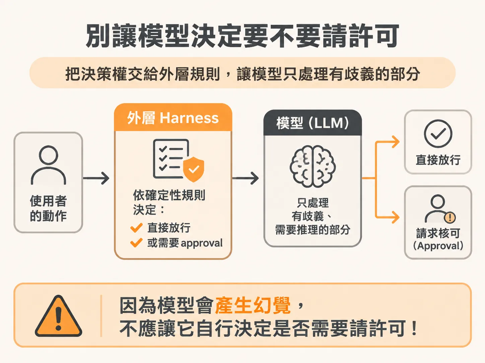
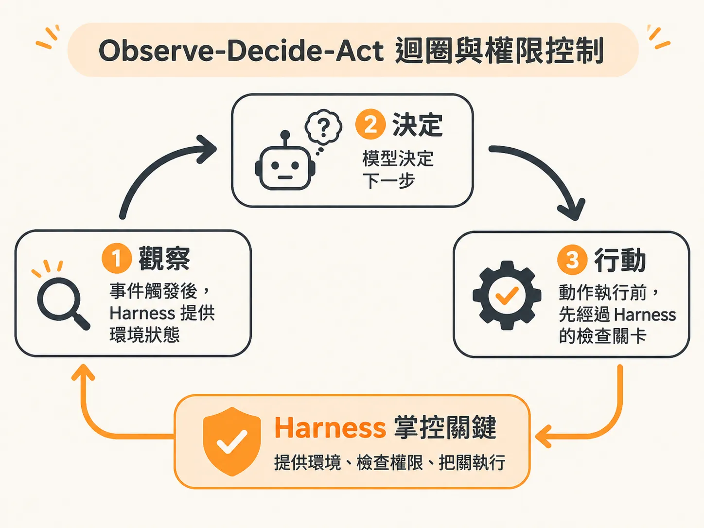
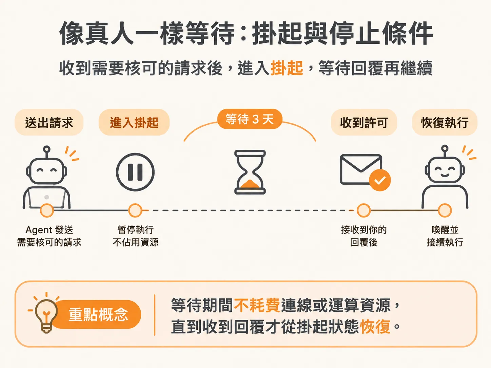

# 為什麼 Approval 與停止條件必須由 Harness 決定，而不是交給模型？

上一段說到背景代理會自行回應事件、不必等你下指令，這也立刻帶出下一個問題：一旦它「觸發後放手」，誰有權限做決定？先從你熟悉的對話式 Agent 說起。當你使用一般的對話式 Agent 或寫程式助手時，控制權通常還在你的眼皮底下。除非你主動給提示詞（prompt），否則模型什麼都不會做。這類工具往往會提供設定：你要讓它全自動執行？每呼叫一個工具都要停下來確認？還是要把某些工具放進白名單、黑名單？在這種情境下，你可以隨時決定自己要握有多少權限。

但背景 Agent（background agent）完全是另一回事。它有自己的目標，會自行回應各種事件。當你設定完任務轉身離開，甚至人已經在夏威夷的海灘上度假時，這套系統處於「觸發後放手」（fire and forget）的狀態。這時就必須嚴肅面對一個問題：到底誰有權限做決定？這份授權契約又要如何被嚴格遵守？

## 不能叫模型「記得去要許可」

如果你在提示詞裡告訴模型：「要做這件事之前，請記得先請求許可。」這種做法從一開始就錯了。

將「判斷是否需要 approval（核可）」的責任丟給大型語言模型（LLM），是極其危險的設計。我們都知道 LLM 本身就會產生幻覺（hallucinate）。既然它會產生幻覺，為什麼在關鍵時刻不會對「現在要不要請求許可」這件事產生幻覺？它絕對會。

因此，你必須在架構上做出清楚的切分：
- **LLM 的職責**：處理具有歧義、真正需要智慧與推理的事情。
- **Harness（外層控制框架）的職責**：執行確定性（deterministic）的動作。把關鍵權限從模型身邊抽離，只在模型真正需要的時候把資料「一口一口餵給它」（spoon feed）。

這是在設計背景 Agent 時必須拿捏的權衡，也是 Harness 最核心的任務：所有 approval 與停止條件，都必須由外層的程式碼決定，而不是交給模型自由心證。

## Observe-Decide-Act 迴圈與權限控制

為了把權限收回 Harness，我們需要建立一個 Observe-Decide-Act（觀察、決定、行動）迴圈。

在 Agent 的架構研究中，有非常多類似的思考框架，例如 Chain of Thought、Tree of Thought 或是 ReAct（這裡指 ReAct 架構，不是前端的 React.js）。Observe-Decide-Act 迴圈的核心運作很單純：當某個事件發生時，Agent 先觀察外層提供給它的環境狀態（Observe），接著思考下一步要做什麼（Decide），最後執行決定好的動作（Act），然後不斷循環。

幾乎所有內建工具迴圈（tool loop）的 Agent SDK 都在做類似的事，但如果要把控制權完全交給 Harness，實作細節會出現關鍵差異。舉例來說，這個 Harness 甚至完全不使用模型層級的原生 Tool Calling（工具呼叫）；即便不依賴模型內建的 tool calling 機制，我們依然能讓 Agent 挑選它要採取的動作，同時把控制權牢牢鎖在 Harness 手中。

## 像真人一樣等待：掛起與停止條件

把權限與狀態管理交給 Harness 的另一個關鍵原因，在於背景執行的「等待」機制。

現行大多數的 coding agent 無法真正長久地等待你。它們通常是在發送訊息後，整個行程（process）就結束了；或者一旦你把筆電闔上，執行就中斷了。試想一個情境：今天在遠端伺服器上部署了一個 Agent，它需要你回覆確認才能繼續下一步，但你過了三天才回覆。

你不可能讓那台機器的連線或運算資源一直掛在那裡空轉三天，更不用說三天後原本的環境狀態可能早就改變了。

我們需要的是讓背景 Agent 能像真人同事一樣：就像有人用 Slack 傳訊息問你問題，在得到答案前他處於卡關狀態（blocked），他只會放著等你回覆，等收到訊息後再繼續手邊的工作。在等待的三天裡，背後不消耗任何伺服器運算資源。

這種在需要 approval 或達到停止條件時將狀態暫停、掛起，並在獲得許可後才喚醒接續執行的能力，只能由外層的 Harness 來掌控與排程，模型本身完全做不到這一點。
