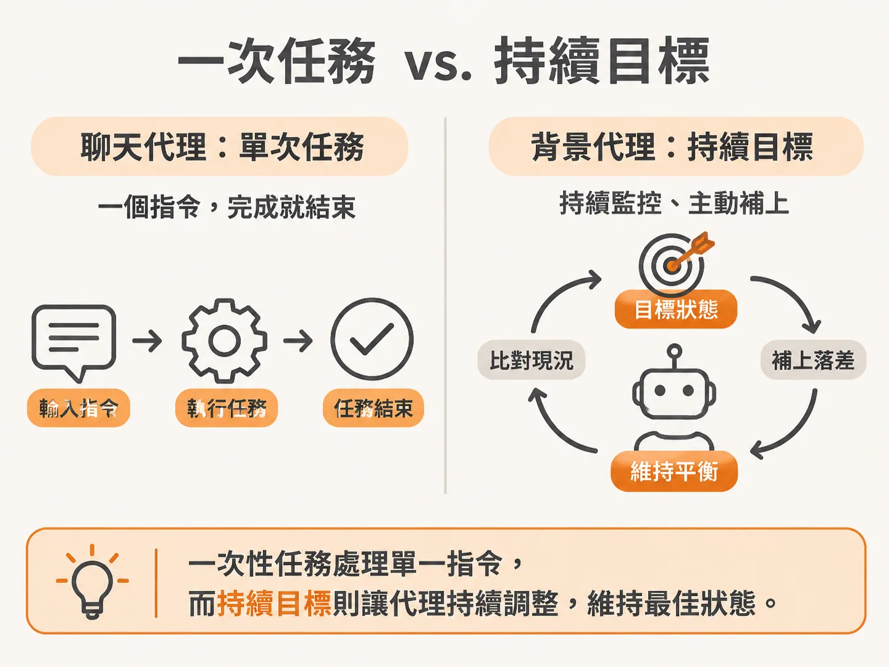
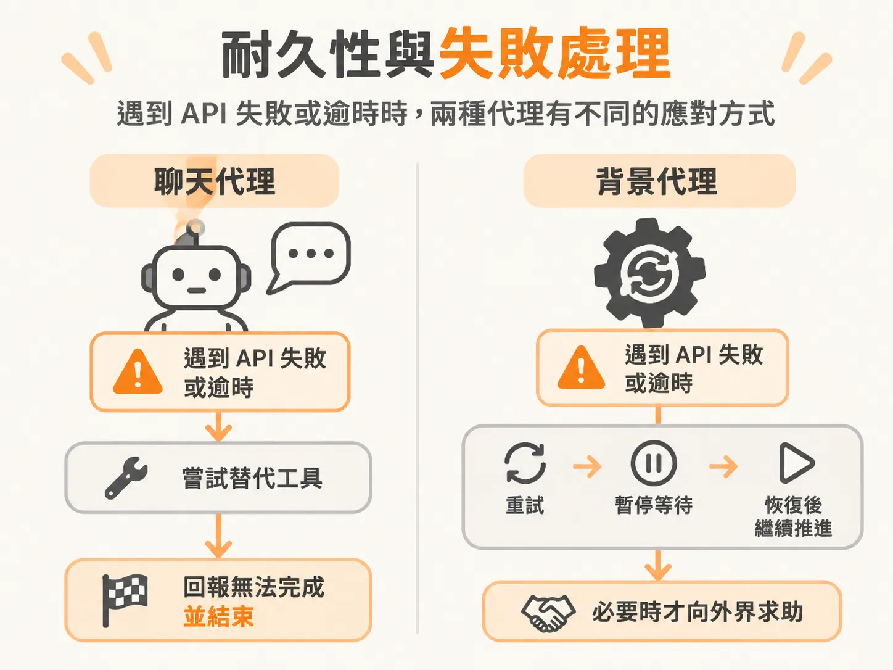
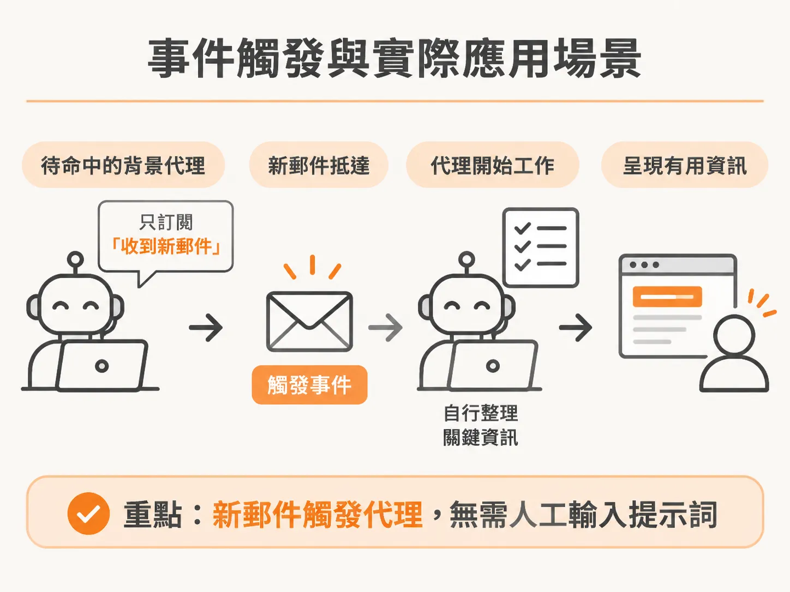

# 背景代理與聊天代理有何不同？從持續目標、事件觸發與耐久性看起

在使用各類 AI 程式碼助手或聊天代理時，許多人都會體會到一種瓶頸：AI 寫程式的速度確實很快，但你的整體產出，依然受限於你輸入提示詞（prompt）的速度。你必須坐在螢幕前給指令、等待它回傳結果、檢查輸出，然後再給下一個指令。

這種必須一來一回的同步互動，正是聊天代理的典型模式。如果想真正釋放生產力，關鍵在於讓事情在背後自動完成，而且不需要你隨時盯著下指令。這正是背景代理（Background Agent）要解決的問題。

## 什麼是背景代理？

背景代理有許多不同的稱呼，在工程師眼裡，它的運作型態也各有對應的想像：

* 有人覺得它就像 Kubernetes 的 operator，在背景形成無限迴圈，每隔一段時間就主動調解（reconcile）系統狀態，確保現況符合預期。
* 有人認為它是一種被賦予工作的程序（process），例如在寫程式的介面中，主代理額外啟動一個子代理（subagent）在背景默默修改程式碼。
* 也有人指出，背景代理的核心特徵是「外部世界的某個事件發生時，它會自動被啟動」。

這些說法都指出了背景代理的一部分樣貌。它可以是定時執行的循環，也可以是接收到外部事件才觸發的流程，但更根本的差別，在於它脫離了必須即時等待的對話框。

## 同步對話與團隊協作的差異

聊天代理是嚴格的同步流程（synchronous）。它並不是「發後不理（fire and forget）」的工具——你不對它發話，它就什麼都不會做；發了話，你就必須等待回應。即便有些工具允許設定排程或固定間隔執行，本質上依然擺脫不了對話式的單次任務結構。

想像一下最高效率的工作方式：你身邊有一群非常專業的團隊成員，他們清楚知道何時該做什麼事，甚至不需要你主動提醒該在什麼時間點動手。背景代理的設計骨架就是朝著這個方向前進——它不依賴使用者逐條下達提示詞，而是能夠自主感知並推進工作。

## 持續目標（Standing Goal）與單次任務

聊天代理與背景代理在任務定義上有本質上的不同：

* **聊天代理接收的是單一提示詞或單次任務**：你給一個指令，它執行一次。
* **背景代理接收的是持續目標（standing goal）**：你給它的不是一串瑣碎步驟，而是你對環境或系統預期達到的願景。

背景代理的工作，是持續監控環境，並主動做任何必要的事情，讓系統始終維持在你設定的理想平衡狀態（equilibrium）。

舉例來說，你可以要求代理「上網幫我買某樣東西」。聊天代理確實也能接收這項要求，但如果過程中遇到 API 斷線、網路逾時或網站出錯，兩者的反應會完全不同。

## 耐久性（Durability）與失敗處理

這兩種代理的另一個關鍵差別是耐久性（durability）與韌性（resilience）：

如果聊天代理在執行任務時遇到了錯誤，它頂多換一個工具嘗試；如果依然行不通，它最後只能在對話框回覆「我無法完成這項任務」，整個流程就此終止。

但在真實工作情境中，如果指派一個真人負責這件事，對方通常不會因為一次網路斷線就直接放棄，而是會持續想辦法排除障礙、不斷跟進進度。

背景代理就具備這種耐久性。它針對長時間運行的任務（long-running tasks）設計，遇到故障能繼續嘗試推進目標；在需要的時候，它也可以主動暫停狀態、在稍後恢復運作，甚至在必要時中途尋求外部或人類的協助，而不是直接報錯退出。

## 事件觸發與實際應用場景

除了內部運維代理持續監控服務狀態之外，另一個貼近日常的例子是電子郵件管理。

如果一個人經常來不及回信，他可以建立一個背景代理專門盯著收件匣。這個代理平時處於待命狀態，它唯一關心的外部事件就是「收到新郵件」。當新信件進來時，代理會自動觸發，依照設定好的期望目標整理重點並呈現資訊，完全不需要使用者每次手動輸入提示詞要求它「幫我看這封信」。

這並不代表背景代理會全面取代聊天代理。需要即時討論、腦力激盪或單次問答的情境，聊天代理依然最自然直接；但當任務需要長時間監控、具備耐久性、或是由外部事件自動觸發時，背景代理才能發揮真正的自主價值。
