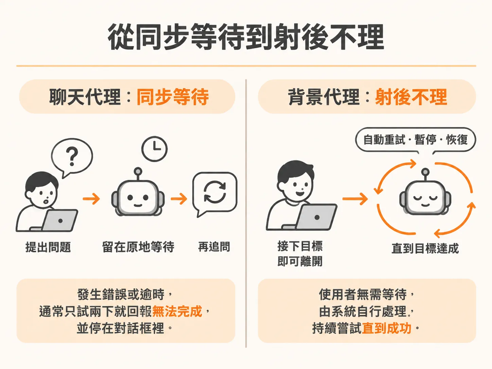
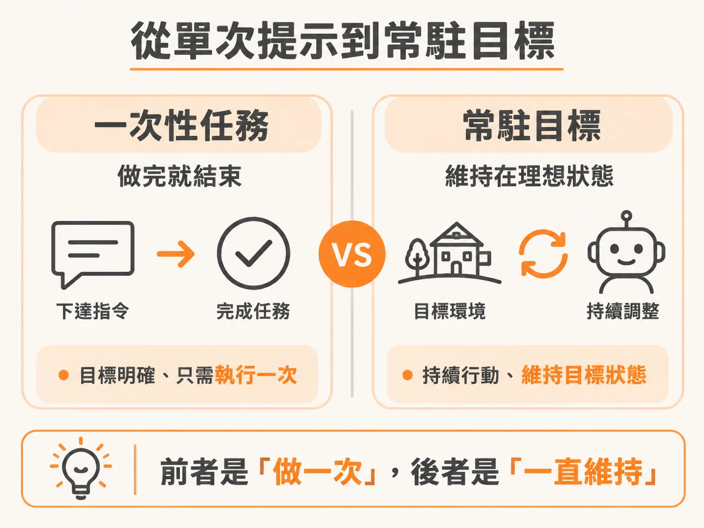

# 背景代理是另一種代理

使用 ChatGPT、Claude 或寫程式的輔助工具時，你的工作節奏完全綁在對話框前面。你輸入一段提示詞，等它產生結果，檢查內容，再接著下下一道指令。這種互動模式是同步的，你的產出速度，本質上取決於你打字下提示詞的速度。

背景代理（Background Agent）並不是用來淘汰這種聊天代理，而是為了解決完全不同的工作型態。

### 從同步等待到射後不理

聊天代理的本質是問答。你給它一項任務，就必須留在原地等待執行步驟，中途只要 API 逾時或出錯，它通常試了兩下就回報「我無法完成」，接著停在對話框裡不再動作。

背景代理則是「射後不理」（fire-and-forget）。你可以把任務交代下去，轉身去做其他事，甚至休假離開電腦。代理系統本身具備耐久性（durable）與修復能力，遇到網路逾時或服務中斷，它能自行重試、暫停或恢復進度，持續推進直到目標達成，不需要人類坐在螢幕前即時監督。

### 從單次提示到常駐目標

這兩種代理在任務設定上有根本差異：

- **單次提示（Prompt）**：聊天代理通常接收單一、具體的任務指令，像是「幫我寫這段函式」或「摘要這篇文章」。做完這件事，它的任務就宣告結束。
- **常駐目標（Standing Goal）**：背景代理接收的是一個長期維持的目標狀態。例如，你的目標可能是「維持收件匣維持在處理好的狀態」或「讓線上服務指標維持在穩定狀態」。

有了常駐目標，背景代理的角色就像系統狀態的守護者。它心裡有一幅環境應該呈現的樣貌，並自主採取必要行動，讓系統隨時維持在這個平衡點。

### 事件觸發與確定性協作

聊天代理必須有人主動開啟對話才會開始運作；背景代理則多半像是一個 API 服務，由事件驅動（event-driven）或排程自動觸發。

舉例來說，當監控系統收到錯誤警報，或是收件匣進來一封新郵件時，這個「事件」就會主動喚醒背景代理。代理會讀取當前環境的狀態，判斷該做哪些處理。

在執行過程中，如果遇到重大決定或需要人類授權，系統能以確定性（deterministic）的方式暫停並發送通知尋求審批，而不是任由模型自行猜測是否該聯絡你。等收到你的許可後，它再繼續往下跑。

聊天代理適合即時討論、探索想法與臨時計畫；背景代理則適合放進基礎架構中，長年監聽事件、維持目標並自主排除障礙。兩者分工不同，能處理的問題規模也完全不同。
