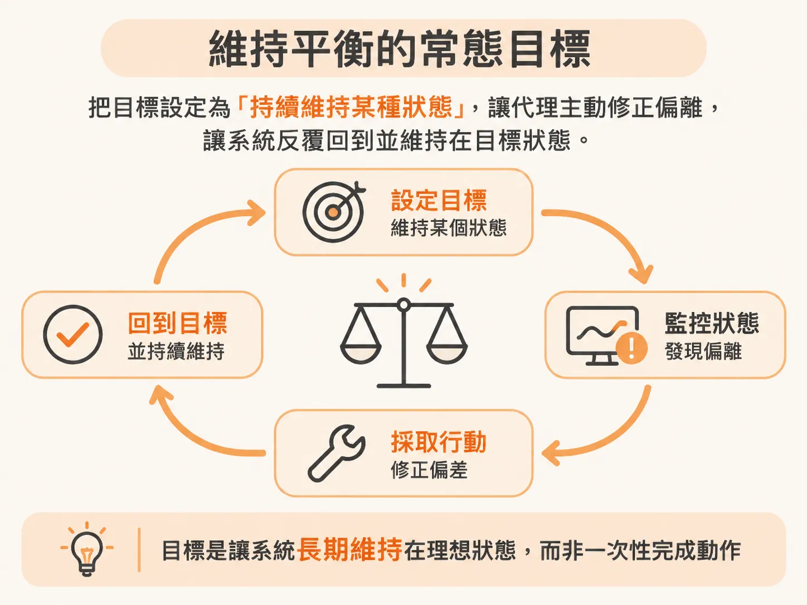
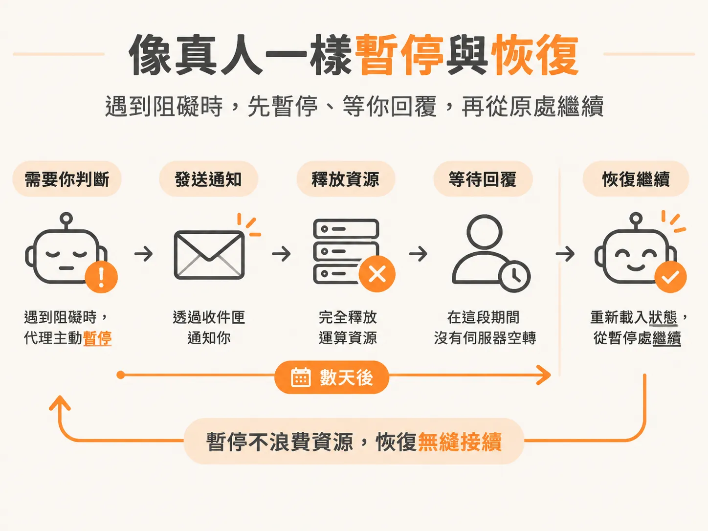

# 它拿到的是目標，不是任務

上一段把差別擺在「誰在等誰」，但真正的分水嶺是代理拿到什麼。使用一般的對話式 AI 代理時，你的互動通常是一問一答：你給它一段提示詞、指派一個單次任務，然後坐在螢幕前等它跑完。

如果中間某個 API 壞掉、連線逾時，或是流程卡住，對話代理頂多換個工具試試看，最後通常只會在對話框裡回覆一句「我無法完成這項工作」，接著整件事就停擺了。當你把瀏覽器分頁關掉，這段任務基本上也就跟著結束。

背景代理（Background Agent）的運作方式從根本上就不同。它拿到的不是一件單次清單上的「任務」，而是一個必須持續維持的「目標」。

### 維持平衡的常態目標

你可以把目標想像成一種對系統狀態的願景。你告訴背景代理：「你的目標是讓系統維持在某個狀態」，或是「持續監控並確保某個條件永遠成立」。

對話代理是在執行動作，背景代理則是在尋求平衡。它會留意環境的變化，只要現實狀態偏離了你設定的願景，它就會主動採取行動去修正，試圖讓系統回到你期望的穩定狀態。即使你關掉視窗、離開電腦，這個長期目標依然有效，代理人依然在背後持續守護。

### 為什麼關鍵在於持久性（Durability）

有人可能會問：難道我不能在對話框裡輸入同一個目標，讓對話代理去跑嗎？

問題在於系統的耐韌性與持久性（Durability）。

面對長時間運行的工作，現實環境一定會出錯——服務暫時中斷、網路波動、或者是執行到一半缺少關鍵資訊。一般的對話代理是同步運作的，一旦連線斷開或遇到預期外的障礙，它只能兩手一攤放棄。

但如果是人類接下這份職責，遇到阻礙時不會直接宣告失敗，而是會持續嘗試其他路徑，直到取得進展為止。背景代理的設計目標就是具備這種持久性：它不怕長時間運行，遇到臨時故障能等待重試，發現無法自行決策時，也能主動尋求協助。

### 像真人一樣暫停與恢復

在長流程中，代理人往往需要人類的判斷。這正是最考驗持久性的地方。

假設背景代理寫了一段程式碼，需要你確認授權才能部署。如果你出差或正在開會，整整三天沒有回覆，系統該怎麼辦？

傳統的連線不可能在伺服器上空轉等三天，把運算資源一直掛在那裡既不實際也浪費成本。背景代理必須具備暫停（Suspend）與恢復（Resume）的能力。

當它遇到阻礙、需要你的判斷時，它可以把進度安全地凍結起來，透過收件匣等非同步管道通知你，然後完全釋放運算資源。在等待你回信的這三天裡，沒有任何伺服器在空轉；一旦你抽空按下批准，它便能重新載入狀態，從當初暫停的地方繼續往下走。

能夠持有常態目標、能在外界出錯時耐韌地重試，並且在需要等待時優雅地暫停與恢復——這正是背景代理與一般對話代理最根本的分水嶺。
