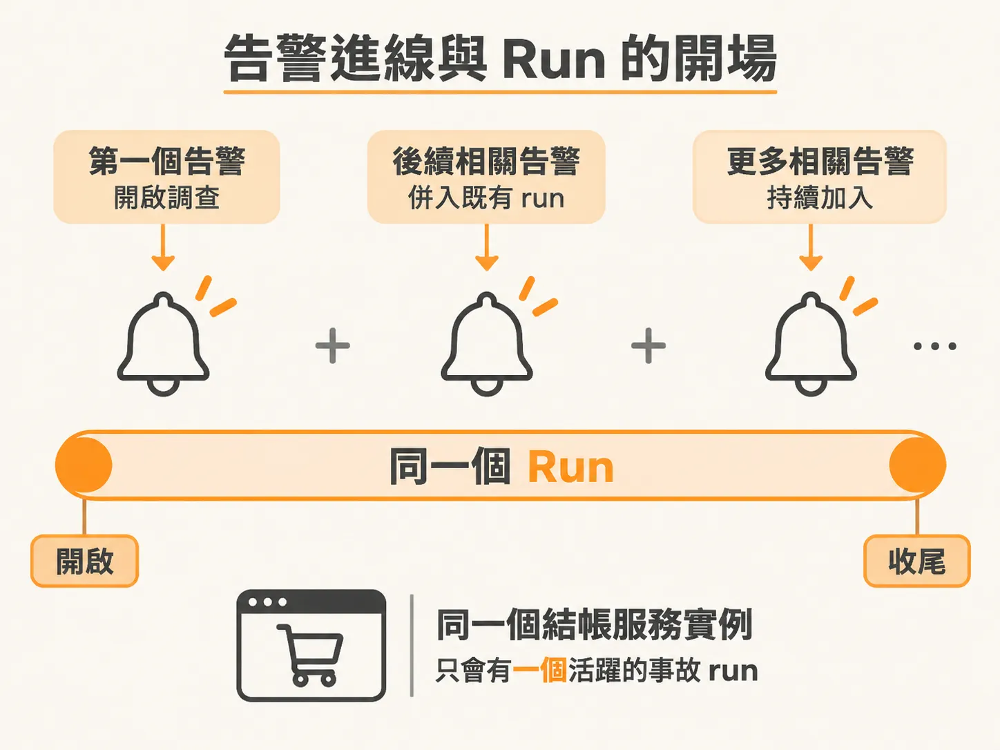
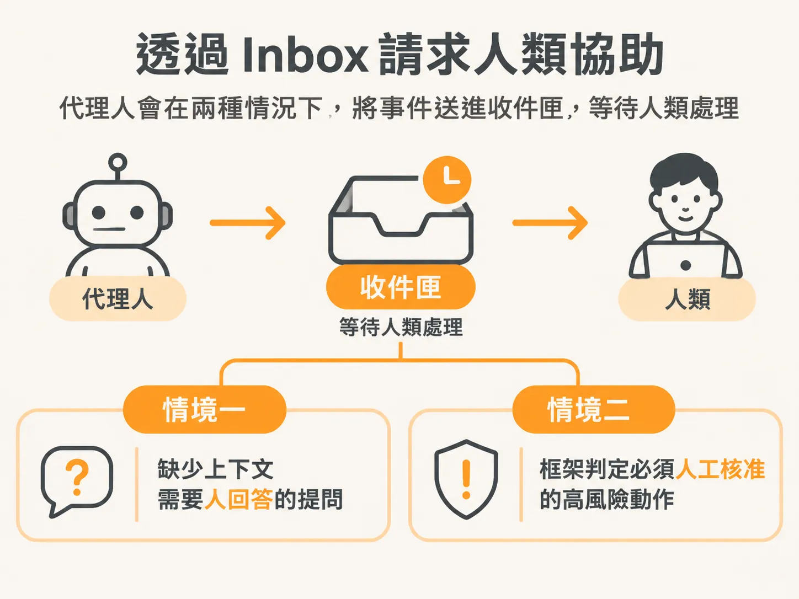
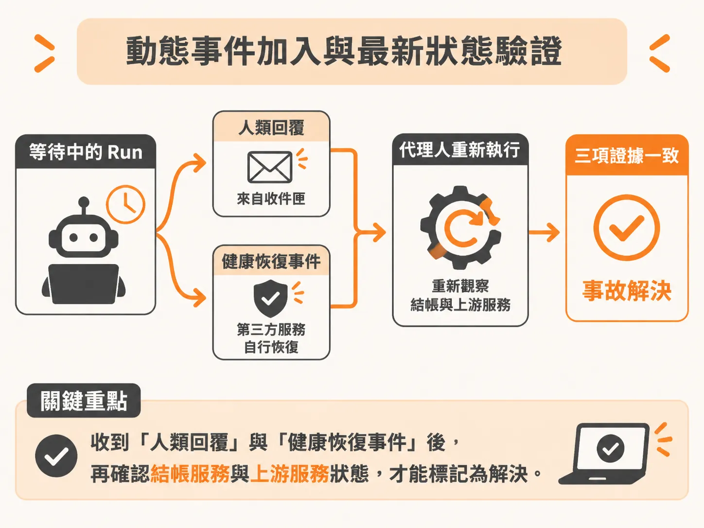

# 從一次結帳事故看背景代理人的運作週期

把權限與等待交回 Harness 之後，接著看這套安排跑在真實事故上長什麼樣子。電商平台的結帳服務（checkout service）一旦不穩定，值班工程師往往得通宵排查日誌與警報。一般對話式的 AI 助理只有在工程師打開視窗打字時才有作用，但背景代理人（background agent）不同：它能在背景持續監控服務，在問題發生時自主展開調查，直到需要人類判斷時才透過收件匣（inbox）求助。

了解背景代理人如何處理一次結帳事故，能清楚看出它從啟動、監聽事件、請求協助到確認恢復的完整生命週期。

## 系統啟動與代理人的基本定位

在終端機執行 `npm run dev` 後，會同時拉起兩個核心元件：一個是前端操作介面，另一個則是代理人本身的 API 服務。

這個代理人本質上是一支 API，隨時在背景監聽來自結帳服務的各類事件與日誌。打開介面時，如果資料庫剛初始化，畫面可能是空的；隨著服務運作與各次事故排查，介面會逐步累積每一次的執行紀錄（run）。

因為代理人是默默在背景運作，我們不需要一直盯著它對話。介面存在的目的，是讓我們看見它正在做什麼，並在它遇到阻礙時替它解除阻塞（unblock）。

## 告警進線與 Run 的開場

當結帳服務發出第一個異常告警時，代理人會立刻啟動一次調查（investigation），這就是一個 run 的開始。在系統設計上，同一個結帳服務實例只會維持一個活躍的事故 run，後續進來的相關告警會直接加入這個既有的 run，而不會重複開啟多個代理人。

調查啟動後，代理人會先觀察當下世界的真實狀態：現在結帳服務的狀態長什麼樣子？接著它會進入決策迴圈，根據當前狀態、設定的排查目標，以及被允許執行的動作清單，推算下一步最合適的處置方案。

為了避免代理人做出危險動作，系統會在控制框架（harness）中加入驗證與權限檢查。如果代理人推薦的動作超出了它的處置範圍，框架就會限制它，要求它轉向人類值班人員求援。

## 透過 Inbox 請求人類協助

代理人與人類的協作主要透過收件匣（inbox）進行。通常在兩種情況下，代理人會把事件推到收件匣等待處理：

1. **缺少上下文的提問**：代理人想採取行動，但缺乏足夠資訊或不確定關鍵情境，需要人類回答。
2. **高權限動作的審批**：代理人判斷需要執行某個操作，但框架規定該動作具有破壞性或風險，必須取得人工核准才能放行。

以一個具體的故障情境為例：我們在結帳服務中注入一個第三方相依服務的假故障（fake fault）。此時結帳失敗是因為外部的金流閘道（payment gateway）API 異常，這並非我們內部程式碼能直接修復的範圍。

代理人接收到錯誤日誌並展開排查後，發現這超出了自身領域的處理能力。它在歷經幾輪排查步驟後，主動在收件匣發出求助請求，詢問負責人：「能否幫忙調查並恢復支付閘道？」隨後便進入等待狀態。

## 動態事件加入與最新狀態驗證

就在工程師準備點進收件匣回覆時，外部的第三方服務可能已經自行修復，結帳系統因此發送出了一筆「健康已恢復（health recovered）」事件。

這項事件會直接加入正在等待中的 run。代理人即使處於等待人類決策的狀態，底層的事件監聽依然持續運作。

值班工程師在收件匣回覆代理人：「應該很快就好了，等恢復事件就好。」

代理人接收到工程師的回覆後，隨即恢復執行：

1. 它讀取了工程師給予的提示（請等待恢復事件）。
2. 它看見剛剛已經進線的「健康已恢復」事件。
3. 它沒有直接盲目相信文字，而是重新呼叫 API 觀察最新狀態。

重新觀察的結果確認了兩件事：結帳服務本身當前標記為健康，且上游相依服務（upstream healthy）的狀態也確實為真。

## 調查收尾

當人類的答覆、剛收到的恢復事件，以及重新觀察到的最新狀態完全相符時，代理人確認服務已經真正恢復正常。

這時代理人會將該次事故標記為解決（resolved），結束這個 run 的生命週期。透過「事件驅動開場、自主觀察決策、必要時 Inbox 介入、重新觀察驗證收尾」的流程，背景代理人既能分擔值班人員的排查壓力，又能透過控制框架與狀態驗證確保系統處置的安全。
