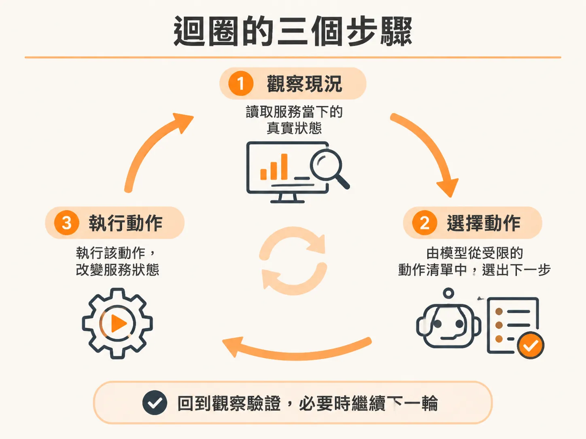
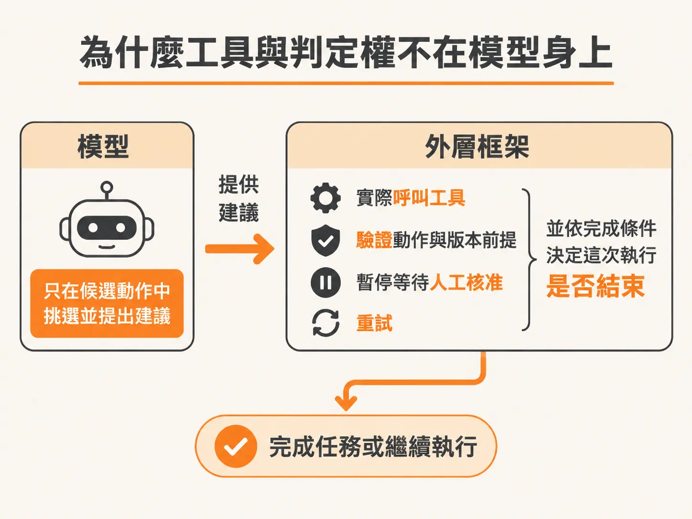

# 觀察、決定、行動的迴圈

有了常駐目標，代理接下來要決定怎麼一步步逼近它。當線上服務發出警報時，系統通常需要有人立即排查、判斷現況並採取修復措施。如果要讓自動化程式接手這類維運調查，最核心的運作模式就是「觀察（Observe）→ 決定（Decide）→ 行動（Act）」的連續迴圈。

這個迴圈看似與常見的 AI Agent 工具調用類似，但在架構分工上有一項關鍵差異：模型只負責在受限的選項中做選擇，工具的實際持有、執行以及整個流程是否結束的判定權，全部留在外層的控制框架（Harness）手中。

## 迴圈的三個步驟

每當異常事件觸發調查，系統就會啟動一次執行流程，反覆進行以下三步：



1. **觀察（Observe）**  
   警報本身只是一則通知，代表有事件發生，但它不等於系統當下的完整全貌。Agent 收到通知後，會透過 HTTP 即時讀取目標服務（例如結帳服務）的最新記憶體狀態與指標，取得當前的真實世界狀態。
2. **決定（Decide）**  
   模型比對「當前狀態」、「預設目標」以及「系統給定的一份狹窄行動清單」，推論出下一步最適合執行的單一動作。
3. **行動（Act）**  
   送出選定的動作以改變外部服務的狀態。動作執行後，系統會再次進入「觀察」階段，驗證剛才的改動是否確實生效，並決定是否需要繼續下一步。

整個系統的元件互動關係如下：

<!-- source: sources/background-agent/20261105/README.md#L8-L10 -->

```text
checkout process (port 3004) ── alert ──> operator API (port 3001)
checkout process <── fresh HTTP observation / operation ── incident agent (port 3002)
operator inbox ── human decision ──> paused Inngest run
```

每一次行動都會改變結帳服務的狀態，而下一次迴圈的即時觀察必須驗證這個改變。如此循環數次，直到問題被排除為止。

## 為什麼工具與判定權不在模型身上

在傳統的 Agent 設計裡，模型通常擁有底層的 Tool Calling 能力，模型自己決定要呼叫什麼函式、何時發送請求，甚至自己判定「我已經修復完成了」。

但在背景維運的架構中，模型並不具備 model-level 的 tool calling 能力，也不直接擁有工具。兩者的責任劃分非常明確：



- **模型只負責選擇**：模型只在有限的目錄中「推薦」下一個該採取的動作，就像填寫選擇題一樣。
- **Harness 持有工具與安全機制**：動作的具體驗證、向負責人請求人工審查（human approval）、依據版本檢查前提條件（version preconditions）、重試邏輯、暫停等待，以及決策次數上限，全都由外層的 Harness 程式碼嚴密控制。即使模型決定「需要找真人幫忙」，也是由 Harness 負責呼叫通訊介面聯繫當班人員，並暫停流程等待回覆。
- **Harness 掌控完成判定（Terminal Status）**：任務是否結束，絕不能由模型說了算。系統環境會定義明確的完成條件（例如 `health.status = healthy`）。只有當 Harness 在觀察步驟中驗證服務狀態已符合健康標準，或者達到無法繼續的終止條件時，Harness 才會將這次事件標記為結案。

這樣的切分能確保系統的韌性。模型發揮其推論與建議的專長，而對外部環境產生實質影響的執行權、防護欄與最後的驗收標準，則牢牢鎖在 Harness 的確定性程式碼中。
