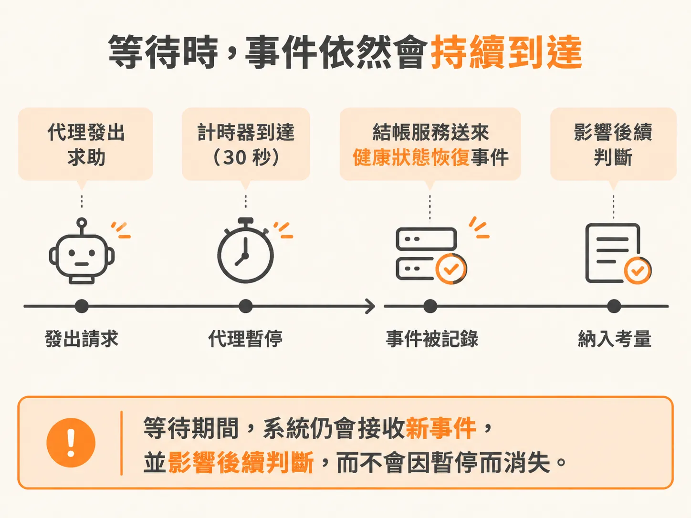
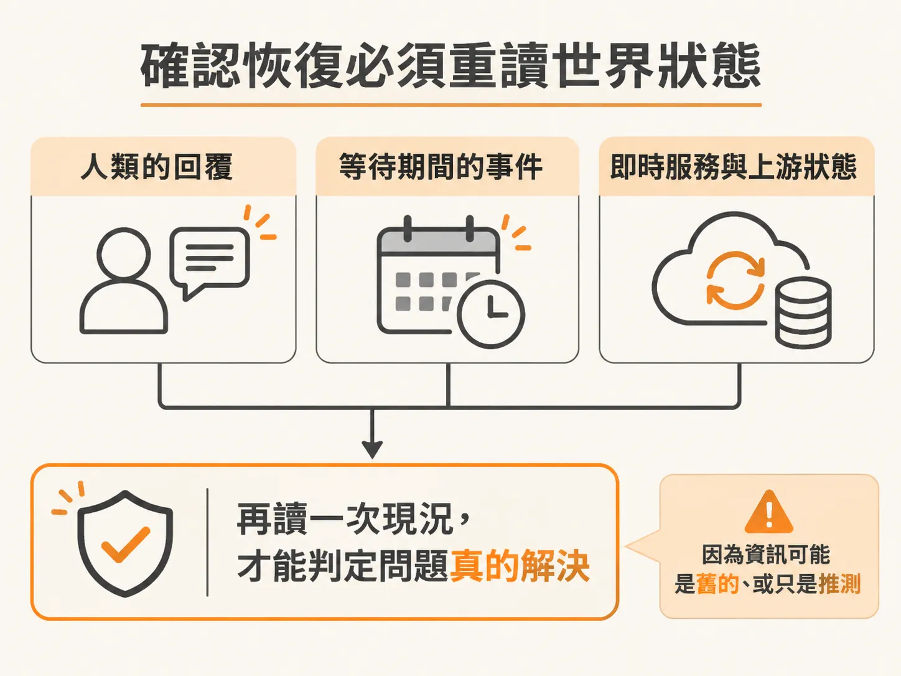

# 我看了最新的狀態

知道誰有權之後，還有一種情況是連有權的人都幫不上忙。當服務呼叫外部第三方 API 失敗時，系統往往無法靠內部重試或重啟自行解決。在自動化維運流程中，負責處理事件的 Agent 遇到這種跨領域的依賴故障（dependency fault），通常只能舉手向維運人員求助。

但在非同步的系統環境中，外部依賴隨時可能自行恢復。在人類收到通知、登入系統調查的這段空檔裡，世界狀態隨時在改變。

## 模擬外部依賴故障

我們可以使用結帳服務（checkout service）來重現這個情境。透過啟動參數注入依賴故障，並設定自動恢復的秒數：

<!-- source: sources/background-agent/20261105/README.md#L73-L77 -->

```bash
npm run dev:checkout -- --fault feature --alerts 3 --interval-ms 1000
npm run dev:checkout -- --fault release
npm run dev:checkout -- --fault dependency --recover-after-ms 30000
npm run dev:checkout -- --fault feature --lose-next-action-response
npm run dev:checkout -- --fault none
```

使用 `--fault dependency --recover-after-ms 30000` 啟動時，結帳服務會因為模擬的第三方金流閘道異常而陷入故障，並在 30 秒後自動恢復。Agent 與操作 API 事先並不知道啟動時帶了什麼故障參數，只能透過服務拋出的事件與狀態來判斷情況。

啟動後，Agent 會收到警報並進入處理迴圈。分析幾輪後，它確認問題出在不在自身控制範圍的第三方金流，於是停下來發出請求：「可以幫我調查並恢復金流閘道（payment gateway）嗎？」

## 等待時，事件依然會持續到達

在介面的 `/activity` 頁面上，可以看到 Agent 正處於「需要協助」的等待狀態。

但這不代表系統凍結了。在人類還在打字回覆、尚未送出核可之前，三十秒的計時器到了，結帳服務發出了一筆健康狀態恢復（health recovered）的事件。



Agent 即使停在等待人類決策的步驟，背後依然在持續監聽來自服務的所有事件。這些非同步到達的事件會被記錄下來，直接影響 Agent 接下來的行動。

## 確認恢復必須重讀世界狀態

當維運人員在介面打完字送出回覆，表示金流閘道已經修復時，Agent 面前同時擺著兩份資訊：維運人員的回覆，以及剛才在等待過程中收到的恢復事件。

這時 Agent 不能只看其中一項就直接結案，因為事件可能是舊的，人類的回覆也可能只是推測。



Agent 採取的做法是退一步「看最新的狀態」：重新讀取服務與上游當前的真實狀態。當它確認服務本身的健康指標為 true，上游依賴的健康狀態也確實為 true，三者完全吻合——人類說修好了、事件說恢復了、實際檢查狀態也是健康的——Agent 才會判定問題確實解決，結束這次的事件處理。
