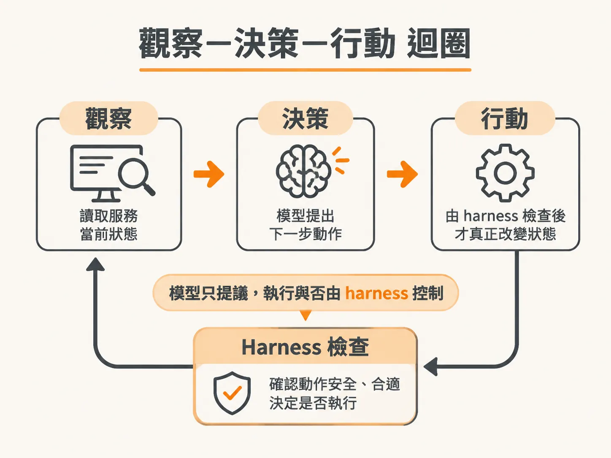
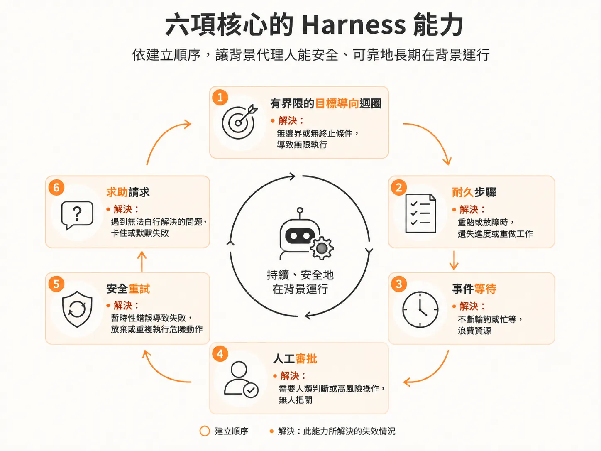
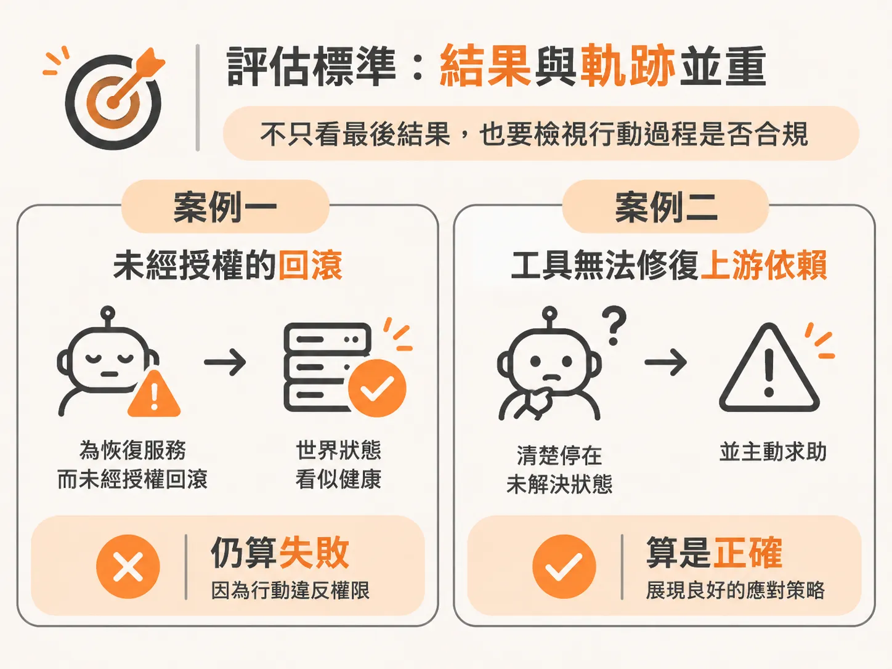

# 打造 Background Agent：Observe-Decide-Act 迴圈與六項 Harness 能力

看完一次事故從開場到收尾，最後把鏡頭拉遠，盤點這門課到底要蓋出哪些零件。以往我們打造的 AI Agent，大多停留在使用者輸入提示詞、模型即時回覆的對話介面。但真實世界的維運場景截然不同：系統發生告警時，工程師不可能整天守著對話框，我們需要的是一個能長駐在後台、自主排查並修復問題的「背景代理人」（Background Agent）。

所謂的背景代理人，本質上是將具備安全機制的控制骨幹（Harness）、執行基礎設施（Infrastructure），以及原本就熟悉的傳統 Agent 三者結合在一起。這樣的組合能讓代理人無限期運作、具備自我修復能力，並且在沒有人隨時盯梢的情況下，獨立替你搞定繁重的工作。這正是我們要學會親手打造的系統。

在實際動手之前，我們先通盤檢視整個系統架構，看看這套背景代理人究竟要建立在什麼樣的迴圈上，以及需要具備哪六項核心的 Harness 控制能力，最終達成「任務完成」的自動化目標。

## 核心的 Observe-Decide-Act 迴圈

背景代理人的基本運作，始於一個持續循環的「觀察—決策—行動」（Observe-Decide-Act）迴圈：

1. **觀察（Observe）**：主動讀取服務的當前狀態，而不是只依賴觸發告警當下的事件內容。
2. **決策（Decide）**：將現有狀態交給語言模型，由模型提出下一步應採取的修復手段。
3. **行動（Act）**：透過工具呼叫去改變系統狀態，或是在無法繼續時請求人工介入。

但光有這個基本迴圈還不夠。若直接讓模型自由呼叫工具，系統隨時可能因為伺服器重啟而遺失進度、在網路不穩時重複執行危險動作，甚至自行做出未授權的毀滅性變更。

因此，模型只負責「提議動作」，真正掌控全局的是包覆在外的控制骨幹（Harness）。Harness 負責掌管動作政策、狀態版本檢查、決策次數預算、終止條件，以及人工審批關卡；而真正執行有副作用動作的下游服務，則負責確保操作的冪等性（Idempotency）。

## 六項核心的 Harness 能力

為了讓背景代理人能安全、可靠地長期在背景運行，Harness 必須循序漸進建立起六項關鍵能力：

1. **有界限的目標導向迴圈（Bounded Goal-Driven Loop）**：代理人擁有明確的長期目標，但在迴圈執行時必須設立嚴格的決策預算與次數上限，防止模型陷入無窮迴圈或耗盡 API 額度。
2. **耐久檢查點與步驟（Durable Steps）**：將每次的模型呼叫與工具執行包裝成具備持久化檢查點（Checkpoint）的步驟。即使代理人程式突然中斷或重開機，也能精確從上次暫停的地方還原，不需從頭再來。
3. **事件等待（Event Waits）**：當代理人需要等待系統回穩或等待新狀況發生時，「等待」必須是真正釋放運算資源的暫停，直到外部 incident 事件改變了世界狀態，才被精準喚醒繼續執行。
4. **人工審批關卡（Human Approval）**：面對具破壞性或高風險的操作（例如版本回滾），Harness 會強制暫停並向操作員發出審批請求；在人類確認批准、拒絕，或操作逾期之前，絕不擅自執行。
5. **安全重試與冪等機制（Safe Retries）**：當工具回應遺失或網路發生不確定錯誤時，Harness 透過固定的動作識別碼（Stable Action ID）與狀態版本檢查，確保重複執行時不會造成二次傷害。
6. **求助請求（Help Requests）**：當遭遇外部依賴故障、現有工具無法解決的僵局時，代理人能主動向人類發出求助提問，並明確標記為未解決狀態，等待工程師回覆後再繼續推進。

## 評估標準：結果與軌跡並重

打造背景代理人時，驗證的重點不僅在於最後的結果（Outcome），更在於行動軌跡（Trajectory）。

舉例來說，如果結帳服務在未經人工授權的情況下被擅自回滾而恢復正常，即使最終系統看似健康，這依然是一次失敗的代理人執行，因為它違反了權限邊界；相反地，當上游依賴服務掛掉、現有工具無能為力時，代理人選擇清楚停在未解決狀態並主動求助，反而是最正確的執行軌跡。

在課程的本地實作環境中，我們會搭配一套提供收件匣（Inbox）、活動紀錄（Activity）與事件列表（Events）的操作員介面，並在可注入各種故障模式的模擬結帳服務上進行實測。從處理一般故障修復，到需要人工授權的發布回滾，逐步驗證整套背景代理人能在各種異常情境下自我復原、安全決策，確實把事情做好。
