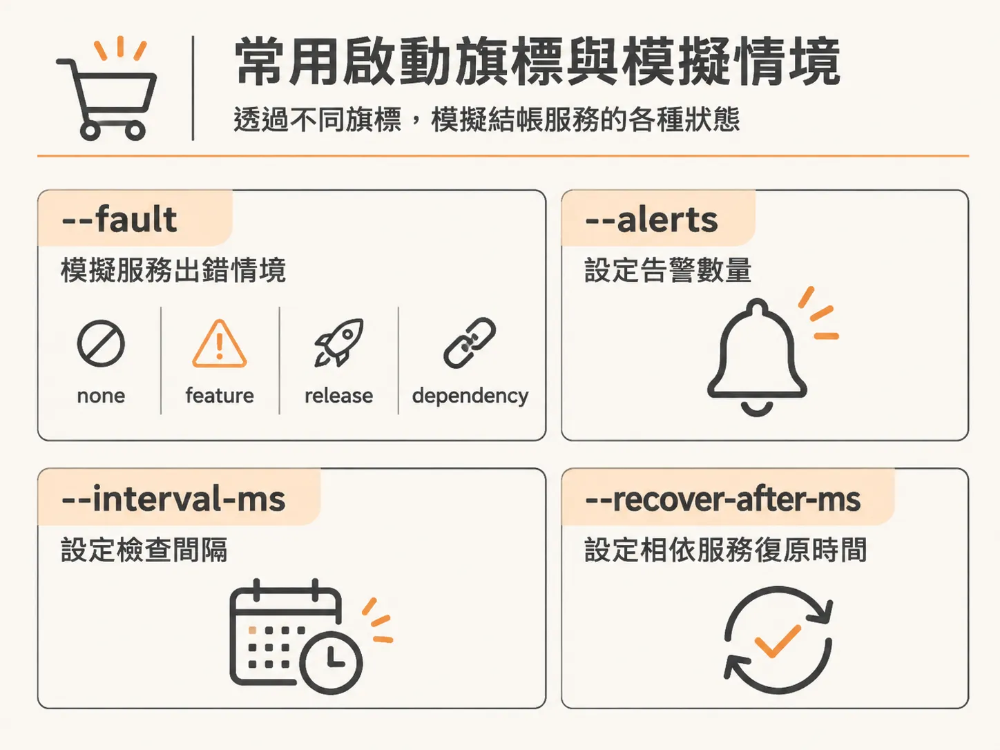
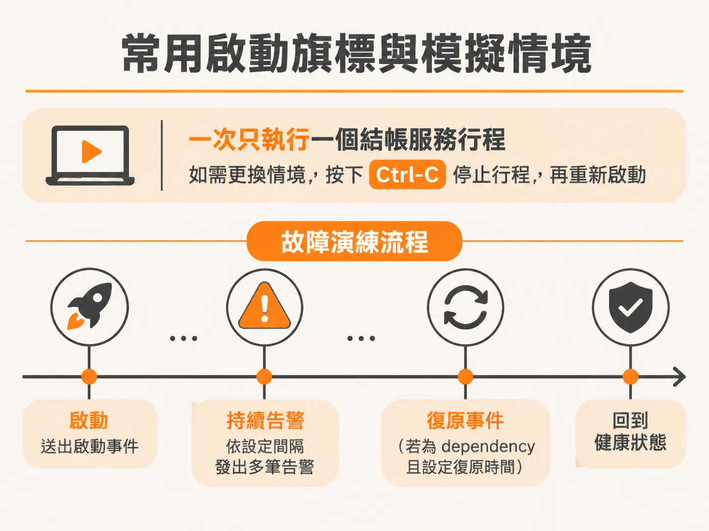
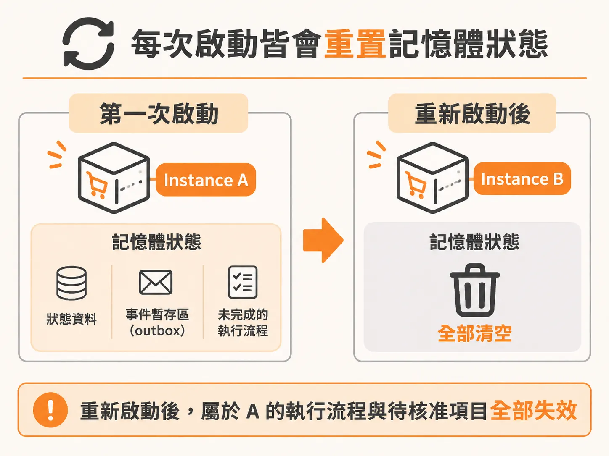

# 透過 Checkout 啟動旗標模擬故障事件與服務狀態重置

三個程序都跑起來之後，接著要能主動製造事件，而不是枯等真實故障上門。在測試負責維運的代理人（agent）時，我們需要隨時製造出各種可觀察的事件（incidents）與服務降級（degradations），觀察系統在異常發生時如何反應。專案中的結帳服務（checkout service）內建了一系列啟動旗標，專門用來模擬這些不同的故障情境。

你可以指定想要的故障類型、預計發出的告警次數、發送間隔，甚至能設定服務是否會在特定時間後自我復原。

結帳服務內部使用 Zod 解析這些啟動參數，並根據傳入的設定決定模擬行為：

<!-- source: sources/background-agent/20261109/supplement/service/checkout.ts#L1-L221 -->

```typescript
const fault = z
  .enum(['none', 'feature', 'release', 'dependency'])
  .parse(flag('fault', 'none')) as Fault
const alertCount = z.coerce
  .number()
  .int()
  .min(0)
  .max(100)
  .parse(flag('alerts', fault === 'none' ? '0' : '1'))
const intervalMs = z.coerce.number().int().min(100).max(60_000).parse(flag('interval-ms', '3000'))
const recoverAfterMs = z.coerce
  .number()
  .int()
  .min(0)
  .parse(flag('recover-after-ms', fault === 'dependency' ? '30000' : '0'))
...
  if (fault === 'dependency' && recoverAfterMs > 0) {
    setTimeout(() => {
      state = { ...state, upstreamHealthy: true }
      recover('upstream dependency recovery')
    }, recoverAfterMs)
```

### 常用啟動旗標與模擬情境

結帳服務支援以下幾種核心旗標：



- `--fault`：設定故障類型，可接受 `none`（正常無故障）、`feature`（功能異常）、`release`（發布錯誤）或 `dependency`（上游相依服務中斷）。
- `--alerts`：設定觸發故障時要送出多少筆告警事件，預設在有故障時送出 1 筆，無故障時為 0。
- `--interval-ms`：設定連續告警事件之間的發送間隔（毫秒），預設為 3000 毫秒。
- `--recover-after-ms`：設定上游相依服務故障後幾毫秒自動復原。當故障類型為 `dependency` 時預設為 30000 毫秒；如果手動設為 `0`，該相依服務就會持續處於降級狀態，直到服務重啟為止。
- `--lose-next-action-response`：模擬寫入成功但回應遺失的情境。服務會正常套用第一次變更操作，但對外回傳 503 錯誤，用來測試代理人在遇到副作用與確認回傳不一致時的應對機制。

進行故障演練時，同一時間只能執行一個結帳服務行程。如果想要更換演練情境，只要在負責執行結帳服務的終端機按下 Ctrl-C 停止行程，再換上對應的參數重新啟動即可：



<!-- derived -->
```bash
# 模擬功能開關故障，以 1 秒為間隔發送 3 次告警
npm run dev:checkout -- --fault feature --alerts 3 --interval-ms 1000

# 模擬發布錯誤
npm run dev:checkout -- --fault release

# 模擬上游相依服務故障，並在 30 秒後自動復原
npm run dev:checkout -- --fault dependency --recover-after-ms 30000

# 模擬功能故障，並在第一次變更操作時丟失回應
npm run dev:checkout -- --fault feature --lose-next-action-response

# 回復為無故障的健康狀態
npm run dev:checkout -- --fault none
```

### 每次啟動皆會重置記憶體狀態

結帳服務本身是一套獨立的模擬服務，並不屬於代理人核心架構。它的狀態與事件發送暫存區（outbox）都只保存在記憶體中。



這意味著每次重啟結帳服務時，系統都會產生一個全新的 instance ID，並將所有的狀態徹底清空重置。先前活躍的執行個體以及尚未核准的待處理變更都會隨之失效。這種設計讓測試邊界非常乾淨，每一次啟動都是從頭開始。

這些旗標在後續的課程章節中會非常實用。屆時我們會需要執行各種不同情境，深入測試代理人的各項決策邏輯，例如：當故障自動復原之後，代理人會採取什麼動作？或是遇到相依服務中斷時，它又會如何排查？這正是我們驗證代理人行為的主要工具。雖然現在有興趣的話可以先跑跑看指令體驗一下，但在目前這個環境建置階段，我們還不會正式使用它們。
