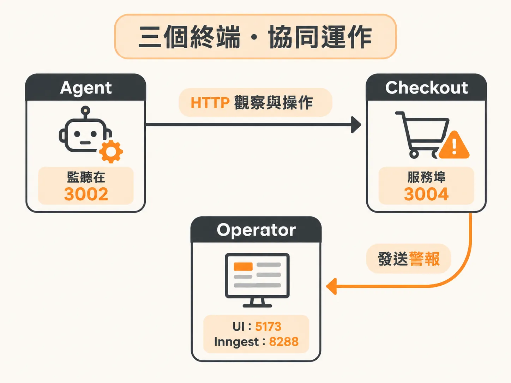
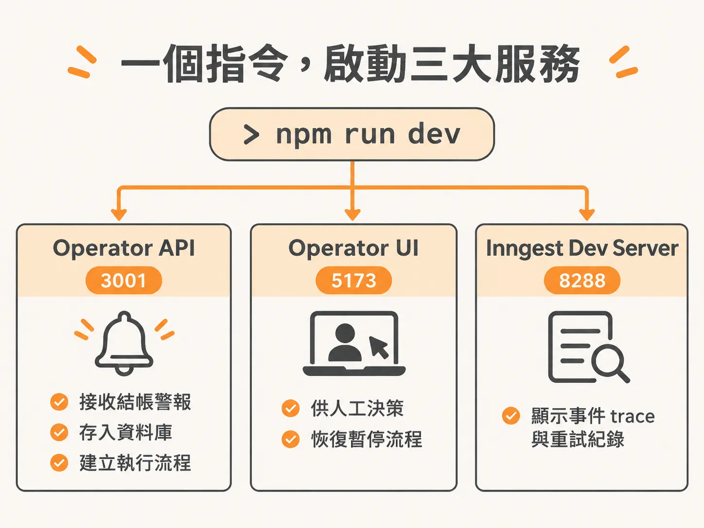
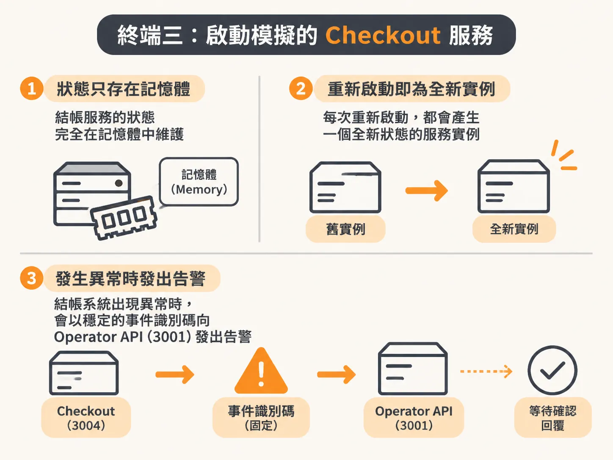

# 在三個終端啟動 Agent、Operator 與 Checkout

環境與資料庫就緒後，下一步是把整套系統真的跑起來。在開始除錯與開發背景代理人之前，你需要將系統拆成三個獨立進程同時運行。這三個服務分別負責模擬真實業務、集中控管事件流程，以及執行代理人邏輯。這些指令都定義在專案的 `package.json` 中，建議開啟三個獨立的終端機視窗分別執行。

## 終端一：啟動 Agent 端點

在第一個終端機輸入啟動指令：

<!-- derived -->
```bash
npm run dev:agent
```

這個進程會啟動 Agent 的 API 服務，監聽在 `127.0.0.1:3002`。



目前這個端點還只是一個幾乎什麼都沒做的普通 API 處理常式（route handler）。後續課程的核心重點，就是逐步把這個簡單的端點改造成具備完整能力的代理人。它在架構中的角色是事件處理的核心，負責向模擬結帳服務發出 HTTP 請求進行狀態觀察（observation）與操作（operation）。

你可以透過健康檢查網址確認 Agent 是否正常就緒：

- **健康檢查位置**：`http://127.0.0.1:3002/api/health`

啟動時終端機文字會顯示所綁定的 OpenAI 模型名稱，而造訪健康檢查端點也會回傳當前配置的模型資訊，方便你在教學或測試前先確認環境是否正確。

## 終端二：啟動 Operator 系統與 Inngest

在第二個終端機輸入：

<!-- derived -->
```bash
npm run dev
```

這個指令會同時帶起前端 Web 應用程式、Operator API 與 Inngest Dev Server：



- **Operator API**（埠號 `3001`，`127.0.0.1:3001`）：負責接收來自結帳系統的警報事件，將事件持久化儲存至 Neon 資料庫，並為進行中的事件建立唯一的執行流程（incident run）。
- **Operator UI**（埠號 `5173`，`http://127.0.0.1:5173`）：提供操作員使用的儀表板與收件匣介面，供人工介入決策並恢復暫停的流程。
- **Inngest Dev Server**（埠號 `8288`，`http://127.0.0.1:8288`）：提供耐用執行（durable execution）環境，你可以開啟此網址檢視所有事件 trace 與重試紀錄。

## 終端三：啟動模擬的 Checkout 服務

在第三個終端機輸入：

<!-- derived -->
```bash
npm run dev:checkout
```

這個指令會運行模擬的結帳服務（fake checkout service），監聽在 `127.0.0.1:3004`。

結帳服務完全在記憶體中維護自身的狀態。每次重新啟動都會產生一個帶有全新狀態的服務實例。當結帳系統發生異常時，它會發送穩定的事件識別碼向 Operator API（埠號 `3001`）發出告警，等待確認回覆。雖然在剛建立環境時我們還不需要對它做任何操作，但後續模擬注入故障時都會需要它常駐運行。



如果啟動時終端機提示埠號已被佔用，請先找到先前執行的工作坊進程並手動終止。這些啟動指令在遇到衝突時會直接失敗中斷，不會自動漂移到其他埠號。
