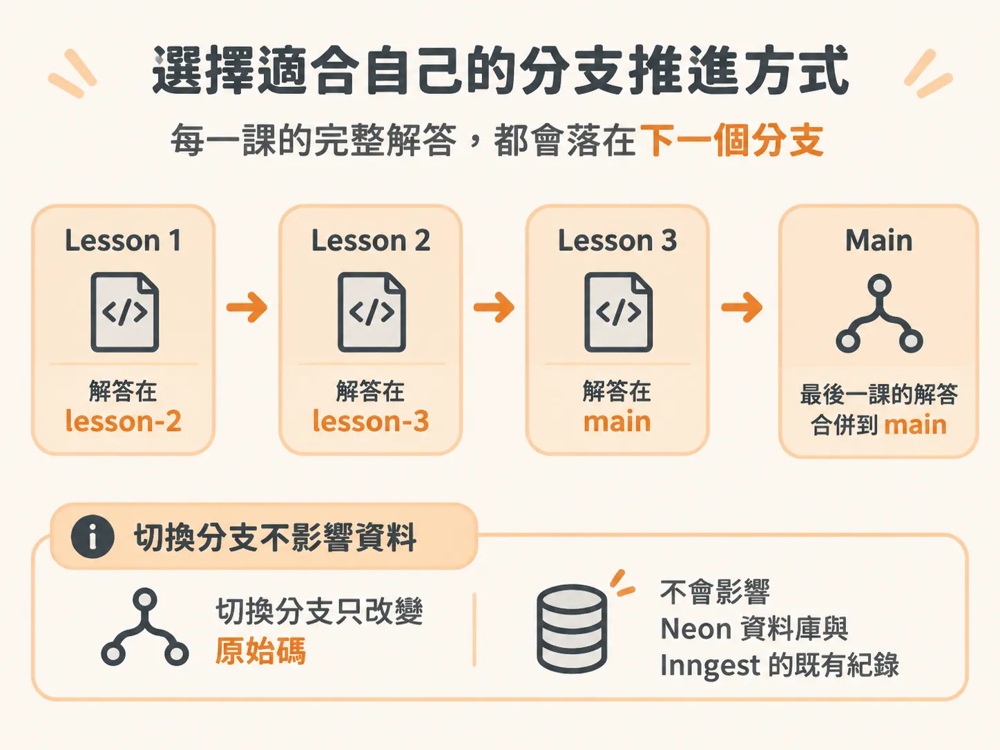
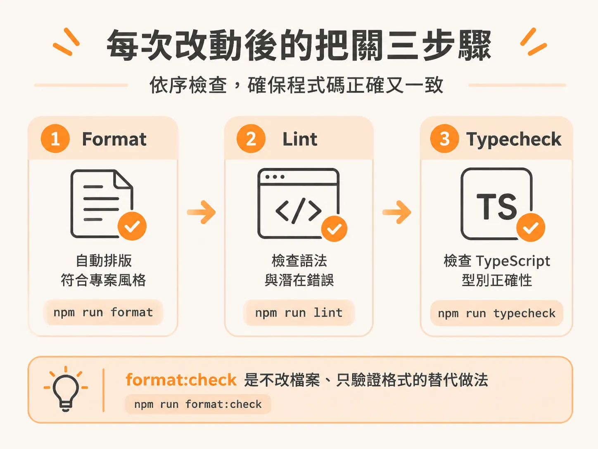

# 課程分支的推進策略與程式碼品質把關

環境、程序與故障工具都備妥後，最後談談怎麼在六堂課的分支之間穩定推進。跟著專案實作時，每個人習慣的節奏都不太一樣：有人喜歡邊看邊敲程式碼，有人想先看過一遍示範，也有人在中途卡住時希望能立刻對照標準答案。了解課程專案的分支設計，並在每次改動後做好檢查，能讓你在學習過程中隨時跟上進度，也不會把程式碼改壞。

## 選擇適合自己的分支推進方式

課程的分支安排非常直覺：每一堂課都以前一課的解答為起點，而當前這堂課的完整解答，則會直接落在下一個分支上。例如第一課的解答就在 `lesson-2` 分支，第二課的解答則在 `lesson-3`，依此類推，最後一課的解答則合併在 `main`。

在實作時，講者通常會在當前分支上寫程式碼、觀察系統運作與改動的結果。等到要進入下一階段時，講者甚至不會把剛寫好的程式碼帶過去，而是直接切換（checkout）到下一個課堂分支，直接從現成的解答重新開始。

身為學習者，你可以根據自己的狀況選擇不同的做法：

- **一路帶著自己的程式碼往下寫**：如果你跟得上進度，最理想的方式是保留自己親手寫的成果，不必切換到下一課的解答分支，直接繼續推進。
- **直接切換到解答分支**：如果你中途進度落後了、只想先單純觀看示範不想即時跟著寫，或者想使用官方提供的解答來對照自己的寫法，隨時可以直接切換到下一個分支。講者的解答是回推每一個改動差異（diff）並記錄在筆記裡的，內容基本上與課堂示範完全一致。
- **請 Coding Agent 協助**：你也可以把課堂筆記交給你的 coding agent，讓它參考筆記裡的修改步驟幫你完成。

要想跟上進度，有非常多種彈性做法。另外要注意的是，切換 Git 分支只會改變本地端的專案原始碼，並不會清除或影響 Neon 資料庫與 Inngest 的既有執行紀錄。

## 每次改動後的把關三步驟

專案本身設定了統一的程式碼風格，採用 Oxfmt 工具，規則為「使用單引號」且「結尾不加分號」。

為了確保每一次編輯後程式碼都能正常運作且格式一致，每完成一段修改，建議依序執行以下三個指令：

1. `npm run format`：自動將程式碼排版成符合專案規範的格式（單引號、無分號）。
2. `npm run lint`：檢查語法與潛在錯誤。
3. `npm run typecheck`：進行 TypeScript 型別檢查，確保型別沒有衝突或缺漏。

如果你只想驗證目前已提交的檔案格式是否符合規範，而不想自動改動檔案內容，也可以改用 `npm run format:check` 來單純做格式檢查。只要養成隨手執行這組檢查的習慣，就能在切換分支或繼續實作前，確保手上的程式碼穩固無誤。
