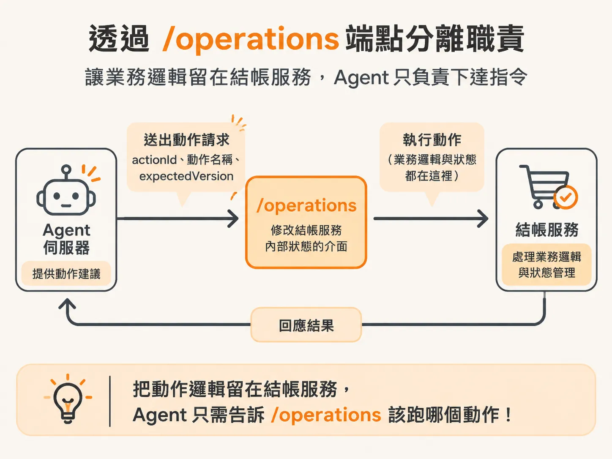
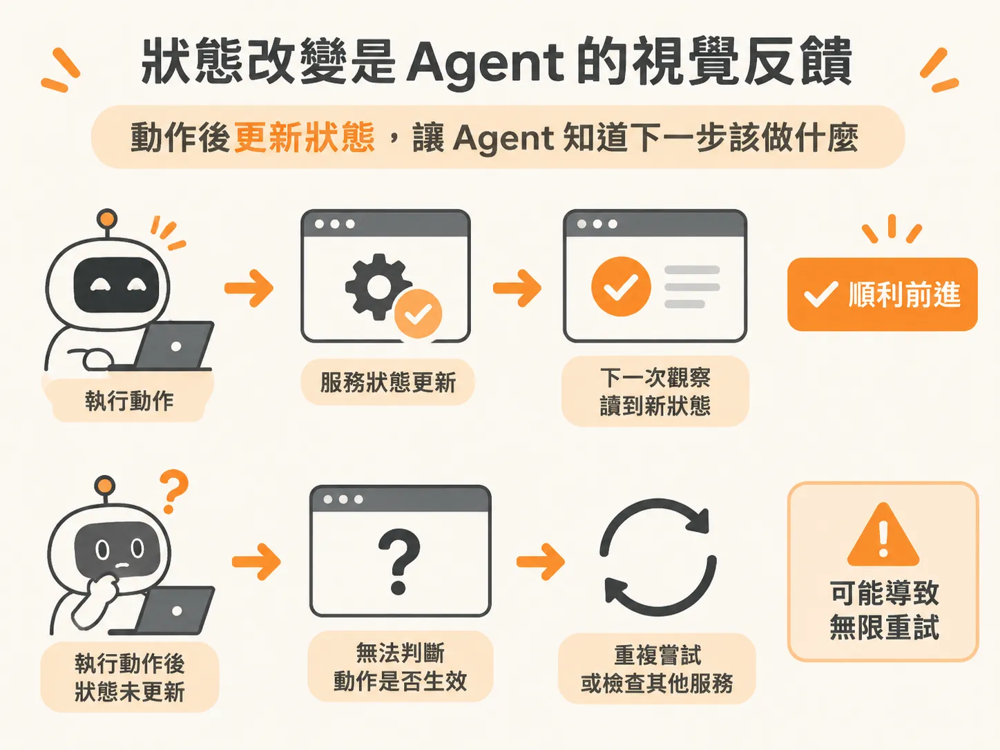
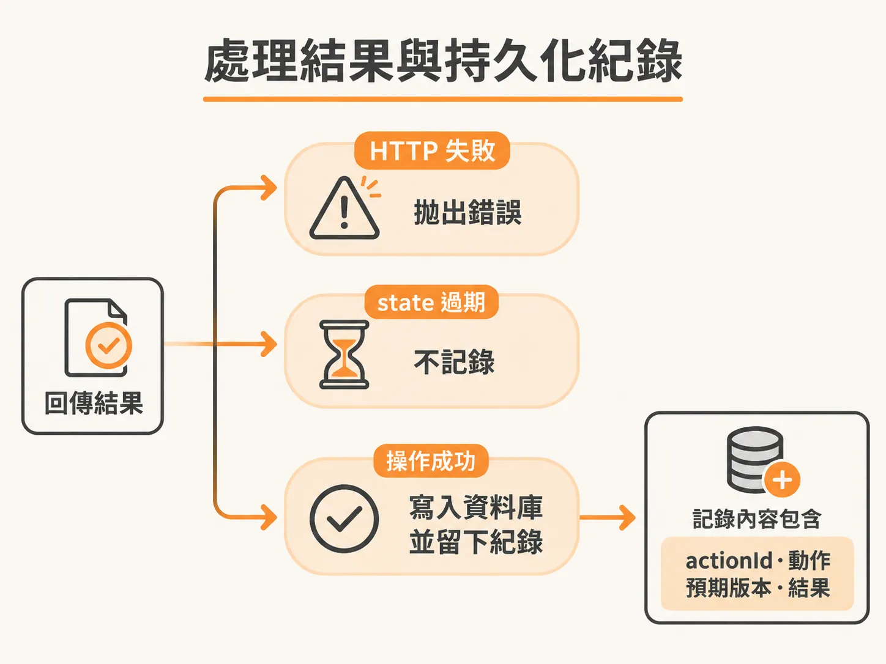

# 將 Agent 動作派送至 Checkout Service 並記錄執行結果

弄懂為什麼要自建迴圈、哪些動作必須先被攔下之後，接著看那些被放行的動作怎麼真的執行。當背景運作的 Agent 決定要採取某個動作（action）時，最核心的問題在於：我們該如何安全地執行它，並且在系統裡留下足夠的證據？

如果把所有的業務邏輯都塞進 Agent 伺服器，系統會變得極其臃腫。更關鍵的是信任感問題——面對在背景自動跑的 Agent，如果拿不出確切的執行證明與追蹤紀錄，其他人對系統的信任度基本上是零。因此，執行動作的過程必須嚴謹、可追蹤，並與目標服務的狀態保持同步。

## 產生 Action ID

特殊動作在第一步已經被攔下，這裡只看被放行的動作怎麼執行。第一件事是產生一個 `actionId`（通常使用隨機的 UUID），系統才能精準追蹤每一個被派送的動作。

## 透過 `/operations` 端點分離職責

我們要保護的目標是結帳服務（checkout service），因此動作執行是透過發送 API 請求到該服務的 `/operations` 路由。

這個端點扮演著修改結帳服務內部狀態的介面。模型本身並不在乎背後的實作細節，它只負責給出建議。把所有動作邏輯保留在結帳服務那端，而不是搬到 Agent 伺服器上，可以讓業務邏輯留在屬於它的服務裡。Agent 伺服器只要告訴 `/operations` 該跑哪一個動作即可。



呼叫這個端點時，我們會以 POST 發送 JSON 格式的內容：

- `actionId`：用來追蹤與記錄這一次的操作。
- `name`：Agent 決定執行的動作名稱。
- `expectedVersion`：當前狀態的預期版本號。

設定 `expectedVersion` 就像管理 API 版本一樣，能讓我們為服務狀態建立版本控管。如果服務進行升級、狀態結構發生變動，帶上預期版本就能作為預防手段，明確標記 Agent 做出決策時所看到的「世界版本」到底長什麼樣子。

<!-- source: sources/background-agent/20261109/supplement/server/agent-workflow.ts#L187-L195 -->

```typescript
      const result = await step.run(`execute-action-${cycle}`, () =>
        executeAction(
          environmentId,
          runId,
          actionId,
          decision.action,
          policy === 'read' ? undefined : state.world.version,
        ),
      )
```

在實際呼叫時，系統會組合出這些參數並發出請求：

<!-- source: sources/background-agent/20261109/supplement/server/agent-workflow.ts#L20-L56 -->

```typescript
async function executeAction(
  environmentId: string,
  runId: string,
  actionId: string,
  name: ActionName,
  expectedVersion?: number,
) {
  const input = expectedVersion === undefined ? {} : { expectedVersion }
  await logAgentActivity(environmentId, runId, 'act', `Calling ${name.replaceAll('_', ' ')}`, {
    actionId,
    input,
  })
  try {
    const response = await fetch(`${checkoutServiceUrl}/operations`, {
      method: 'POST',
      headers: { 'Content-Type': 'application/json' },
      body: JSON.stringify({ actionId, name, ...input }),
...
    const result = (await response.json()) as Record<string, unknown>
    if (!response.ok) throw new Error(String(result.error || `Tool failed: ${response.status}`))
    if (result.stale !== true)
      await recordToolAction(environmentId, runId, actionId, name, input, result)
    return result
```

## 狀態改變是 Agent 的視覺反饋

當 API 呼叫發出後，我們假設結帳服務會依約完成動作並更新其狀態。這一點非常關鍵：**每一個改寫型動作都必須反映在服務狀態上**。

如果改寫型動作執行後狀態沒有任何改變，當 Agent 進入下一個循環時，它就無法得知剛才的操作到底有沒有生效。這就像在 GitHub 上點擊了「Merge」按鈕，但畫面上的 UI 卻完全沒有變動一樣——使用者只能困惑地去翻伺服器日誌確認到底合併了沒有。

對 Agent 來說，它所讀取到的狀態就是它的「使用者介面」。如果狀態沒有更新，Agent 失去反饋，甚至可能會嘗試去檢查其他服務，疑惑為什麼執行了復原（rollback）但狀態卻沒有標記為完成。因此，動作完成後更新狀態，是確保 Agent 能正確判斷下一步的前提。



## 處理結果與持久化紀錄

收到結帳服務的回傳結果後，若 HTTP 回應不是 OK，程式會直接拋出錯誤中斷。在持久化執行（durable execution）架構下的重試策略與錯誤處理是另一個進階主題，此處先以標準錯誤處理應對。

結帳服務本身設計有過期狀態（stale state）的概念。只要回傳的結果不是過期狀態（`result.stale !== true`），就代表這次操作順利完成，系統便會呼叫記錄函式，把相關資料完整寫入資料庫：



<!-- source: sources/background-agent/20261109/supplement/server/agent-data.ts#L156-L173 -->

```typescript
export async function recordToolAction(
  environmentId: string,
  runId: string,
  actionId: string,
  name: ActionName,
  input: Record<string, unknown>,
  result: Record<string, unknown>,
) {
  await db
    .insert(actions)
    .values({ id: actionId, environmentId, name, input, result })
    .onConflictDoNothing()
  await logAgentActivity(environmentId, runId, 'act', `${name.replaceAll('_', ' ')} returned`, {
    actionId,
    input,
    result,
  })
}
```

記錄時會將環境 ID、執行 ID（runId）、動作 ID、動作名稱、傳入的預期版本以及執行結果一併存下。雖然在某些情境下連預期版本都記錄看似有點過度防防護，但對於需要高度透明度與可追溯性的背景 Agent 而言，這些完整的日誌與資料庫紀錄正是建立信任不可或缺的基礎。
