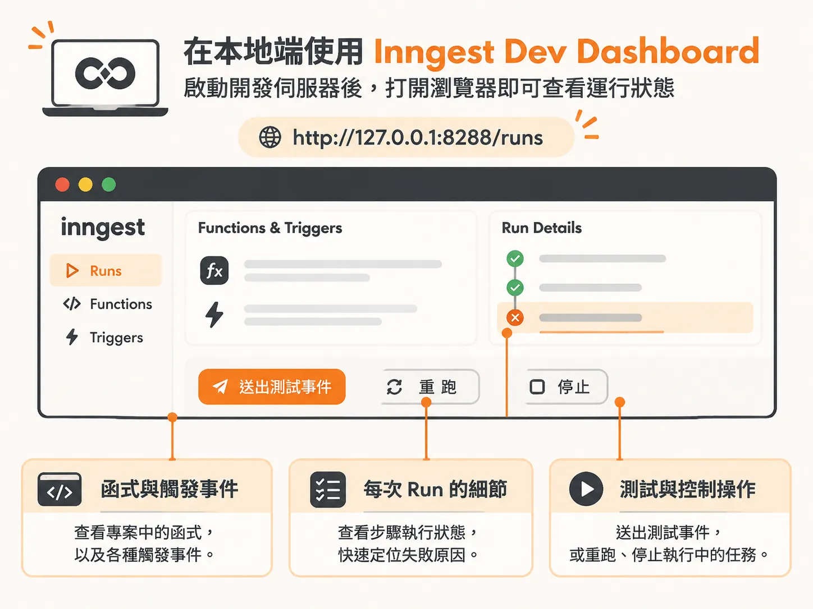
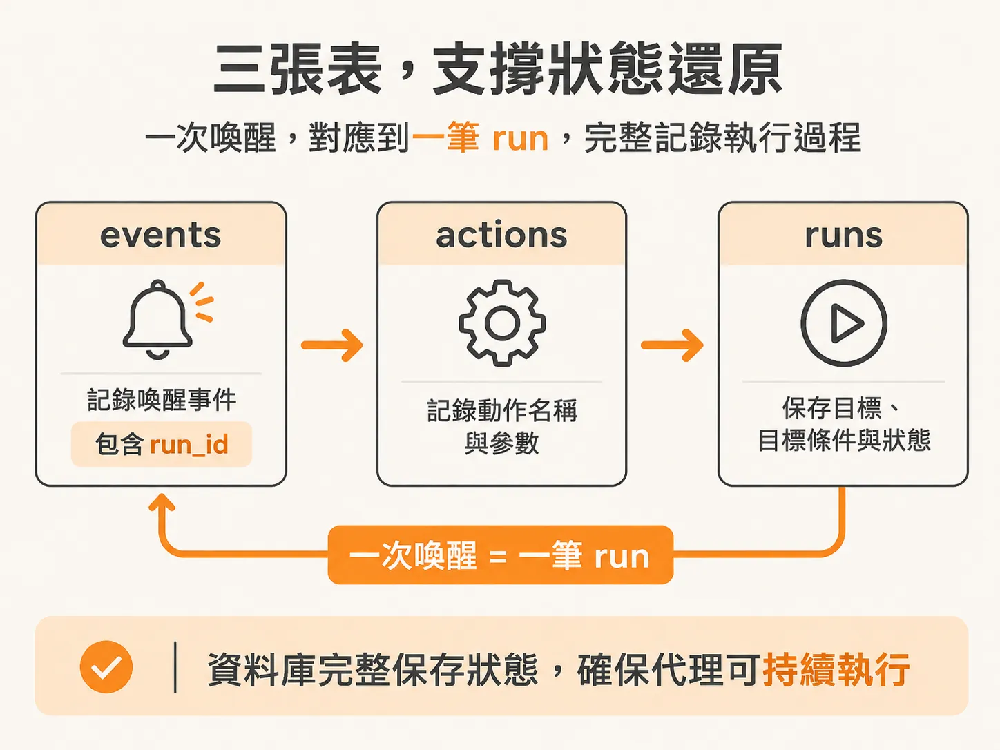
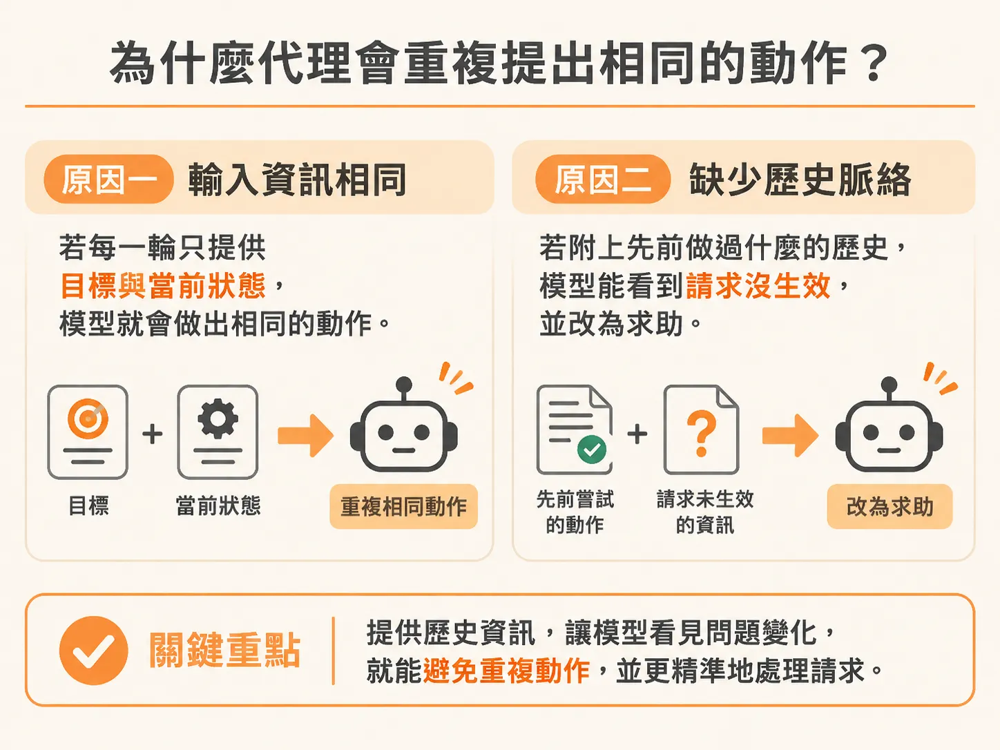
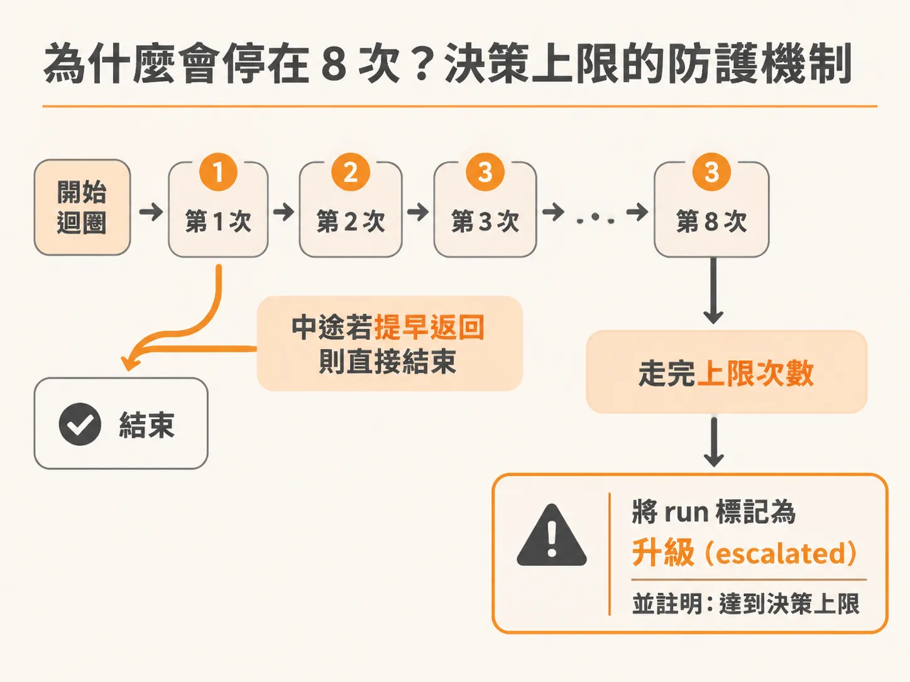

# 用 Inngest Dashboard 與資料表排查代理重複行動與決策上限

讀懂單次軌跡之後，接著把鏡頭拉到跨越多輪的資料。開發背景代理（Background Agent）時，最常見的困惑之一是：為什麼代理明明已經建議了某個動作，下一輪迴圈卻像忘記剛才做過的事一樣，不斷重複提出完全相同的請求？最後整趟執行突然停了下來，在日誌上留下一筆失敗或中斷的紀錄。

要釐清這個現象，不需要通靈或猜測大型語言模型（LLM）的心思。透過 Inngest 本地開發伺服器的儀表板，以及資料庫中記錄的 events、actions 與 runs 資料表，就能清楚還原代理的執行狀態與中止原因。

## 在本地端使用 Inngest Dev Dashboard

Inngest 內建本地開發伺服器（Dev Server），預設會在 `127.0.0.1:8288` 提供圖形化儀表板（例如 `http://127.0.0.1:8288/runs`）。在終端機啟動後，只要打開瀏覽器就能直接觀察背景工作的運行細節：



1. **查看函式與觸發條件**：儀表板會列出所有已註冊的 Inngest 函式、各函式綁定的觸發事件（Triggers）以及對應的 App URL。
2. **追蹤執行步驟（Steps）與失敗狀態**：若函式在執行中斷或未妥善處理結束條件，可以在 Runs 列表中看到該次執行最後標記為失敗。雖然在最初期的原型中，整隻代理可能只包在一個 step 內執行，能看到的階段拆解不多，但隨著流程逐步拆分成多個 step，儀表板會變得極為實用。
3. **模擬與發送測試事件**：排查問題時不一定要透過 CLI 觸發。在儀表板中可以直接貼上自訂的 JSON 事件內容（例如模擬某個下游服務掛掉），直接在本地喚醒代理工作流程；也可以隨時重新執行（Rerun）或手動停止（Stop）正在跑的函式。

當看到一趟執行在儀表板中停下甚至失敗時，下一步就是進入資料庫比對結構。

## 支撐狀態還原的資料表設計：events、actions、runs

代理並非憑空運行，其 durable execution（持久化執行）的核心在於將一切狀態存入資料庫。這套機制的底層資料表結構其實相當單純，主要圍繞在三張表：



- **events**：記錄喚醒或傳遞給代理的事件。包含該筆事件的 JSON 資料（data）以及所屬的 `run_id`。
- **actions**：記錄代理決定採取的動作。內容通常只是 Postgres 裡的 JSON blob，記下動作名稱（name）與執行該動作所需的參數（arguments）。
- **runs**：記錄整趟執行的核心狀態。包含該次執行的目標（goal）、目標條件（goal_condition）以及目前的狀態（status）。

以 Drizzle ORM 的定義為例，events 與 runs 的關聯相當直觀：

<!-- source: sources/background-agent/20261109/supplement/server/schema.ts#L51-L90 -->

```typescript
export const events = pgTable('events', {
  id: uuid('id').primaryKey(),
  environmentId: uuid('lab_id')
    .notNull()
    .references(() => environments.id),
  runId: uuid('run_id').references(() => runs.id),
  instanceId: text('instance_id'),
  type: text('type').notNull(),
  data: jsonb('data').$type<Record<string, unknown>>().notNull(),
  createdAt: timestamp('created_at', { withTimezone: true }).notNull().defaultNow(),
})
...
export const runs = pgTable('runs', {
  id: uuid('id').primaryKey(),
  environmentId: uuid('lab_id')
    .notNull()
    .references(() => environments.id),
  eventId: uuid('event_id'),
  instanceId: text('instance_id'),
  eventSequence: integer('event_sequence').notNull().default(0),
  goal: text('goal').notNull(),
  goalCondition: jsonb('goal_condition').$type<GoalCondition>(),
  status: text('status').notNull(),
```

### 什麼是一次 Run？

在概念上，「run」代表代理被某個事件喚醒後所展開的一輪執行歷程。

這與業務上的「調查（investigation）」不完全相同。一場生產環境事件的調查可能長達數週，中途代理可能多次被喚醒、多次介入，因此一場調查可能橫跨多個 runs。

每次收到新事件時，系統要開啟新的 run，還是把事件追加（append）到既有的 run 裡面，完全取決於系統邏輯。舉例來說：

- 若上游有自動化監控系統，在發出事件時就已經將問題分類為 SEV-0 或 SEV-1 等 incident，背景服務收到時就能判斷該 incident 是否已有進行中的 run。如果有，就直接掛到既有 run 底下，不必建立新 run。
- 若沒有這類上游分類機制，最單純的做法就是「每一次喚醒都當成一個全新的 run」。

這套邏輯與模型本身無關。真正費工夫的策略與狀態設計，前面幾個步驟已經談過；這裡只補一個常被忽略的點：哪些狀態該對模型隱藏，也屬於這層設計。

當所有決定 run 的要素都被序列化進資料庫時，run 本身就具備了可攜性（portability）。即使一週後才啟動全新工作流程，只要讀取同一份狀態快照，實質上就等於接續舊的執行進度，整體行為就像一台以資料庫狀態為核心的狀態機。

## 為什麼代理會重複提出相同的動作？

在執行日誌中，常會看到代理連續好幾次（課程示範的那次是連續 8 次）給出完全相同的判斷：「我認為應該把這項 feature 關閉。」

代理會不斷重複相同動作，通常有兩個核心原因：



1. **下游客戶端尚未實作對應動作**：代理雖然決定了「disable_feature」，但系統還沒將執行這項動作的程式碼接入真實環境，周遭世界的狀態（observed state）在每一輪迴圈結束後完全沒有改變。
2. **決策迴圈沒有傳入歷史紀錄（History）**：在呼叫 `chooseAction` 之類的決策函式時，如果傳給模型的只有「整體目標（goal）」與「當前觀察到的狀態（current observed state）」，而沒有附帶「你在此之前已經做過哪些事」，模型每一輪看到的輸入就會完全一樣。

因為模型看不到先前的對話與行動歷史，它在第 2 次、第 3 次決策時，根本不知道自己剛才已經提出過「關閉 feature」。它只看到目標依然未達成、環境依然異常，自然會得出相同的結論。如果給它完整的歷史紀錄，它在第二次發現請求沒有效果時，就會轉向請求人類協助，而不會一再重複。

## 為什麼會停在 8 次？決策上限的防護機制

當代理陷入上述的重複行動迴圈，又沒有遇到終止條件（如任務完成或向人類求助）時，系統必須有安全護欄（safeguard rails）避免無窮迴圈消耗額外的 LLM 成本。

常見的做法是在代理迴圈設定上限次數。示範程式把上限放在 24 次（`cycle <= 24`），跑滿就強制收手。

在程式結構中，迴圈內部若成功執行了中斷或完成動作，通常會透過提早返回（return）直接結束整段呼叫堆疊。但如果代理在每一次循環中都沒有觸發任何提早退出的分支，迴圈就會完整走完設定的上限次數。

一旦正常退出迴圈底端，程式就會將該筆 run 的狀態更新為升級（escalated），並標註達到決策上限（decision limit reached）：



<!-- source: sources/background-agent/20261109/supplement/server/agent-workflow.ts#L212-L215 -->

```typescript
    }

    await step.run('stop-at-limit', () => setRun(runId, 'escalated', 'Decision limit reached'))
  },
```

當你在 Inngest 儀表板上看到工作流程跑滿上限後停滯並標記為結束，同時資料庫中對應的 run 被標上 `escalated` 與 `Decision limit reached` 時，就代表這趟執行並非死當，而是因為缺乏動作歷史與下游回饋，安全地觸碰了系統預設的防護上限。
