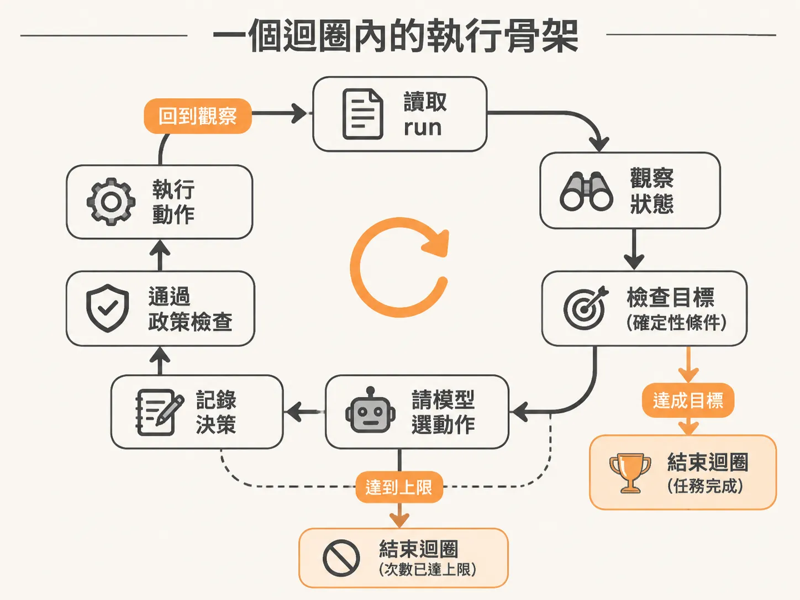
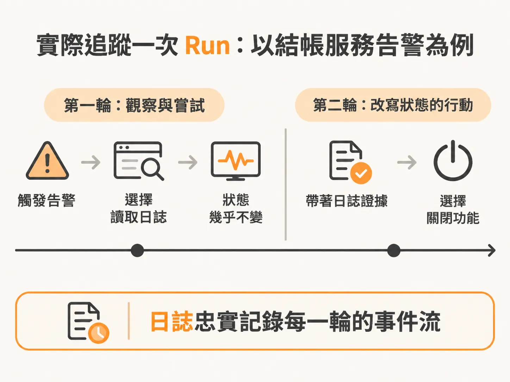
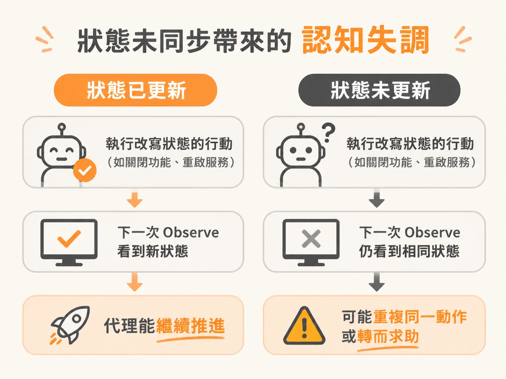

# 解讀背景 Agent 的執行軌跡：從狀態日誌看 Observe、Predict 與 Act

動作有了安全的執行與記錄方式，就能把整趟執行當成證據來讀。當後台的背景 Agent 自動跑起來時，如果系統只丟出一段最終結果，開發者很難判斷它中途做了什麼判斷，以及系統的狀態究竟在哪一步發生了變化。要除錯或評估一個 Agent 是否正常工作，最直接的方式就是打開執行日誌（activity log）與狀態物件（state），一步一步還原它的「觀察（Observe）→ 預測（Predict）→ 行動（Act）」軌跡。

## 一個迴圈內部的執行骨架

背景 Agent 的核心通常落在一個有上限的迴圈中（例如最多執行八次或數十次）。每一次迭代，流程都會嚴格依照固定的順序推進：



<!-- source: sources/background-agent/20261109/supplement/server/agent-workflow.ts#L81-L99 -->

```typescript
    for (let cycle = 1; cycle <= 24; cycle++) {
      const current = await getRun(runId)
      if (['completed', 'failed', 'cancelled', 'escalated', 'superseded'].includes(current.status))
        return
      const state = await step.run(`observe-state-${cycle}`, () => agentState(environmentId, runId))

      if (goalSatisfied(state, run.goalCondition)) {
        const report = await step.run(`write-report-${cycle}`, () => writeReport(run.goal, state))
        await step.run(`complete-run-${cycle}`, () => setRun(runId, 'completed', null, report))
        return { report }
      }

      const decision = await step.run(`choose-action-${cycle}`, () => chooseAction(run.goal, state))
      await step.run(`set-iteration-${cycle}`, () => setIteration(runId, cycle))
      await step.run(`record-decision-${cycle}`, () =>
        recordDecision(environmentId, runId, cycle, decision.action, decision.reason),
      )

      if (decision.action === 'wait' || (decision.action === 'complete' && run.goalCondition)) {
```

### 1. 觀察當前世界（Observe）

迴圈一開始，系統會先抓取被監控對象的最新狀態。以結帳服務（checkout service）為例，我們會取得它目前的健康度、錯誤率、發布版本與啟用的功能開關。

<!-- source: sources/background-agent/20261109/supplement/server/agent-data.ts#L63-L121 -->

```typescript
  const state = {
    environmentId,
    eventSequence: run.eventSequence,
    world,
    events: recentEvents.map((item) => ({
      type: item.type,
      data: item.data,
      at: item.createdAt.toISOString(),
    })),
    actions: recentActions.map((item) => ({
      id: item.id,
      name: item.name,
      input: item.input,
      result: item.result,
      at: item.createdAt.toISOString(),
    })),
    humanDecisions: recentApprovals
      .filter((item) => item.status !== 'pending')
      .map((item) => ({ action: item.action, status: item.status, answer: item.reason })),
  }
```

拿到狀態後，程式會先進行一次確定性檢查（deterministic check）：當前的狀態是否已經滿足目標？如果已經滿足，工作就直接完成並結束，不再繼續往下跑。

但如果確定性程式碼判斷目標尚未達成，系統就會把當前看到的整體狀態、目標以及系統提示詞（system prompt）打包好，交給大型語言模型（LLM）。

### 2. 決定下一步動作（Predict）

LLM 的任務是在所有允許執行的動作清單中，挑選出當下最合理的一項，並附上具體的決策原因。模型預測出動作後，工作流程會先做基礎記錄（更新計數並把決策寫入日誌），但在真正調用外部 API 執行動作前，必須經過一層安全防護檢查：

* **等待（Wait）與請求人工協助（Request for help）**：這些不是普通的 API 呼叫，通常需要暫停當前工作流程或步驟，通知人類並無限期等待回覆。
* **回滾發布（Rollback release）**：在沒有人類明確介入與核准前，嚴格禁止 Agent 自主執行這類高風險動作，遇到時必須立刻攔截暫停。
* **標記完成（Complete）**：可能需要呼叫另一個模型產出總結報告、發送通知信，或是更新外部看板，因此也需要走特殊分支。

### 3. 執行與記錄（Act）

只要不是上述受限制的特殊動作，Agent 就可以自主調用服務上的 API 來執行該動作。執行完畢後，工作流程取得執行結果、記錄行動，只要沒有觸發結束條件或拋出錯誤，就會回到迴圈頂端，展開下一輪觀察。

## 實際追蹤一次 Run：以結帳服務告警為例

當系統觸發警報時，日誌會忠實記錄每一個輪次的事件流。



### 第一次迭代：讀取狀態（Read Action）

工作流程啟動，目標是「調查結帳事故，在允許範圍內恢復服務，必要時尋求人類協助」。隨後收到的原始事件顯示結帳快速功能（Checkout Express feature）引發錯誤。

1. **Observe（觀察）**：系統呼叫取得狀態的函式。日誌中的健康度物件顯示狀態為「降級（degraded）」、錯誤率高達「42%」，且某項新功能為開啟狀態。
2. **Predict（預測）**：進入第一輪迴圈，LLM 比對可用動作後，決定選擇「檢查日誌（inspect logs）」。它在理由中說明：告警雖然指向開啟的 Express 功能，但在改動服務狀態前，需要先看日誌確認真正的失敗來源。
3. **Act（行動）**：檢查日誌不屬於受限的特殊操作，系統直接呼叫 API 執行，並取回日誌內容。其中一筆詳細日誌清楚寫著：「Checkout Express feature raised an error during payment confirmation.」系統將動作與結果記錄下來，完成第一輪。

在進入第二輪時，系統再次 Observe。這時伺服器的健康狀態與錯誤率幾乎沒有改變，這是完全合理的：**檢查日誌是一個讀取行動（Read Action），不是變更狀態的動作（Mutative Action）**。不管是人還是 Agent，都不會預期單純「看日誌」就讓伺服器的錯誤率下降。

### 第二次迭代：改寫狀態（Mutative Action）

進入第二輪迴圈後，Agent 帶著前一次讀到的詳細日誌資訊再度進行決策：

1. **Predict（預測）**：既然日誌已經確認該功能在付款確認階段崩潰，Agent 的下一步就是挑選「關閉該功能（disable feature）」。
2. **Act（行動）**：調用 API 將該功能關閉。這項動作屬於會改寫狀態的行動，我們預期在下一次 Observe 時，伺服器的狀態物件會反映出該功能已被關閉，進而使錯誤率改善。

## 狀態未同步帶來的「認知失調」

如果 Agent 執行了一個理應改寫狀態的行動（例如關閉功能或重啟服務），但在下一次迴圈 Observe 時，看到的狀態卻完全沒有變動，Agent 就會陷入嚴重的混亂。



這就像工程師打開 CSS 檔案把背景改成紅色、存檔並看見伺服器重新啟動，但切回網頁查看時背景依然不是紅色。此時任何人都會懷疑是快取問題或底層系統損壞。

Agent 遇到這種情況時，它無法確認動作究竟有沒有生效。如果系統放任 Agent 忽略狀態、自顧自假定「API 回傳成功就是做好了」，整套依賴狀態反饋的背景控制迴圈就會失去意義。最終 Agent 往往會因無法推進目標而放棄，或是直接呼叫人類求助。確保變更動作確實反映在當前的狀態資料上，是底層系統必須保證的基礎，這與模型本身的推理能力無關。

## 確定性檢查與模型判斷的落差

在迴圈開頭檢查目標是否滿足時，有時會遇到一種落差：開發者撰寫的確定性條件判斷程式碼認為「目標尚未完成」，但跑到迴圈下方時，LLM 根據整體脈絡卻選了「標記完成（complete）」。

這種衝突通常代表開發者寫在檢查函式裡的邏輯，與餵給 Agent 的系統提示詞及目標描述之間存在認知差距。如果某些業務目標太過複雜、無法用簡短的程式規則做確定性驗證，也可以將「檢查目標是否滿足」直接交由另一次專門的 LLM 呼叫來判定。這樣做不僅有獨立且範圍更小的系統提示詞，能大幅提升準確率，還能依據任務需求選用更輕量或專門的判斷模型。
