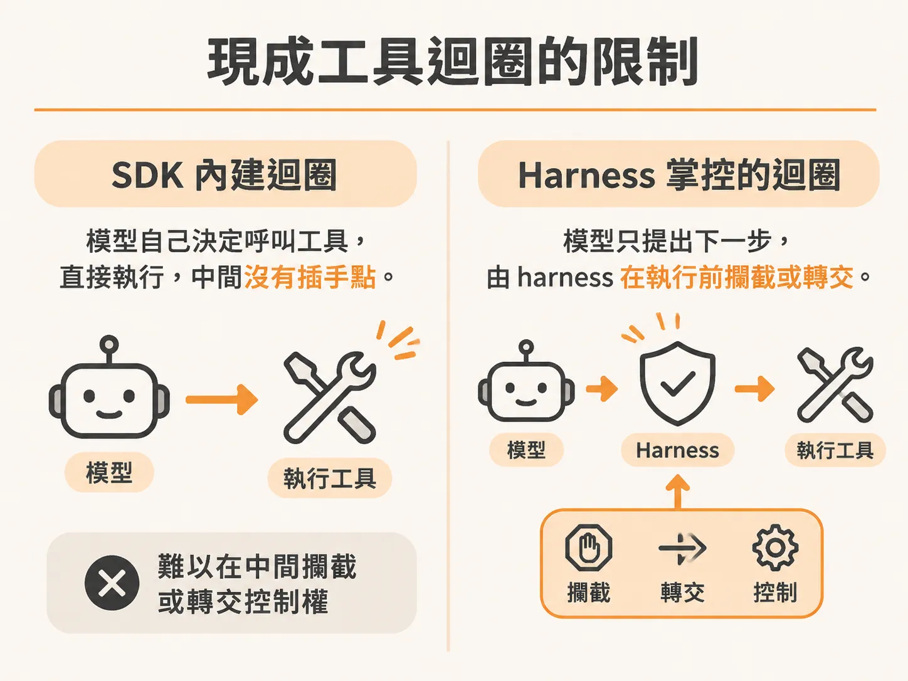
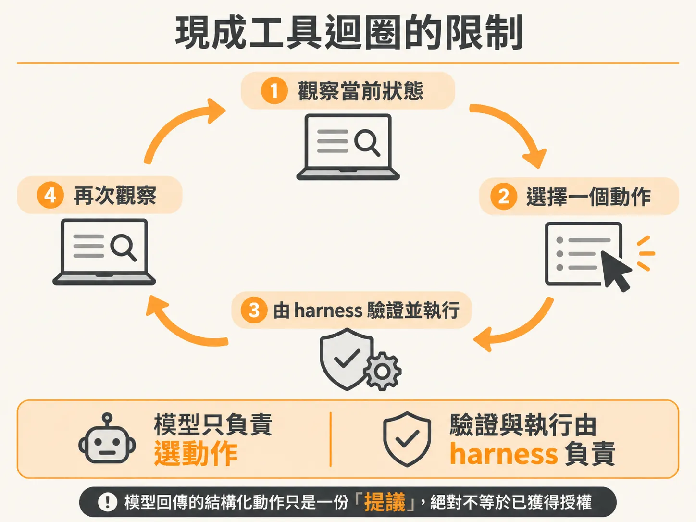
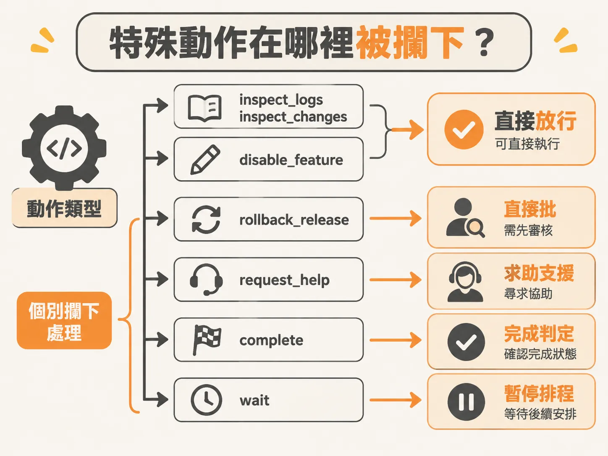

# 為什麼 Agent Harness 要自建工具迴圈？

現成的 AI SDK 通常內建了工具呼叫迴圈（tool loop）。例如在呼叫文字生成函式時直接傳入工具清單，再設定類似 `stopWhen` 的條件，模型就會自己一直跑：拿到 prompt、決定呼叫工具、取得工具回傳結果；如果覺得還不能回答，就再呼叫下一個工具，直到它認為可以給出最終回覆為止。

這種全自動的內部迴圈寫起來很省事，但只要把 Agent 放進實際的基礎設施或生產環境，問題就會浮現。

## 現成工具迴圈的限制

許多 SDK 雖然支援在工具執行前掛上護欄函式（guardrail function），或是提供基礎的真人介入（human-in-the-loop）鉤子，但如果想在「模型決定呼叫工具」與「工具真正執行」之間硬生生打斷流程，並且把控制權轉交給外部基礎設施，現成的封裝往往很難做到。



在實際維運中，某些工具呼叫本質上不是單純的函式運算：

- **暫停等待**：需要等一段時間再看，這牽涉到排程或休眠等基礎設施操作。
- **對外求助**：需要通知人類工程師，甚至暫停整個 workflow 等待回覆。
- **高風險變更**：例如線上服務的回滾，不能讓模型自己判斷想做就直接做。

如果把這些動作全交給 SDK 內建的迴圈，模型就成了唯一決定何時呼叫、何時成功的決策者。這也是為什麼我們必須把現成的工具迴圈拆開，改成由外層的測試骨架（harness）自己掌控流程：我們只讓模型在每次迭代中告訴我們「它認為下一步該做什麼」，真正的執行與攔截邏輯則完全由外部的程式碼接管。

整個迴圈的運作節奏固定為：**觀察當前環境 → 選擇一個動作 → 由 harness 驗證並執行 → 再次觀察**。模型回傳的結構化動作只是一份「提議」，絕對不等於已獲得授權。



## 特殊動作在哪裡被攔下？

在 harness 中，工具被明確區分為不同策略等級。以工具策略表為例：

<!-- source: sources/background-agent/20261109/supplement/server/tool-policy.ts#L1-L15 -->

```typescript
import type { ActionName } from '../shared/types'

// The harness reads policy metadata; it does not branch on checkout fault flags.
export const actionPolicy: Record<
  ActionName,
  'read' | 'write' | 'approval' | 'help' | 'terminal' | 'wait'
> = {
  inspect_logs: 'read',
  inspect_changes: 'read',
  disable_feature: 'write',
  rollback_release: 'approval',
  request_help: 'help',
  complete: 'terminal',
  wait: 'wait',
}
```

像 `inspect_logs` 與 `inspect_changes` 屬於單純讀取，`disable_feature` 屬於一般寫入。但其餘四個動作，harness 會在執行前或執行時個別攔下處理：



### 1. request_help（求助）

當模型發現資訊不足或無法處理，發出 `request_help`（策略為 `help`）時，這不是模型內部能自己消化的事。此時必須由 harness 攔下，將當前狀態標記為升級處理（escalated），並銜接外部通報或基礎設施的暫停機制。在尚未串接完整人類審批流程的早期實作中，harness 會直接將 run 狀態設為 escalated 並中斷結束，避免迴圈在無人回應的情況下空轉。

### 2. rollback_release（回滾版本）

線上版本回滾屬於高風險操作。在工具策略中，它的等級是 `approval`。即便模型根據日誌與變更判斷應該回滾，harness 也不允許它自動執行。這項動作會被外層判斷攔截；在具備審批機制的版本中，必須先建立變更提議並等待人類核准；如果審批機制尚未建好，harness 的安全防線就是直接回傳並通報 escalated，絕對不讓未經授權的變更直接打到線上服務。

程式碼中對 `approval` 與 `help` 的具體攔截點如下：

<!-- source: sources/background-agent/20261109/supplement/server/agent-workflow.ts#L141-L185 -->

```typescript
      const actionId = `${runId}:${cycle}:${decision.action}`
      const policy = actionPolicy[decision.action]
      if (policy === 'approval' || policy === 'help') {
        const input =
          policy === 'help'
            ? { question: decision.detail }
            : { expectedVersion: state.world.version }
        const proposalId = await step.run(`propose-action-${cycle}`, async () => {
...
        if (proposal.status !== 'approved') {
          await step.run(`stop-after-human-${cycle}`, () =>
            setRun(runId, 'escalated', `Human decision: ${proposal.status}`),
          )
          return
        }
        if (policy === 'help') continue
```

### 3. wait（等待）與 complete（完成）

除了求助與回滾，生命週期動作同樣不能當成一般工具呼叫：

- **wait**：當環境變更剛發布，系統需要時間生效時，模型可能提議等待。harness 攔下 `wait` 後，由排程系統（例如 Inngest 的 step 休眠）接手暫停，而不是讓執行緒開著 busy-waiting。
- **complete**：宣告事件處理完畢。harness 不會只聽信模型單方面宣布成功，而是會由外層檢驗環境的真實狀態是否已經復原，才決定是否結束執行。

只要把這四個關鍵的生命週期與高風險動作（`wait`、`request_help`、`complete`、`rollback_release`）攔截下來，剩下的普通決策就能放心放行給系統執行。這樣設計出來的 Agent，才不會因為失控的內部迴圈而做出無法挽回的操作。
