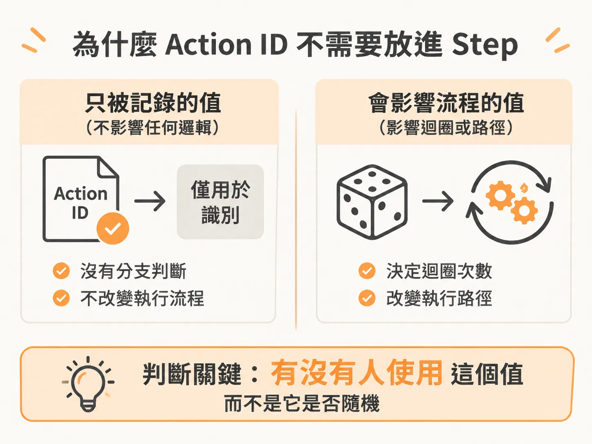
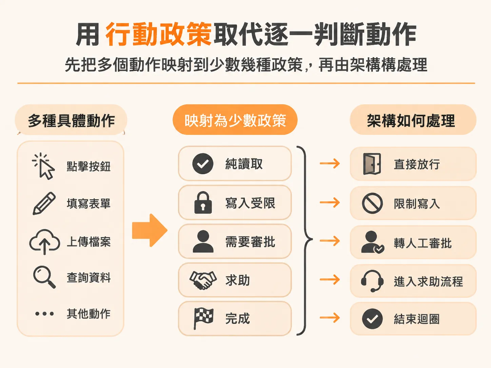

# Action ID 為何不必包成 Step：用行動政策分類執行權限

處理完特殊分支後，下一個冒出來的細節是：執行前那組 action ID 需不需要也包成 step？在設計工作流程（workflow）驅動的代理人系統時，當流程推進到準備執行動作的階段，我們往往需要替當前動作產生一組 action ID。直覺上，工作流程系統要求確保程式具備確定性（deterministic），而隨機產生 ID 看似具備非確定性，讓人猶豫是否該用 `step` 將它包裝起來。

事實上，產生 action ID 並不需要包裝進 `step` 中，而後續動作的執行權限，則應該透過行動政策（action policy）進行分類管理。

## 為什麼 Action ID 不需要放進 Step

在耐久性工作流程中，將操作包成 `step` 的核心目的通常是快取結果，確保重播（replay）時能夠得到相同的回傳值，避免破壞確定性。但在 action ID 的情境中，快取完全沒有意義。

我們根本不在乎 action ID 的具體數值是什麼，唯一的目的只是確保它「具備唯一性」。系統並沒有任何業務邏輯會依賴這個 ID 的數值來做分支判斷。這與在迴圈中呼叫 `Math.random()` 完全不同——若根據隨機數值決定迴圈要跑多少次，後續執行路徑就會改變，這才是真正會破壞工作流程的非確定性。



Action ID 就像是一筆日誌紀錄，只是純粹記錄或存到某個地方。只要沒有任何邏輯會因數值改變而產生不同行為，即使它在每次重播或重新產生時是隨機的，對工作流程實質上也是安全且等同具備確定性的。

唯一需要把 ID 產生包進 `step` 的情況，是取得 ID 的代價很高昂。例如呼叫外部網路 API 來取得隨機 ID 時，為了避免每一次重播或迴圈都要承擔網路延遲與成本，我們會利用工作流程自動提供的快取機制。但這純粹是為了效能優化，而不是為了解決確定性問題。使用本地隨機產生（例如 `crypto.randomUUID`）時完全免費，直接產生即可。

## 用行動政策取代逐一判斷動作

決定執行動作後，代理人架構（harness）需要判斷 AI 是否擁有執行該動作的權限。

系統中定義了多種不同的動作：

<!-- source: sources/background-agent/20261109/supplement/shared/types.ts#L1-L13 -->

```typescript
export const ACTIONS = [
  'inspect_logs',
  'inspect_changes',
  'disable_feature',
  'rollback_release',
  'request_help',
  'complete',
  'wait',
] as const
export type ActionName = (typeof ACTIONS)[number]

export type WorldState = Record<string, unknown>
export type GoalCondition = { path: string; equals: string | number | boolean } | null
```

如果為每個動作都寫一組判斷式，當工具增加到 30 個時，程式碼裡就會充滿 30 個 `if` 分支。比較理想的做法是引入一層抽象層，替動作劃分「行動政策（action policy）」：

<!-- source: sources/background-agent/20261109/supplement/server/tool-policy.ts#L1-L15 -->

```typescript
import type { ActionName } from '../shared/types'

// The harness reads policy metadata; it does not branch on checkout fault flags.
export const actionPolicy: Record<
  ActionName,
  'read' | 'write' | 'approval' | 'help' | 'terminal' | 'wait'
> = {
  inspect_logs: 'read',
  inspect_changes: 'read',
  disable_feature: 'write',
  rollback_release: 'approval',
  request_help: 'help',
  complete: 'terminal',
  wait: 'wait',
}
```

透過行動政策，執行架構只要針對政策類型進行分類處理：



- **`read`**：純讀取行為，例如檢查日誌（`inspect_logs`）或查看變更（`inspect_changes`）。這類操作完全不會改動環境，架構可以直接放心讓代理人執行。
- **`write`**：具備寫入或修改性質的動作，例如關閉功能（`disable_feature`）。系統可能不能直接放行，需要更嚴格的限制或檢查。
- **`approval`**：具備高風險或不可逆的動作，例如版本回滾（`rollback_release`）。這類動作不需要架構自行揣摩，毫無懸念必須取得人工審批（human approval）才能執行。
- **`help`**：當代理人無法自主推進而呼叫求助動作（`request_help`）時，系統會轉入求助流程。
- **`terminal`**：代表任務完成（`complete`），直接結束工作流程的迴圈。

在架構實作上，程式碼只需要針對需要特殊處理的政策（例如 `approval`）撰寫分支邏輯，向人工發出審批請求；而其餘像 `read` 這類操作，則可以直接當作預設處理（fallback）直接放行執行。未來即便擴充更多新工具，也只需要為它標記所屬的政策，不必修改核心的執行判斷流程。
