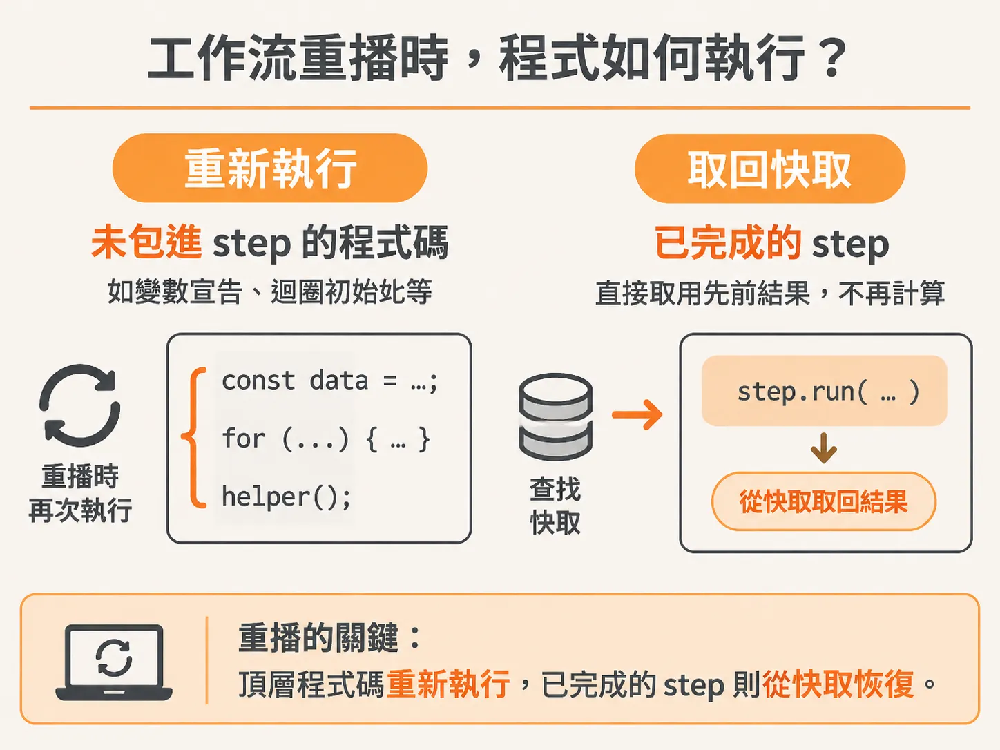
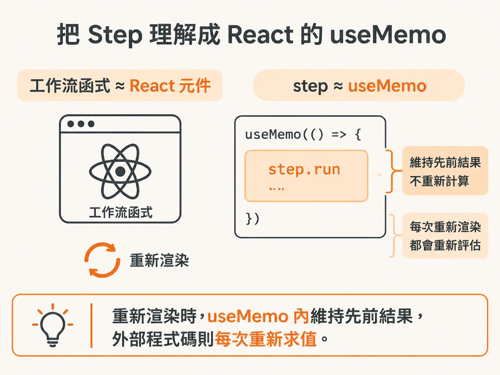
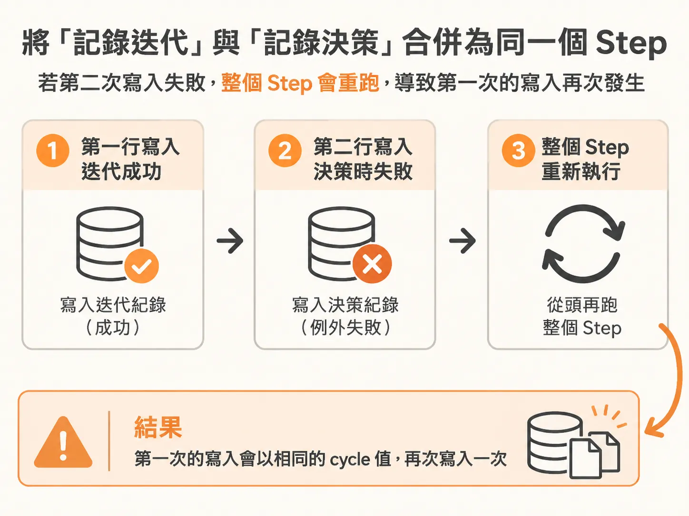
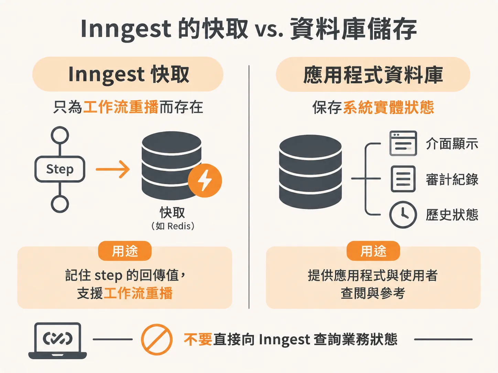

# 為何 LLM 決策必須包進 Step？用 Inngest 打造可靠的工作流

在開發背景 Agent 時，很多人直覺會認為：「決策只是拿當前狀態問一下語言模型（LLM），狀態是什麼就得出什麼結果，何必大費周章把它包進 `step.run`？」

這個看似合理的直覺，在遭遇伺服器重啟或當機時會立刻引發災難。理解耐用執行（Durable Execution）如何運作，以及為什麼 LLM 的呼叫絕對不能裸露在工作流最外層，是打造穩定 Agent 的核心基礎。

## 當伺服器當機時，工作流究竟是如何重播的？

當執行 Agent 的伺服器突然重啟或當機，工作流引擎（如 Inngest）會重新啟動該次執行。這時發生的不是「魔法般地跳到中斷那一行」，而是**從工作流函式的最頂端重新把程式碼跑一遍**。

在重播（replay）過程中：
1. **所有沒有包進 step 的程式碼都會重新執行**：變數宣告、迴圈初始化、普通函式呼叫都會再跑一次。
2. **包在 `step.run` 裡的程式碼會跳過計算**：當程式執行到已經完成過的 step 時，引擎會認出該步驟的名稱（step ID），直接從快取拿出上一次的結果灌回（hydrate）變數中，不會再次執行回呼函式內部的邏輯。



如果你的 LLM 決策沒有包在 step 裡，重播經過它時，程式就會對 LLM 發送全新的請求。這會帶來三大嚴重問題：

1. **花費更多成本（金錢）**：每次重播或重試都要重新計費。
2. **增加延遲**：LLM 推理速度慢，重播時重新等待會拖慢整體復原時間。
3. **破壞確定性（最大的致命傷）**：LLM 本質上是機率性的（stochastic / probabilistic），並非確定性（deterministic）系統。即使輸入相同的提示詞，重跑一次也很可能給出完全不同的決策。

想像一下：Agent 在當機前決定要「檢查日誌」，後續的 step 已經根據這個決定記錄了狀態；當機重播後，LLM 卻改口說要「請求人工協助」。此時後續步驟接收到的輸入與先前的歷史記錄完全脫節，整個工作流的狀態就徹底壞掉了。

在工作流中，我們需要確定性。把 LLM 決策包進 step，就能確保該決策被快取下來——即使系統掛掉重啟，Agent 也會嚴格遵循當時做出的同一個決定。

## 把 Step 理解成 React 的 `useMemo`

如果你寫過 React，最直覺的類比就是 `useMemo`：
* **工作流函式**就像一個 React 元件。當伺服器重啟或在儀表板按下重播時，就像元件觸發了重新渲染（re-render）。
* **`step.run`** 就像 `useMemo`。在重新渲染時，只要它已經被記憶（memoized），就不會重新計算，而是直接回傳先前的結果。沒有包在裡面的部分，每一次重新渲染都得重新評估。



## 實作：決策與記錄的三部曲

在 Agent 的迴圈內，我們依序需要三件事：讓 LLM 做決策、更新迭代次數，以及將決策存入資料庫。為了讓每次迴圈在歷史記錄中都有獨一無二的識別名稱，我們會在 step 名稱後方加上當前的迴圈計數器 `${cycle}`。

模型決策的函式定義如下：

<!-- source: sources/background-agent/20261109/supplement/server/agent-brain.ts#L8-L41 -->

```typescript
const decisionSchema = z.object({
  action: z.enum(ACTIONS),
  reason: z.string(),
  detail: z.string(),
})

type Decision = { action: ActionName; reason: string; detail: string }

export async function chooseAction(goal: string, state: AgentState): Promise<Decision> {
  const result = await generateText({
    model: model(),
    output: Output.object({ schema: decisionSchema }),
    system: `You are a background incident agent for a checkout service.
Choose exactly one action. The harness validates it and controls execution.
...
Keep reason to one short sentence. Put a question to the operator in detail for request_help; otherwise detail may be empty.`,
    prompt: `Goal: ${goal}\n\nCurrent observed state:\n${JSON.stringify(state, null, 2)}`,
  })
  return result.output
}
```

在工作流主程式中，我們使用三個獨立的 step 來串接這個流程：

<!-- source: sources/background-agent/20261109/supplement/server/agent-workflow.ts#L93-L97 -->

```typescript
      const decision = await step.run(`choose-action-${cycle}`, () => chooseAction(run.goal, state))
      await step.run(`set-iteration-${cycle}`, () => setIteration(runId, cycle))
      await step.run(`record-decision-${cycle}`, () =>
        recordDecision(environmentId, runId, cycle, decision.action, decision.reason),
      )
```

### 1. `choose-action-${cycle}`
呼叫 `chooseAction`，將目標與目前的觀察狀態傳入模型。這個 step 的回傳值會被 Inngest 快取。重播時，`decision` 變數會直接拿到先前快取的物件，絕不重複呼叫 LLM。

### 2. `set-iteration-${cycle}`
更新當前的迭代次數。這同樣需要 memoize，確保重播時的次數計算不會錯亂。

### 3. `record-decision-${cycle}`
呼叫應用程式的 `recordDecision` 函式，將環境 ID、執行 ID、cycle、模型挑選的動作（action）與挑選的原因（reason）寫入資料庫。

## 能不能把「記錄迭代」與「記錄決策」合併成一個 Step？

看到連續兩個步驟都在寫入資料，許多人會問：既然這兩件事緊接著發生，何不包在同一個 `step.run` 裡就好？

假設你把它們合併：
1. 第一行寫入迭代成功。
2. 第二行寫入決策時發生例外失敗。
3. 工作流重試原則啟動，重新執行整個 step。



這意味著「寫入迭代」會再跑一次。但在這個情境中，由於當前執行的 `cycle` 數值完全相同，重新寫入也只是用相同的值覆蓋，除了多一次資料庫寫入開銷外，不會破壞系統的業務邏輯。

這涉及架構設計的取捨：
* **合併（Batching）**：減少 step 數量。某些持久化執行平台是根據 memoize 的步驟數量計費，合併有助於大規模運行時的最佳化。
* **分開**：邊界乾淨，追蹤介面（trace）一目了然，且完全沒有重複寫入資料庫的副作用。

在大部分情況下，保持細緻且語意明確的 step，能換來最佳的可讀性與除錯體驗。

## Inngest 的快取 vs. 資料庫儲存

新手常有的另一個疑惑是：既然 Inngest 會記錄 step 的回傳值，為什麼我們還需要獨立寫入自己的資料庫？

兩者的目的截然不同：
* **Inngest 只在乎 step 的回傳值**：它的目的是工作流重播時的快取（就像以 step 名稱為 key 存入 Redis）。應用程式本體無法也不應該直接向 Inngest 查詢業務狀態。
* **應用程式資料庫保存系統實體狀態**：例如介面顯示、審計紀錄、以及 Agent 下一步要拿來參考的歷史狀態，都需要存放在你自己的資料庫中。



雖然在記錄決策時，Inngest 與資料庫都拿到了同一筆決策資料，但一邊是為了確保「工作流當機重播時的確定性」，另一邊則是為了「業務邏輯的持續運作」。各司其職，才能構建出強健的背景 Agent。
