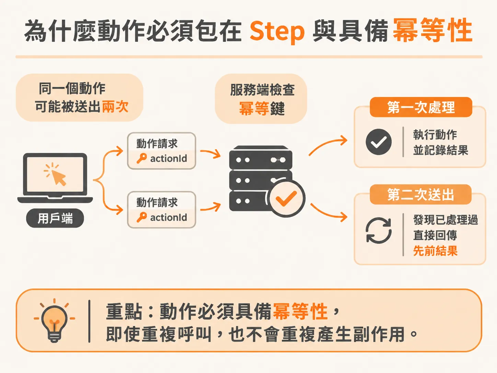
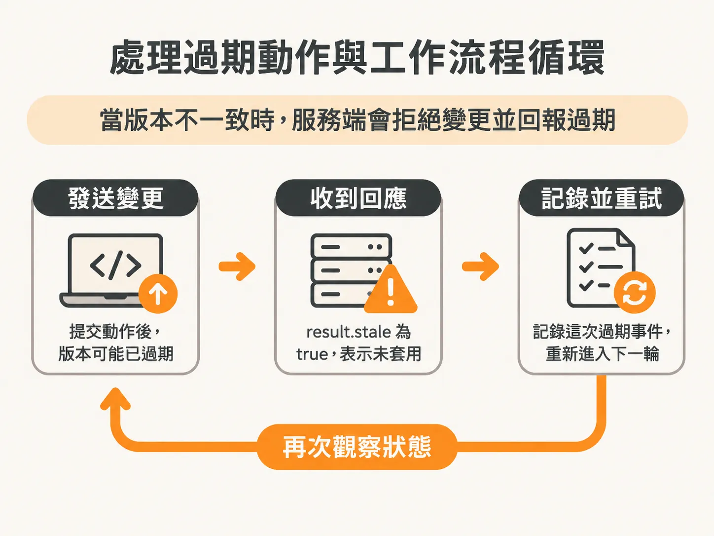
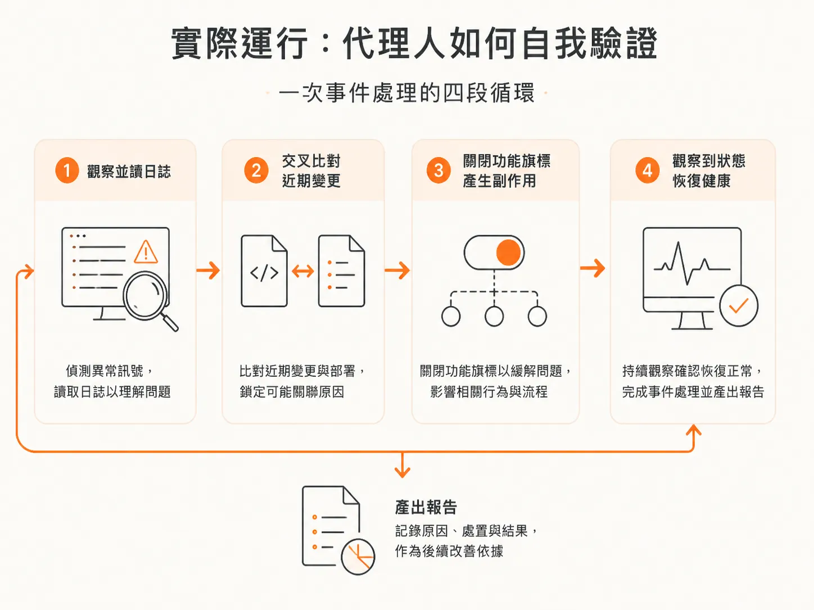

# 把 Action 包進 Step：用 Idempotency Key 與版本比對防止重複改動世界

行動政策把動作分好類之後，最後要保證真正落到世界上的效果只發生一次。當背景代理人（Background Agent）開始具備修改外部系統的能力（例如切換功能旗標、重啟服務或呼叫 API）時，最危險的事情就是「同一件事被執行了兩次」。

如果你的系統因為網路超時或當機而自動重試轉帳操作，沒有做好防護的系統可能會真的轉出兩次款項。即便是在持久化執行（durable execution）架構中，工具在外部服務提交變更與工作流程記錄結果之間，依然可能存在斷線或崩潰的空檔。為了確保副作用只發生一次，必須將動作執行妥善包裝在步驟（step）中，並結合冪等鍵（idempotency key）與預期版本號（expected version）。

## 為什麼動作必須包在 Step 與具備冪等性

把動作的執行包裝在 `step.run` 中，能讓工作流程引擎在重放（replay）時記住執行結果（memoization），避免工作流程從頭恢復時盲目重跑。

但單靠步驟記憶還不夠，進入步驟內部執行的外部變動函式，本身必須是冪等的（idempotent）：即使給定相同參數呼叫兩次，也不該重複產生副作用。常見的做法是傳入一個冪等鍵（例如每一次操作專屬的 `actionId`）。當系統在同一次執行中重放或重試時，帶著完全相同的鍵送往服務端；服務端若發現該鍵已有處理紀錄，就直接回傳先前已完成的狀態，不再重複執行實際邏輯。



除了冪等鍵，變更類操作還需要傳入 `expectedVersion`。如果代理人要執行的只是讀取操作（例如讀取日誌），版本號可以設為 `undefined`；但若是會改變世界的寫入操作，就必須附帶代理人當前觀察到的狀態版本（`state.world.version`）。

在具體的實作中，發送操作請求的輔助函式會將 `actionId` 與 `expectedVersion` 一併打包傳送：

<!-- source: sources/background-agent/20261109/supplement/server/agent-workflow.ts#L20-L56 -->

```typescript
async function executeAction(
  environmentId: string,
  runId: string,
  actionId: string,
  name: ActionName,
  expectedVersion?: number,
) {
  const input = expectedVersion === undefined ? {} : { expectedVersion }
  await logAgentActivity(environmentId, runId, 'act', `Calling ${name.replaceAll('_', ' ')}`, {
    actionId,
    input,
  })
  try {
    const response = await fetch(`${checkoutServiceUrl}/operations`, {
      method: 'POST',
      headers: { 'Content-Type': 'application/json' },
      body: JSON.stringify({ actionId, name, ...input }),
    })
    const result = (await response.json()) as Record<string, unknown>
...
    throw error
  }
}
```

## 處理過期動作與工作流程循環

在主循環中，代理人呼叫動作並檢查回傳結果是否「過期」（stale）：

<!-- source: sources/background-agent/20261109/supplement/server/agent-workflow.ts#L187-L211 -->

```typescript
      const result = await step.run(`execute-action-${cycle}`, () =>
        executeAction(
          environmentId,
          runId,
          actionId,
          decision.action,
          policy === 'read' ? undefined : state.world.version,
        ),
      )
      if (result.stale === true) {
        await step.run(`stale-action-${cycle}`, () =>
          logAgentActivity(
            environmentId,
            runId,
...
            result,
          ),
        )
        continue
      }
      await step.run(`settle-status-${cycle}`, () =>
        setRun(runId, 'waiting', 'Waiting briefly before observing the effect'),
      )
      await step.sleep(`settle-${cycle}`, process.env.AGENT_SETTLE_DELAY ?? '1s')
```

當回傳的 `result.stale` 為 `true` 時，代表這個動作沒有被真正套用。這通常有兩種情況：



1. **服務端狀態已改變**：世界的實際版本與代理人預期的版本不符，服務端為了防止在過期狀態上覆寫變更而予以拒絕。
2. **工作流程在更新過程中執行**：若工作流程執行到一半，系統部署了新版工作流程，而該動作已被移除或規格變動，舊流程便會遇到過期動作。

記錄下過期事件（`Action rejected because service state changed`）後，讓工作流程直接執行 `continue`，跳過後續等待並重新進入下一個循環。這麼做能在不中斷工作流程的前提下，讓代理人重新觀察最新狀態再做決策。同時，這筆日誌能讓維運團隊在部署新版流程時，清查仍在運行的舊流程是否有異常的過期活動。

在執行變更後，加入短暫的沉睡（sleep / settle delay），能讓外部系統有時間完成狀態變更與事件廣播，方便代理人在下一次循環讀取到真實的新狀態。

## 實際運行：代理人如何自我驗證

在啟動 API、模擬故障注入（fault feature）與背景工作流程後，代理人的完整運作過程展現了這套防護機制的價值：



1. **第一輪循環（觀察與讀取）**：系統收到結帳服務付款確認錯誤率升至 42 的警報，啟動事件調查。代理人觀察當前狀態後，決定執行唯讀的「檢查日誌」（inspect logs）動作，並成功取得後端日誌。
2. **第二輪循環（交叉比對變更）**：代理人再次觀察狀態，確認錯誤仍在持續。這一次它沒有貿然關閉功能，而是決定執行「檢查變更」（inspect changes），模擬前往 GitHub 確認近期推送的提交紀錄，查出有人剛剛推了一筆啟用 Express 結帳功能的修改。
3. **第三輪循環（執行副作用）**：確認錯誤是由該功能旗標引起的之後，代理人發起變更操作，關閉 Express 功能。服務端處理變更後，發布了系統復原的事件。
4. **第四輪循環（觀察更新後的狀態與產出報告）**：代理人重新觀察最新狀態，看到結帳服務狀態轉為健康（healthy），錯誤率降為 1，且功能旗標顯示為關閉（`feature_enabled: false`）。代理人確認自己的操作已產生預期效果，達成目標並產出結案報告。

## 狀態更新是代理人推理的基石

如果建構了讓代理人觀察狀態的架構，當它執行了變更操作後，必須確保它能讀到更新後的狀態。

如果代理人執行了修復動作，世界的狀態卻沒有同步更新，對它來說就像看到魔術師在眼前變戲法一樣：視覺看到的現象與邏輯推論完全衝突。此時模型很容易陷入混亂甚至胡言亂語。

即使模型在不同次執行中推論出的步驟順序略有不同（例如直接停用旗標，或是先去查 Git 提交紀錄），只要外圍的保護架構（Harness）有確實把動作放進步驟、透過冪等性防止重複寫入，並用版本比對阻擋過期變更，系統就不會因代理人的探索而受到破壞。對於影響範圍過大的動作，未來也能進一步加入人工審核收件匣，確保自動化操作安全可控。
