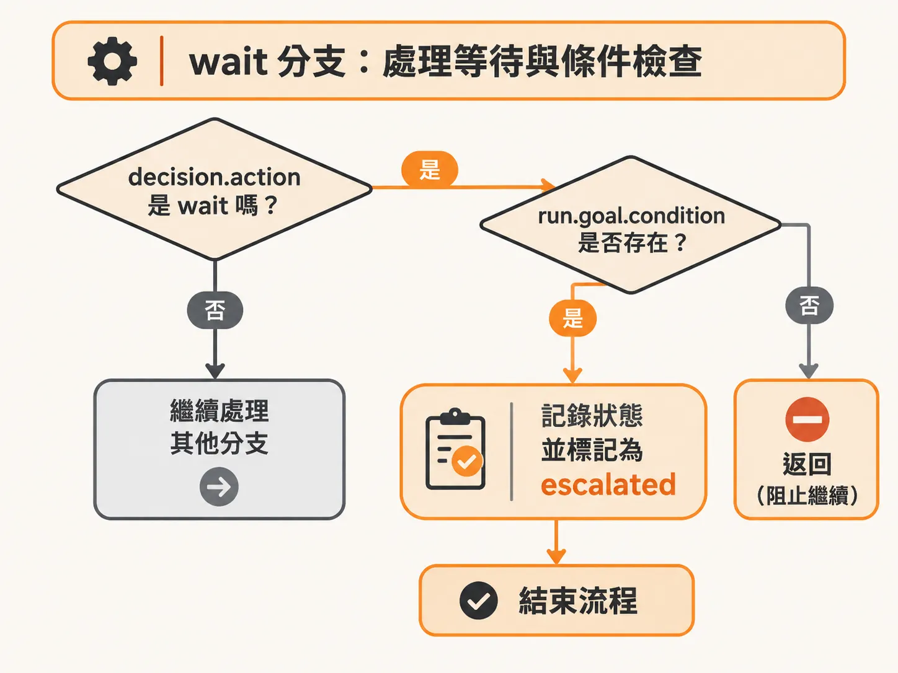
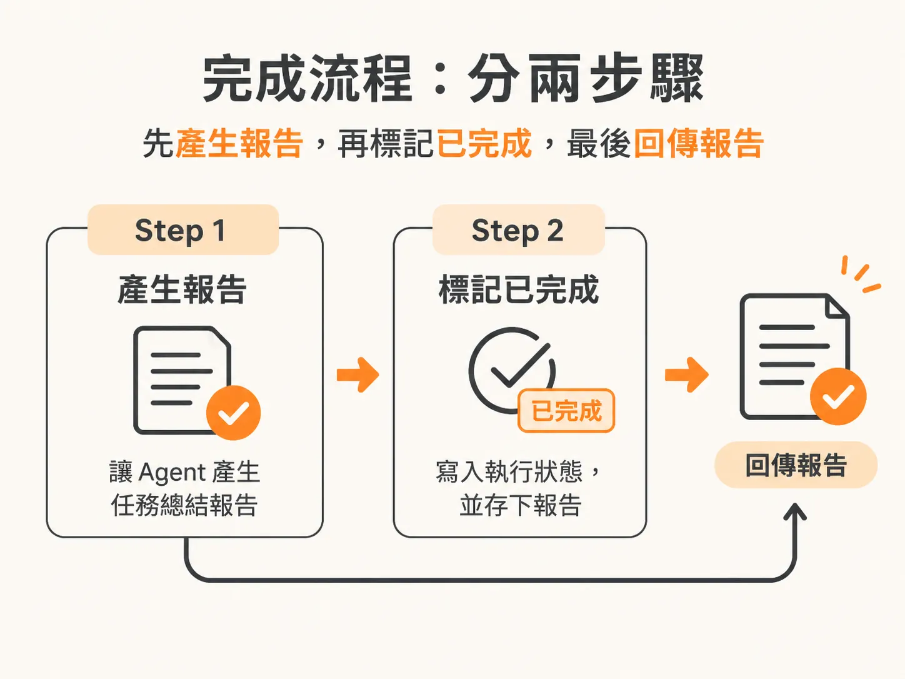
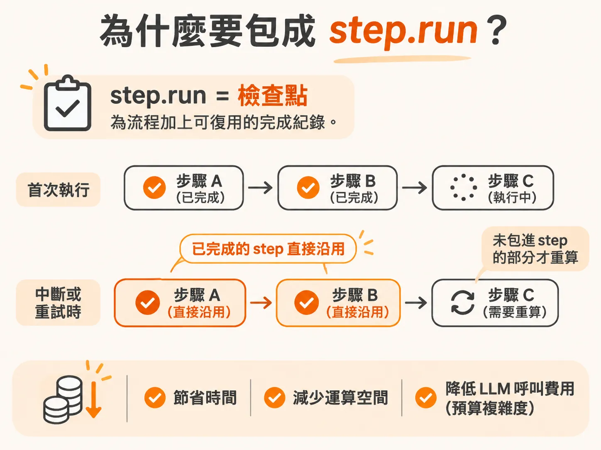

# 處理 Agent 的特殊決策：為 wait、complete 與 request_help 建立持久化 step

決策既然已經被安全地包進 step，接著看那些不是單純工具呼叫的特殊決策。當背景 Agent 做出決策時，並非每一次都是單純執行工具，它可能會決定「等待」（wait）、「完成」（complete）或是「請求協助」（request_help）。這些特殊動作過去可能寫成簡單的條件判斷，但在需要高度容錯的 Durable Execution 架構下，不能直接把邏輯整段複製貼上。

為了確保執行流程可中斷、可重試且不會浪費資源，我們必須為這些特殊情況分別建立獨立分支，並把具不確定性的動作與狀態更新包裝進 step 裡。

## wait 分支：處理等待與條件檢查

首先處理 `decision.action` 為 `wait` 的情況。在實作這個分支時，還可以加上一項過去沒有的防呆檢查：確認 `run.goal.condition` 是否真的存在。

如果在建立任務時根本沒有設定目標條件，就等於是在對 Agent 進行心理操縱（gaslighting）——給它一堆資料，問它「有沒有問題？有的話就去修」，卻不給明確的判斷準則。這對 Agent 來說並不公平。

當決策是等待，或是發現根本沒設定目標條件時，就需要透過 step 記錄下來。由於目前等待機制尚未正式實作，我們可以先用 step 記錄為「該輪週期無法等待」，把任務狀態提升或標記為需要注意（escalated），並附上「等待事件尚未建置」的紀錄。最重要的是，處理完後一定要直接 `return` 結束當前流程，否則程式碼會繼續往下跑。

## complete 分支：將產出報告與完成標記拆為 step

當 `decision.action` 為 `complete` 時，代表 Agent 認為任務已經完成。在結束前，通常需要讓 Agent 產生一份總結報告。

呼叫大型語言模型（LLM）具有非確定性（nondeterministic），每一次呼叫的結果與耗時都不相同。在 Durable Execution 架構中，絕對不要把非確定性的操作放在 step 之外。因此，產出報告必須獨立包成一個 step，例如命名為寫入當前週期的報告，在裡面呼叫報告函式，傳入目標與狀態。

拿到報告後，緊接著要建立第二個 step 來標記任務完成。這個 step 的工作是把 run 的狀態更新為已完成，並存入剛才產出的報告。

這個顯式標記完成的步驟非常關鍵。如果沒有確實把狀態寫成已完成，系統下一次又會因為未完成檢查而繼續執行，導致 Agent 回頭去解決「已經解決的問題」。這就像主管要求同事去修一個早就修好的 bug 一樣令人沮喪。最後，完成 step 執行完畢後，直接回傳這份報告。

## request_help 分支：請求真人協助

第三種情況是 Agent 決定請求協助（`request_help`）。

這部分的架構與前面處理 wait 的邏輯非常類似。因為目前系統還沒串接真人審查的流程，所以同樣先包裝一個 step，記錄「真人協助功能尚未建立」，狀態設為無法提供協助，隨後直接 `return`。

## 為什麼要包成 step.run？

為這些特殊分支加上 `step.run`，並沒有改變原本的業務邏輯，而是大幅提升了程式的持久度與耐用性（durable）。

每一個 `step.run` 就是一個檢查點（checkpoint）。有了檢查點，一旦系統中斷或重試，先前已經完成的步驟就不需要重新運算，計算成本直接降到最低。這不僅省下了時間與空間複雜度，更重要的是節省了呼叫 LLM 的真實費用——這可以說是降低了「預算複雜度」，替專案省下大筆開銷。

