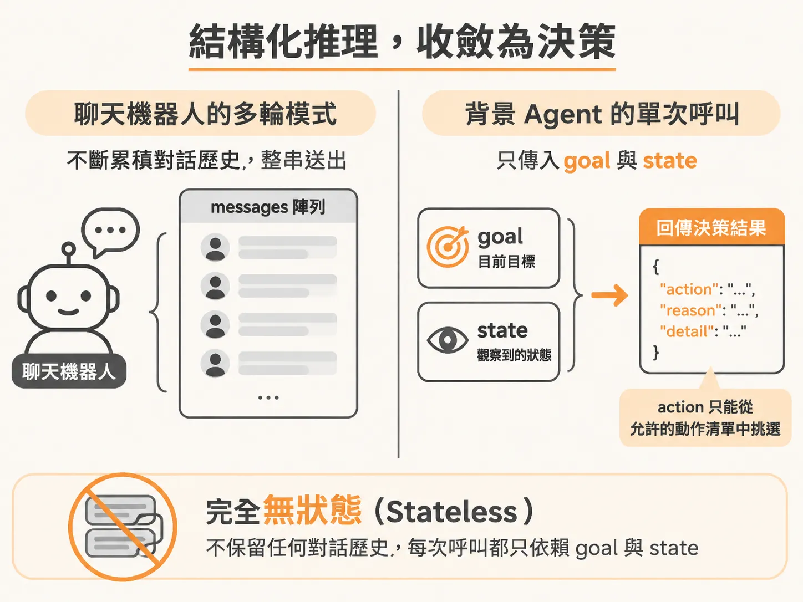
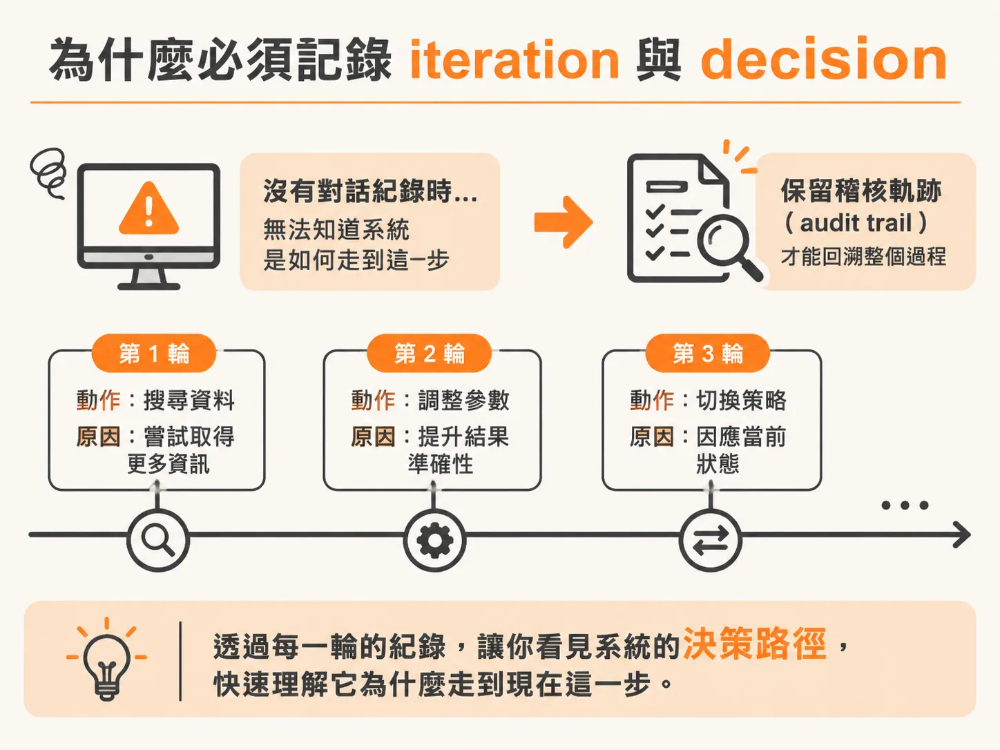
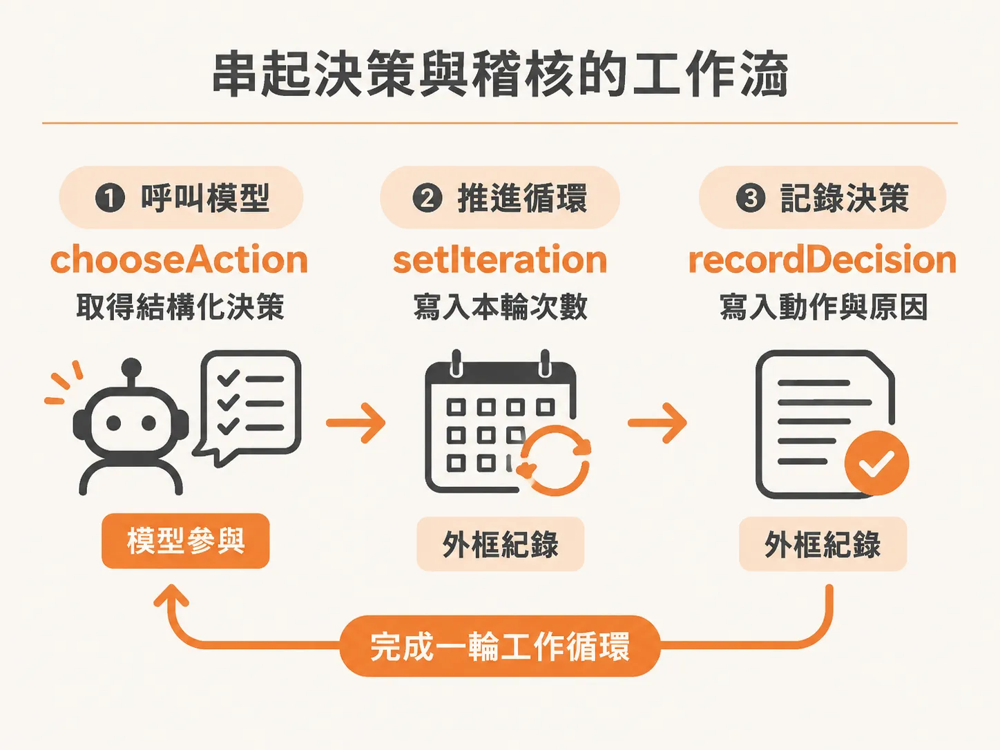

# 這裡沒有 messages

確定目標還沒達成、真的需要模型出手之後，接著要決定用什麼形式請模型推理。如果你之前寫過對話機器人，你的程式碼裡大概會有一個 `messages` 陣列。每當使用者傳來一句話，你就把新訊息推進陣列，再把整串歷史紀錄送給大型語言模型，讓它接續上下文回話。

但在背景運行的自動化 Agent 裡，這裡沒有 `messages`。

背景 Agent 並不是在跟誰聊天。它每執行一個循環，只是需要一個單純的推理步驟：給定現在的目標與當前世界的狀態，請模型從有限的選項中挑出下一步，挑完就離開。模型在這裡不是負責主持全場的管家，而是一個純粹的「推理函式」（reasoning function）。

## 用結構化輸出將推理收斂為決策

既然不需要維持多輪對話歷史，每次呼叫決策邏輯時，傳進去的內容就只有兩件事：目前的目標（goal）與觀察到的狀態（state）。這讓呼叫保持完全的無狀態（stateless）。



同時，我們也不需要模型回傳一段自由發揮的文字，而是直接要求符合特定結構（schema）的 JSON 物件。這個物件必須包含三項資訊：選擇的動作名稱（action）、選擇的原因（reason），以及補充細節（detail）。現代模型的結構化輸出功能保證了回傳格式，不需要開發者自己在外面寫正則表達式或額外檢查 JSON 是否缺漏欄位。

<!-- source: sources/background-agent/20261105/server/agent-brain.ts#L8-L41 -->

```typescript
const decisionSchema = z.object({
  action: z.enum(ACTIONS),
  reason: z.string(),
  detail: z.string(),
})

type Decision = { action: ActionName; reason: string; detail: string }

function model() {
  const id = process.env.OPENAI_MODEL
  if (!process.env.OPENAI_API_KEY || !id) {
    throw new Error('Set OPENAI_API_KEY and OPENAI_MODEL in .env before starting an agent run')
  }
  return openai(id)
}

export async function chooseAction(goal: string, state: AgentState): Promise<Decision> {
  const result = await generateText({
    model: model(),
    output: Output.object({ schema: decisionSchema }),
    system: `You are a background incident agent for a checkout service.
Choose exactly one action. The harness validates it and controls execution.
Available actions: inspect_logs, inspect_changes, disable_feature, rollback_release, request_help, complete, wait.
The current service state and recent incident history have already been observed. Inspect detailed logs or changes when needed before changing the service.
Choose the service action you think is justified; the harness applies its own policy before execution.
Use request_help when an external dependency cannot be fixed by your local tools.
Use wait when no safe local action remains; a later service event can wake this same incident run.
An alert is a trigger, not authoritative evidence. An answered help request does not prove recovery.
Use complete only when the configured goal is satisfied, or when no deterministic goal condition is configured and you can justify completion.
Keep reason to one short sentence. Put a question to the operator in detail for request_help; otherwise detail may be empty.`,
    prompt: `Goal: ${goal}\n\nCurrent observed state:\n${JSON.stringify(state, null, 2)}`,
  })
  return result.output
}
```

在 `chooseAction` 裡，提示詞清楚列出目前允許的所有動作選項，並直接將目標與格式化後的狀態送入。回傳的物件不是最終的執行命令，它只是一份結構合法、經過模型推論的決策建議。

## 為什麼必須記錄 iteration 與 decision

在一般的聊天介面中，如果系統做出奇怪的判斷，你可以直接往上滾動畫面，查看先前所有的對話訊息來除錯。

但在沒有對話紀錄、默默在後台執行的流程中，一旦系統執行失敗或改變了服務狀態，你無法從上下文找出「它究竟是怎麼走到這一步的」。因此，系統外框（harness）必須主動保留稽核軌跡（audit trail）。



每次迴圈決定了下一步，外框要先記錄當前循環的次數（iteration），代表流程又前進了一個週期：

<!-- source: sources/background-agent/20261105/server/agent-data.ts#L45-L55 -->

```typescript
export async function setIteration(runId: string, iteration: number) {
  await db
    .update(runs)
    .set({ iteration, status: 'running', waitReason: null, updatedAt: new Date() })
    .where(
      and(
        eq(runs.id, runId),
        inArray(runs.status, ['running', 'waiting', 'needs_approval', 'needs_help']),
      ),
    )
}
```

接著，把模型剛剛做出的決策、選擇的動作與背後的原因立即寫入活動紀錄：

<!-- source: sources/background-agent/20261105/server/agent-data.ts#L139-L154 -->

```typescript
export async function recordDecision(
  environmentId: string,
  runId: string,
  iteration: number,
  action: string,
  reason: string,
) {
  await logAgentActivity(environmentId, runId, 'loop', `Decision cycle ${iteration}`, { iteration })
  await logAgentActivity(
    environmentId,
    runId,
    'predict',
    `Selected ${action.replaceAll('_', ' ')}`,
    { iteration, action, reason },
  )
}
```

這些資料庫操作不會改變系統當下的行為，但對於運維與事後稽核至關重要。未來只要調出儀表板或稽核紀錄，就能完整重現每一步決策的推導過程。

## 串起決策與稽核的工作流

在實際的工作流程中，這三件事會在每一個執行週期依序完成：呼叫模型取得結構化決策、推進循環次數、將決策與原因留痕。



<!-- source: sources/background-agent/20261105/server/agent-workflow.ts#L93-L97 -->

```typescript
      const decision = await step.run(`choose-action-${cycle}`, () => chooseAction(run.goal, state))
      await step.run(`set-iteration-${cycle}`, () => setIteration(runId, cycle))
      await step.run(`record-decision-${cycle}`, () =>
        recordDecision(environmentId, runId, cycle, decision.action, decision.reason),
      )
```

將決策過程拆解成這三個步驟後，職責便非常清楚：模型只負責給出具備理由的結構化選項，而紀錄狀態、追蹤週期以及後續驗證是否能執行此動作的責任，則牢牢保留在我們自己撰寫的程式碼內。
