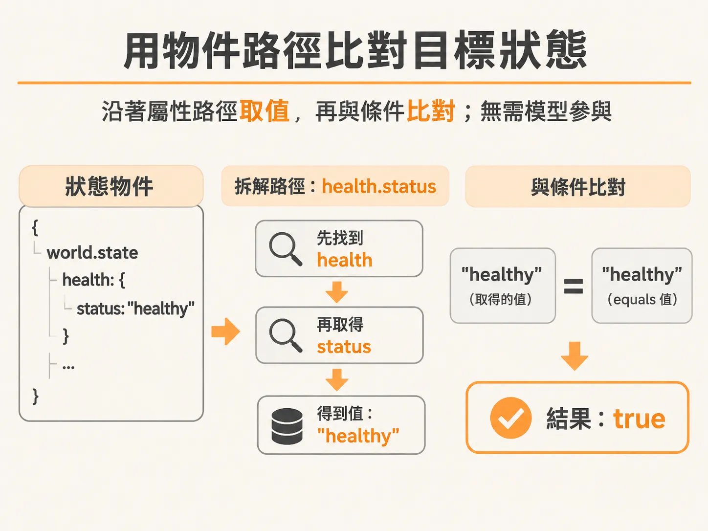
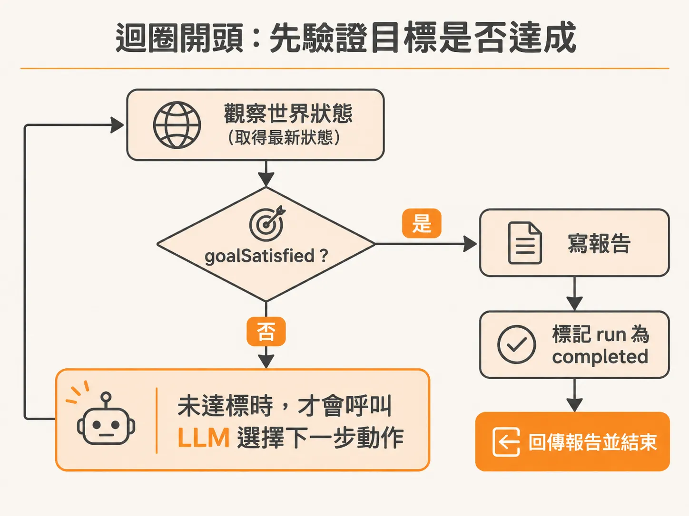
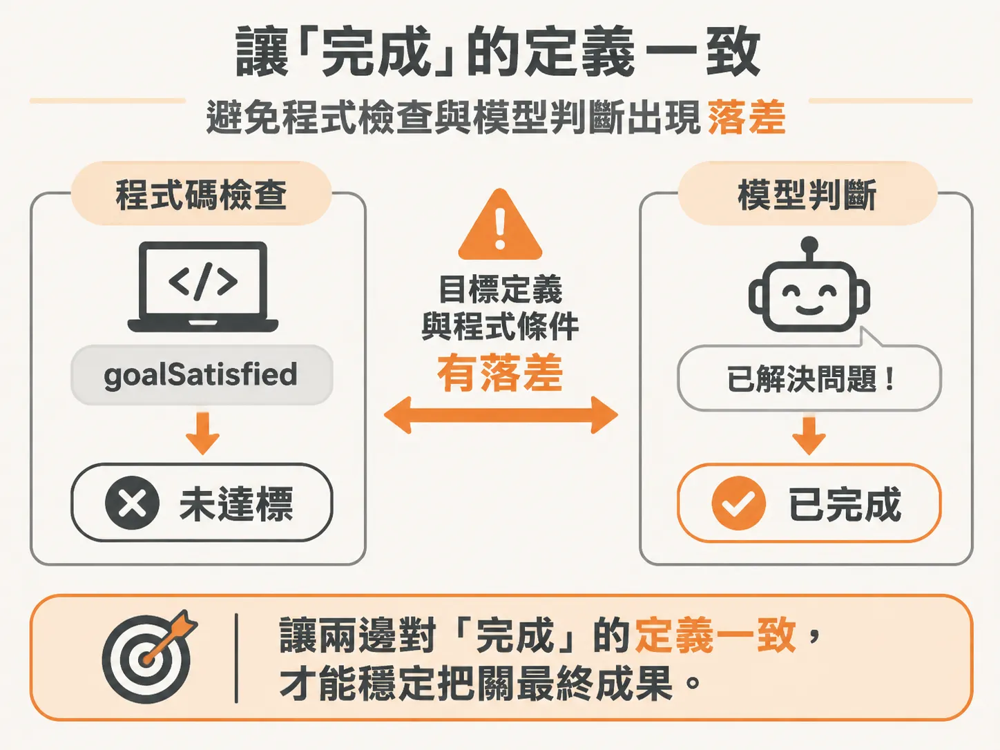

# 不用 LLM 決定目標是否完成

每一輪都拿到最新的世界快照後，下一個問題是：這輪到底還要不要繼續花 Token？讓背景執行的 Agent 自行處理問題時，最容易踩到的一個坑，就是讓模型自己判斷「事情做完了沒」。如果模型本身是判斷任務是否成功的唯一權威，系統就容易因為模型幻覺或誤判而提早收工，或者在目標早已達成時繼續浪費 Token 盲目嘗試。

如果服務的世界狀態（world state）本身就是結構化資料，例如伺服器的 HTTP 狀態碼從 500 變回 200，或者健康檢查變回正常，開發者其實一開始就知道「什麼叫做好」。這類驗證不需要詢問 LLM，直接用確定性（deterministic）的程式碼比對狀態即可。

## 用物件路徑比對目標狀態

要做到確定性判定，可以在外層控制流程（harness）中加入一個比對函式。只要傳入當前的系統狀態與預期的目標條件，比對兩者是否相符：

<!-- source: sources/background-agent/20261105/server/agent-data.ts#L125-L137 -->

```typescript
export function goalSatisfied(state: AgentState, condition: GoalCondition) {
  if (!condition) return false
  const value = condition.path
    .split('.')
    .reduce<unknown>(
      (current, key) =>
        current && typeof current === 'object'
          ? (current as Record<string, unknown>)[key]
          : undefined,
      state.world.state,
    )
  return value === condition.equals
}
```

這個 `goalSatisfied` 函式不需要呼叫任何模型。它將目標條件中的屬性路徑（例如 `health.status`）拆開，一層層在狀態物件中尋找對應的值，最後檢查該值是否等於預期的 `equals`。



目標條件通常會在建立或啟動任務時一併設定，定義出系統回到正常時應具備的數值特徵：

<!-- source: sources/background-agent/20261105/server/environment.ts#L7-L13 -->

```typescript
const DEFAULT_GOAL =
  'Investigate checkout incidents, use permitted actions to restore service when possible, ask for human help when needed, verify recovery from fresh state, and record the outcome.'
export const DEFAULT_CONDITION: GoalCondition = { path: 'health.status', equals: 'healthy' }

export function configuredGoal() {
  return process.env.AGENT_GOAL?.trim() || DEFAULT_GOAL
}
```

## 在迴圈開頭驗證並結束執行

在 Agent 執行迴圈中，順序是「觀察世界狀態 → 檢查是否達標 → 若未達標才交給 LLM 決定下一步動作」。

每一次迴圈一開始，系統重新觀察外部環境並取得最新狀態後，第一件事就是執行 `goalSatisfied`。一旦狀態已經滿足目標，就代表外部環境已經修復完成，這時完全不需要再呼叫 LLM：



<!-- source: sources/background-agent/20261105/server/agent-workflow.ts#L87-L91 -->

```typescript
      if (goalSatisfied(state, run.goalCondition)) {
        const report = await step.run(`write-report-${cycle}`, () => writeReport(run.goal, state))
        await step.run(`complete-run-${cycle}`, () => setRun(runId, 'completed', null, report))
        return { report }
      }
```

只要條件符合，系統會立刻進行收尾：
1. 呼叫 `writeReport` 工具，把整個調查過程與最終狀態彙整成報告。
2. 將此輪執行的狀態更新為 `completed`，並附上報告。
3. 直接跳出迴圈結束執行，不再發送下一個思考提示詞給模型。

這樣做不僅能省下後續決策的 Token 成本，還能確保結束條件嚴格符合系統工程規範。

## 避免程式檢查與 Prompt 產生衝突

採用確定性完成判定時，開發者需要注意 System Prompt 的引導內容是否與程式碼的條件一致。

如果模型在執行的過程中認為自己已經解決問題，但外層的 `goalSatisfied` 卻判定尚未達標，通常代表開發者給模型的指示（目標說明與 Prompt）跟程式檢查的邏輯存在落差。確保兩者的目標定義一致，才能讓模型在不確定的環境中專注尋找修復動作，並由外層程式穩定把關最終成果。


