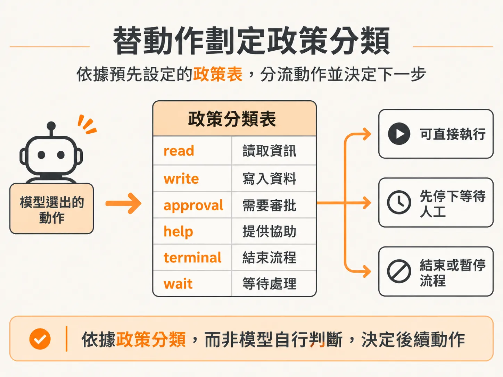
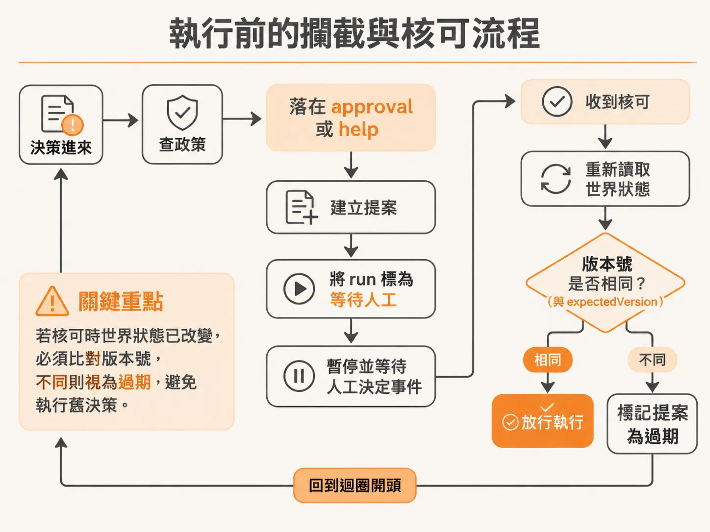
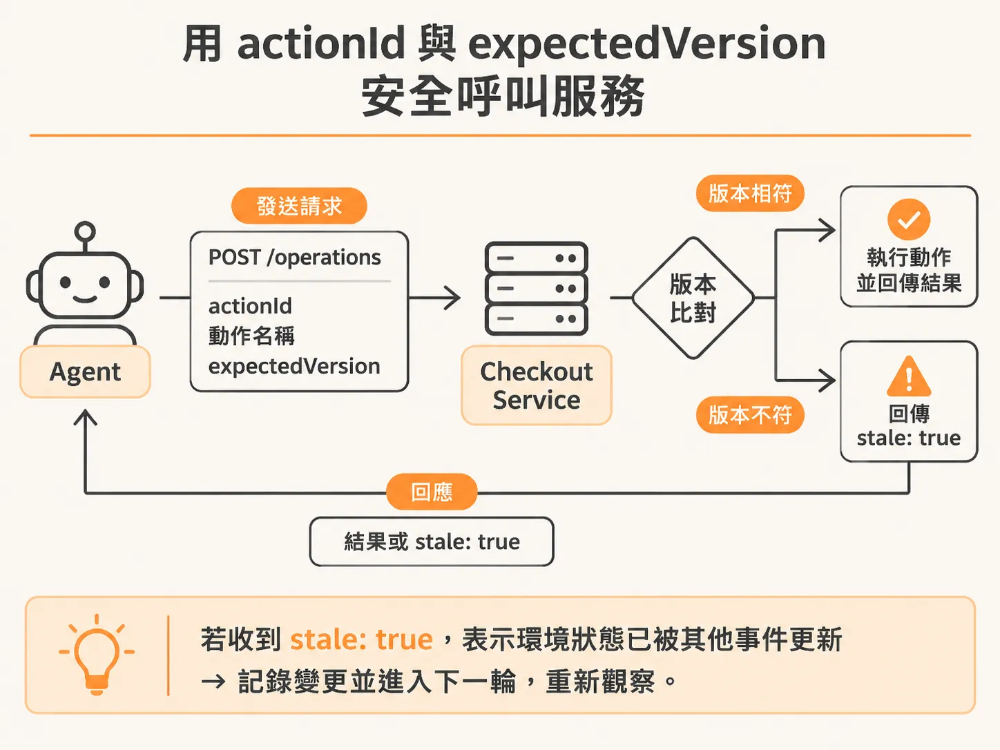
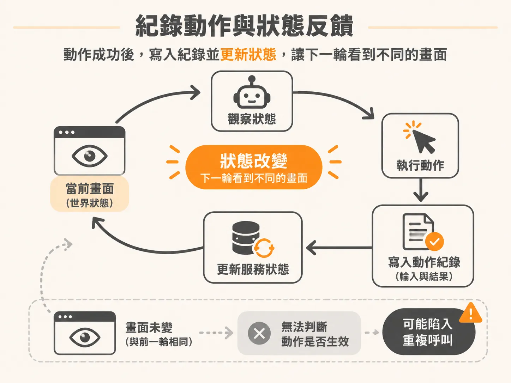

# 迴圈由我控制

模型給出結構化決策之後，真正執行的權力仍然在 harness 手上。多數 AI SDK 都提供內建的工具迴圈（tool loop）：只要把工具清單餵給模型，模型決定呼叫工具、拿回結果，再決定下一個動作，直到它覺得任務完成為止。

這種黑盒迴圈在單純的查詢場景很方便，但在背景執行的自動化任務裡卻極度危險。如果模型決定執行退回版本（rollback）或是請求人工支援，系統往往需要暫停排程、發送通知、等待人員審核，甚至串接特定的基礎設施。如果直接讓 SDK 內建的迴圈自己跑，我們就很難在動作即將執行的瞬間將它攔截下來。

要把控制權拿回手裡，關鍵就是不讓模型自動遞迴呼叫工具。我們只讓模型告訴我們「它建議下一步做什麼」，由外部的控制器（harness）全權掌控每一次執行。

## 替動作劃定政策分類

要安全地攔截動作，首先要明確區分哪些動作是安全的、哪些需要人工介入。我們透過政策表（action policy）替每個動作標註類型：

<!-- source: sources/background-agent/20261105/server/tool-policy.ts#L1-L15 -->

```typescript
import type { ActionName } from '../shared/types'

// The harness reads policy metadata; it does not branch on checkout fault flags.
export const actionPolicy: Record<
  ActionName,
  'read' | 'write' | 'approval' | 'help' | 'terminal' | 'wait'
> = {
  inspect_logs: 'read',
  inspect_changes: 'read',
  disable_feature: 'write',
  rollback_release: 'approval',
  request_help: 'help',
  complete: 'terminal',
  wait: 'wait',
}
```

透過這份對照表，控制器在拿到模型的決定後，不需要去猜測業務邏輯，只要看政策類別就能決定下一步是直接執行、尋求審批，還是暫停工作流程。



## 執行前的攔截與核可流程

當模型的決策屬於需要核可的動作（例如 `rollback_release`）或求助動作（`request_help`）時，控制器會在呼叫任何外部服務前強制攔截，建立提案並等待人工回應：

<!-- source: sources/background-agent/20261105/server/agent-workflow.ts#L141-L195 -->

```typescript
      const actionId = `${runId}:${cycle}:${decision.action}`
      const policy = actionPolicy[decision.action]
      if (policy === 'approval' || policy === 'help') {
        const input =
          policy === 'help'
            ? { question: decision.detail }
            : { expectedVersion: state.world.version }
        const proposalId = await step.run(`propose-action-${cycle}`, async () => {
          const proposal = await proposeAction(
            environmentId,
            runId,
            actionId,
            decision.action,
            input,
          )
          return proposal.id
        })
        let proposal = await step.run(`read-human-${cycle}`, () => getProposal(proposalId))
        let check = 0
        while (proposal.status === 'pending') {
          check++
          await step.waitForEvent(`wait-for-human-${cycle}-${check}`, {
            event: 'agent/approval.decided',
            if: `async.data.proposalId == "${proposalId}"`,
            timeout: '10s',
          })
          proposal = await step.run(`reconcile-human-${cycle}-${check}`, () =>
            getProposal(proposalId),
          )
        }
        if (proposal.status !== 'approved') {
          await step.run(`stop-after-human-${cycle}`, () =>
            setRun(runId, 'escalated', `Human decision: ${proposal.status}`),
          )
          return
        }
        if (policy === 'help') continue
        const fresh = await step.run(`recheck-approved-state-${cycle}`, () =>
          agentState(environmentId, runId),
        )
        if (fresh.world.version !== input.expectedVersion) {
          await step.run(`invalidate-approval-${cycle}`, () => staleProposal(proposalId))
          continue
        }
      }

      const result = await step.run(`execute-action-${cycle}`, () =>
        executeAction(
          environmentId,
          runId,
          actionId,
          decision.action,
          policy === 'read' ? undefined : state.world.version,
        ),
      )
      if (result.stale === true) {
        await step.run(`stale-action-${cycle}`, () =>
          logAgentActivity(
            environmentId,
            runId,
            'act',
            'Action rejected because service state changed',
            result,
          ),
        )
        continue
      }
```

攔截邏輯中有個至關重要的細節：當人工核可送達時，當初做決策的世界狀態可能已經改變了。如果最新狀態的版本號與當初提案時記錄的 `expectedVersion` 不符，這次核可就必須視為過期作廢（stale），避免在已經變動的環境中盲目執行舊決策。



## 用 actionId 與 expectedVersion 安全呼叫服務

如果決策屬於可以直接執行的動作，或是已經通過審核，控制器才會透過 API 呼叫目標服務。

所有業務邏輯都應該保留在目標服務（例如 checkout service）的 `/operations` 端點，Agent 伺服器本身不維護這些操作的實作細節。呼叫時必須附帶兩個關鍵資訊：

1. **`actionId`**：每次動作專屬的唯一識別碼（結合 run ID、循環次數與動作名稱），確保每一筆操作在系統中都能被精確追蹤與稽核。
2. **`expectedVersion`**：樂觀鎖機制。讓目標服務知道呼叫端是基於哪一個版本號的狀態提出請求，若狀態已變更，服務端可以主動回絕。

<!-- source: sources/background-agent/20261105/server/agent-workflow.ts#L20-L56 -->

```typescript
async function executeAction(
  environmentId: string,
  runId: string,
  actionId: string,
  name: ActionName,
  expectedVersion?: number,
) {
  const input = expectedVersion === undefined ? {} : { expectedVersion }
  await logAgentActivity(environmentId, runId, 'act', `Calling ${name.replaceAll('_', ' ')}`, {
    actionId,
    input,
  })
  try {
    const response = await fetch(`${checkoutServiceUrl}/operations`, {
      method: 'POST',
      headers: { 'Content-Type': 'application/json' },
      body: JSON.stringify({ actionId, name, ...input }),
    })
    const result = (await response.json()) as Record<string, unknown>
    if (!response.ok) throw new Error(String(result.error || `Tool failed: ${response.status}`))
    if (result.stale !== true)
      await recordToolAction(environmentId, runId, actionId, name, input, result)
    return result
  } catch (error) {
    await logAgentActivity(
      environmentId,
      runId,
      'act',
      `${name.replaceAll('_', ' ')} attempt failed`,
      {
        actionId,
        error: error instanceof Error ? error.message : String(error),
      },
    )
    throw error
  }
}
```

若服務回傳 `stale: true`，代表環境狀態已經被其他事件更新，控制器會記錄這項變更並直接進入下一個循環，讓模型根據最新狀態重新判斷。



## 紀錄動作與狀態反饋

在動作順利執行且狀態未過期的情況下，控制器必須確實記錄這次執行的輸入與輸出結果：

<!-- source: sources/background-agent/20261105/server/agent-data.ts#L156-L173 -->

```typescript
export async function recordToolAction(
  environmentId: string,
  runId: string,
  actionId: string,
  name: ActionName,
  input: Record<string, unknown>,
  result: Record<string, unknown>,
) {
  await db
    .insert(actions)
    .values({ id: actionId, environmentId, name, input, result })
    .onConflictDoNothing()
  await logAgentActivity(environmentId, runId, 'act', `${name.replaceAll('_', ' ')} returned`, {
    actionId,
    input,
    result,
  })
}
```

自動化 Agent 每一輪觀察到的狀態，就像人類使用者看到的軟體畫面。當 Agent 呼叫動作後，目標服務必須相應改變狀態；如果狀態沒有改變，Agent 在下一輪循環中就無法判斷剛剛的操作是否生效，甚至陷入重複呼叫的困境。透過明確的動作紀錄與即時更新的世界狀態，整個迴圈才能在受控且透明的前提下持續運作。


