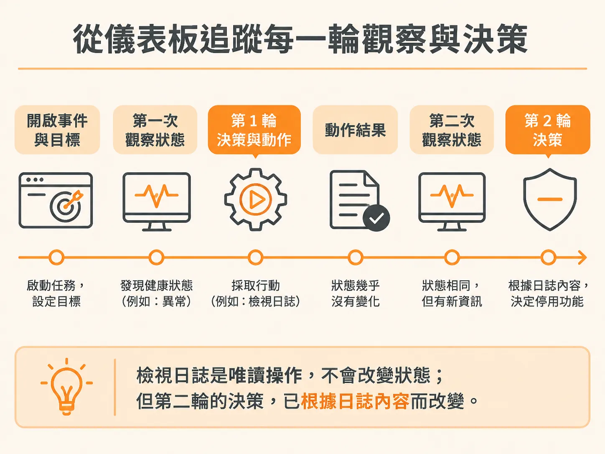
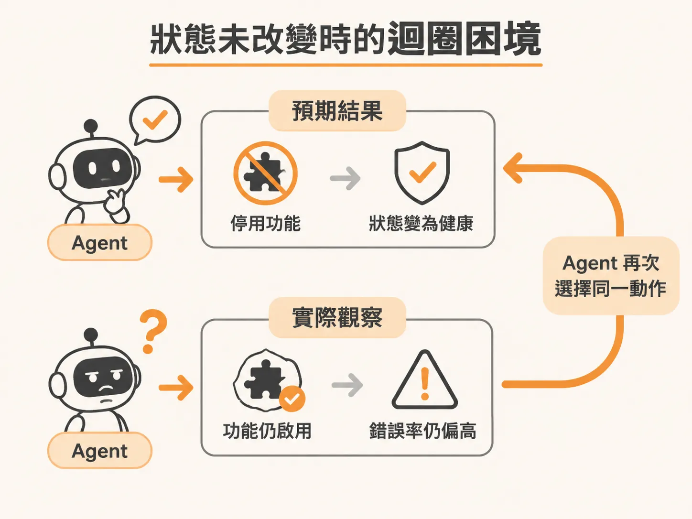
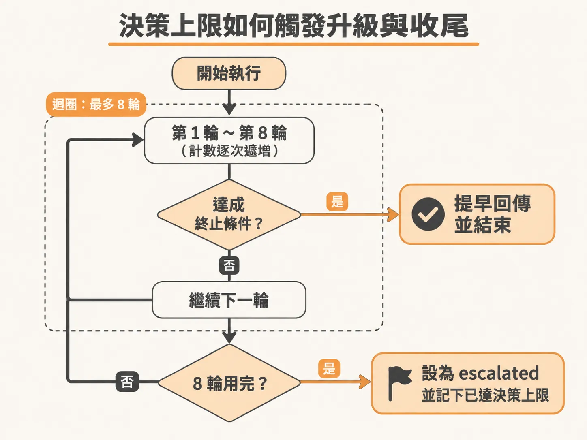

# 決策上限到了

動作能安全執行、世界狀態也會即時更新，最後要確認的是這個迴圈什麼時候該停。當線上服務發出健康警報（例如結帳服務的錯誤率突然竄升至 42%），自動化背景 Agent 會隨即啟動調查。在系統的活動摘要（Activity Feed）或儀表板上，你可以清楚看到 Agent 為了修復服務所展開的一輪輪觀察與行動；但如果問題遲遲無法排除，這場自動調查該如何安全收尾？

## 從儀表板追蹤每一輪觀察與決策

Agent 的運作本質上是一個反覆進行的迴圈。在儀表板中，每一次執行（Run）都會從觸發事件與既定目標開始展開記錄：

1. **觀察目前狀態（Observe）**：在每一輪迭代開頭，Agent 會先取得系統當前的健康度物件，包含服務狀態（如 degraded）、錯誤率、目前版本以及功能旗標的開關狀態。
2. **預測並決定下一步（Predict）**：根據收集到的狀態與系統允許的動作清單，Agent 決定此時最適當的處置。例如第一輪通常會先決定檢視日誌（inspect logs）。
3. **執行動作（Act）**：呼叫對應的工具並記錄執行結果。

像檢視日誌這類動作屬於唯讀操作，不會改變系統本身的狀態。當 Agent 完成日誌讀取並進入第二輪時，它會再次觀察狀態；這時狀態與前一輪大致相同，但 Agent 已經從日誌中得到新資訊（例如確認是某個剛啟用的結帳功能引發錯誤），進而決定採取實質處置，例如停用該功能。



## 狀態未改變時的迴圈困境

在設計工具迴圈時，能改變系統狀態的操作必須如實反映在下一輪的狀態觀察中。

如果 Agent 執行了停用功能的操作，但在下一輪觀察時，系統狀態依然顯示該功能處於啟用、錯誤率依舊居高不下，Agent 就會陷入困惑。對它而言，它確信自己執行了解法，但眼前的現實卻毫無起色。這時 Agent 很可能會在下一輪繼續選擇停用相同功能，甚至連續好幾輪都在重複同一個決定。



如果沒有限制，這種無法打破僵局的迴圈就會持續運作，耗費資源卻毫無進展。

## 決策上限如何觸發升級與收尾

為避免無止境的嘗試，迴圈必須設定決策次數上限（例如最多迭代 8 次）。

在正常的執行流程中，如果問題順利修復並確認健康，或者 Agent 主動判定需要轉交人工，流程就會在迴圈內部透過提早回傳（return）宣告完成並終止。但如果每一輪的處置都未達到終止條件，計數器就會一路遞增，直到耗盡所有輪次並跳出迴圈。



跳出迴圈之後的收尾邏輯如下：

<!-- source: sources/background-agent/20261105/server/agent-workflow.ts#L196-L216 -->

```typescript
      if (result.stale === true) {
        await step.run(`stale-action-${cycle}`, () =>
          logAgentActivity(
            environmentId,
            runId,
            'act',
            'Action rejected because service state changed',
            result,
          ),
        )
        continue
      }
      await step.run(`settle-status-${cycle}`, () =>
        setRun(runId, 'waiting', 'Waiting briefly before observing the effect'),
      )
      await step.sleep(`settle-${cycle}`, process.env.AGENT_SETTLE_DELAY ?? '1s')
    }

    await step.run('stop-at-limit', () => setRun(runId, 'escalated', 'Decision limit reached'))
```

當所有迴圈次數都用完時，程式碼便會落到迴圈最底部的步驟。這裡會將該次執行的狀態更新為 `escalated`（已升級），並附上訊息「Decision limit reached」（已達決策上限）。這代表 Agent 已窮盡所有允許的自主嘗試次數，系統正式結束自動化調查，並將事件升級交由工程團隊接手排查。
