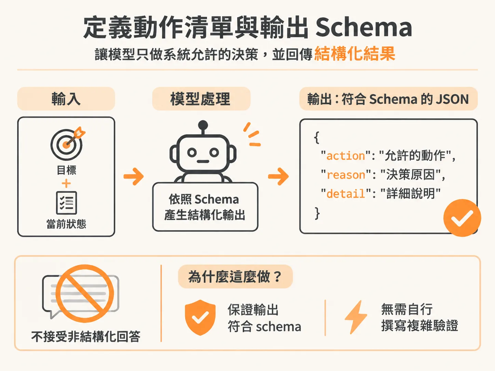
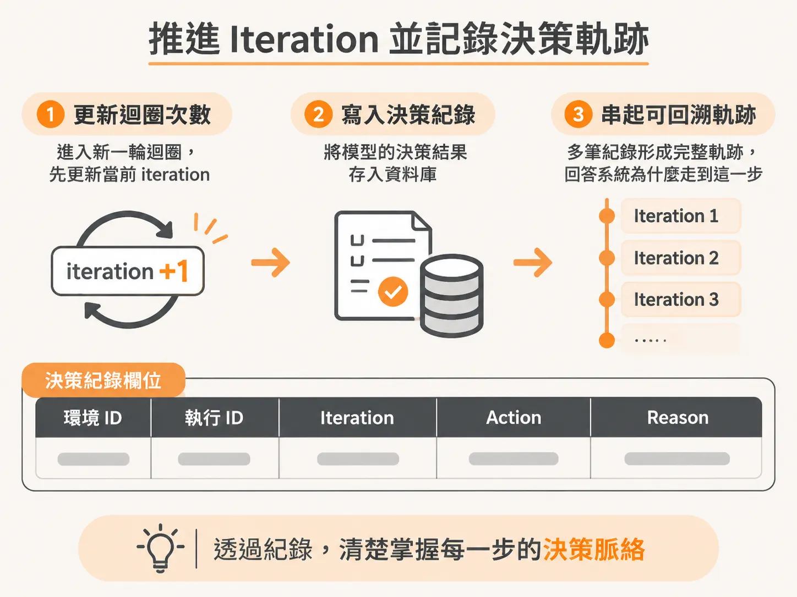
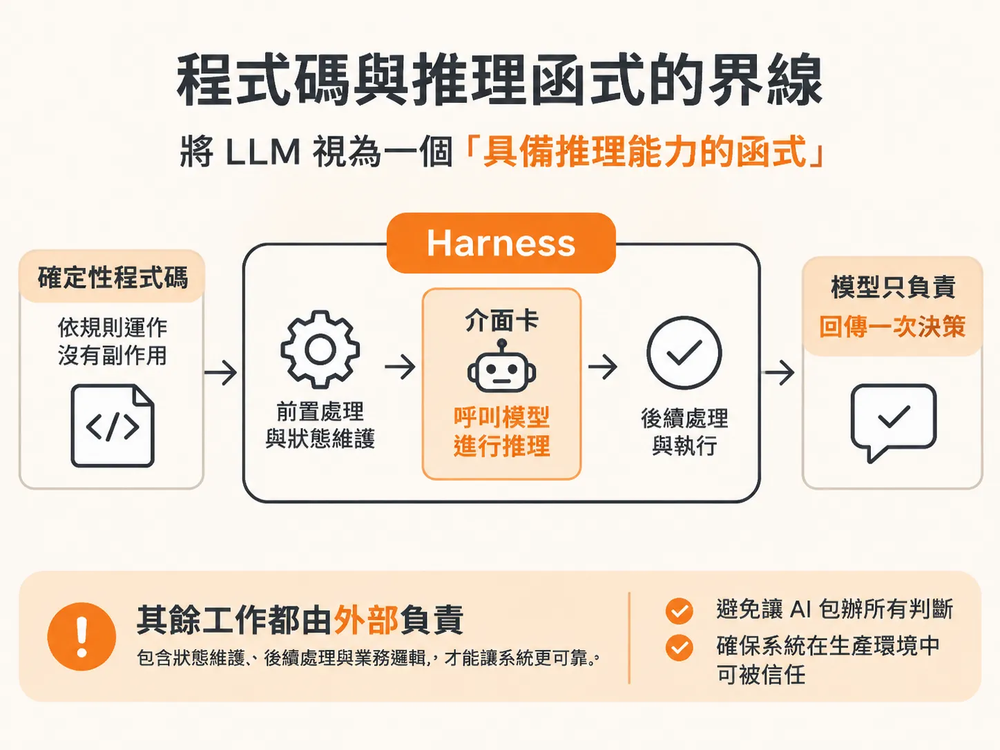

# 用結構化輸出做單步決策：記錄 Action、Reason 與 Iteration

有了由事件觸發的工作流程外殼，接著看它每一輪如何向模型要一次決策。在背景運行的 Incident Agent 中，如果確定性的目標條件尚未滿足，系統就必須決定下一步該做什麼。這時可以呼叫大型語言模型（LLM）來做出決策，但背景 Agent 的運作方式與一般的聊天機器人有很大不同。

在這種架構裡，LLM 其實是整個系統中相對單純的一環。系統不需要像聊天機器人那樣維持多輪對話歷史（不會傳遞 `messages` 陣列），每次呼叫都是完全無狀態的單次呼叫（one-off call）。我們只把當前的目標與環境狀態交給模型，讓它單純扮演「推理函式（reasoning function）」的角色：評估現況、挑出下一步動作，接著把控制權交回給外部的包裹程式（harness）。在實務上，呼叫模型往往最容易，真正複雜的是外圍 harness 如何管理狀態、限制行為並記錄每一步軌跡。

## 定義動作清單與輸出 Schema

為了確保模型只做出系統允許的決策，我們不讓模型自由回答文字，而是要求它回傳符合結構化輸出（Structured Outputs）規範的 JSON 物件。現代前沿模型已經過專門微調，能保證回傳的資料形狀完全符合提供的 schema，開發者不需要再自行撰寫複雜的格式驗證。



決策需要三個關鍵欄位：
1. `action`：必須是系統預先定義好的動作清單之一。
2. `reason`：選擇該動作的簡短理由。
3. `detail`：補充細節（例如向操作員求助時提出的問題）。

系統定義的動作列舉如下：

<!-- source: sources/background-agent/20261109/supplement/shared/types.ts#L1-L13 -->

```typescript
export const ACTIONS = [
  'inspect_logs',
  'inspect_changes',
  'disable_feature',
  'rollback_release',
  'request_help',
  'complete',
  'wait',
] as const
export type ActionName = (typeof ACTIONS)[number]

export type WorldState = Record<string, unknown>
export type GoalCondition = { path: string; equals: string | number | boolean } | null
```

在決策函式中，我們透過 schema 限制模型的輸出格式，並給予清楚的角色規範與觀察到的狀態：

<!-- source: sources/background-agent/20261109/supplement/server/agent-brain.ts#L1-L41 -->

```typescript
const decisionSchema = z.object({
  action: z.enum(ACTIONS),
  reason: z.string(),
  detail: z.string(),
})

...

export async function chooseAction(goal: string, state: AgentState): Promise<Decision> {
  const result = await generateText({
    model: model(),
    output: Output.object({ schema: decisionSchema }),
    system: `You are a background incident agent for a checkout service.
Choose exactly one action. The harness validates it and controls execution.
...
Use request_help when an external dependency cannot be fixed by your local tools.
Use wait when no safe local action remains; a later service event can wake this same incident run.
An alert is a trigger, not authoritative evidence. An answered help request does not prove recovery.
Use complete only when the configured goal is satisfied, or when no deterministic goal condition is configured and you can justify completion.
Keep reason to one short sentence. Put a question to the operator in detail for request_help; otherwise detail may be empty.`,
    prompt: `Goal: ${goal}\n\nCurrent observed state:\n${JSON.stringify(state, null, 2)}`,
  })
  return result.output
}
```

每次模型回傳時，我們就能確定拿到一個包含 `action`、`reason` 與 `detail` 的標準 JSON 物件。

## 推進 Iteration 並記錄決策軌跡

取得決策後，必須在 harness 中進行狀態維護。這一步代表流程又進入了一個新的迴圈，因此要先更新當前的 iteration（或稱 cycle），隨後立即把模型的決策結果寫入資料庫：



<!-- source: sources/background-agent/20261109/supplement/server/agent-workflow.ts#L93-L97 -->

```typescript
      const decision = await step.run(`choose-action-${cycle}`, () => chooseAction(run.goal, state))
      await step.run(`set-iteration-${cycle}`, () => setIteration(runId, cycle))
      await step.run(`record-decision-${cycle}`, () =>
        recordDecision(environmentId, runId, cycle, decision.action, decision.reason),
      )
```

寫入紀錄由專屬函式處理，把環境 ID、執行 ID、iteration 以及模型挑選的動作與原因一併存檔：

<!-- source: sources/background-agent/20261109/supplement/server/agent-data.ts#L139-L154 -->

```typescript
export async function recordDecision(
  environmentId: string,
  runId: string,
  iteration: number,
  action: string,
  reason: string,
) {
  await logAgentActivity(environmentId, runId, 'loop', `Decision cycle ${iteration}`, { iteration })
  await logAgentActivity(
    environmentId,
    runId,
    'predict',
    `Selected ${action.replaceAll('_', ' ')}`,
    { iteration, action, reason },
  )
}
```

儲存決策雖然不會直接改變當前系統的運算結果，卻是背景任務不可或缺的防護。聊天機器人出錯時，使用者可以向上滾動看對話紀錄；但背景運行的 Agent 沒有聊天介面，如果沒有在每一步清楚記下當時做出的決策、理由與執行動作，日後若發生非預期的偏差，工程師將完全無法追溯「系統是如何走到這一步的」，自然也無法做出改善。

## 程式碼與推理函式的界線

在 harness 的設計理念中，LLM 就像一個普通的函式，只是它具備推理能力。一般撰寫的程式碼都是沒有副作用的確定性函式（deterministic functions），只有在真正需要思考、無法用規則簡單描述的地方，才切出介面讓 LLM 介入。如果試圖讓 AI 包辦所有路徑與判斷，系統在生產環境中將難以被信任。



一個常見的疑問是：檢查目標是否達成（is goal satisfied），難道不需要讓 LLM 來判斷嗎？

答案取決於情境。在多數服務異常處理的背景 Agent 中，狀態本身是一個清楚的物件，身為領域專家的開發者清楚知道什麼是「健全狀態」。例如：
- 服務版本回滾成功，狀態欄位為 `rollback_release: true`。
- 特定異常功能被關閉後，錯誤指標不再上升。

這類判斷只需要用簡單的確定性規則檢查狀態路徑與值即可，不需要耗費模型資源。不同領域的 Agent，其狀態定義差異極大：
- 瀏覽器 Agent 的狀態可能是網頁 DOM 搭配標上選取框的截圖。
- 電腦操作（computer use）Agent 的狀態可能是螢幕截圖與滑鼠可點擊的 X、Y 座標。
- 遊戲 Agent 的狀態可能是伺服器回傳的所有玩家位置資料。

定義狀態結構、約定狀態是可變還是只能追加（append-only），往往占去開發最多時間。只有在狀態複雜到無法用規則評估、或規則化成本過高時，才值得將目標檢查看作推理任務，呼叫最新的高階模型進行評估。

## 處理特殊與終止決策

拿到決策並完成記錄後，harness 還必須檢查是否有特殊動作需要即時介入：

- **等待（`wait`）**：模型判斷當前沒有安全的本地動作可執行，選擇等待外部事件喚醒，流程必須進入等待狀態。
- **完成（`complete`）**：如果確定性檢查尚未通過，但模型卻判斷任務已經完成，這是一個極具價值的信號。開發者需要進一步驗證：模型是否正確抓到了規則沒涵蓋到的成功條件？如果是，就該把這項邏輯補回確定性檢查函式中；如果模型判斷錯誤，則代表 prompt 指引可能存在誤導，需要修正。
