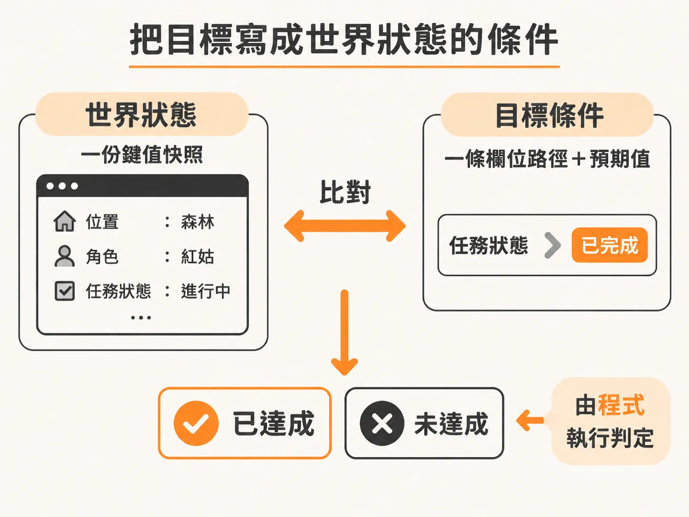
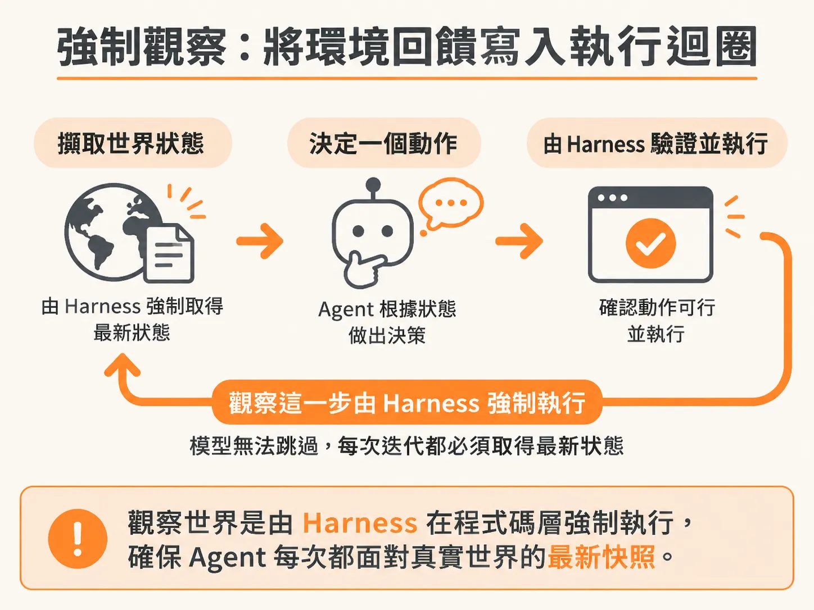
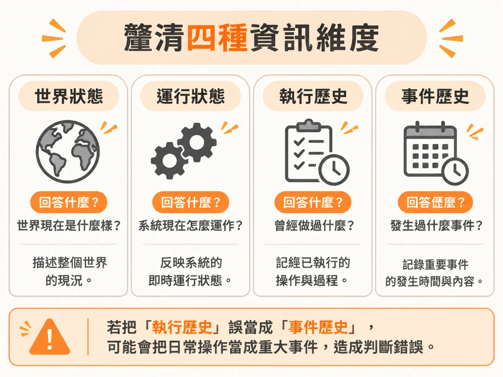
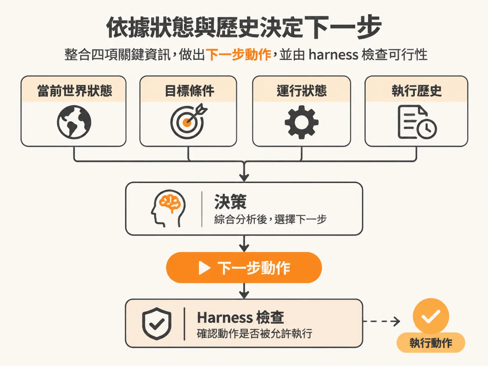

# 以世界狀態定義目標：結合運行狀態與執行歷史引導 Agent 決策

在設計負責監控與維護服務的 Agent 時，我們不必為它建構複雜的虛擬世界。對這類 Agent 而言，「世界」（World）就是目標服務當前的即時狀態。它需要掌握與這項服務相關的所有現況：服務現在是否健康？API 是否持續回傳 200？最近收到的警報有哪些？

這就像開發瀏覽器爬蟲 Agent 或電腦操作（Computer Use）Agent 一樣。要讓這類 Agent 的表現穩定，最直接有效的做法就是讓它看見眼前的事物——也就是直接截圖給它看。如果進一步在截圖上把可互動的元件加上邊框與標籤，Agent 就能自動略過無關的雜訊，專注在能操作的目標上。展示數位世界遠比實體世界容易，而在維運情境中，向 Agent 展示世界的方式，就是將伺服器當前的狀態擷取成一份完整的快照。

### 把目標寫成世界狀態的條件

只要能把世界的全貌攤開在模型面前，並提供清楚的工具與目標，模型就有能力自行推導出修復問題的步驟。但要讓程式能夠自動判斷任務何時結束，我們不能只給模型一段模糊的文字目標，而是要將目標具體表示為針對「世界狀態」的檢驗條件。

在型別設計上，我們可以將世界狀態定義為鍵值結構，並把目標條件明確寫成欄位路徑與預期數值的比對：



<!-- source: sources/background-agent/20261109/supplement/shared/types.ts#L1-L13 -->

```typescript
export const ACTIONS = [
  'inspect_logs',
  'inspect_changes',
  'disable_feature',
  'rollback_release',
  'request_help',
  'complete',
  'wait',
] as const
export type ActionName = (typeof ACTIONS)[number]

export type WorldState = Record<string, unknown>
export type GoalCondition = { path: string; equals: string | number | boolean } | null
```

在實際執行環境中，系統會將預設目標與世界狀態條件關聯起來。例如，將目標條件直接指定為服務健康度欄位必須為健康：

<!-- source: sources/background-agent/20261109/supplement/server/environment.ts#L1-L37 -->

```typescript
import type { GoalCondition } from '../shared/types'

const DEFAULT_GOAL =
  'Investigate checkout incidents, use permitted actions to restore service when possible, ask for human help when needed, verify recovery from fresh state, and record the outcome.'
export const DEFAULT_CONDITION: GoalCondition = { path: 'health.status', equals: 'healthy' }

export function configuredGoal() {
  return process.env.AGENT_GOAL?.trim() || DEFAULT_GOAL
}

...

      state: {},
      goal: DEFAULT_GOAL,
      goalCondition: DEFAULT_CONDITION,
    })
    .returning()
  return created
}
```

有了這種基於狀態條件的設計，Agent 是否達成目標便不再依賴模型自己的主觀陳述，而是能由程式客觀驗證。

### 強制觀察：將環境回饋寫入執行迴圈

在傳統的 Agent 工具迴圈中，常見做法是給模型一組工具與一段 Prompt，讓模型自己決定何時要調用工具去查詢系統狀態。

但在健全的架構中，觀察世界的步驟是由 Harness（執行骨架）在程式碼層次直接鎖定的。每次迴圈啟動時，系統一定會先擷取目標服務的最新狀態並強制餵給 Agent。這不是 Agent 能自由選擇「要不要做」的事情，它無從拒絕，每次迭代都必須面對真實世界的最新快照。



### 釐清四種資訊維度

在讓 Agent 決定下一步時，最容易發生的錯誤就是混淆了不同性質的資訊，例如把警報通知裡的舊資料當成伺服器當前的快照、把過去的觀察誤以為是現況，或是把模型自己提議的預期結果當成已經生效的事實。

為了避免這種混淆，我們必須清楚區分四種不同的資訊維度：



1. **世界狀態（World State）**：目標系統此時此刻的真實數據，例如服務最新回傳的健康指標。
2. **運行狀態（Run State）**：目前這場調查本身的狀態，包括這場任務設定的目標、當前進度與已經做過的決策次數。
3. **執行歷史（Execution History）**：系統至今已經確實執行並完成儲存（Checkpoint）的歷史動作。
4. **事件歷史（Event History）**：記錄外界發出「世界可能已產生變動」的各項通知。

### 依據狀態與歷史決定下一步

每次進入決策時，Agent 會同時參考四項核心資訊：當前的世界狀態、目標條件、運行狀態以及至今為止的執行歷史，以此決定下一步動作（Next Action）。



這些動作並不一定都是直接更動系統的程式碼或設定：

* **終止動作**：確認世界狀態已經滿足目標條件，主動宣告任務完成（`complete`）。
* **等待更多資訊**：當前缺乏足夠徵兆時，先讓自己暫停等待（`wait`）。
* **向人類求助**：在資訊不足或遇到無法處理的異常時主動尋求協助（`request_help`）。
* **深入調查**：調用工具收集更多證據，例如檢查記錄檔（`inspect_logs`）或檢查程式變更（`inspect_changes`）。

當 Agent 選定下一步動作後，Harness 會再次於程式碼層次驗證這個動作是否符合規則、是否允許執行。

這套設計不需要龐大複雜的工具箱。不同於 Claude Code 或 Codex 那類串接大量 MCP 伺服器與外掛技能的環境，這裡只保留極少數且邊界清楚的工具。限制工具數量並在程式端強制實施政策，模型才不會被非受信任的日誌內容牽著走；同時，觀察、規劃與決策的節奏也能維持在每次只走有限的一小步，隨後再次觀察世界，確保修復過程穩定可控。
