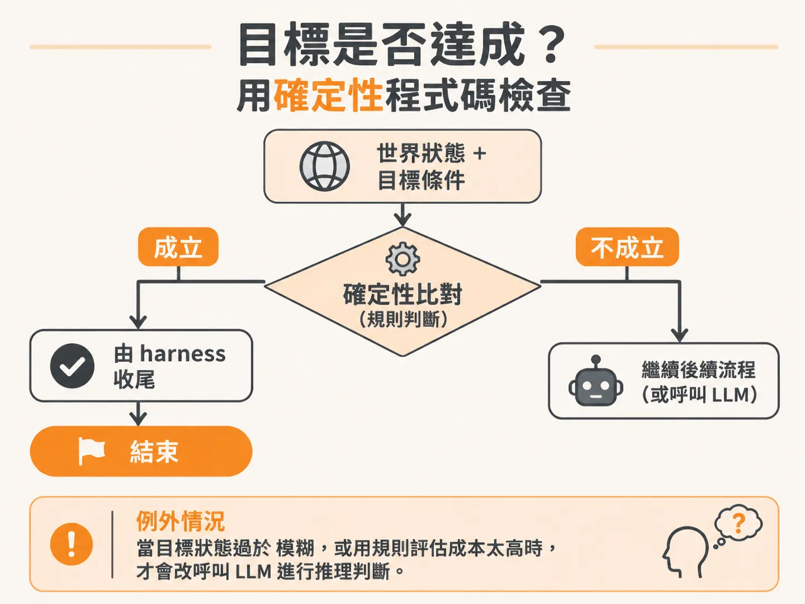
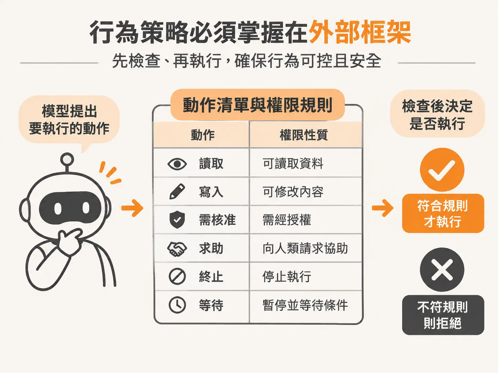

# 掌控 Agent 的骨架：為什麼完成判定與行為策略都屬於 Harness

模型每輪只交回一個結構化決策，那麼最後誰有權把它變成行動、誰來喊停？這正是 harness 的工作。很多人在打造 AI Agent 時，直覺會想把所有決策都丟給模型：讓它決定何時算完成任務、讓它隨意挑選要呼叫的工具。在展示（demo）時這樣做或許能跑出漂亮的結果，但一進到生產環境，往往漏洞百出。這時如果以為「換更強的模型」或「多修幾次提示詞（prompt）」就能解決，就徹底抓錯了方向。

真正的穩定性來自外層的控制框架（harness）。在健全的架構中，大語言模型（LLM）不是全權掌控流程的指揮官，它只是一個在需要時被呼叫一次的「推理函式」（reasoning function）。

## 模型只是一個推理函式

撰寫 harness 的核心思維，是把它當成一般的軟體工程：絕大多數程式碼都是具備確定性（deterministic）、沒有副作用的函式，只有在真正需要「思考判斷」的那個環節，才把資料交給 LLM。

如果你期待 AI 能包辦一切、自己規劃所有路徑，那在目前是不可能在生產環境中獲得可信賴系統的。除非哪天實現了通用人工智慧（AGI），否則把整個流程託付給模型只會帶來不穩定。

在 harness 裡，開發者的工作就是做好家務管理（housekeeping）、設立護欄（guardrails），嚴格限制哪些東西能暴露給模型、哪些不行。這也說明了為什麼模型本身並非競爭護城河——不論是哪家廠商的新模型，很快都會有更強的版本出現。真正讓一個 Agent 具備獨特性與可靠性的，是包覆在模型外面的 harness。

## 目標是否達成？用確定性程式碼檢查

當任務進行到某個階段，系統該如何判斷「目標已經達成」？這件事通常不需要呼叫 LLM，更不用為此浪費額外的 token 來決定下一步。

作為設計系統的領域專家，我們清楚知道一個「好狀態」長什麼樣子。既然狀態往往可以用明確的資料結構表達，就可以直接用確定性函式來比對：

<!-- source: sources/background-agent/20261109/supplement/server/agent-data.ts#L125-L137 -->

```typescript
export function goalSatisfied(state: AgentState, condition: GoalCondition) {
  if (!condition) return false
  const value = condition.path
    .split('.')
    .reduce<unknown>(
      (current, key) =>
        current && typeof current === 'object'
          ? (current as Record<string, unknown>)[key]
          : undefined,
      state.world.state,
    )
  return value === condition.equals
}
```

這段邏輯非常單純：比對狀態物件裡的特定路徑是否等於預期的值。例如，如果目標是回復版本，那就檢查 `rollback_release` 是否為 `true`；若是關閉特定功能，就確認該功能的狀態是否已經恢復正常。

只要比對成立，harness 就會立刻切斷迴圈，執行收尾工作（例如產出報告並將狀態標記為完成）：

- 呼叫 `await writeReport`，帶入目前的目標與狀態，整理過程摘要。
- 呼叫 `await updateRun`，將執行狀態更新為 `completed`，並記錄報告。
- 如果系統後續又收到帶有相同 `runId` 的事件，就能直接判定該執行進入了錯誤狀態，因為該次執行已經確定結束。

只有在一種情況下才需要讓 LLM 參與完成判定：當目前的目標狀態過於模糊，難以用單純的資料欄位或規則評估，或者評估成本太高時，才可能退而求其次，安排一個 LLM 呼叫來做推理判斷。



## 狀態設計是 Harness 的核心難題

不依賴 LLM 做流程控制，意味著開發者必須花費大量時間定義「世界的狀態」（state）。這往往佔據了開發背景 Agent（background agent）的大部分工作：

- 瀏覽器 Agent 的狀態，可能是帶有標記方框的螢幕截圖加上 DOM 結構。
- 電腦操作（computer use）的狀態，可能是螢幕畫面配上滑鼠可點擊的 X、Y 座標。
- 遊戲 Agent 的狀態，可能是伺服器回傳的所有玩家位置資料。

你必須清楚定義狀態的契約（contract）：這個狀態是可變的（mutable）、不可變的（immutable），還是只能附加（append-only）？這些資料結構與契約的設計，完全無關乎 LLM，卻直接決定了 Agent 的骨架是否穩固。

## 行為策略必須掌握在外部框架

除了完成判定，模型能執行哪些動作、各動作具備什麼性質，也必須由 harness 嚴格規範，而不是讓模型自由發揮。這就是行為策略（action policy）的角色：



<!-- source: sources/background-agent/20261109/supplement/server/tool-policy.ts#L1-L15 -->

```typescript
import type { ActionName } from '../shared/types'

// The harness reads policy metadata; it does not branch on checkout fault flags.
export const actionPolicy: Record<
  ActionName,
  'read' | 'write' | 'approval' | 'help' | 'terminal' | 'wait'
> = {
  inspect_logs: 'read',
  inspect_changes: 'read',
  disable_feature: 'write',
  rollback_release: 'approval',
  request_help: 'help',
  complete: 'terminal',
  wait: 'wait',
}
```

透過 policy 定義，每一項動作都有清楚的權限與性質分類（例如單純讀取日誌的 `read`、關閉功能的 `write`、回復版本所需的 `approval`、或是代表終止的 `terminal`）。

harness 讀取這份策略中繼資料來維持執行迴圈，確保模型只能在規定的軌道內推理，而不會越權觸發不可逆的變更。

這是一個高度受控、具備確定性結果的執行迴圈。模型在其中並非主導者，它只是 harness 在特定步驟中所呼叫的推理元件；掌控系統生命週期、目標達成檢查與行為邊界的，始終是外層的 harness。
