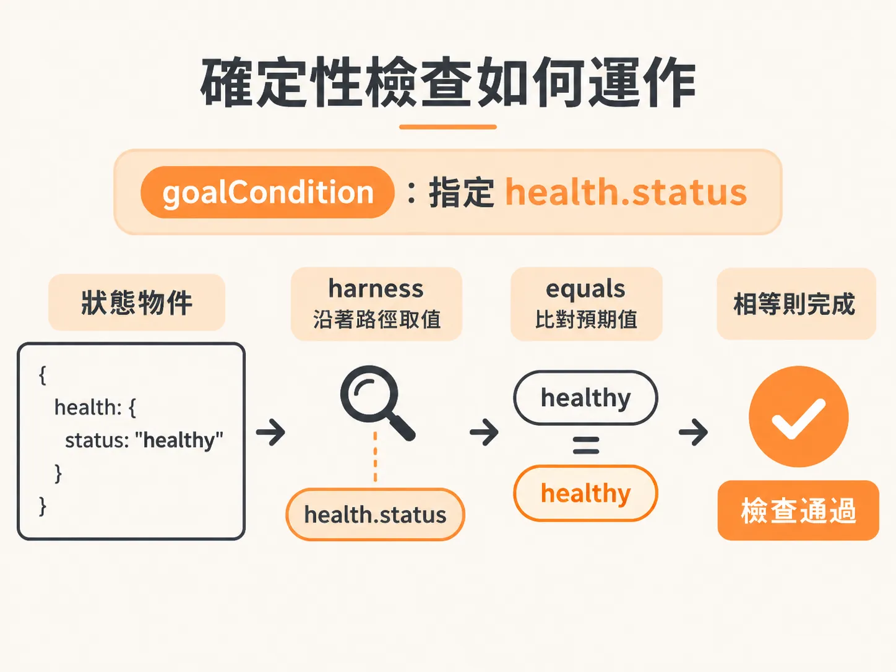
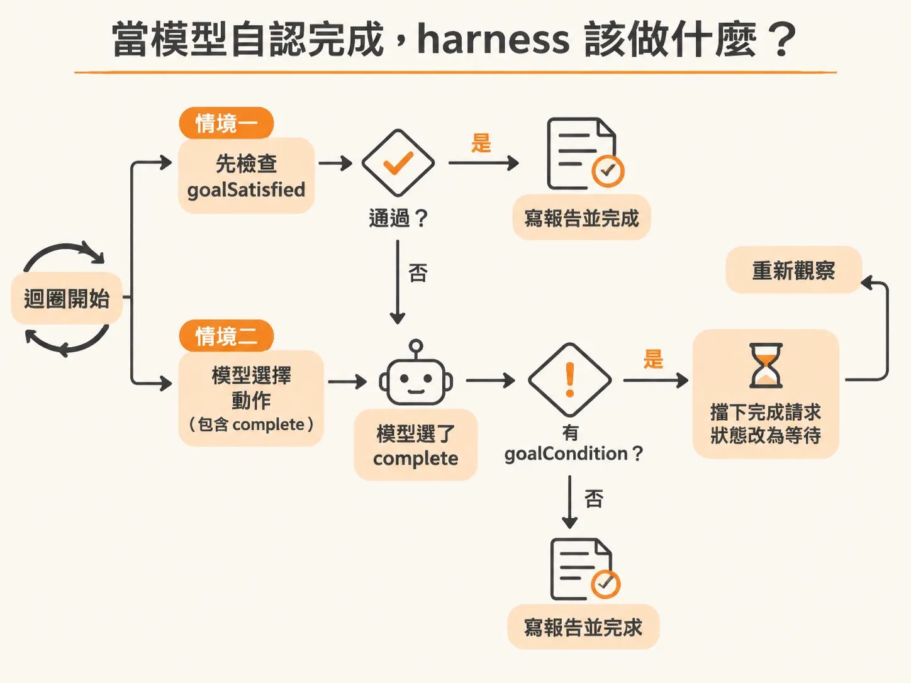
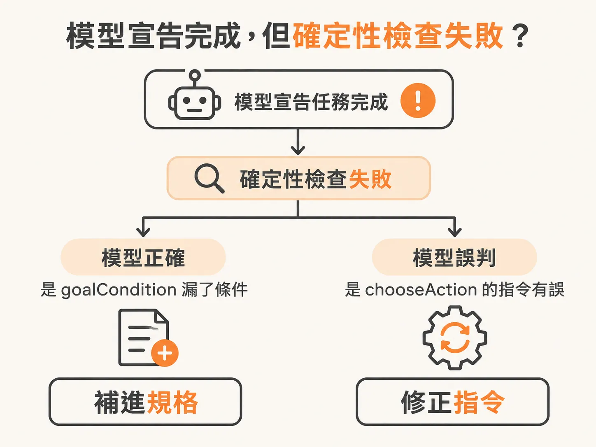

# 目標達標與否，交給確定性檢查

模型每次只做一個決定，那它什麼時候可以宣告結束？打造後台代理人（background agent）時，最容易讓人掉入的陷阱，就是讓大型語言模型自己宣布「我做完了」。

當代理人執行修復操作、重啟服務或切換設定後，模型可能會產生幻覺，或是單純根據局部上下文推斷「事情已經解決」。如果讓模型全權掌握任務是否完成的決定權，系統就很容易在問題尚未真正排除時提早退場。

真正穩健的架構，必須由外層的測試與執行骨幹（harness）來掌握完成判定，並且這個判定必須是確定性的（deterministic）。

## 為什麼不能讓模型單方面決定完成？

在代理人的運作迴圈中，標準流程通常是：觀察當前世界、挑選一個動作、交給 harness 驗證並執行，接著再次觀察。

在這個循環裡，模型挑選出的動作本質上只是一個「結構化的建議」，既不是授權，也不是系統真正修復的證據。如果任務能否結束完全由模型說了算，系統的可靠度就會直接受限於模型的推論穩定度。

因此，harness 必須擁有動作目錄、決策上限，以及最重要的：完成判定的測試權限。領域專家清楚知道系統處於「健康」或「已解決」時，狀態物件裡的欄位應該長什麼樣子。既然如此，這段邏輯就該交給確定性的程式碼來檢查，而不是交給模型猜測。

## 確定性檢查如何運作

在實作上，確定性檢查不需要複雜的推論，而是透過明確的規則比對環境狀態。例如，檢查狀態物件中的某個特定路徑是否等於預期值：



<!-- source: sources/background-agent/20261105/server/agent-data.ts#L125-L137 -->

```typescript
export function goalSatisfied(state: AgentState, condition: GoalCondition) {
  if (!condition) return false
  const value = condition.path
    .split('.')
    .reduce<unknown>(
      (current, key) =>
        current && typeof current === 'object'
          ? (current as Record<string, unknown>)[key]
          : undefined,
      state.world.state,
    )
  return value === condition.equals
}
```

搭配的預設條件可以非常直接，例如確保服務的健康狀態欄位確實回到正常：

<!-- source: sources/background-agent/20261105/server/environment.ts#L7-L13 -->

```typescript
const DEFAULT_GOAL =
  'Investigate checkout incidents, use permitted actions to restore service when possible, ask for human help when needed, verify recovery from fresh state, and record the outcome.'
export const DEFAULT_CONDITION: GoalCondition = { path: 'health.status', equals: 'healthy' }

export function configuredGoal() {
  return process.env.AGENT_GOAL?.trim() || DEFAULT_GOAL
}
```

這段邏輯會在每個循環的最一開始執行。只要系統狀態符合 `goalCondition`，harness 就會認定目標達成，接著撰寫報告並結束執行：

<!-- source: sources/background-agent/20261105/server/agent-workflow.ts#L87-L139 -->

```typescript
      if (goalSatisfied(state, run.goalCondition)) {
        const report = await step.run(`write-report-${cycle}`, () => writeReport(run.goal, state))
        await step.run(`complete-run-${cycle}`, () => setRun(runId, 'completed', null, report))
        return { report }
      }

      const decision = await step.run(`choose-action-${cycle}`, () => chooseAction(run.goal, state))
      await step.run(`set-iteration-${cycle}`, () => setIteration(runId, cycle))
      await step.run(`record-decision-${cycle}`, () =>
        recordDecision(environmentId, runId, cycle, decision.action, decision.reason),
      )

      if (decision.action === 'wait' || (decision.action === 'complete' && run.goalCondition)) {
        if (decision.action === 'complete') {
          await step.run(`reject-completion-${cycle}`, () =>
            logAgentActivity(
              environmentId,
              runId,
              'human',
              'Completion blocked by configured goal condition',
              { condition: run.goalCondition },
            ),
          )
        }
        await step.run(`wait-status-${cycle}`, () =>
          setRun(
            runId,
            'waiting',
            decision.action === 'wait' ? decision.reason : 'Recovery is not verified',
          ),
        )
        let check = 0
        while (true) {
          const latest = await step.run(`read-event-sequence-${cycle}-${check}`, () =>
            getRun(runId),
          )
          if (['cancelled', 'superseded', 'failed'].includes(latest.status)) return
          if (latest.eventSequence > state.eventSequence) break
          check++
          await step.waitForEvent(`wait-for-service-${cycle}-${check}`, {
            event: 'incident/updated',
            if: `async.data.runId == "${runId}"`,
            timeout: '10s',
          })
          // The timeout also reconciles an event that arrived just before the wait.
        }
        continue
      }
      if (decision.action === 'complete') {
        const report = await step.run(`write-report-${cycle}`, () => writeReport(run.goal, state))
        await step.run(`complete-run-${cycle}`, () => setRun(runId, 'completed', null, report))
        return { report }
      }
```

## 當模型自認完成，harness 該做什麼？

在 `agent-workflow.ts` 的迴圈中，有兩種可能觸發完成的情境。第一種是迴圈一開頭的 `goalSatisfied` 通過；第二種則是迴圈往下走，模型自己挑選了名為 `complete` 的動作。



如果程式執行到了挑選動作之後，模型回傳了 `decision.action === 'complete'`，但最上方的 `goalSatisfied` 卻沒有通過，這代表出現了分歧：模型認為沒事了，確定性檢查卻認為目標尚未滿足。

此時 harness 的處理方式不是直接相信模型，而是擋下完成要求：

1. 記錄一筆活動，指出完成請求已被設定的 `goalCondition` 阻擋（`Completion blocked by configured goal condition`）。
2. 將任務狀態改為等待（`waiting`），原因註記為「復原未被驗證」（`Recovery is not verified`）。
3. 進入等待事件或輪詢的狀態，等待系統有新的事件更新，再重新進入下一輪循環。

## 模型宣告完成時，先檢查 goalCondition 少了什麼

當模型認定任務已經完成，但確定性檢查卻失敗時，這是一個極具價值的信號。開發者應該從兩個方向來除錯：



第一，**模型是不是對的？**
如果檢視當時的實際狀態與系統行為，發現服務確實已經完全修復，那問題就不在模型，而是 harness 的確定性檢查寫得太狹隘或遺漏了條件。這時該做的是把模型捕捉到的判斷依據，補回 `goalSatisfied` 或 `goalCondition` 的規格中。

第二，**模型是不是誤判了？**
如果系統根本還沒修好，模型卻說完成了，那往往是因為在挑選動作的提示詞（prompt）或指令不夠精準，誤導了模型的判斷。

無論是哪一種情況，核心原則都不會改變：永遠不要讓模型成為證明自身成功的唯一權威。把完成判定收歸在 harness 的確定性檢查裡，當分歧發生時，回頭檢視 `goalCondition` 到底少了什麼，才能讓後台代理人真正穩定地自動運作。
