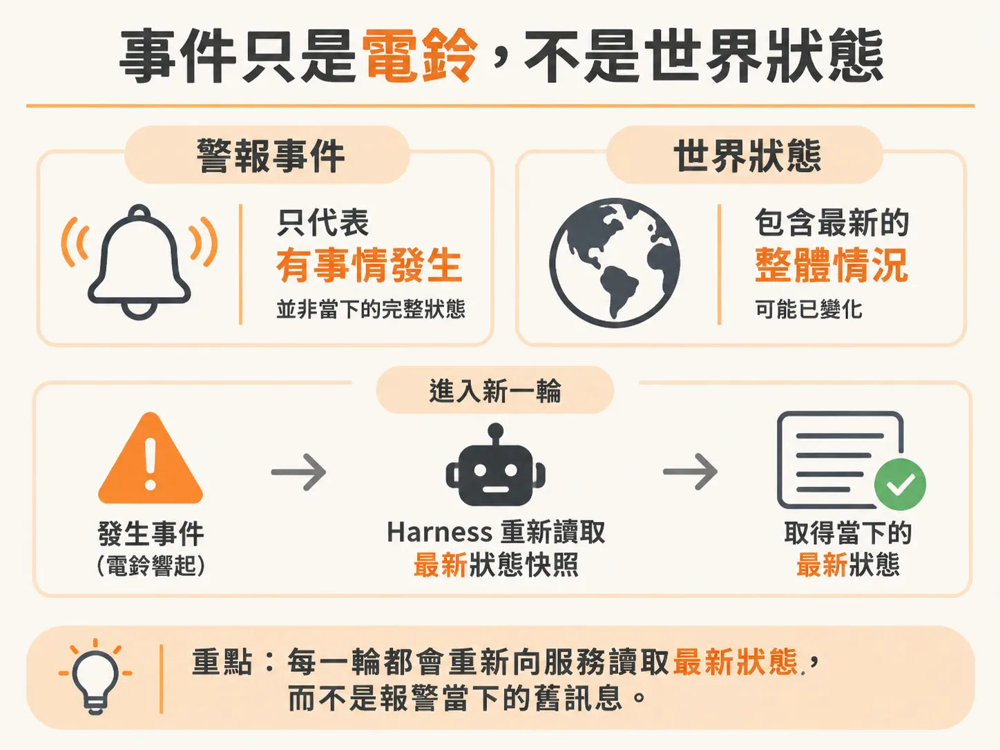
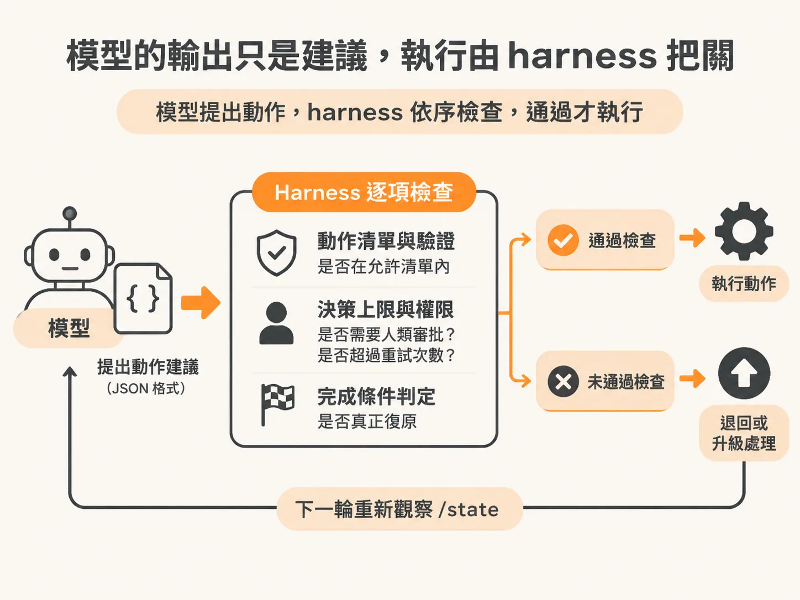

# 觀察 → 決定 → 行動：把觀察內建在 harness

背景代理有了常駐目標之後，下一個問題是它每一輪到底怎麼動。當系統發生故障時，傳統的 AI Agent 做法往往是提供一整套工具（Tools），並在 prompt 裡問模型：「這是剛收到的警報，你想呼叫什麼工具來排查？」

這種設計很快就會遇到問題：模型常常忘記先確認現況，或是把一開始收到的警報內容當作唯一的真相，在沒看過服務最新狀態的情況下就直接下指令重開機。

要讓背景代理人（Background Agent）可靠運作，核心就在於把迴圈的控制權收回給框架（harness），形成一個固定且強制執行的生命週期：

<!-- derived -->

```text
┌──────────────────────────────────────────────┐
│                   Harness                    │
│                                              │
│  [1. 觀察 Observe]                           │
│  讀取 checkout /state、歷史事件與人類決策       │
│                     │                        │
│                     ▼                        │
│  [2. 決定 Decide]  (呼叫模型)                │
│  依據目標、歷史與當前狀態，產出一個結構化動作提案 │
│                     │                        │
│                     ▼                        │
│  [3. 行動 Act]                               │
│  由 harness 驗證限制、檢查授權並執行           │
│                     │                        │
│                     └────► 回到 [1. 觀察]     │
└──────────────────────────────────────────────┘
```

## 事件只是電鈴，不是世界狀態

在伺服器發出警報時，常犯的錯誤是直接拿警報內容（alert payload）當作推論依據。

警報只是一聲「電鈴」，代表有事情發生了，它本身並不是當下的世界狀態。當代理人啟動或進入新的一輪時，伺服器可能早就被別的機制重開、可能故障已經擴大，也可能已經自我修復。



如果依賴模型自己決定何時呼叫查詢工具，模型很可能會根據上一輪的記憶自行推測，甚至跳過查詢。因此在 harness 的設計中，**觀察不是模型的一個選項，而是 harness 在每輪迴圈硬性執行的工作**。

在呼叫模型前，harness 的程式碼會主動向外部服務（例如結帳服務的 `/state` API）索取當前快照，連同處理目標、過往動作歷史與人類核准紀錄打包好，強制「餵」（force feed）給模型。模型沒有選擇「不看」的權利，每一輪它看到的都是真實系統的最新截面。

## 模型的輸出只是建議，執行由 harness 把關

在這個架構下，模型負責的是「決定」（Decide）：在已知目標與最新環境狀態下，給出下一個結構化動作提案。

模型輸出的 JSON 動作只是格式合規的建議，既不代表它已經獲得授權，也不代表系統已經修復。 harness 必須掌控邊界：
- **動作清單與驗證**：檢查模型選的動作是否在允許清單內。
- **決策上限與權限**：動作是否需要人類審批？是否超過重試次數上限？
- **完成條件判定**：系統是否真正復原，不由模型自說自話，而是由 harness 在下一輪重新觀察 `/state` 時進行驗證。



把「觀察」與「驗證」牢牢鎖在 harness 裡，模型就能專注在面對不確定性時挑選最合適的下一步，而不會因為妄想或幻覺脫離系統現況。
