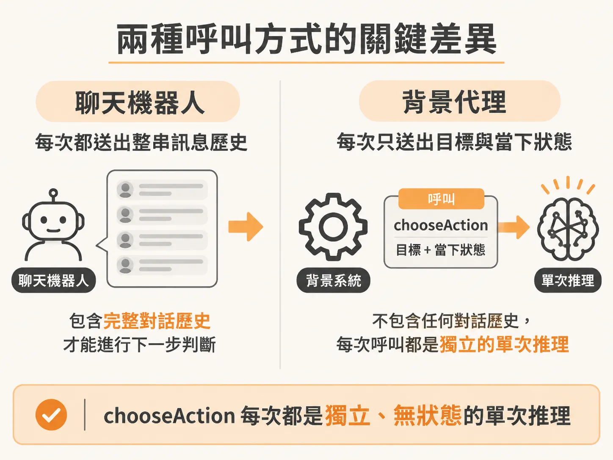
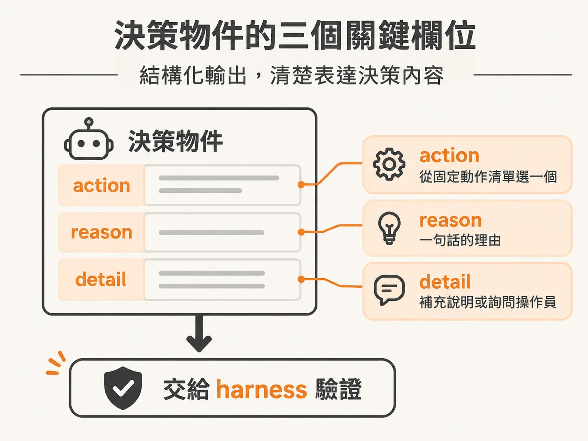
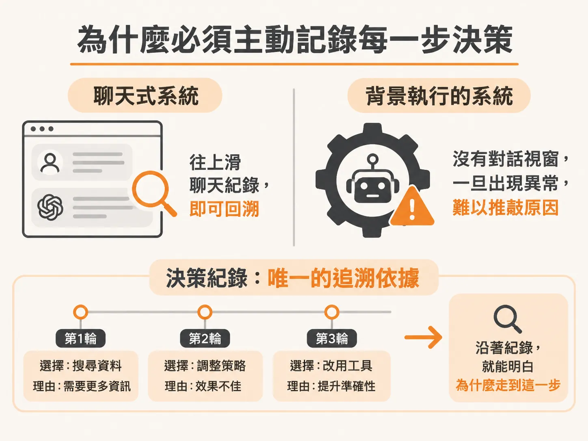

# 一次性的呼叫，無狀態的決策

餵給模型的四種資訊裡，真正進入決策的其實只有目標與世界狀態。在開發聊天機器人時，通常會維護一個訊息陣列，把使用者與系統過去的對話歷史一併送給語言模型，讓對話能夠來回延續。但在後台自主運行的代理人（Agent）架構中，決策流程截然不同：模型不是在跟你聊天，它只負責在單一步驟中做出推理判斷，決定下一步該做什麼。

這意味著負責決策的函式可以完全保持無狀態（stateless）。

## 沒有對話紀錄的單次推理

當背景系統發現當前目標尚未達成，需要決定下一步時，會呼叫 `chooseAction` 函式。這個呼叫完全是單次、一次性的請求（one-off call），不包含任何聊天訊息歷史。



每一次呼叫，系統只會餵給模型兩項核心資訊：
1. 目前要達成的目標（goal）
2. 系統此刻觀察到的世界狀態（state）

模型不需要知道五分鐘前誰對它說了什麼，它唯一的任務就是在給定的目標與現況下，挑出下一步動作。在整個代理人架構中，模型只是負責做推理選擇的元件，外部的調度骨幹（harness）才是控制執行流程與驗證安全的核心。

<!-- source: sources/background-agent/20261105/server/agent-brain.ts#L8-L41 -->

```typescript
const decisionSchema = z.object({
  action: z.enum(ACTIONS),
  reason: z.string(),
  detail: z.string(),
})

type Decision = { action: ActionName; reason: string; detail: string }

function model() {
  const id = process.env.OPENAI_MODEL
  if (!process.env.OPENAI_API_KEY || !id) {
    throw new Error('Set OPENAI_API_KEY and OPENAI_MODEL in .env before starting an agent run')
  }
  return openai(id)
}

export async function chooseAction(goal: string, state: AgentState): Promise<Decision> {
  const result = await generateText({
    model: model(),
    output: Output.object({ schema: decisionSchema }),
    system: `You are a background incident agent for a checkout service.
Choose exactly one action. The harness validates it and controls execution.
Available actions: inspect_logs, inspect_changes, disable_feature, rollback_release, request_help, complete, wait.
The current service state and recent incident history have already been observed. Inspect detailed logs or changes when needed before changing the service.
Choose the service action you think is justified; the harness applies its own policy before execution.
Use request_help when an external dependency cannot be fixed by your local tools.
Use wait when no safe local action remains; a later service event can wake this same incident run.
An alert is a trigger, not authoritative evidence. An answered help request does not prove recovery.
Use complete only when the configured goal is satisfied, or when no deterministic goal condition is configured and you can justify completion.
Keep reason to one short sentence. Put a question to the operator in detail for request_help; otherwise detail may be empty.`,
    prompt: `Goal: ${goal}\n\nCurrent observed state:\n${JSON.stringify(state, null, 2)}`,
  })
  return result.output
}
```

## 透過結構化輸出規範決策內容

為了讓調度系統能穩定解析模型的推理結果，呼叫時必須使用結構化輸出（structured outputs）。這不是讓模型自由發揮回傳普通文字，而是透過指定的 Schema 強制模型回傳符合特定規格的 JSON 物件。現代頂尖模型經過微調後，能保證產出的資料結構符合約束，免去手動解析字串或檢查欄位的麻煩。

在決策物件中，主要包含三個關鍵欄位：



- **action**：從預先定義的動作清單（例如檢查日誌、回滾發布或請求協助等）中，精確選出一個動作名稱。
- **reason**：簡短說明選擇這個動作的核心理由，限制為一句話，便於快速閱讀。
- **detail**：補充具體細節。例如當模型選擇請求人類協助時，可以將需要詢問操作員的問題寫在 detail；若不需要額外細節則可留空。

呼叫完成後，系統拿到的就是乾淨的決策資料，能立即交給外層骨幹進行策略驗證與執行。

## 為什麼必須主動記錄每一步決策

在一般的對話介面中，如果系統做出奇怪的回答，只要往上滑動看聊天紀錄，就能看出一路上的上下文脈絡。然而在背景靜默運行的系統沒有對話視窗，如果模型偏離預期或是採取了意外的舉動，事後很難憑空推敲它當初為何這麼做。



因此，每當模型回傳決策，系統都必須明確記錄當下的循環輪次（iteration）、選擇的動作與理由：

<!-- source: sources/background-agent/20261105/server/agent-data.ts#L139-L154 -->

```typescript
export async function recordDecision(
  environmentId: string,
  runId: string,
  iteration: number,
  action: string,
  reason: string,
) {
  await logAgentActivity(environmentId, runId, 'loop', `Decision cycle ${iteration}`, { iteration })
  await logAgentActivity(
    environmentId,
    runId,
    'predict',
    `Selected ${action.replaceAll('_', ' ')}`,
    { iteration, action, reason },
  )
}
```

將決策寫入資料庫雖然不會改變當下系統的運作行為，但它留下了完整的稽核紀錄（audit log）。這讓維運人員在儀表板上能清楚看見代理人每一輪決策的推導過程；一旦執行過程出現偏差，也能回溯特定時間點的判斷依據，作為日後調校提示詞與流程的重要基礎。
