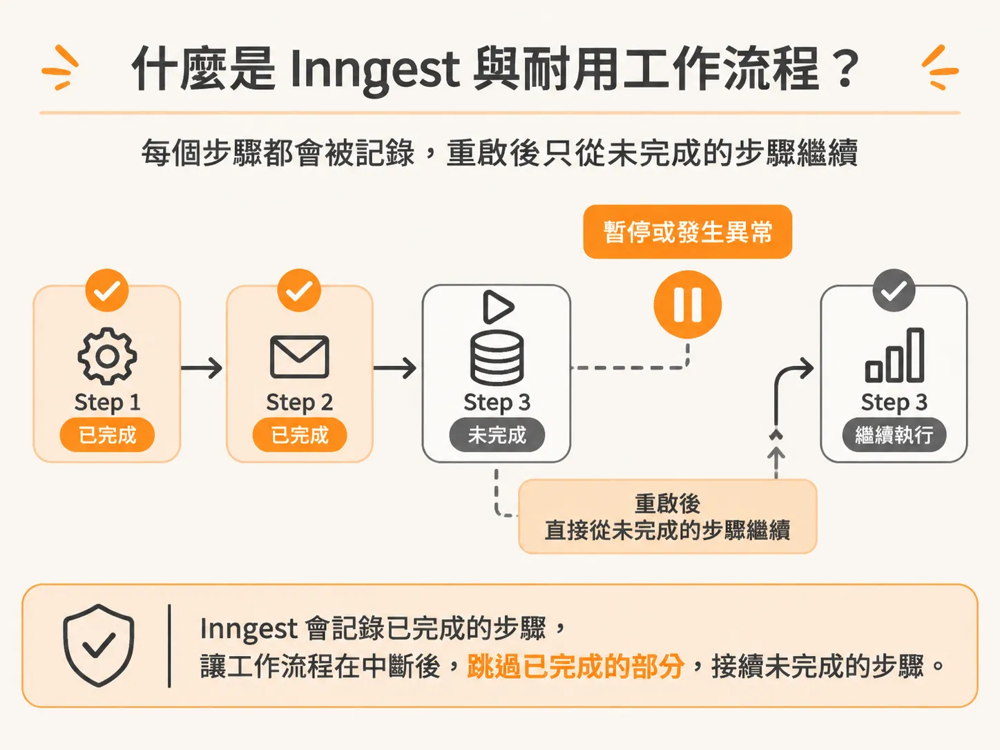
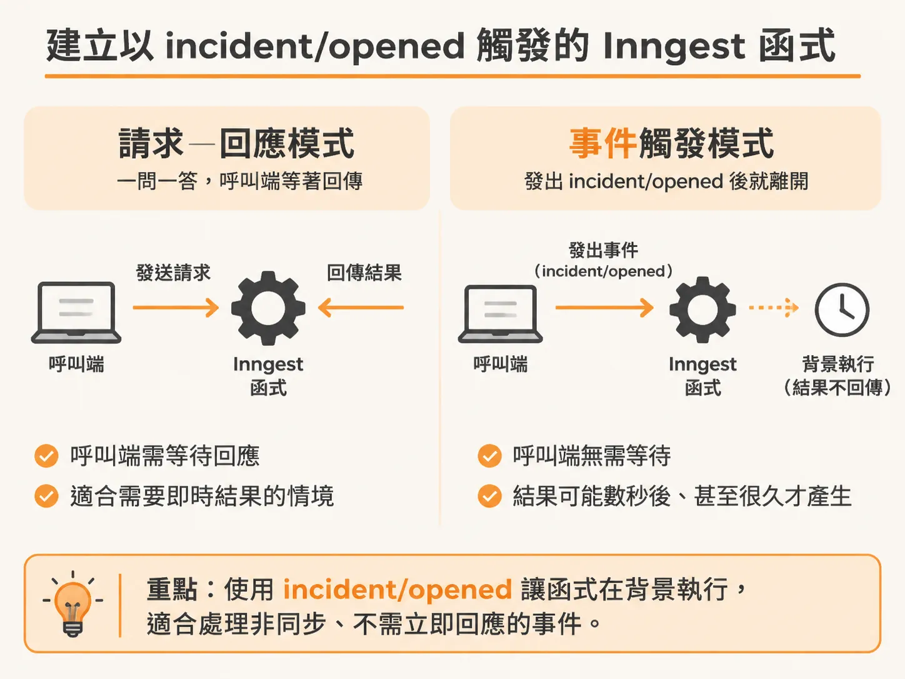
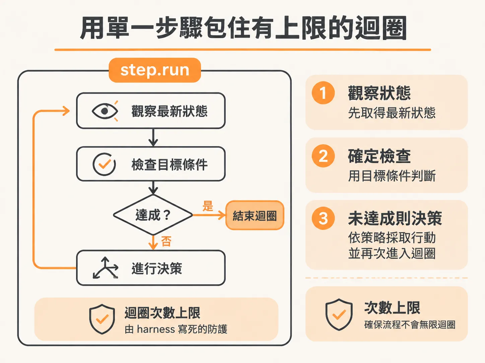

# 建立事件觸發的 Inngest 背景 Agent 工作流程

把目標寫成世界狀態條件之後，下一個問題是：誰來反覆檢驗這道條件？這就需要一個能長時間運作的外殼。建置在背景自主運行的 Agent，面臨的執行環境與一般的對話式機器人完全不同。聊天機器人採用傳統的「請求—回應」（Request-Response）模式，使用者發出請求，API 伺服器處理完後立刻回傳結果；但在系統巡檢或事故調查的場景中，Agent 必須以「觸發後不理」（Fire-and-forget）的方式在背景長時間運作。這類任務可能耗時數分鐘、數小時，甚至需要等待外部事件喚醒，傳統無狀態的 API 架構很容易因為逾時或重開機而中斷。

要讓背景任務能穩定運行，就需要耐用執行環境（Durable Execution Runtime）來管理狀態與流程。

## 什麼是 Inngest 與耐用工作流程？

Inngest 的核心精神是「堅不可摧的 Agent，隱形無感的基礎架構」（Unbreakable agents, invisible infra）。它提供了一套開箱即用的分散式運算架構，讓開發者能將程式碼拆解成獨立的步驟（steps）。

在 Inngest 的機制中，每個步驟在執行後都會被記錄並快取（memoized）。當工作流程需要暫停等待外部事件、或是中途發生異常重試時，系統不必從頭重跑整個函式，而是能直接跳過已完成的步驟，從中斷處恢復。



這就像開發銀行轉帳系統：傳統作法是手動包裝交易邏輯，一旦某個環節失敗就必須自己寫繁瑣的 rollback 復原程式碼；但如果有耐用執行環境，系統會清楚記錄執行到哪一步，失敗時能明確看到位置並安全接續，大幅增加架構的彈性。

市場上雖然還有 Cloudflare、Vercel 等平台提供的類似工作流程方案，各有不同的應用場景，但 Inngest 的開發者體驗（DX）相對直覺簡潔，非常適合作為長期在背景執行的 Agent 骨幹。

## 準備工作流程所需的資料輔助函式

在進入 `server/agent-workflow.ts` 建立流程之前，需要先備齊管理狀態與記錄歷程的輔助函式：

- `getRun`：根據 `runId` 查詢已經啟動的調查，方便接續先前留下的脈絡。

<!-- source: sources/background-agent/20261109/supplement/server/agent-data.ts#L10-L14 -->

```typescript
export async function getRun(runId: string) {
  const [run] = await db.select().from(runs).where(eq(runs.id, runId)).limit(1)
  if (!run) throw new Error('Agent run not found')
  return run
}
```

- `agentState`：用來觀察目前環境與系統的最新狀態。

<!-- source: sources/background-agent/20261109/supplement/server/agent-data.ts#L63-L121 -->

```typescript
export async function agentState(environmentId: string, runId: string) {
  const [world, run, recentEvents, recentActions, recentApprovals] = await Promise.all([
    getLatestState(),
    getRun(runId),
    ...
  ])
  const state = {
    environmentId,
    eventSequence: run.eventSequence,
    world,
    events: recentEvents.map((item) => ({
      type: item.type,
      data: item.data,
      at: item.createdAt.toISOString(),
    })),
    ...
  }
```

- `goalSatisfied`：檢查當前環境是否已經達到預期目標。這是背景 Agent 的一大優勢：我們可以採用確定性（deterministic）的方式直接比對物件狀態，而不必凡事都交給大型語言模型（LLM）去判斷。例如伺服器回應 500 代表異常，200 代表正常，只要比對物件欄位是否已恢復正常，就能立刻判定目標是否達成。只有在語意模糊的情境下，才需要回頭詢問模型。

<!-- source: sources/background-agent/20261109/supplement/server/agent-data.ts#L125-L137 -->

```typescript
export function goalSatisfied(state: AgentState, condition: GoalCondition) {
  if (!condition) return false
  const value = condition.path
    .split('.')
    .reduce<unknown>(
      (current, key) =>
        current && typeof current === 'object'
          ? (current as Record<string, unknown>)[key]
          : undefined,
      state.world.state,
    )
  return value === condition.equals
}
```

- `recordDecision`：記錄 AI 決定要採取的行動。
- `recordToolAction`：當測試架構（harness）驗證並實際執行工具動作後，將該行為記錄下來。
- `setIteration`：計算 Agent 當前的迴圈次數，作為系統可觀測性（observability）的指標。
- `setRun`：更新調查執行的最新狀態。
- `chooseAction`：從 Agent 大腦模組導入的核心決策邏輯。
- `writeReport`：Agent 在調查結尾撰寫總結報告所使用的工具。
- `checkoutServiceUrl`：從觀測模組中導入待檢查服務的 URL（本機開發時需注意埠號設定是否正確）。

先前範例中暫時使用的獨立 `setRun` 邏輯已經不再需要，可以直接清除，改由統一的模組提供。

## 建立以 incident/opened 觸發的 Inngest 函式

在 Inngest 中建立工作流程非常直覺，只要呼叫 `inngest.createFunction`，指定函式的唯一 ID、可讀名稱以及觸發條件即可。

背景 Agent 依賴分散式事件進行溝通，因為發出事件後我們不知道結果何時產生，回應可能在幾秒後、甚至很久之後才會抵達。在這裡，我們宣告監聽 `incident/opened` 事件：



<!-- source: sources/background-agent/20261109/supplement/server/agent-workflow.ts#L58-L92 -->

```typescript
export const incidentAgent = inngest.createFunction(
  {
    id: 'incident-agent',
    name: 'Checkout incident agent',
    triggers: { event: 'incident/opened' },
    retries: 2,
    cancelOn: [{ event: 'agent/run.cancelled', match: 'data.runId' }],
    // This limits executing steps, not the number of waiting incidents.
    concurrency: { limit: 1, key: 'event.data.environmentId' },
    onFailure: async ({ error, event }) => {
      const original = event.data.event as { data?: { runId?: string } }
      if (original.data?.runId) await setRun(original.data.runId, 'failed', error.message)
    },
  },
  async ({ event, step }) => {
    const { environmentId, runId, instanceId } = event.data
    const run = await getRun(runId)
    if (
      run.instanceId !== instanceId ||
      ['completed', 'failed', 'cancelled', 'escalated', 'superseded'].includes(run.status)
    )
      return
...
```

一旦系統接收到 `incident/opened` 事件，Inngest 就會在背景排程喚起此函式，並傳入事件酬載與步驟控制器 `step`。

## 用單一步驟包住有上限的 observe 迴圈

工作流程中的 `step` 可以視為一個個檢查點（checkpoint）。只要同一個 run 再次執行，已完成的 checkpoint 就不會重複計算。

在架構初期，為了循序漸進驗證流程，我們先用一個粗粒度的 `step.run` 把整個迴圈包起來：



<!-- derived -->

```typescript
export const incidentAgent = inngest.createFunction(
  {
    id: 'incident-agent',
    name: 'Checkout incident agent',
    triggers: { event: 'incident/opened' },
  },
  async ({ event, step }) => {
    const { environmentId, runId } = event.data

    await step.run('the whole agent loop', async () => {
      const run = await getRun(runId)

      for (let i = 1; i <= 8; i++) {
        const state = await agentState(environmentId, runId)

        if (goalSatisfied(state, run.goalCondition)) {
          return
        }

        // 接著進行決策與執行動作
      }
    })
  }
)
```

雖然把整個迴圈塞進單一步驟暫時無法發揮多步驟細緻快取的優勢，但它能清楚展現 harness 控制流程的核心順序：

1. **取得事件識別碼**：從 `event.data` 讀出 `environmentId` 與 `runId`。
2. **防範重複調查**：在步驟開頭立刻呼叫 `getRun(runId)` 查詢資料庫。這就像透過使用者 ID 查詢資料一樣，單純用來確認該次執行的歷史脈絡，避免系統針對同一場事故開啟重複的調查流程。
3. **設定防護上限（Guard rail）**：為了避免 Agent 陷入無窮迴圈耗盡資源，使用 `for` 迴圈設定硬性上限，例如最多只允許循環 8 次。
4. **觀察現狀（Observe）**：每次循環開頭，呼叫 `agentState(environmentId, runId)` 抓取該環境最新的系統狀態。
5. **確定性結束檢查**：取得狀態後，立刻呼叫 `goalSatisfied` 檢查是否已經抵達目標狀態。如果伺服器已經回到健康狀態，世界已經恢復正常，整個函式就可以直接結束，完全不需要浪費資源去呼叫 LLM。

這整個迴圈邊界完全由 harness 的程式邏輯嚴格控制，在尚未引入模型決策前，就先確保了 Agent 具備明確的退出機制與運作防護。
