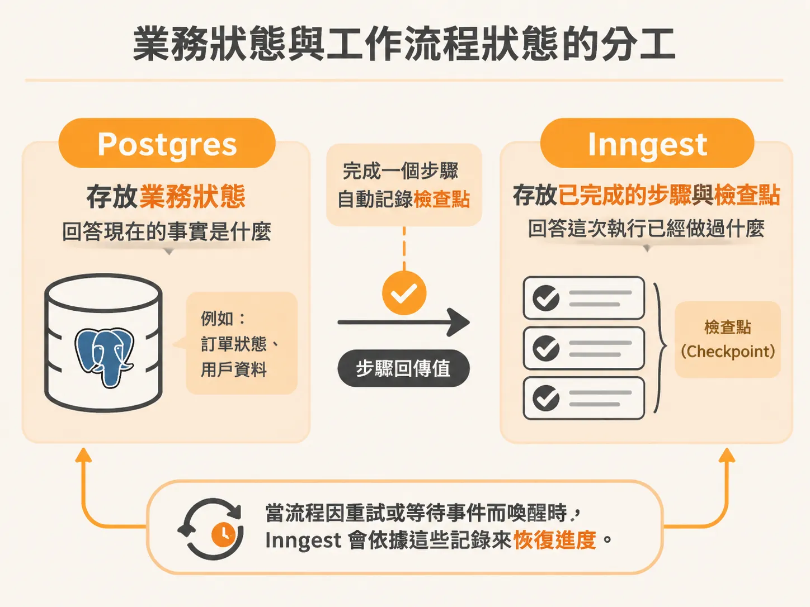
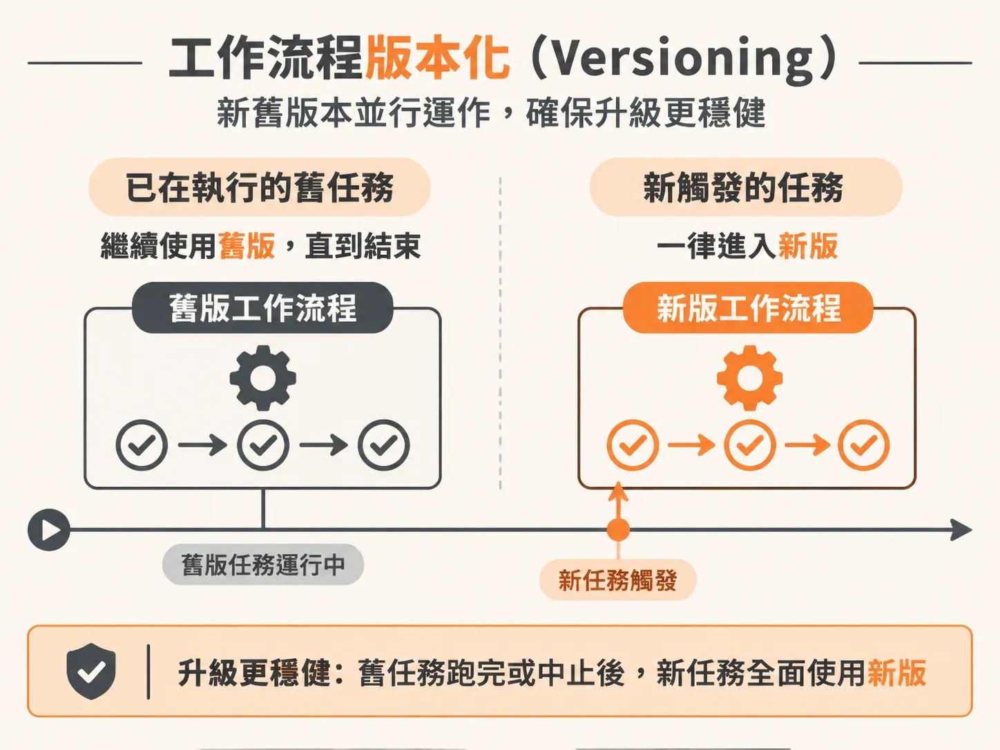
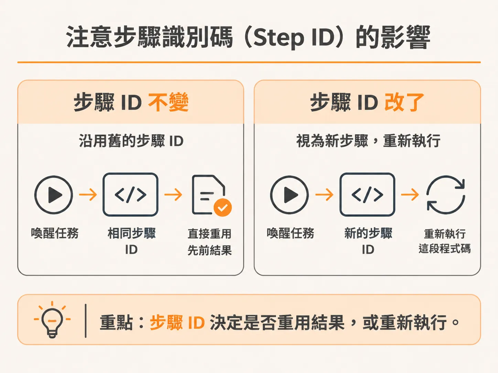

# 區分業務狀態與工作流程狀態：長時間運行 Agent 的升級策略

確定性與冪等性顧好之後，接著要問：這些被重播的狀態到底存在哪裡？在開發以背景任務運行的 AI Agent 時，最常遇到的問題之一就是狀態管理：當系統需要長時間執行、甚至中途暫停等待事件時，目前的狀態到底存放在哪裡？如果這時候要更新程式碼，那些正在執行中的任務又該如何處理？

要釐清這些問題，首先必須分清楚兩種完全不同的狀態存放機制：業務狀態（business state）與工作流程狀態（workflow state）。

## 業務狀態與工作流程狀態的分工

以負責監控與處理結帳流程（checkout process）的 Agent 為例，系統裡同時存在兩套狀態機制：

1. **Postgres 儲存的業務狀態**：結帳服務的當前狀態、事件記錄（incidents）、審批歷程與 AI 決定採取的動作等，都由我們自己寫入 Postgres。這類資料回答的是：「**現在的事實是什麼？**（What is true now?）」
2. **Inngest 負責的工作流程狀態**：工作流程裡哪些步驟（steps）已經完成、中途暫停後要從哪裡恢復執行，全部由 Inngest 自動處理，開發者不需要手動建表儲存。

可以把 Inngest 的每個步驟看成一個檢查點（checkpoint）。每當工作流程完成一個步驟，Inngest 就會自動記錄這個檢查點與該步驟的回傳值。當流程因重試或等待事件而喚醒時，Inngest 就是依據這些記錄來恢復進度。

但 Inngest 記錄的只是步驟回傳的資料，它不會替你維護業務邏輯。如果你希望在儀表板（dashboard）上即時看到 AI 做出的決策，或是記錄每次觀察到的系統現象，就必須自己在步驟內把資料寫入 Postgres。

這也是為什麼在 Agent 的迴圈中，每一輪都要主動建立新的 observation 步驟（例如 `observe-state-3`）。外部世界是隨時變動的，第 3 輪記下的檢查點只是 Agent 在那個時間點看到的證據，並不保證第 4 輪時結帳系統依然是同一個狀態。工作流程歷程回答的是：「**這次執行已經做過什麼？**（What did this run already do?）」

## 當程式碼更新時，執行中的任務該如何處理？

Agent 的任務往往需要長時間運行，可能正在調查某個系統異常，但開發團隊同時需要部署新程式碼。這時最大的挑戰是：已經在跑的流程，該如何遷移到新程式碼？

這就跟資料庫遷移（database migration）是一樣的道理。當你在資料庫新增欄位，舊資料行本來並沒有這些欄位，你就必須規劃如何補齊資料、評估遷移成本。工作流程的程式碼升級也是如此，若沒有事先規劃，部署時就會出現非預期的錯誤。

處理執行中的任務，通常有以下幾種策略：

### 1. 工作流程版本化（Versioning）

最穩健的做法是採用版本化。讓新舊兩個版本的工作流程在系統中平行運作：
- 已經在執行的舊任務繼續跑舊版程式碼，直到它們自然執行完畢並結束。
- 所有新觸發的任務一律進入新版工作流程。

如果某些舊任務本身不是那麼重要，或者評估後確認新程式碼的改動並不具破壞性，也可以選擇直接將舊任務手動中止。

### 2. 注意步驟識別碼（Step ID）的影響

Inngest 會依據步驟的識別碼來快取與重用執行結果（memoized results）。如果在新程式碼中：
- **沿用舊的步驟名稱或 ID**：被喚醒的在跑任務會直接重用過去已儲存的結果。
- **修改了步驟名稱或 ID**：流程會視為全新步驟，強制重新執行這段程式碼。

這在架構與部署上是關鍵的取捨。如果該步驟包含模型呼叫（LLM call）或是具備外部副作用的操作（例如發送通知、扣款），貿然修改步驟名稱可能導致舊任務醒來後重複執行這些高成本或危險的操作。在生產環境修改步驟名稱前，務必先盤點有哪些現存任務可能會被喚醒，以及它們是否會因此重複執行。
