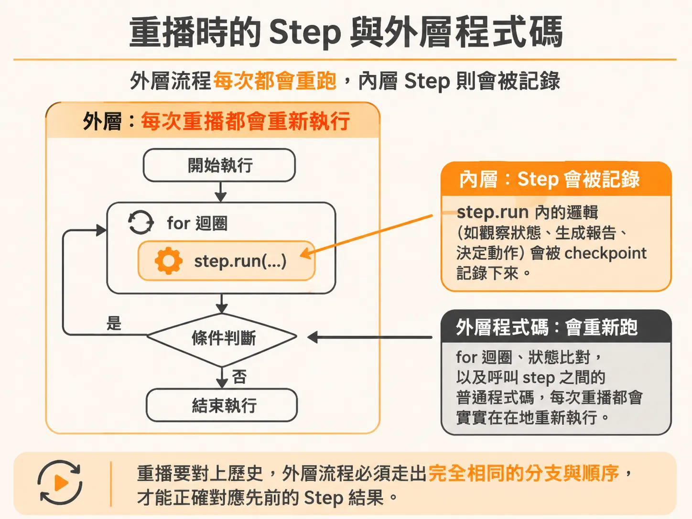
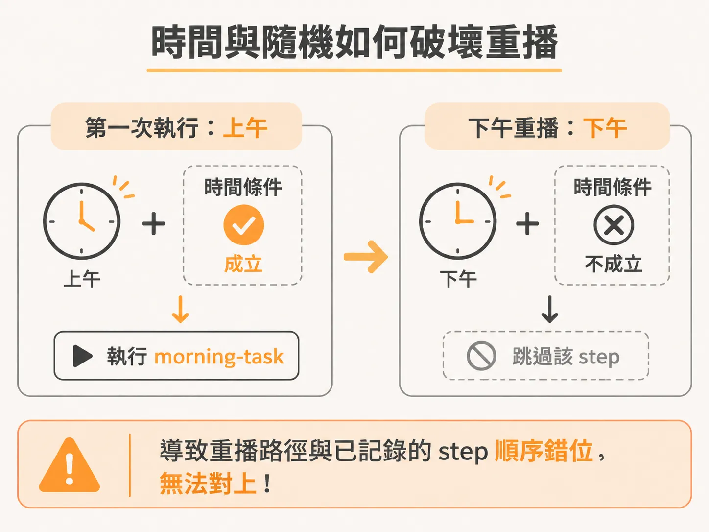
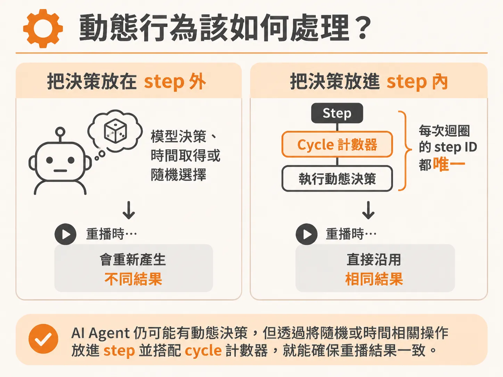

# step 之外的程式碼必須是確定性的

理解 replay 會重跑函式本體之後，就能推出一條嚴格的限制：workflow body 不能任意使用時間或隨機值。在使用耐用執行（durable execution）框架（例如 Inngest）編寫背景工作流程時，函式中途失敗或中斷是很常見的狀況。系統之所以能從中斷點自動恢復，是因為它具備重播（replay）機制：當工作流程重新啟動時，它會把整段函式程式碼從頭再執行一次。

在這個重播過程中，先前已經執行成功的 `step.run` 會直接跳過原本的回呼函式（callback），由引擎直接注入上次保存的結果。程式碼會一路重播，直到抵達第一個尚未完成的步驟為止。

這種運作模式帶來了一個關鍵限制：所有包在 `step.run` 之外的程式碼，都必須是確定性的（deterministic）。

## 重播時的 step 與外層程式碼

以一個典型的 Agent 工作流程為例：

<!-- source: sources/background-agent/20261105/server/agent-workflow.ts#L81-L97 -->

```typescript
    for (let cycle = 1; cycle <= 24; cycle++) {
      const current = await getRun(runId)
      if (['completed', 'failed', 'cancelled', 'escalated', 'superseded'].includes(current.status))
        return
      const state = await step.run(`observe-state-${cycle}`, () => agentState(environmentId, runId))

      if (goalSatisfied(state, run.goalCondition)) {
        const report = await step.run(`write-report-${cycle}`, () => writeReport(run.goal, state))
        await step.run(`complete-run-${cycle}`, () => setRun(runId, 'completed', null, report))
        return { report }
      }

      const decision = await step.run(`choose-action-${cycle}`, () => chooseAction(run.goal, state))
      await step.run(`set-iteration-${cycle}`, () => setIteration(runId, cycle))
      await step.run(`record-decision-${cycle}`, () =>
        recordDecision(environmentId, runId, cycle, decision.action, decision.reason),
      )
```

在上面的迴圈中，`step.run` 內的邏輯（例如觀察狀態、生成報告、決定動作）會被 checkpoint 記錄下來。然而，包裹它們的 `for` 迴圈、狀態變數的比對，以及呼叫 step 之間的普通 JavaScript/TypeScript 程式碼，每次重播都會實實在在地重新跑過。



這表示，只要不在 step 內，每次執行都必須產生完全相同的分支與順序。

## 時間與隨機如何破壞重播

如果在 step 之外放入了非確定性的邏輯，重播機制就會直接失效：



- **依賴目前時間**：假設你在 step 之外寫了 `if (new Date().getHours() < 12)`，第一次執行時是上午，工作流程進入這個分支並觸發了名為 `morning-task` 的 step；如果系統出錯並在下午重播，條件不再成立，程式跳過了 `morning-task`，嘗試對照接下來的步驟。這時重播紀錄與實際執行的 step 順序錯位，流程便會徹底損壞。
- **隨機數值**：如果在 step 之外呼叫 `Math.random()` 或生成新的隨機 ID 來決定分支，第一次與第二次重播走的路徑可能完全不同，導致系統無法正確對應先前儲存的 step 歷史紀錄。

這類非確定性行為會破壞重播的安全保證。因此，許多工作流程工具在底層會嘗試檢查程式碼是否具備確定性，一旦偵測到不合規定的隨機或時間操作，甚至會直接拋出錯誤。

## 動態行為該如何處理？

這並不代表整個工作流程不能有任何隨機或動態決策。以 AI Agent 來說，模型每一次做出的決定本來就充滿動態變化——它可能在第一輪選擇檢查日誌，第二輪選擇停用功能。



差別在於這些不可預測的行為發生的位置：

1. **不可預測的邏輯必須放在 `step.run` 裡面**：模型決策、時間戳記取得、外部 API 呼叫，都應該是 step 的執行內容。只要步驟完成並寫入紀錄，重播時就會直接重用那筆記錄下來的結果，而不會重新向模型發問或重新取得時間。
2. **利用動態計數確保 step ID 唯一**：在迴圈中，透過像 `cycle` 這樣的計數器讓每個 `step.run` 都有唯一識別碼（例如 `observe-state-1`、`observe-state-2`）。如果不加序號，重複迴圈會產生相同的 step ID，導致歷史紀錄混淆。

只要將所有動態與副作用封裝進 step 內，step 外的控制流程就能保持純粹且確定，重播機制也才能可靠地重建系統狀態。
