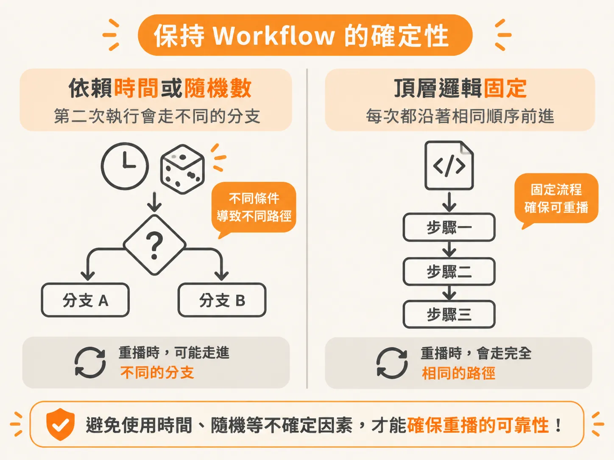
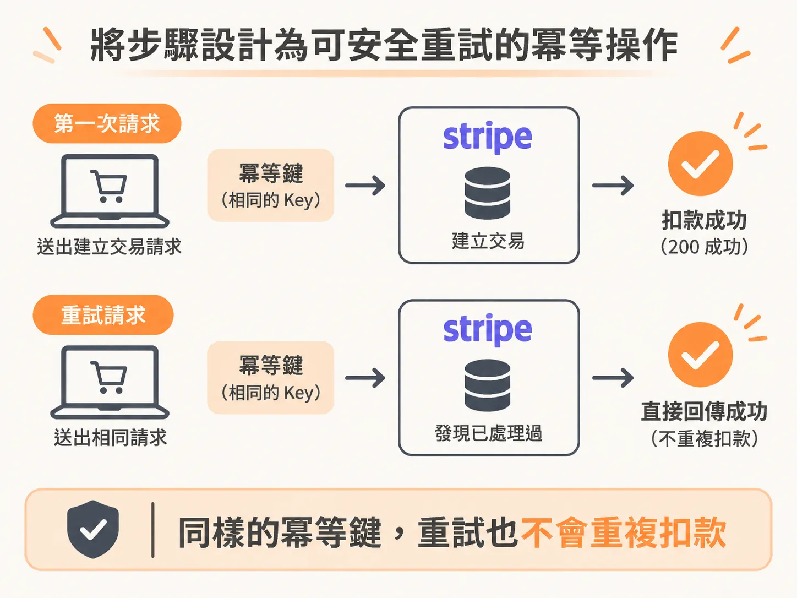
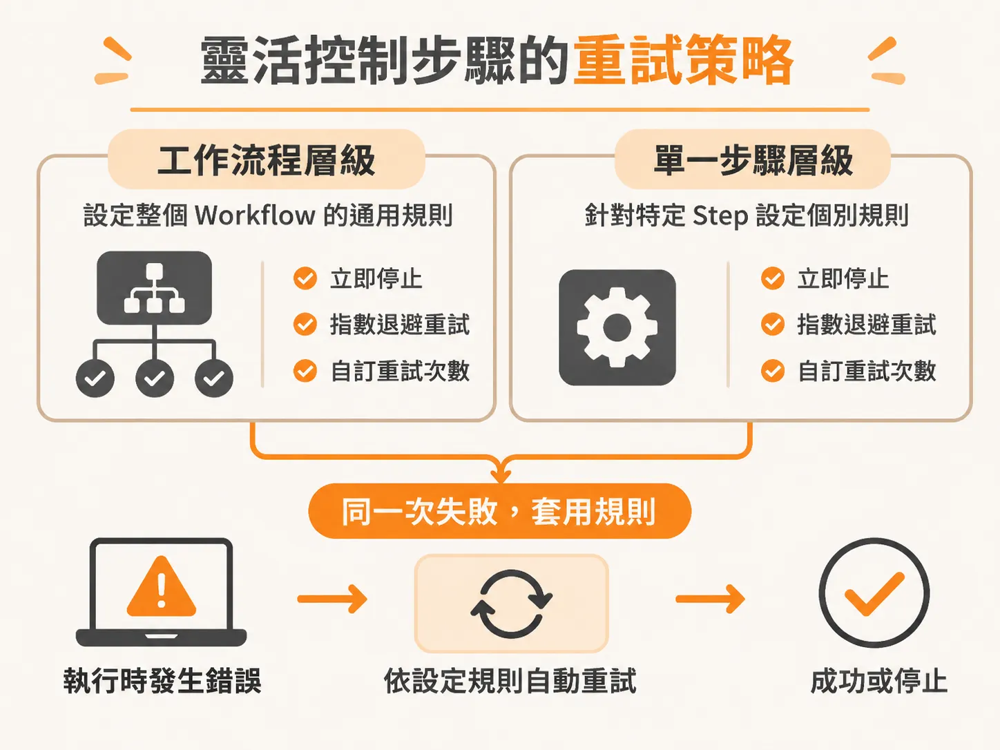

# 打造可重放的 Workflow：確定性邏輯與步驟冪等性

知道系統是靠重播已完成的步驟來復原之後，下一個問題自然就是：重播要能安全，靠什麼保證？在建構耐久執行（durable execution）架構時，像 Inngest 這類工作流程引擎最大的優勢，在於系統遇到當機或網路中斷時，能透過重放（replay）機制從中斷處復原並繼續往下走。然而，重放機制要能安全運作，整個架構必須遵守兩大原則：工作流程（workflow）最外層的程式碼必須具備**確定性（deterministic）**，而個別步驟（step）本身則必須具備**冪等性（idempotent）**。

## 保持 Workflow 最外層的確定性

在定義工作流程函式時，所有包在最外層、但不在具體 step 內部的程式碼，都屬於 workflow 層級。這一層的所有邏輯，每次重新執行時都必須產生完全相同的結果。

如果你在 workflow 頂層寫了依賴當前時間的條件判斷，例如「如果現在時間超過某個點就執行特定分支」，或是呼叫了隨機數產生器，這段程式碼就失去了確定性。當工作流程發生錯誤需要重放時，第二次執行就會走出完全不同的路徑，導致整個重放機制徹底失效，系統也失去了耐久執行的安全保障。

許多支援耐久執行的工具（例如 Inngest）會嘗試檢測你的頂層程式碼是否具備確定性，一旦發現不合規定的邏輯，甚至會在執行時直接拋出錯誤。因此，任何可能在多次執行間產生不同結果的操作，都嚴格禁止放在 workflow 的頂層邏輯中。

## 將步驟設計為可安全重試的冪等操作

相對於頂層的確定性要求，實際執行具體操作的各個 step，其核心要求則是冪等性。

如果一個步驟會執行狀態變更（mutation），例如修改資料庫或扣款，當這個步驟被呼叫兩次時，系統絕不能重複執行該變更兩次。步驟本身必須具備判斷能力，知道這件事是否已經處理過；如果已經完成，就直接略過並回報成功，而不是再次觸發副作用。

線上支付服務 Stripe 的 API 就是標準的冪等設計範例。當你呼叫 API 建立交易時，通常會附帶一個冪等鍵（idempotency key）。如果網路斷線導致工作流程重試、伺服器再次送出相同的請求，Stripe 會比對這組 key，確認這筆款項已經扣過，於是直接回傳 200 成功，而不會向客戶重複請款。

在耐久執行中，系統無法保證外部效果永遠「恰好發生一次（exactly once）」。外部服務很可能已經寫入變更，但回應在抵達並記錄為成功之前就遺失了。因此，讓 step 具備冪等性，才能確保即使伺服器因重放而重複呼叫，也不會引發災難性的重複操作。

## 靈活控制步驟的重試策略

當迴圈或流程內部的某個 API 呼叫失敗時，系統並不一定會盲目重啟整個流程。像 Inngest 這類工具提供了相當靈活的控制選項，讓你自行決定失敗時的應對方式。

你可以依據業務需求，在整個 workflow 層級設定通用的重試政策（retry policy），也可以針對容易出錯的特定 step 個別定義重試規則。無論是希望遇到錯誤時立即停止、依照指數退避演算法自動重試，或是自訂重試次數，都能在系統中精確配置。

