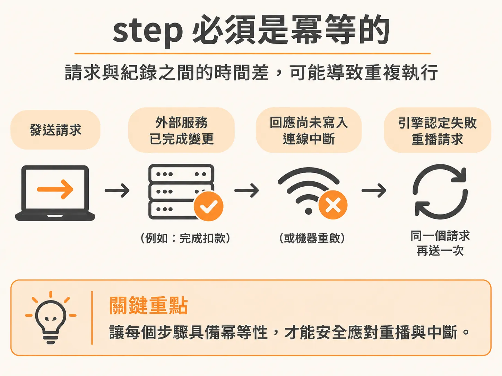
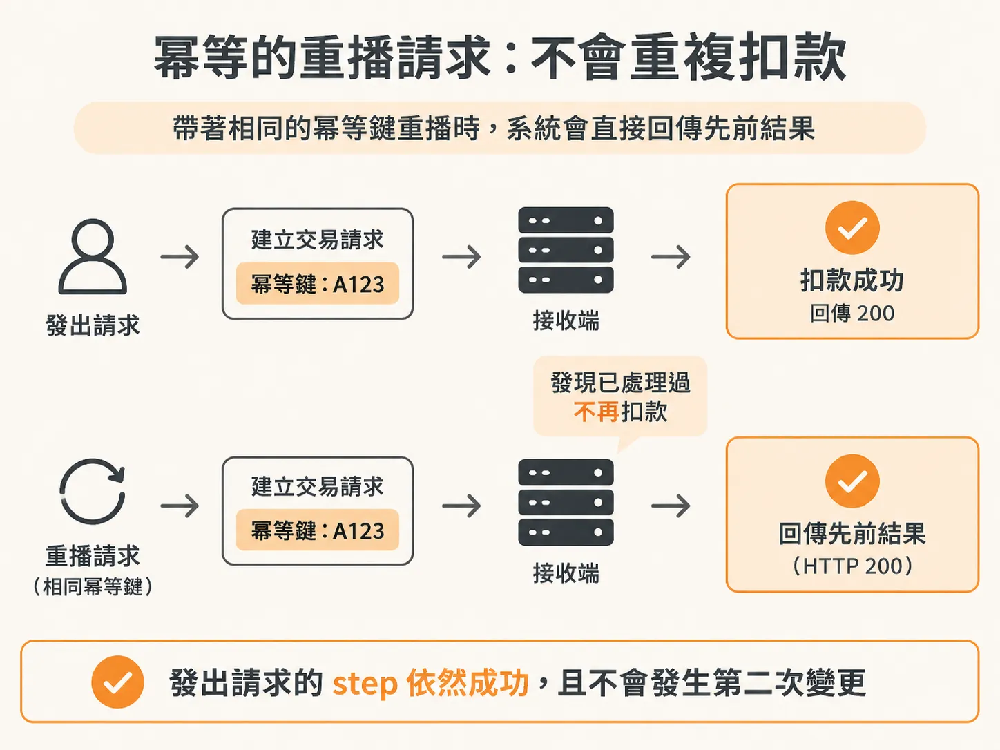

# step 必須是冪等的

即使 step 外的程式碼保持確定性，step 內部的副作用仍然可能被重跑。在開發背景工作流程或耐久執行（durable execution）系統時，我們常依賴系統的自動重試與重播機制來克服網路不穩或程式崩潰。但許多人容易產生一個誤解，以為耐久執行能確保外部副作用「恰好發生一次」（exactly-once）。

事實上，系統無法憑空保證外部副作用絕不重複。問題往往出在操作提交與狀態記錄之間的間隙：當你的步驟（step）發送請求給外部服務，外部服務已經成功變更資料（例如完成扣款），但在將回應傳回伺服器、或是工作流程引擎把「步驟成功」的狀態寫入資料庫之前，連線突然中斷或機器重啟了。



對工作流程引擎來說，這個步驟就是執行失敗。等到系統復原並重新播放（replay）該步驟時，如果沒有防護機制，同樣的請求就會再送出一次，導致使用者被重複扣款。

這就是為什麼所有帶有副作用的步驟都必須具備「冪等性」（idempotence）——無論同一個動作被呼叫一次還是多次，產生的副作用都必須與呼叫一次完全相同。

以金流服務 Stripe 的設計為例，當你發送建立交易的請求時，可以附帶一組唯一的冪等鍵（idempotency key）。當工作流程因重播而再度發送相同的請求時，金流服務會先比對這組 key。一旦發現這筆操作先前已經處理過，它就不會再次扣款，而是直接回傳成功的 HTTP 200 與先前的處理結果。對發出請求的步驟來說，呼叫依然順利完成，外部世界卻不會發生第二次變更。



在實際撰寫工作流程步驟時，為每個動作產生唯一識別碼（如 `actionId`），並將它傳入外部服務是常見的做法：

<!-- source: sources/background-agent/20261105/server/agent-workflow.ts#L20-L56 -->

```typescript
async function executeAction(
  environmentId: string,
  runId: string,
  actionId: string,
  name: ActionName,
  expectedVersion?: number,
) {
  const input = expectedVersion === undefined ? {} : { expectedVersion }
  await logAgentActivity(environmentId, runId, 'act', `Calling ${name.replaceAll('_', ' ')}`, {
    actionId,
    input,
  })
  try {
    const response = await fetch(`${checkoutServiceUrl}/operations`, {
      method: 'POST',
      headers: { 'Content-Type': 'application/json' },
      body: JSON.stringify({ actionId, name, ...input }),
    })
    const result = (await response.json()) as Record<string, unknown>
    if (!response.ok) throw new Error(String(result.error || `Tool failed: ${response.status}`))
    if (result.stale !== true)
      await recordToolAction(environmentId, runId, actionId, name, input, result)
    return result
  } catch (error) {
    await logAgentActivity(
      environmentId,
      runId,
      'act',
      `${name.replaceAll('_', ' ')} attempt failed`,
      {
        actionId,
        error: error instanceof Error ? error.message : String(error),
      },
    )
    throw error
  }
}
```

不僅對外呼叫需要冪等，本地記錄狀態時也同樣需要防範重複寫入。例如將操作結果儲存到資料庫時，利用同一個 `actionId` 搭配衝突忽略處理，就能確保重播時不會留下重複的紀錄：

<!-- source: sources/background-agent/20261105/server/agent-data.ts#L156-L173 -->

```typescript
export async function recordToolAction(
  environmentId: string,
  runId: string,
  actionId: string,
  name: ActionName,
  input: Record<string, unknown>,
  result: Record<string, unknown>,
) {
  await db
    .insert(actions)
    .values({ id: actionId, environmentId, name, input, result })
    .onConflictDoNothing()
  await logAgentActivity(environmentId, runId, 'act', `${name.replaceAll('_', ' ')} returned`, {
    actionId,
    input,
    result,
  })
}
```

耐久執行解決的是「確保流程一定會跑完」，而冪等性解決的是「流程重跑時不會把事情搞砸」。在任何可能呼叫外部變更的步驟裡，只要將操作綁定唯一識別碼並由接收端檢查重複，就能確保重播時安全無虞。
