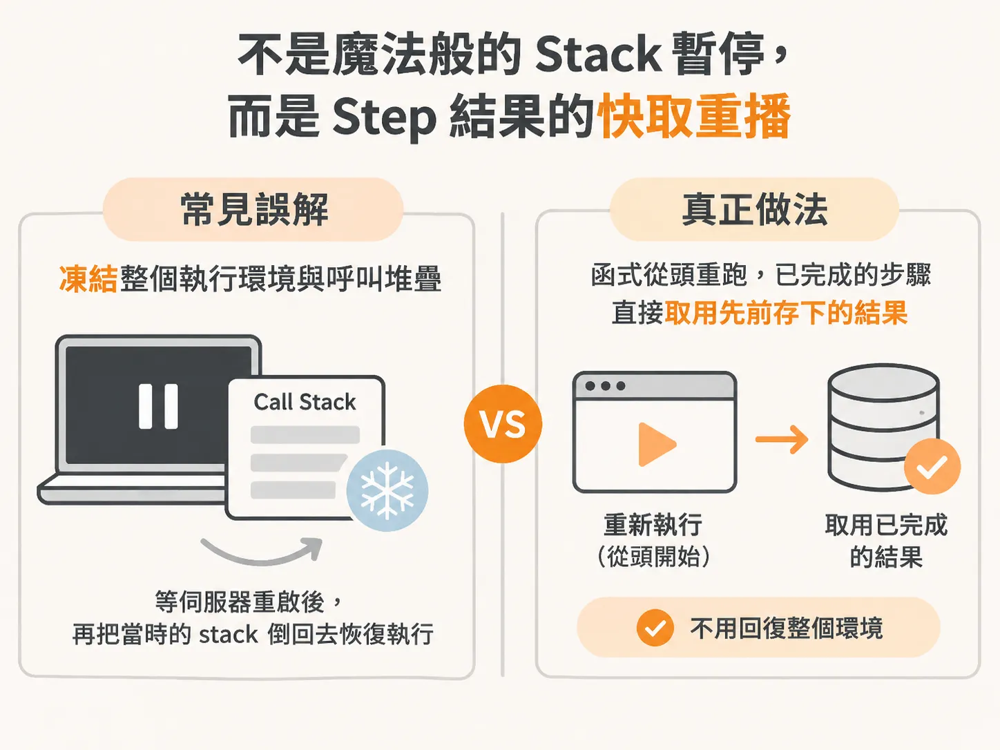
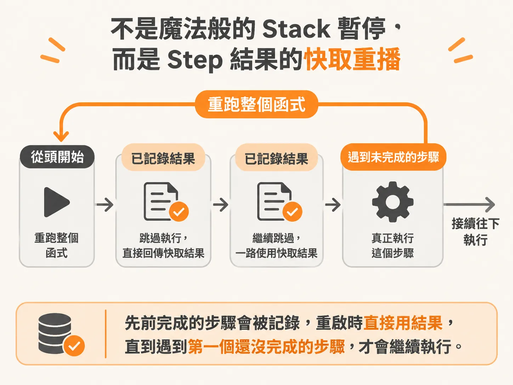
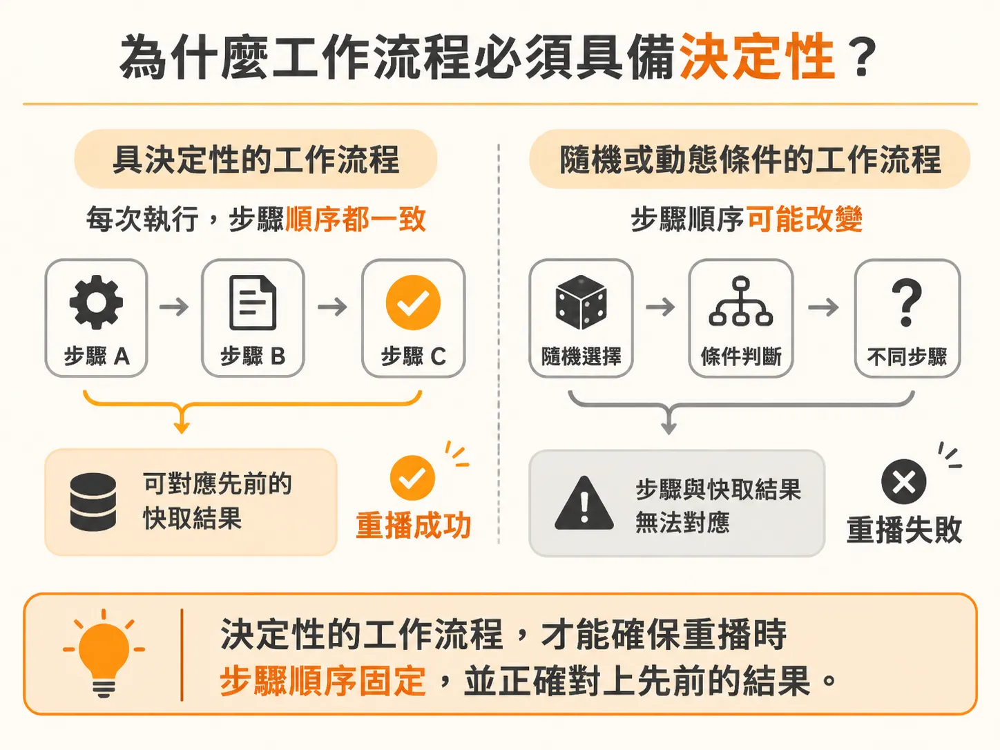

# Durable Execution 的運作原理：Memoize 重播而非還原 Call Stack

當你寫了一個長時間執行的 Agent，讓它在迴圈裡檢查日誌、呼叫模型、關閉有問題的功能，最怕遇到伺服器當機或基礎設施故障。如果整個迴圈都塞在同一個步驟（step）裡，一旦在步驟完成前回應中斷，整個流程就得從頭重來一遍。

為了解決這個問題，像是 Inngest 這類工具提供了「持久化執行」（durable execution）。但在接觸這項技術時，許多熟悉 JavaScript 的開發者常會產生一個誤解：以為系統把當下的 JavaScript 執行環境與 call stack（呼叫堆疊）「暫停」並凍結起來，等到伺服器重啟時，再把當時的 stack 倒回去恢復執行。

事實上，底層的機制完全不是這樣運作的。

## 不是魔法般的 Stack 暫停，而是 Step 結果的快取重播

持久化執行並沒有深入到去凍結或重放 JavaScript 的 context 與 call stack。它的本質非常單純：**把每一個步驟的結果記下來（memoize），並在需要恢復時重跑整個函式。**

在這種機制下：
- 當一個步驟執行完畢，系統會將該步驟的回傳結果持久化記錄下來。
- 如果系統因為故障或斷線需要重啟（resume），它會直接重跑整個函式。
- 當函式跑到先前已經記錄過結果的步驟時，不會重新執行該步驟的邏輯，而是直接拿先前 memoize 的結果回傳。
- 接著，工作流程順著這些結果，一路走到第一個還沒完成的步驟，繼續往下執行。

因為狀態與步驟結果都已經存在外部儲存中，即使伺服器死掉，重新啟動時也不會遺失原本該拿到的任何資訊。這正是為什麼我們需要把 Agent 的龐大迴圈拆開，將檢查日誌、呼叫模型、執行工具等個別操作，切成各自獨立的步驟單位。如果全都放在同一個步驟，就享受不到這種跳過已完成步驟的好處。

## 為什麼工作流程必須具備決定性？

既然整個機制是「從頭重跑函式、遇到已完成步驟就回傳快取結果」，這就帶來了一個關鍵限制：**工作流程（workflow）本身的邏輯必須是決定性的（deterministic）。**

你必須保證每次重跑這段程式碼時，這些步驟觸發的順序與路徑是一致的。如果工作流程仰賴隨機變數或動態外部條件來決定要跑哪一個步驟，重播時路徑走歪了，系統就無法正確對應先前 memoize 的結果。

這也凸顯了「被重新評估的 JavaScript 程式碼」與「真正被執行的步驟回呼（step callback）」之間的差別：
- 步驟外的 JavaScript 程式碼在每次重播時都會重新跑過一遍。
- 包在步驟裡的邏輯（例如呼叫外部 API 或寫入資料庫）只要有記錄，就絕對不會重跑。

只要步驟劃分得當，重播時就能穩定沿著先前的足跡，一路前進到斷點繼續執行，而完全不需要依賴任何神奇的 JavaScript 堆疊還原技術。
