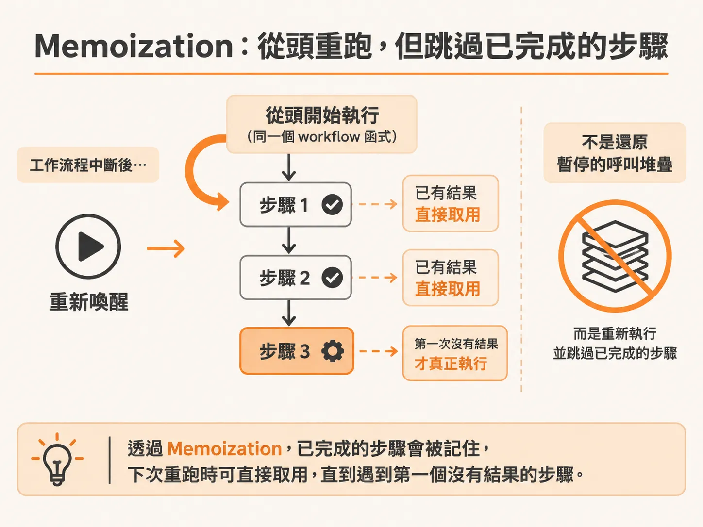
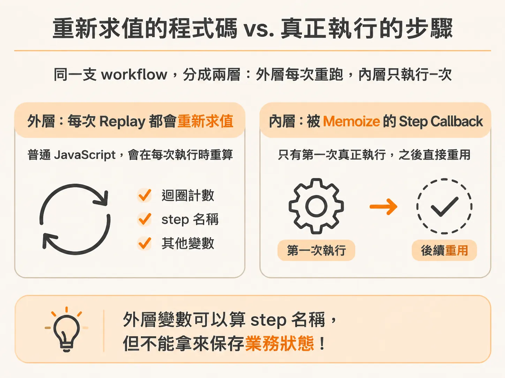
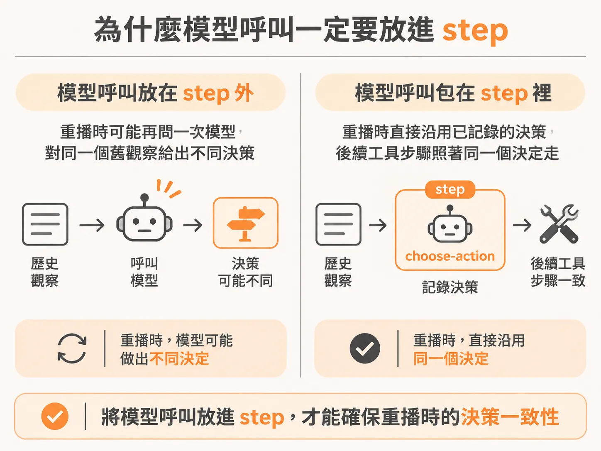

# Replay 不是恢復暫停的堆疊

把迴圈拆成小步驟之後，下一個疑問通常是：系統到底怎麼跳過已完成的那幾步？第一次接觸持久執行（Durable Execution）的人，常會直覺以為系統做的事情很神奇：程式跑到一半等待外部事件或重試時，底層是不是像作業系統或虛擬機一樣，把整個 JavaScript 的呼叫堆疊（call stack）凍結存檔，等喚醒時再一模一樣地還原？

其實完全不是這樣。

持久執行沒有碰觸 JavaScript 執行期的記憶體堆疊，背後的原理其實非常單純：**重跑函式本體（workflow body），但跳過已經完成的步驟（step）**。

### Memoization，而不是還原堆疊

在 Inngest 這類持久執行架構中，每個透過 `step.run` 包起來的步驟，其執行結果都會被記錄（memoized）下來。當工作流程因為中斷、等待事件或拋出錯誤而需要重新喚醒時，系統所做的不是回到暫停的那一行，而是**把整個 workflow 函式從頭再執行一次**。



重跑時，引擎會比對每一個 step 的識別名稱。如果某個 step 之前已經跑過且留有結果，引擎就不會再執行裡面的 callback，而是直接回傳之前記錄的結果；只有尚未執行過的 step，才會真正觸發計算。

在實際的工作流程程式碼中，這種結構通常表現為一個包含多個 step 的迴圈：

<!-- source: sources/background-agent/20261105/server/agent-workflow.ts#L72-L97 -->

```typescript
  async ({ event, step }) => {
    const { environmentId, runId, instanceId } = event.data
    const run = await getRun(runId)
    if (
      run.instanceId !== instanceId ||
      ['completed', 'failed', 'cancelled', 'escalated', 'superseded'].includes(run.status)
    )
      return

    for (let cycle = 1; cycle <= 24; cycle++) {
      const current = await getRun(runId)
      if (['completed', 'failed', 'cancelled', 'escalated', 'superseded'].includes(current.status))
        return
      const state = await step.run(`observe-state-${cycle}`, () => agentState(environmentId, runId))

      if (goalSatisfied(state, run.goalCondition)) {
        const report = await step.run(`write-report-${cycle}`, () => writeReport(run.goal, state))
        await step.run(`complete-run-${cycle}`, () => setRun(runId, 'completed', null, report))
        return { report }
      }

      const decision = await step.run(`choose-action-${cycle}`, () => chooseAction(run.goal, state))
      await step.run(`set-iteration-${cycle}`, () => setIteration(runId, cycle))
      await step.run(`record-decision-${cycle}`, () =>
        recordDecision(environmentId, runId, cycle, decision.action, decision.reason),
      )
```

在這個工作流程中，假設程式在第 3 回合的 `choose-action-3` 發生錯誤或暫停，等到下一次重試時，整個非同步函式會從第一行重新開始。但在第 1 與第 2 回合中，`observe-state-1`、`choose-action-1` 等所有步驟都已經完成，它們的 callback 完全不會被呼叫，而是直接拿到上次記下來的輸出值，瞬間略過並一路挺進到上次中斷的地方。

在伺服器端，這些先前步驟的歷史紀錄會直接隨著請求送回端點，供工作流程重組路徑：

<!-- source: sources/background-agent/20261105/server/agent.ts#L1-L28 -->

```typescript
import 'dotenv/config'
import express from 'express'
import { serve } from 'inngest/express'
import { incidentAgent } from './agent-workflow'
import { inngest } from './inngest'

if (!process.env.OPENAI_API_KEY || !process.env.OPENAI_MODEL) {
  throw new Error('Set OPENAI_API_KEY and OPENAI_MODEL before starting the real agent')
}

const app = express()
// Inngest replays prior step results to this local endpoint; long incident runs exceed Express's 100 KB default.
app.use(express.json({ limit: '10mb' }))
app.get('/api/health', (_request, response) =>
  response.json({
    ok: true,
    process: 'agent',
    mode: 'openai',
    model: process.env.OPENAI_MODEL,
  }),
)
app.use('/api/inngest', serve({ client: inngest, functions: [incidentAgent] }))

app.listen(3002, '127.0.0.1', () =>
  console.log(
    `Agent endpoint http://127.0.0.1:3002/api/inngest | REAL MODEL: ${process.env.OPENAI_MODEL}`,
  ),
)
```

### 重新求值的程式碼 vs. 真正執行的步驟

既然工作流程函式會從頭再跑一次，就必須區分兩種代碼：



1. **被重新求值（reevaluated）的 JavaScript**：寫在 `step.run` 外面的普通邏輯。
2. **真正被執行的步驟（actually executed）**：包在 `step.run` callback 裡面的邏輯。

寫在 `step.run` 外面的變數宣告、迴圈計數器或是條件判斷，每次 replay 都會重新運算一遍。因此，普通的區域變數適合用來組合 step 的名稱（例如 `observe-state-${cycle}`），但不能當作持久保存業務狀態的地方。任何會產生副作用（side effect）的操作，例如呼叫外部 API、寫入資料庫或扣款，都必須收在具名的 step 裡面，否則每次 replay 都會無意間重複執行。

這也是為什麼工作流程必須具備決定性（deterministic）。因為如果程式路徑每次重跑都依賴不可預測的外部動態因素，跳過步驟的比對邏輯就會亂掉。

### 為什麼模型呼叫一定要放進 step

以 AI Agent 為例，大語言模型的輸出本質上帶有隨機性。如果把模型呼叫寫在 `step.run` 外面，一旦函式 replay，模型就可能針對同一個歷史觀察做出不同的動作決定，導致前後狀態矛盾。



將模型呼叫包進 `choose-action-${cycle}` 這類 step 裡，模型的決策就會被記錄成這次 run 的不可變歷史。就算後續步驟重試或系統重啟，replay 都會嚴格沿用同一個決定，後續的工具調用也才能依循一致的脈絡繼續推進。
