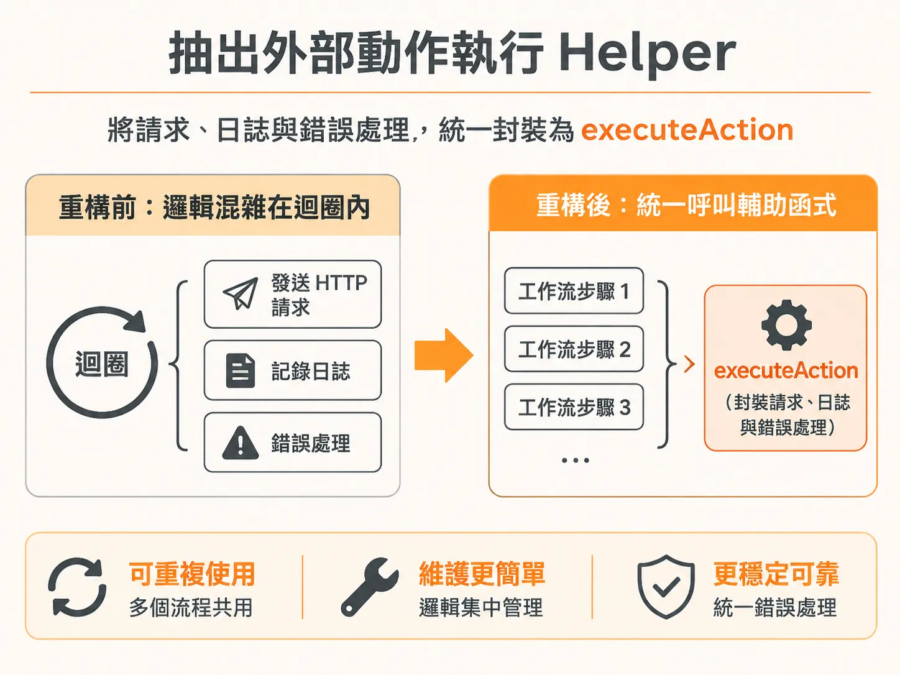
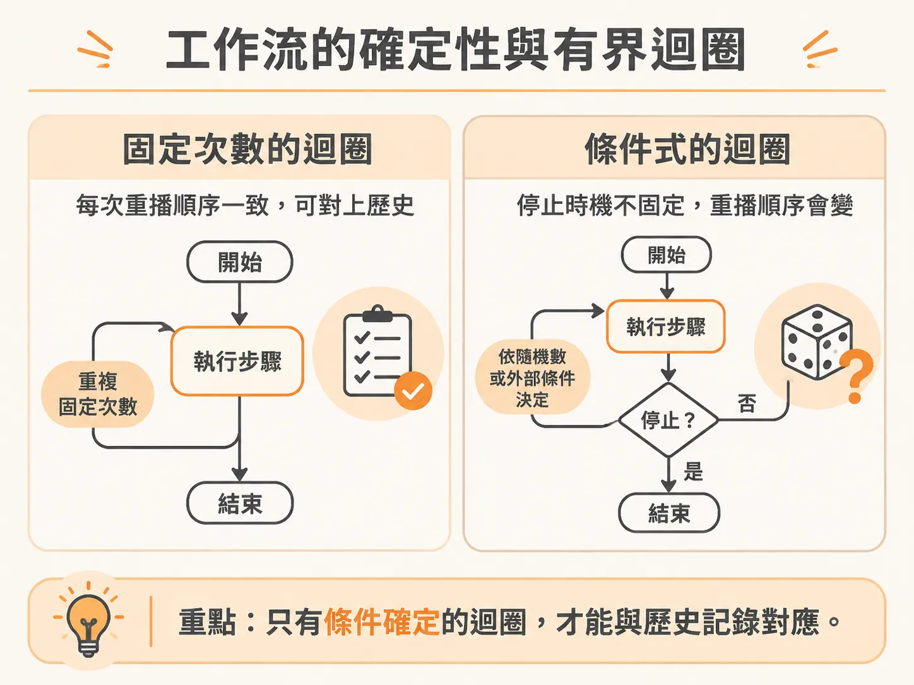
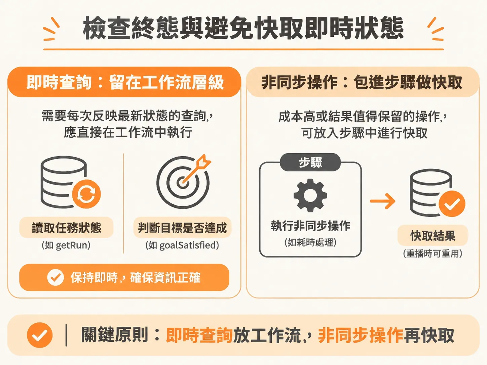
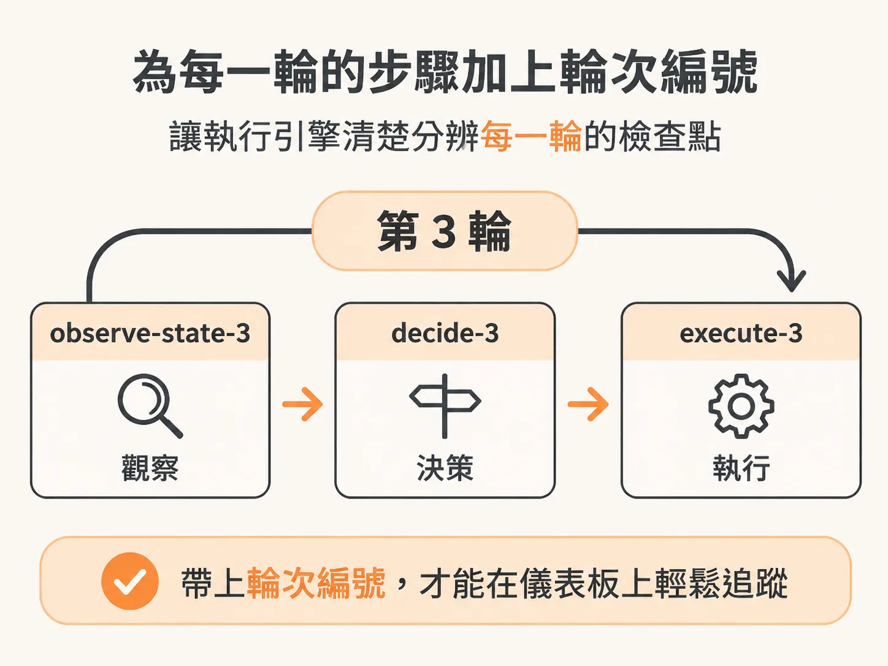

# 重構 Agent 迴圈：拆解為具名且可記憶的有界工作流步驟

原理與狀態邊界都想清楚後，終於可以動手改程式。如果把整個背景 Agent 執行迴圈塞進單一工作流步驟（step）裡，只要中途任何一個環節逾時或拋出例外，整段迴圈就必須從第一輪開始重播。這不僅白白浪費模型呼叫的成本，外部工具呼叫也可能在重複執行時引發副作用。

要讓背景任務具備強韌的耐久執行能力（durable execution），關鍵在於兩件事：先把執行外部動作的邏輯抽成獨立 Helper，再把原本不透明的單一巨大步驟，改寫成由確定性迴圈驅動、帶有輪次編號且能各自快取（memoize）的多個獨立步驟。

## 抽出外部動作執行 Helper：executeAction

在原本的寫法中，發送 HTTP 請求執行動作、記錄日誌與防護處理全部混雜在迴圈內部。重構時，第一步是將這段邏輯抽成獨立的輔助函式 `executeAction`。



這個函式需要接收環境識別碼（`environmentId`）、執行任務識別碼（`runId`）、動作識別碼（`actionId`）、動作名稱（`name`），以及可選的狀態版本號（`expectedVersion`）。

在發出請求前，函式會先呼叫 `logAgentActivity` 記錄當前進入 `act` 階段，並寫入即將執行的動作名稱與參數。接著發送請求到服務端點：

<!-- source: sources/background-agent/20261109/supplement/server/agent-workflow.ts#L20-L56 -->

```typescript
async function executeAction(
  environmentId: string,
  runId: string,
  actionId: string,
  name: ActionName,
  expectedVersion?: number,
) {
  const input = expectedVersion === undefined ? {} : { expectedVersion }
  await logAgentActivity(environmentId, runId, 'act', `Calling ${name.replaceAll('_', ' ')}`, {
    actionId,
    input,
  })
...
    throw error
  }
}
```

成功收到回應後，函式會解析 JSON。只要狀態不是過期（stale），就透過 `recordToolAction` 寫入執行結果。如果請求失敗，除了記錄嘗試失敗的日誌外，依然會拋出錯誤，讓外層的工作流機制決定如何處理。

輔助函式背後所呼叫的活動日誌函式如下：

<!-- source: sources/background-agent/20261109/supplement/server/agent-log.ts#L17-L32 -->

```typescript
export async function logAgentActivity(
  environmentId: string,
  runId: string,
  phase: AgentActivityPhase,
  message: string,
  detail: Record<string, unknown> = {},
) {
  await db.insert(timeline).values({
    id: randomUUID(),
    environmentId,
    runId,
    kind: `agent:${phase}`,
    message,
    detail,
  })
}
```

將動作呼叫封裝成 Helper 後，日誌與防護邏輯就能在不同步驟間共用，不需要在每次重構工作流時重複撰寫。

## 工作流的確定性與有界迴圈

在許多耐久執行引擎（如 Inngest）中，工作流主體程式碼必須保證確定性（deterministic）。

過去我們習慣把整個迴圈包在一個步驟內，現在則要把迴圈直接拉到工作流層級。工作流可以使用迴圈，前提是迴圈條件本身是確定性的，例如設定固定次數的計數器：



<!-- derived -->
```typescript
for (let cycle = 1; cycle <= 24; cycle++)
```

不能在工作流層級使用像 `Math.random()` 這類每次執行結果都不一致的非確定性條件，否則執行引擎在重新喚醒工作流時會無法比對執行歷史。設定 24 輪或固定上限，除了符合確定性要求，也能防止代理人無窮迴圈消耗資源。

## 檢查終態與避免快取即時狀態

在進入迴圈之前，必須先讀取當前任務資訊，並驗證任務是否仍然有效：

1. 比對任務資料中的實例識別碼（`instanceId`）是否與傳入事件相符。如果不符，代表並非同一次執行，應立刻中斷返回。
2. 檢查任務狀態是否已進入終態。常見的終態包含 `completed`、`failed`、`cancelled`、`escalated` 與 `superseded`。若已處於這些狀態，代表任務早已結束或被取消，不應再做任何動作。

進入迴圈後，每一輪的最開頭都要再次呼叫 `getRun(runId)` 取得最新狀態，並重新檢查是否處於終態。

這裡要注意一個核心原則：**不是所有非同步呼叫都要包進 `step.run`**。

像 `getRun(runId)` 這種需要隨時反映資料庫最新狀態的查詢，就不應該被包在步驟中，因為被步驟包裝的函式在工作流重播時會直接回傳快取結果（memoized）。如果快取了 `getRun`，當外部系統在中途取消或升級了任務狀態，重播時就讀不到狀態變更。同樣地，判斷目標是否達成的條件式（例如 `goalSatisfied`）也應該在工作流層級即時計算，而不是包成步驟快取。



## 拆分單一職責的具名步驟

決定哪些非同步呼叫該包進步驟時，主要考量兩點：

- **是否需要檢查點（checkpoint）**：伺服器重啟或任務失敗時，哪些結果可以直接沿用，不需重新計算？
- **成本與副作用**：高成本的模型推論或需要被記錄的狀態觀察，一定要放進步驟做 memoize。

原則上，一個步驟只做一件非同步操作。如果一個步驟塞了多個非同步操作，一旦最後一個失敗，整組步驟重跑時前面的操作也會跟著重播。除非這些操作完全沒有副作用且重放也無所謂，否則務必拆成獨立步驟。

此外，在迴圈內宣告步驟時，步驟名稱必須帶上當前的輪次編號（`cycle`），例如 `observe-state-${cycle}`、`write-report-${cycle}`。這樣執行引擎才能清楚分辨每一輪的檢查點，在儀表板追蹤時也能一目了然。



完整的迴圈改寫如下：

<!-- source: sources/background-agent/20261109/supplement/server/agent-workflow.ts#L81-L96 -->

```typescript
    for (let cycle = 1; cycle <= 24; cycle++) {
      const current = await getRun(runId)
      if (['completed', 'failed', 'cancelled', 'escalated', 'superseded'].includes(current.status))
        return
      const state = await step.run(`observe-state-${cycle}`, () => agentState(environmentId, runId))

      if (goalSatisfied(state, run.goalCondition)) {
        const report = await step.run(`write-report-${cycle}`, () => writeReport(run.goal, state))
        await step.run(`complete-run-${cycle}`, () => setRun(runId, 'completed', null, report))
        return { report }
      }

      const decision = await step.run(`choose-action-${cycle}`, () => chooseAction(run.goal, state))
      await step.run(`set-iteration-${cycle}`, () => setIteration(runId, cycle))
      await step.run(`record-decision-${cycle}`, () =>
        recordDecision(environmentId, runId, cycle, decision.action, decision.reason),
      )
```

觀察狀態、撰寫結案報告、更新狀態與決策記錄，各自都成為具名且綁定輪次的獨立步驟。如果某一輪在記錄決策時網路瞬斷，工作流恢復後會直接讀取該輪前面已 memoize 的狀態與推論結果，只從失敗的那個步驟接續重試，大幅提升了整個 Agent 執行的耐久性與可觀測性。
