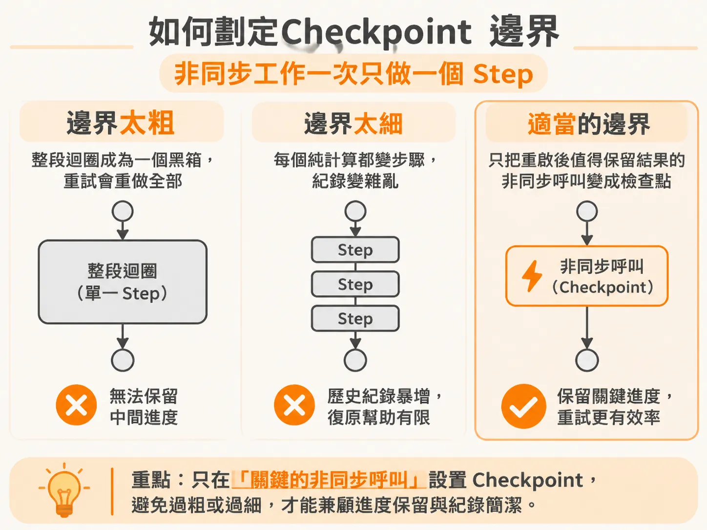
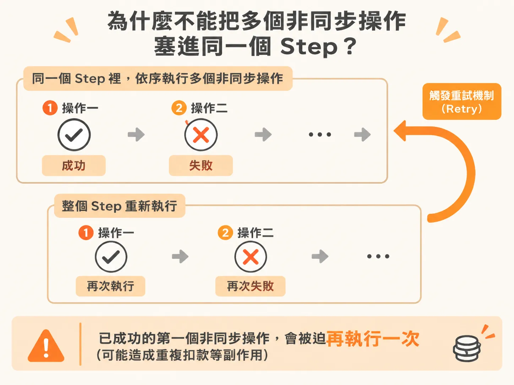
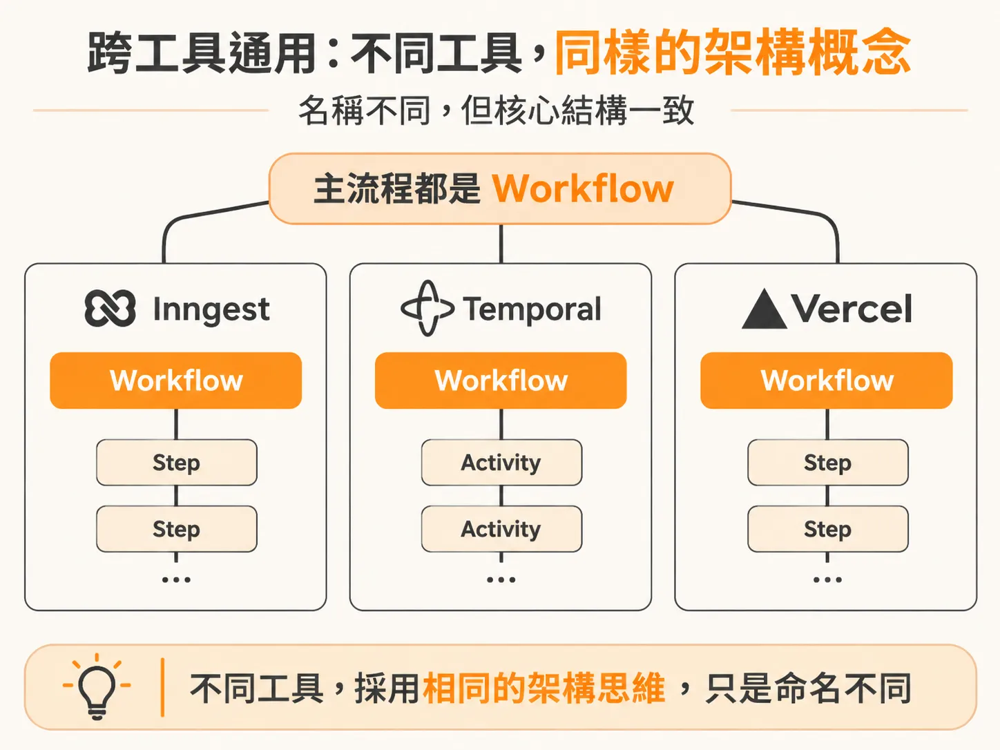

# 如何劃定 Checkpoint 邊界：非同步工作一次只做一個 Step

迴圈真的拆成多個步驟之後，下一個每天都會遇到的實務問題就是：邊界該切在哪裡？在撰寫背景工作或自動化流程時，只要導入像 Inngest 或 Temporal 這類耐用執行（durable execution）框架，最常碰到的核心問題就是：這段程式碼到底該不該包成一個 Step（或 Checkpoint）？

如果切得太粗，把整段迴圈包進同一個 step，一旦出錯就會隱藏中間的進度，重試時還得重複執行前面做過的操作；但如果切得太細，連單純的純量計算都包成 step，只會讓追蹤紀錄（trace）變得雜亂、歷史紀錄暴增，對系統崩潰後的復原能力卻沒有任何幫助。

要拿捏好這個邊界，其實有一套非常清楚的判斷原則：**非同步操作通常要放進 step，而且一個 step 最好只做一件非同步工作。**

---

## 為什麼有些判斷絕對不能放進 Step？

在設計多步驟的迴圈流程時，你可能會寫出一段用來檢查「當前條件是否已經滿足」的邏輯。這時候要特別注意：這類每次迴圈都需要重新評估的判斷，**不能**放進 step。

step 的本質帶有記憶快取（memoization）的特性。如果把條件檢查包進 step，系統在第一次執行時記錄下結果，後續重跑時就會直接拿快取結果回傳，永遠不會再真正執行那段檢查邏輯。

但像「取得特定執行狀態（get run）」這類的呼叫，就算包進 step 也不一定會得到不同結果，這時影響不大；但只要是每次都需要得到最新狀態、每次迴圈都必須重新檢查的條件，就絕對不能快取。反之，流程中的循環邏輯或需要對外發起請求的動作，就需要放進 step 裡記錄下來。

---

## 「非同步工作一次一個 Step」的單一原則

思考程式碼要不要包進 step 時，可以問自己幾個具體問題：
- 這段該被記憶化（memoized）快取起來嗎？
- 系統崩潰重跑時，我需要重新執行它，還是不希望它重複跑？
- 如果它執行結果每次都一樣，我有必要浪費資源重跑一次嗎？

大部分的非同步操作（例如呼叫外部 API、發送請求、寫入資料庫等）都很適合放進 step。而在把非同步操作放進 step 時，最關鍵的鐵則是：**盡量確保一個 step 裡只做一件事，而不是塞進很多件事。**

### 為什麼不能把多個非同步操作塞進同一個 Step？

想像一下，如果你在同一個 step 裡塞了 38 個非同步操作。當執行到第 2 個非同步操作時失敗了，系統觸發重試機制（retry policy）重新執行這個 step，後果就是：**已經成功執行過的第一個非同步操作，會被迫再執行一次。**

如果第一個操作是有副作用的外部動作（例如扣款或發送通知），重複執行可能帶來嚴重的後果。耐用 step 只記錄成功的結果，無法預防在它內部重跑帶來的 side effect。

只有在一種情況下，你才可以把多個非同步操作放在同一個 step 裡：**這些操作之間有密切關聯，而且即使全部重新跑過一次，也沒有任何不良後果。**如果你無法承受前一個動作被重跑的代價，就必須把它拆成獨立的 step。

平常可以先維持「一個非同步操作一個 step」的純粹原則，後續再根據應用程式的實際需要反正規化（denormalize）或拆分邊界。

---

## 跨工具通用：Inngest、Temporal 與 Vercel 的對應關係

這套思考邏輯並不是某個框架的專有名詞，在所有耐用執行工具中完全相通。不同的工具只是命名不同，背後的架構概念完全一致：

| 架構概念 | Inngest | Temporal | Vercel | 其他框架（如 Cloudflare） |
| :--- | :--- | :--- | :--- | :--- |
| **主流程** | Workflow / Function | Workflow | Workflow（如 `useWorkflow`） | Workflow |
| **執行步驟** | Step | Activity | Step / Decorators | Step |

- **Temporal** 將執行的步驟稱為 **Activity**，而不是 Step。
- **Vercel** 則使用類似裝飾器或 Hook 概念（如 `useWorkflow`）來組織流程與步驟。
- **Cloudflare** 也推出了自己的工作流程架構，表現相當優秀，也是非常值得嘗試的選擇。

不論你使用的是哪一種工具，只要記住核心架構規則：
1. **Workflow（工作流程）必須具有確定性（deterministic）**：在給定相同輸入與 step 歷史的情況下，每次重新執行必須走過相同的程式路徑。
2. **Step（步驟 / Activity）最好保持冪等性（idempotent）**：即便因為網路中斷或節點故障被重新觸發，多次執行的結果也必須與執行一次相同。

只要掌握「非同步工作一次一個 step」、「避免重試帶來副作用」的邊界判斷標準，不管日後面對哪一套執行引擎或 API 語法，都能設計出安全且容易復原的長生命週期任務。
