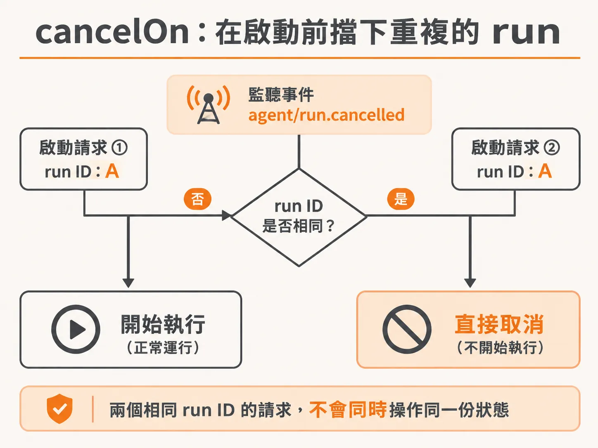
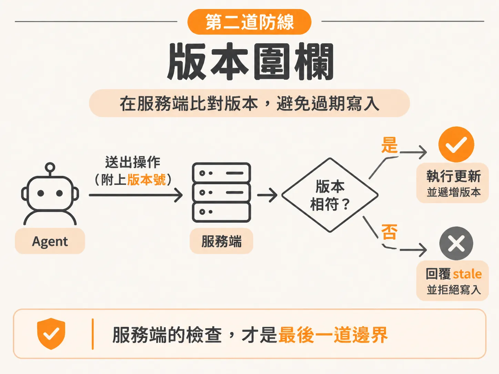
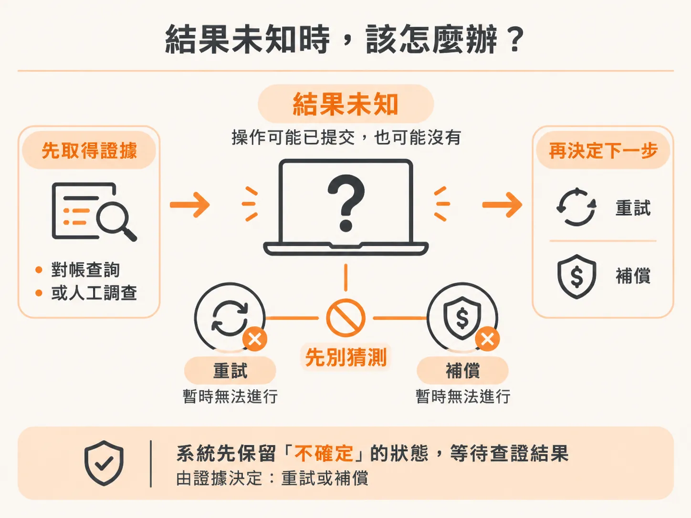

# 用 cancelOn 擋下重複 run：兩道防線與它們的極限

ID 穩定了，同一件事就不會被做兩次；但還有一類重複要處理——重複的 run。想像你的背景 agent 正在處理一起事故，它啟動了一個 workflow，帶著某個 run ID。現在因為重試或重複觸發，另一個同樣 run ID 的 workflow 也快要被啟動。如果不擋下來，兩個 workflow 會同時操作同一份狀態、各自推進、各自得出不同結論，事情就會亂掉。

用 `cancelOn` 可以把重複的 run 擋在門外。但 `cancelOn` 和版本圍欄有一個共同的極限：它們都無法處理「結果未知」的操作。

## cancelOn：在 workflow 啟動前擋下重複的 run

做法是在定義 workflow 時加一個 `cancelOn` 設定。它接受一組事件物件，只要配對到其中任何一個事件，這個 workflow 就不會執行。

<!-- source: sources/background-agent/20261109/supplement/server/agent-workflow.ts#L58-L70 -->

```typescript
export const incidentAgent = inngest.createFunction(
  {
    id: 'incident-agent',
    name: 'Checkout incident agent',
    triggers: { event: 'incident/opened' },
    retries: 2,
    cancelOn: [{ event: 'agent/run.cancelled', match: 'data.runId' }],
    // This limits executing steps, not the number of waiting incidents.
    concurrency: { limit: 1, key: 'event.data.environmentId' },
    onFailure: async ({ error, event }) => {
      const original = event.data.event as { data?: { runId?: string } }
      if (original.data?.runId) await setRun(original.data.runId, 'failed', error.message)
    },
```

這裡的邏輯是：監聽一個叫 `agent/run.cancelled` 的事件。如果這個事件的 payload 裡帶的 run ID，跟你自己正要啟動的那個 run ID 一樣，就直接取消，連流程都不要開始。



為什麼要這麼做？因為這個事件一出現，就代表系統某個地方已經偵測到：同一個 run ID 的 run 已經在跑了。我們絕對不希望同一個 run ID 同時有好幾個 run 在執行。

## 為什麼重複 run 這麼危險

用一個直覺的畫面來想：你把一份 Google Doc 分享給別人，你們兩個人的游標停在同一個位置，然後同時開始打一篇故事。

這樣是寫不出一句通順的話的。你會想叫對方「游標移到別的地方好不好？」但如果兩個人都在同一個位置、同時打字，結果只會是一團亂碼。

兩個 workflow 用同一個 run ID 同時跑，就是這個情況。它們操作的是同一份狀態、同一份所有東西，在同一時間做同樣的事，卻各自碰到不同的 race condition、得出不同的結論。那會是一場災難，所以一開始就要防止它發生。`cancelOn` 就是在做這件事。

## 第二道防線：版本圍欄

`cancelOn` 擋的是重複啟動的 run，但這還不夠。還有另一道防線：當 agent 要執行一個會改變狀態的操作時，它會把「自己觀察到的版本號」一起送出去。服務端在實際改狀態的同一個地方檢查這個版本，如果已經過期就直接拒絕。

<!-- source: sources/background-agent/20261109/supplement/service/checkout.ts#L138-L160 -->

```typescript
  if (
    (input.name === 'disable_feature' || input.name === 'rollback_release') &&
    input.expectedVersion !== version
  ) {
    return response.json({ stale: true, currentVersion: version })
  }
  ...
    case 'disable_feature': {
      state = { ...state, featureEnabled: false }
      recordChange('Disabled checkout express feature')
      if (activeFault === 'feature') recover('feature disablement')
      else version++
      result = { featureEnabled: false, version }
      break
    }
```

為什麼檢查一定要放在服務端、和改狀態綁在一起？為什麼檢查要放在服務端？因為如果只在 agent 這一端（harness）重新檢查一次再送出請求，檢查和送出之間仍然存在一段空檔，race 還是可能發生。服務端自己的檢查，才是最後一道邊界。



在需要人工審核的場景中，這套機制還能進一步收緊權限：人類回覆核准之後，harness 會重新觀察一次狀態，比對核准時的版本，確認沒變才去呼叫服務。

## 取代不了的部分：取消不是補償

有了 `cancelOn` 和版本圍欄，是不是就安全了？還不一定，因為取消有它覆蓋不到的範圍。

操作者可以停掉一個還在等待的事故，Inngest 也能透過 `cancelOn` 阻止未來的步驟執行——但一個已經送出、已經送達外部服務的操作，是收不回來的。它已經發生，效果仍然存在。`cancelOn` 能做的是「步驟之間」的取消，已經 commit 的操作不在此列。對於高衝擊的效應，操作者需要一份 effect ledger，甚至一個明確的補償 workflow。

## 更深的問題：結果未知怎麼辦

這就帶到真正的設計難題：怎麼表示一個操作的「結果未知」。

本地服務在還活著的時候，可以用重複的 ID 給出可靠的答案——問它兩次，它會告訴你同一件事。但外部供應商不一定有 idempotency key（讓同一次操作重複送出也不會重複執行的識別機制），也不一定提供狀態查詢的介面。

在這種情況下，正確的做法是把「不確定」這個狀態保存下來，然後阻止 agent 自己去猜。必須先由一個對帳查詢（reconciliation query）或人工調查確認到底發生了什麼事，agent 才能決定要重試還是要做補償。



把 prompt 寫得再強、再逼真，也變不出系統裡根本不存在的證據。`cancelOn` 能擋下重複的 run，版本圍欄能擋下過期的操作，但面對一個結果未知、又查不到的操作，唯一誠實的處理方式是承認不知道，並把釐清真相變成一個明確的、獨立的步驟。
