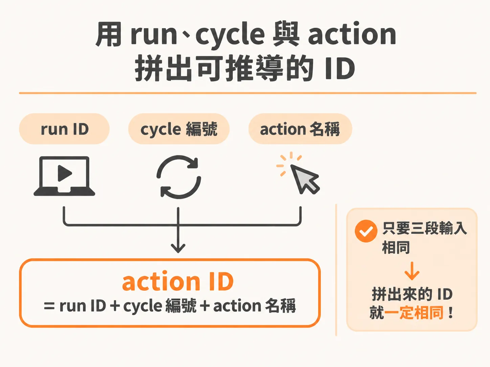
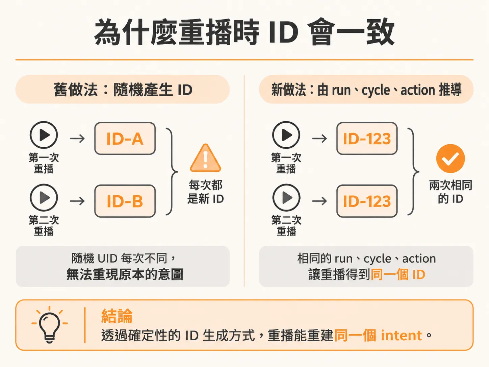

# 用 run、cycle 與 action 推導出確定性的 action ID

「同一個 intent 就用同一個 ID」聽起來很乾淨，剩下的問題是：這個 ID 到底從哪裡來。想像一個 agent workflow 執行到一半，某個步驟失敗了，系統得重播整個流程。重播時，之前那個「送出動作」的意圖（intent）——一個需要重試的動作——必須能被完整重建。問題出在 action ID 怎麼產生。如果每次重播都隨機生成一個新的 ID，系統根本無法知道「現在這次重試，其實就是之前那個動作」。要解的就是這個問題。

## 原本的做法哪裡不夠

在前一個 checkpoint 的做法裡，action ID 是這樣組出來的：run ID 加上一個 `randomUUID()` 隨機產生的字串。這個 ID 只在某一次嘗試（attempt）內有意義——流程一失敗、重播重來，ID 就換了一個全新的。

這個 ID 不夠精確（"scoped well enough"），範圍抓得太鬆。我們想要的是一個更緊、更能精確定位的 ID。

## 加入 cycle 與 action，讓 ID 變得可推導

解法其實很直接：與其依賴隨機值，不如把流程中已經存在的資訊組進 ID 裡——這個決策所處的 **cycle**（決策循環的編號），再加上這一輪選出來的 **action**。



修正的方式就是這一行改動：

<!-- source: sources/background-agent/20261109/supplement/lessons/05-safe-retries/index.md#L60-L70 -->

```diff
         return { report }
       }

-      // An attempt-local ID is intentionally unsafe when a response is lost.
-      const actionId = `${runId}:${randomUUID()}`
+      const actionId = `${runId}:${cycle}:${decision.action}`
       const policy = actionPolicy[decision.action]
       if (policy === 'approval') {
         const input = { expectedVersion: state.world.version }
```

原本那個「嘗試區域性」的 ID，在回應遺失時是不安全的，所以被換掉。新的 action ID 由三個部分組成：run ID、cycle、選定的 action 名稱。

server 端實際執行時，就是拿這個 ID 去執行動作：

<!-- source: sources/background-agent/20261109/supplement/server/agent-workflow.ts#L141-L195 -->

```typescript
      const actionId = `${runId}:${cycle}:${decision.action}`
      const policy = actionPolicy[decision.action]
      ...
      const result = await step.run(`execute-action-${cycle}`, () =>
        executeAction(
          environmentId,
          runId,
          actionId,
          decision.action,
          policy === 'read' ? undefined : state.world.version,
        ),
      )
```

## 為什麼這樣就是 deterministic

整件事的關鍵詞是 **deterministic（確定性）**。

之前的 random UID 不是 deterministic 的——它是隨機的，同樣的輸入，每次跑都會得到不同的 ID，所以失敗重播時無法重現。



現在的寫法是 deterministic 的。只要給定同一個 run ID、同一個 cycle、同一個 decision（決策），就一定能推導出同一個 action ID。重播時不管重建幾次，都能還原出「同一個 intent」。

補充一個前提：模型選出的 action 早已被 checkpoint 記錄下來，所以重播重建時，同樣的決策會還原出同樣的 intent key。這正是確定性推導能成立的原因。

## 測試與一個隱藏的坑

就測試本身而言，沒有太多要額外驗證的——就是確認原本的流程照樣能動，而這部分是已知的，不必特別再測（很多例子裡也沒真的測）。

但為什麼還要特別強調這個改動？因為如果真的把系統推到更大規模——比如再開一個服務、跑一堆東西——舊做法會**立刻壞掉**。你會完全搞不清楚狀況：這些東西是從哪來的？原因就在於它們會共用同一批資源，而舊的隨機 ID 讓你**沒有辦法取消**它們。

改用 deterministic 的 ID 之後，這個問題就解了——現在你有辦法取消它們。

## 一個常見的誤解

最後提醒一個容易搞錯的地方：這個 ID 標記的是**一個 intent（意圖）**，不是一次 HTTP 嘗試。同時要注意，Inngest 的 checkpointing 機制**無法推斷**一個未被確認的外部效果到底有沒有真的完成——這正是為什麼 ID 必須穩定可推導，讓重試落在同一個 intent 上，而不是每次重試都變成新的嘗試。

想再往下延伸，可以把這個 action ID 對應到付款或部署 API 的 idempotency key（等冪金鑰）。如果服務商本身不提供這種機制，那就先寫一個對帳查詢（reconciliation query），在重試之前先確認上一次的效果到底有沒有發生。
