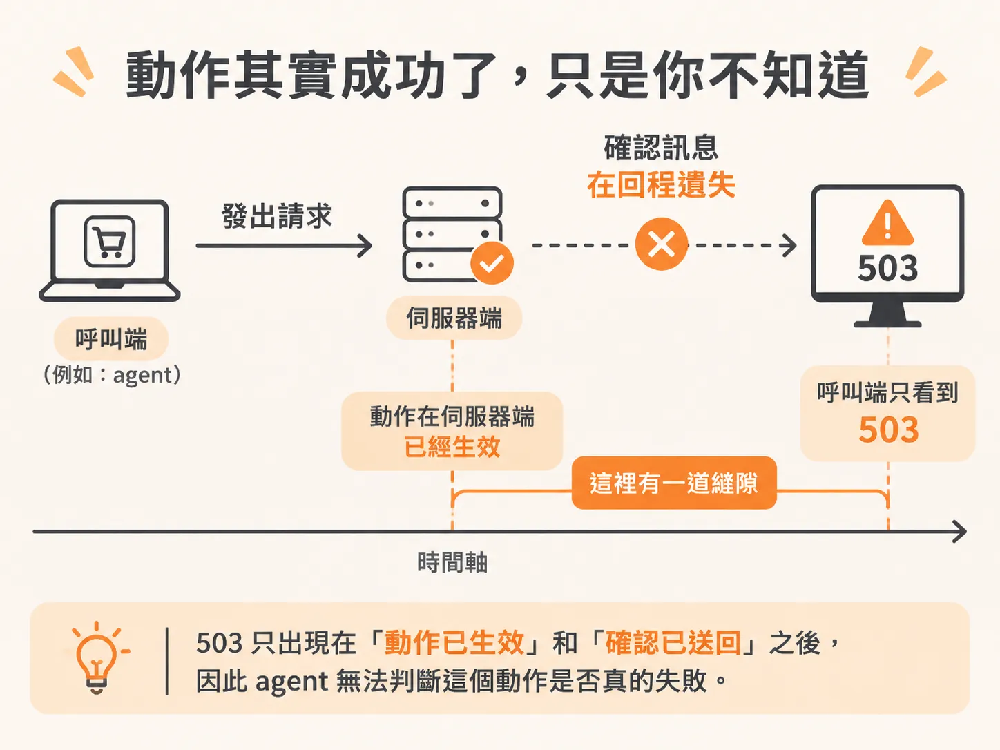
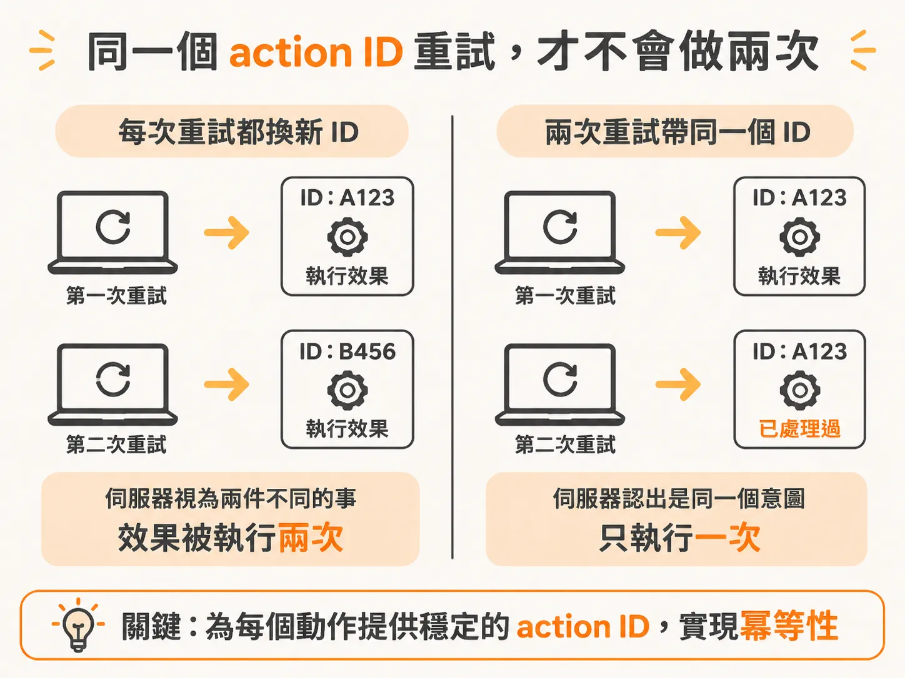
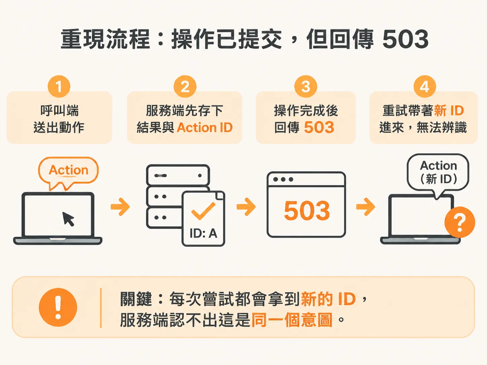

# 重試的陷阱：為什麼收到 503 不代表動作失敗

想像你在寫一個會自動執行動作的 AI agent。它呼叫 API 去「關閉某個功能」，等半天收到的回應是 503。這時 agent 該怎麼辦？直接重試嗎？

問題就出在這裡：503 只代表「你沒收到確認」，不代表「動作沒有發生」。動作可能已經在伺服器那端完成了，只是回應在網路上遺失。如果 agent 看到 503 就換一個新的請求身分重送一次，等於把同一件事做兩次。在真實系統裡，那可能是一筆重複扣款、一封重複寄出的信、一次重複的部署，或一張重複開出的 ticket。

## 不確定的狀態，是最危險的狀態

重試聽起來很簡單，難的是失敗剛好落在「動作已經生效」和「確認已經送回」之間。以結帳流程為例：它先停用某個功能、改變自己的狀態，然後 HTTP 回應在傳回的路上消失。agent 看到的是 503，但它不能下結論說這個動作失敗了——它根本不知道伺服器那端發生了什麼。



durable execution（持久化執行）可以保存成功的步驟結果，但它救不了工作流程從來沒收到的結果。結果沒送回來，就是沒記錄，系統仍然處於不確定狀態。

## 穩定的 action ID：讓不確定的呼叫可以安全重試

解法是給每個動作一個穩定的 action ID。有了這個 ID，一個結果不確定的工具呼叫在重試時，就不會重複產生它的效果——這就是冪等性（idempotency），也有人叫它 idempotent。



概念上，action ID 基本上就是一個 idempotency key（冪等鍵）。重試時帶著同一個 ID，服務端就能認出「這是同一個意圖」，而不是把每次重試都當成新請求。

這也點出一個常見的錯誤：這個 ID 用來識別的是「一個意圖」，不是「一次 HTTP 嘗試」。如果像目前某些實作那樣，每次嘗試都拿到一個新的 ID，服務端就無從分辨那是同一個意圖，重複執行的風險就回來了。checkpointing 機制也無法替你推斷一個沒收到確認的外部效果到底有沒有提交——這個判斷必須靠 ID 機制自己解決。

## 想自己驗證一次？

在 lab 環境輸入 `--fault feature --lose-next-action-response`，就能重現這個情境：操作實際上已經提交，但回傳的是 503。每次嘗試都會拿到新的 ID，所以服務端認不出這是同一個意圖。伺服器端的處理邏輯如下：



<!-- source: sources/background-agent/20261109/supplement/service/checkout.ts#L170-L180 -->

```typescript
  outcomes.set(input.actionId, { fingerprint, result })
  if (
    loseNextActionResponse &&
    (input.name === 'disable_feature' || input.name === 'rollback_release')
  ) {
    loseNextActionResponse = false
    return response
      .status(503)
      .json({ error: 'Simulated acknowledgement lost after the operation committed' })
  }
  return response.json(result)
```

可以看到，它先把結果以 action ID 存起來，然後針對 `disable_feature` 和 `rollback_release` 這兩種動作，刻意在操作完成後丟掉回應、回傳 503——模擬的正是「效果已落地、確認已遺失」的那個縫隙。

## 延伸閱讀

AWS 有一份關於冪等 API 的討論文件，是少數寫得真的不錯的說明文件之一。Inngest 也有一份關於這個主題的指南，可以一併參考。
