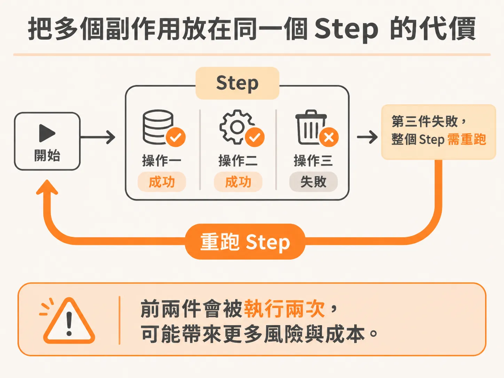
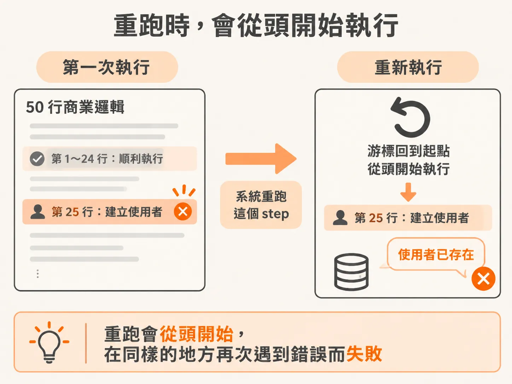
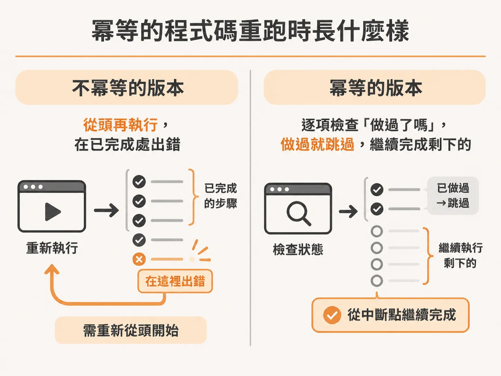

# 把副作用拆成獨立 Step：讓重跑的程式自動跳過已完成的工作

穩定的 action ID 解掉的是「同一個 intent 被做兩次」；但重複還有另一個來源——step 本身是怎麼切的。假設你的背景程式裡有一個 step（一段會被系統執行、失敗時可能重跑的動作）。這個 step 裡做了好幾件對系統有實際影響的事，例如建立資料、呼叫第三方 API。第一次跑的時候，其中一件事失敗了，系統於是把整個 step 重跑一遍。

結果呢？已經成功的事情又被打了一次。輕則浪費功夫，重則在系統裡留下重複的資料。

這種狀況其實可以從一開始就避免。

## 問題一：多個副作用擠在同一個 step 裡

原則很簡單：如果一個 step 裡有多件「會對系統造成改變」的非同步動作，你必須確保它能承受重跑。

具體來說，想想這個情境：一個 step 裡塞了三件破壞性操作。跑到一半，前兩件成功、第三件失敗，整個 step 於是被重跑。請問會發生什麼事？

前兩件已經成功的操作會再被執行一次。系統不會跳過它們——因為它們在同一個 step 裡，重跑的單位是整個 step，不是裡面的個別動作。

如果你希望前面成功的事情不會跟著重跑，最好的辦法就是：一開始就把每件事放進自己的 step。這樣你不必自己寫任何交易機制，就能免費得到「一件事失敗只重跑那件事」的行為。

反過來說，如果你想讓多個操作可以被分開重試，就得在同一個 step 裡自己實作交易邏輯——那比把東西拆開來做要麻煩得多。所以與其想辦法在一個 step 裡模擬這種行為，不如直接拆成多個 step。

有的時候，重跑同一件事會直接讓系統出問題。例如重複建立相同的訂單、重複發送通知。如果你的系統經不起這種重複執行，那就更應該把它們各自放進獨立的 step。

## 問題二：重跑一半失敗的 step

把動作拆成獨立 step 之後，還有第二件事要注意：step 裡的程式碼本身也可能中斷。

舉個例子。你的 step 呼叫了一個內部 API，這個 API 裡有 50 行的商業邏輯——比方說建立使用者、做一大堆後續的設定。程式跑到第 25 行的時候壞掉了，回傳錯誤。這個 step 因為沒有順利完成，系統就會重跑它。

聽起來很合理，對吧？但麻煩來了：前面那 25 行已經做完的事——使用者已經建立了——重跑的時候又會再執行一遍。程式跑到「建立使用者」這行，系統回你一句「這個 email 的使用者已經存在」，然後直接炸掉。

第一次失敗的原因你可能根本不知道，但重跑之後又失敗了一次——這次是因為你的程式碼不具備「冪等性」（idempotent）：意思是一件事做過之後，再做第二次不會產生副作用，也不會出錯。

## 冪等的程式碼會怎麼表現

如果那 50 行商業邏輯是冪等的，重跑的時候它會這樣進行：

「使用者已經存在了，跳過。」「這件事已經做過了，跳過。」

一路跳過所有已經完成的步驟，直接做到當初中斷的那個位置，從那裡繼續，把剩下的事情做完。

所以一個冪等的 step 就算曾經部分失敗，重跑時也會自己把進度「補」到斷點，而不是從頭再做一遍然後撞牆。

## 把兩件事合起來看

真正要解決重跑問題，有兩條腿：

1. **每個副作用一個 step**：這樣重試的最小單位就是單一件工作，已經成功的事不會被牽連重跑。
2. **step 內的程式碼要冪等**：這樣就算一件事做到一半失敗、整個 step 重跑，程式也會沿路檢查「這件做過了嗎？做過就跳過」，一路推進到斷點把它完成。

這兩件事不需要什麼高深的技術，就是你設計 step 的時候多想一步：這個 step 會不會被重跑？重跑的時候，每一段程式碼能不能安全地再執行一次？想清楚這兩個問題，重跑就會從「又炸了一次」變成「自動跳過完成的部分，繼續把事情做完」。
