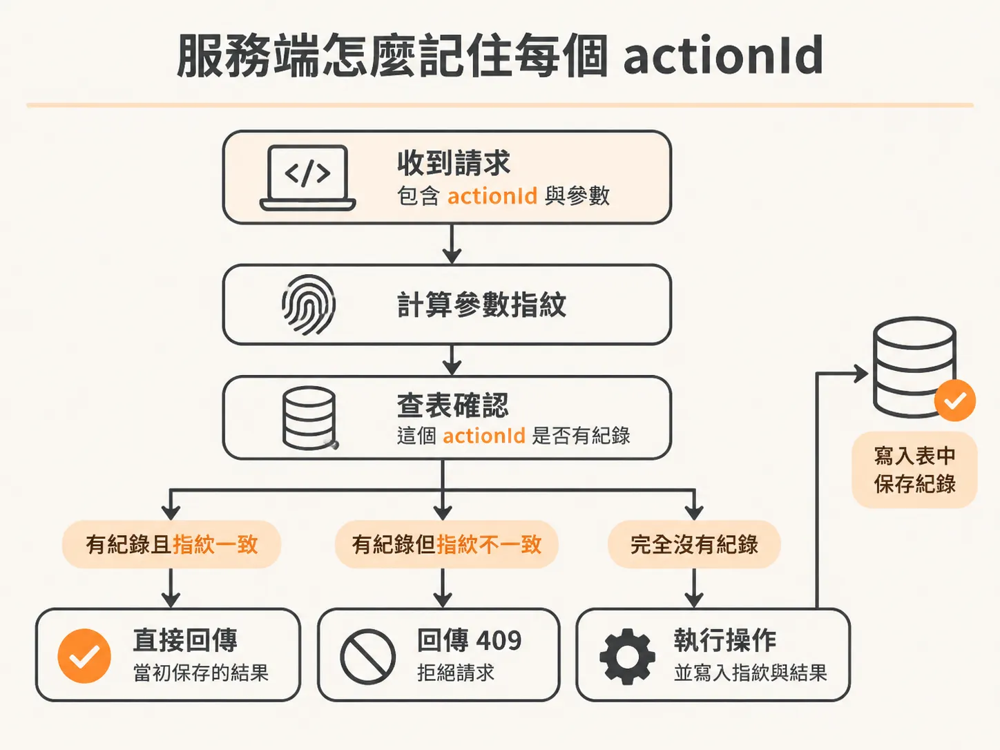
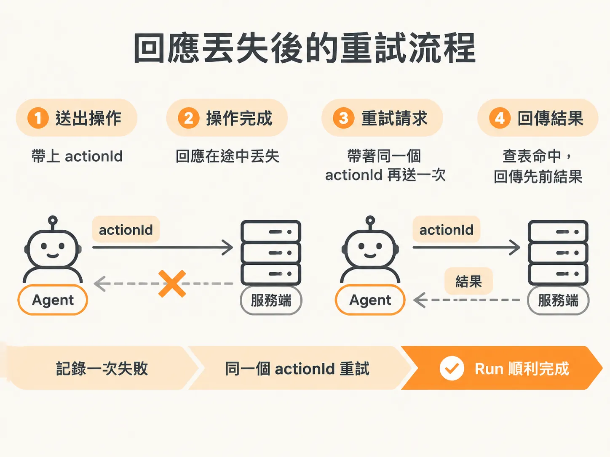

# 用同一個 actionId 讓重試不會做兩次

設計好 step 之後，接著要看服務那一側怎麼記得「這件事做過了」。想像 agent 在跑一個 checkout 流程：它呼叫某個服務要停用某個功能或回滾版本，網路斷了，回應沒傳回來。agent 只知道「我沒收到回應」，於是重試一次。問題來了：第一次的呼叫其實已經成功執行，如果重試又完整跑一遍，同一個操作就會被做兩次。在金流或狀態變更的場景，這不是小事。

## 冪等：不是新問題，Stripe 早就解過

這類問題有個名字，叫冪等（idempotent）：同一件事做一次和做多次，結果要一樣。Stripe 在這方面做得非常好——每筆交易它會給你一把 idempotency key，你本來就應該帶著這把 key 去呼叫。有了 key，Stripe 就能追蹤「這筆我已經處理過了」，不會讓你把同一筆交易做兩次。

要做的是同一件事，只是把那把 key 叫做 **action ID**。每次要建立一個 action 之前，先給它一個 ID。因為同一件事帶的是同一個 ID，系統就能認出「這個我已經做過了」，不會再做第二次。

這偏後端領域，有一整個團隊專門在解這件事。但只要跟這類系統打交道，就繞不開它，所以照著做。

## 以前隨機 ID 就好，現在不行

到目前為止，用的都是隨機 ID，之前的態度是「根本不在乎，隨機就好」。當時這樣想沒問題——反正每次執行都是全新的一次，ID 隨便生成都不影響。

現在不一樣了，因為不想把同一件事跑兩次。「隨機就好」的態度，正好是重試安全性的敵人：重試時如果 ID 又是隨機新的一個，系統根本無從知道這兩次其實是同一個 intent。

## 改法的方向：拿掉隨機 UUID

所以要動手改程式碼。方向很明確：把原來那套隨機 UUID 拿掉，改用既有的內建機制，讓冪等性大部分由系統處理。關鍵是讓「同一個 intent 的重試」算出**同一個** ID——也就是所謂的 derived ID，從操作的內容推導出來，而不是擲骰子。

## checkout service 那一側怎麼記

具體到 effect 所在的 checkout service，它會把每收到一個 `actionId` 和它的執行結果**記下來**。之後如果有人帶著同一個 ID 和同樣的參數再來一次，它不會重新執行操作，而是直接把存好的結果回傳。反過來，如果有人拿同一個 ID 卻帶不同的參數，這是誤用，必須拒絕。

實作上可以用兩件事判斷：



- **查表**：先看看這個 `actionId` 之前有沒有結果。
- **指紋比對**：即使 ID 相同，也要確認參數一樣，才回傳舊結果。

<!-- source: sources/background-agent/20261109/supplement/service/checkout.ts#L131-L170 -->

```typescript
  const fingerprint = JSON.stringify({ name: input.name, expectedVersion: input.expectedVersion })
  const prior = outcomes.get(input.actionId)
  if (prior) {
    if (prior.fingerprint !== fingerprint)
      return response.status(409).json({ error: 'Action ID reused with different arguments' })
    return response.json(prior.result)
  }
  if (
    (input.name === 'disable_feature' || input.name === 'rollback_release') &&
    input.expectedVersion !== version
  ) {
    return response.json({ stale: true, currentVersion: version })
  }
  ...
  outcomes.set(input.actionId, { fingerprint, result })
```

看這段程式碼的頭尾就夠了：開頭先從 `{ name, expectedVersion }` 算出指紋，然後查這個 `actionId` 有沒有之前的紀錄；有紀錄但指紋對不上，就回 `409` 拒絕；指紋一致就直接回傳當時存的結果。走到最後，執行成功後才把 `{ fingerprint, result }` 存進表裡——所以「回傳舊結果」回的一定是真正執行過一次之後的結果。

## 回應丟失時，整套流程長什麼樣

把前面所有零件接起來，看「回應丟失」這個情境：agent 送出了操作，回應在路上掉了。在 Activity 記錄裡，會看到一次失敗的嘗試，接著一次**帶著同一個 ID** 的重試。checkout service 認出這個 ID，回傳它先前記下的結果；Neon 把這個 action 記錄下來，這一次 run 順利完成。



這裡有個重點：**只有走「穩定 ID」這條路的分支，才拿得回原本那次操作的結果**，並把它記錄為這次 run 的 effect。如果重試時換了一個新 ID，服務那邊就只是一筆全新的請求，該做的還是會再做一次。同樣地，同一個 ID 搭配不同參數一定要被拒絕，否則「同一個 ID 代表同一件事」的約定就破了。

## agent 這一側：把結果記進資料庫

服務端記了，agent 這邊也要記。record 的邏輯大致是這樣：

<!-- source: sources/background-agent/20261109/supplement/server/agent-data.ts#L156-L174 -->

```typescript
export async function recordToolAction(
  environmentId: string,
  runId: string,
  actionId: string,
  name: ActionName,
  input: Record<string, unknown>,
  result: Record<string, unknown>,
) {
  await db
    .insert(actions)
    .values({ id: actionId, environmentId, name, input, result })
    .onConflictDoNothing()
  await logAgentActivity(environmentId, runId, 'act', `${name.replaceAll('_', ' ')} returned`, {
    actionId,
    input,
    result,
  })
}
```

`onConflictDoNothing()` 的重點在於：如果這個 `actionId` 已經存在資料表裡（例如前一次 run 已經記過同一個結果），insert 就安靜地不做任何事，不會報錯也不會覆蓋。活動日誌照樣記一筆「某某操作已回傳」，帶著 `actionId`、輸入和結果，讓你在 Activity 裡看得到整條重試軌跡。

## 回頭看一開始的問題

一開始的問題是「回應丟失之後重試，操作會不會做兩次」。現在答案很明確：不會，前提是重試帶著同一個 `actionId`。checkout service 認得這個 ID，直接回存好的結果，操作本身不會再執行一次；ID 對不上參數就被 `409` 擋下；資料庫那邊靠主鍵衝突時不做事，同一個結果也不會被記兩遍。

所以別再用隨機 ID 了。同一個 intent，就要有同一個 ID——這一條規則，就是安全重試的全部基礎。
