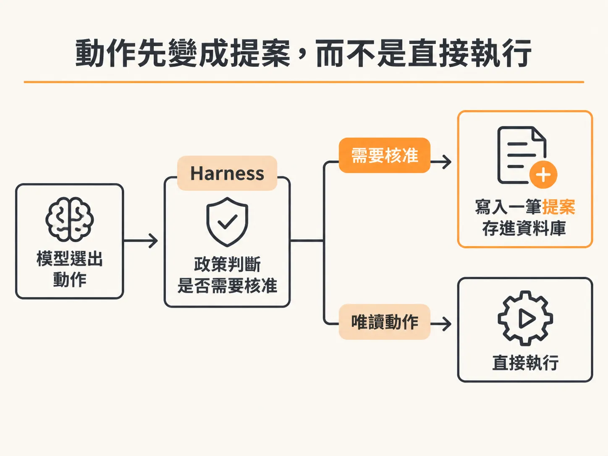
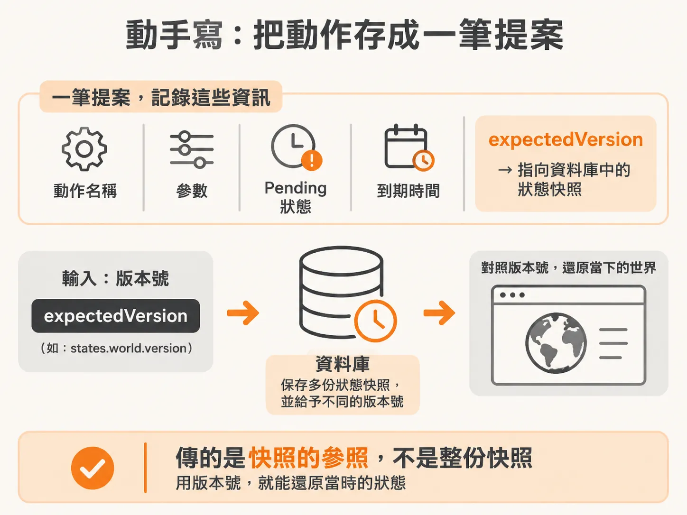
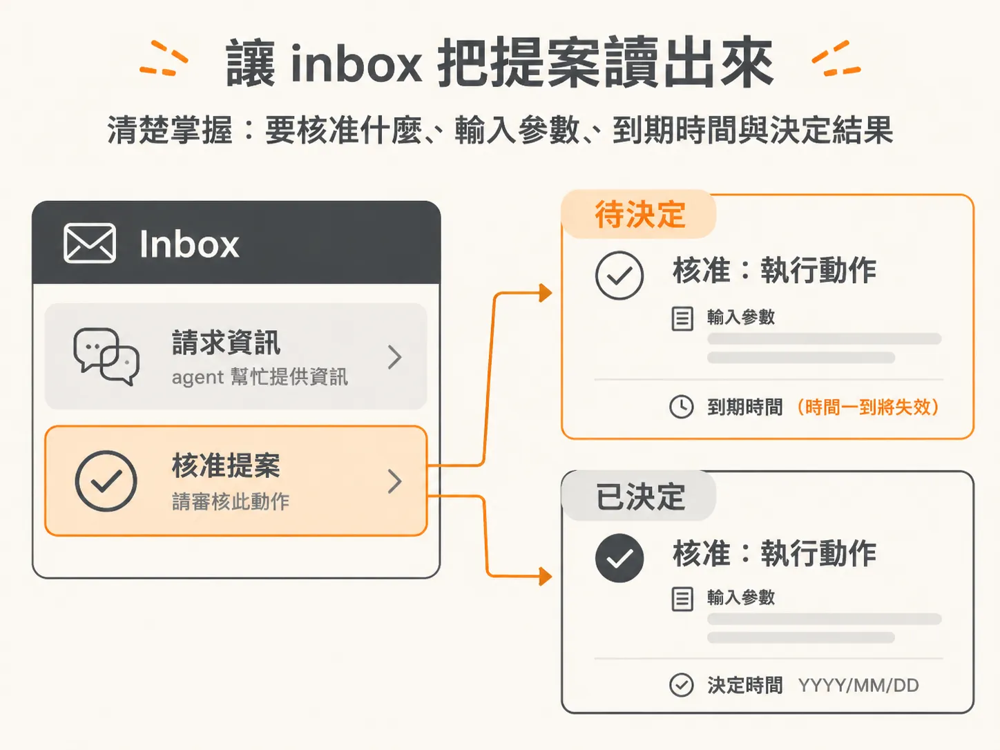

# 把需要核准的動作變成一張 Proposal

背景 agent 咻一下跑完觀察、決定下一步，然後決定要 rollback release。問題來了：這個動作不能讓它直接執行，得先有人點頭。可是 agent 是非同步在跑的，人可能一週後才看到通知，到時候它要怎麼記得「當時我想做什麼、當時的狀態長怎樣」？

答案是把這個動作存成一份 proposal（提案）：裹頭帶著動作名稱、參數、當下的狀態版本，還有到期時間。人從 inbox 核准時，系統再從資料庫把這份提案撈回來，讓 agent 接著跑。

## 先想清楚：哪些動作需要人類點頭

human-in-the-loop（人在決策迴圈裡，簡稱 HITL）的概念其實很簡單：agent 想做某件事，先通知人，等人做完或回覆，再根據「人有沒有做」決定下一步。Inngest 官方的 HITL 指南做法非常像：直接拿 Slack 當 inbox——在 Slack 上喊一聲，請人做某件事，然後等他做，再把結果讀回來。本質上是把 Slack 當成現成的收件匣，而不是自己刻一個。同樣的概念，換個地方放而已。

在這個專案裡，我們選擇 rollback release 當作需要核准的動作。政策程式碼裡已經替它加上了 approval。這些政策並不會暴露給 agent。agent 只看得到名字——它知道有個動作叫 rollback release，但不知道這個動作的政策需要核准。這不是什麼鐵則，純粹是個人偏好；你要暴露給它也不一定會出問題。

那該怎麼判斷哪些工具該加人類核准？一個務實的起點是：凡是會改動資料的（mutative）、有寫入權限的動作，先全部丟到核准後面。然後再逐步去風險化。

因為核准不是萬能的安全護身符。agent 在提出提案之前，可能早就讀過一段不可信的 log，然後基於那個錯誤判斷挑了錯的動作——讀 log 核本來就不需要核准，所以核准擋不住這件事，你必須真的把這點放在心上。

接著就是去風險化的功夫。如果你的背景 agent 監看的流程會做很多寫入，而每個寫入都要核准，你每天光是在 inbox 裡按掉二十幾個請求，那不如花時間想：怎麼把這件事變得安全到不需要問我？可能的樣子包括：建一個 rollback 機制，AI 搞砸了就快速回滾；把爆炸半徑縮到就算搞砸也無所謂；或者雖然會改動，但像發佈那樣分階段——先影響 10%，再 20%，再 40%。

不管是哪種方式，目標都一樣：不要讓自己卡在天天按核准，那等於又變回聊天式 agent，坐在那邊等它回話，生產力根本解鎖不了。這個平衡要自己抓，但我個人認為大部分人的未來工作型態，就是看著一個 inbox，說「你為什麼要做那件事？」或者「等等，不是 12 號，是 13 號。」以後做的事，多半會是這類工作的某種版本——因為我自己現在的工作，某種程度上就是這樣。

## 動作被「提案」，而不是被執行

接下來回到 workflow 檔案，實際把 HITL 寫進程式。第一步是新增幾個 import：`getProposal`、`proposedAction`、`staleProposal`。



- `getProposal` 就是去資料庫查詢一份提案——每當需要向上請示時，提案就會被存進去，之後可以回來參照。
- `proposedAction` 顧名思義：當 AI 已經決定要執行某個動作，但那個動作需要核准，它就從「要執行的動作」變成「被提案的動作」，得先存進資料庫。
- `staleProposal` 處理的是「提案過期了沒」。

為什麼非得存進資料庫？因為等流程繞回 inbox、你按下「核准」的時候，系統得有地方找到這個動作當初的樣子，把動作和參數還原，然後讓 agent 去跑。這份狀態必須存在某個地方，所以我們把它存成 proposed action，之後才能對應回 inbox 上那一次按鈕點擊。

沒有這個參照，你或許可以依賴 Inngest 的 state 繞回原本的位置，但我認為那不是好主意——這是應用程式的邏輯，應該存在你自己的資料庫裡，讓 Inngest 專心處理 workflow 邏輯就好。自己存還有額外的好處：假設你想在某個 dashboard 上看一份清單，列出 AI 目前正在請你核准哪些動作；或者拉出時間軸，看看歷來提過哪些案；又或者你管理一群各自帶著 agent 的人，想跨多個 agent 看所有待核准的提案——這些都建立在「提案存在自己手上」的基礎上。

<!-- source: sources/background-agent/20261109/supplement/server/agent-data.ts#L175-L212 -->

```typescript
export async function proposeAction(
  environmentId: string,
  runId: string,
  actionId: string,
  action: ActionName,
  input: Record<string, unknown>,
) {
  const [proposal] = await db
    .insert(approvals)
    .values({
      id: randomUUID(),
      environmentId,
      runId,
      actionId,
      action,
      input,
      status: 'pending',
      expiresAt: new Date(Date.now() + 10 * 60_000),
    })
    .returning()
...
  return proposal
}
```

上面這段就是提案建立的樣子：寫入時給了狀態 `pending`，並算好一個 `expiresAt`。資料表的欄位也很直觀——動作名稱、輸入、狀態、原因、到期與決定時間都各自一欄：

<!-- source: sources/background-agent/20261109/supplement/server/schema.ts#L92-L107 -->

```typescript
export const approvals = pgTable('approvals', {
  id: uuid('id').primaryKey(),
  environmentId: uuid('lab_id')
    .notNull()
    .references(() => environments.id),
  runId: uuid('run_id')
    .notNull()
    .references(() => runs.id),
  actionId: text('action_id').notNull(),
  action: text('action').notNull(),
  input: jsonb('input').$type<Record<string, unknown>>().notNull(),
  status: text('status').notNull(),
  reason: text('reason'),
  expiresAt: timestamp('expires_at', { withTimezone: true }).notNull(),
  decidedAt: timestamp('decided_at', { withTimezone: true }),
  createdAt: timestamp('created_at', { withTimezone: true }).notNull().defaultNow(),
```

## 狀態會漂：stale proposal 的問題

一切都非同步之後，事情變得不太一樣了。今天送出一份提案，可能一週後才有人看。

送出提案當下，狀態長得像 ABC。一週後你才去核准，狀態已經變成 XYZ。那麼這個「在當時幾乎肯定是下一步」的動作，現在恐怕已經不是該跑的那一個了。所以它過期了——stale。

怎麼知道它 stale？提案時順手拍下狀態的快照存進資料庫。回頭查看時就問一句：現在的狀態，跟資料庫裡存的那份快照一樣嗎？不一樣，就是 stale 動作，硬跑可能會得到不同的結果。這是一種聰明的確認方式：跑這個動作，還能得到我們提案時預期的結果嗎？還是狀態已經漂移太多，這根本不再是最合理的下一步？

如果 stale，我們希望 agent 再跑一輪：哦，人雖然核准了，但提案已經過期，那就再做一次觀察。如果觀察完還是覺得這是對的動作，就重新選它、重新送出一次提案。當然，最好你的人回得夠快，不會無限循環。但這總比拿著 stale 狀態硬跑一通、然後祈禱順利來得強。

一切都非同步之後，你得用這種方式思考——這跟我們平常寫程式的思路差很遠。

## 動手寫：把動作存成提案

目前程式裡，政策是 approval 時什麼都不做。現在我們要讓它做點事。

第一步是取出這次的輸入，它其實就是狀態快照的參照——`expectedVersion`，也就是 `states.world.version`。快照的做法是：在這個模擬伺服器上，狀態每變一次，我就存一份新快照到資料庫，並給它一個不同的版本號。這樣 agent 不用帶著整份快照到處跑，只要傳一個版本號，伺服器再用這個號碼對照回實際的快照。換句話說，每次傳的是快照的參照，不是快照本身，效果是一樣的。



有了輸入，還需要一個 proposal ID 來追蹤這份提案。接著呼叫 proposed action，然後照例追踪目前在第幾個 cycle，尾端放一個 async function，在這個 step 裡做真正的工作。

Step 內第一件事是建立提案。Proposed action 會接收 environment ID、run ID、action ID（也就是我們要執行的動作 `decision.action`），還有 inputs——也就是狀態本身。這樣就建好了提案，最後回傳 `proposal.id`。第一個 step 到這裡完成。

## 讓 inbox 讀到它

提案存進資料庫後，inbox 端就能讀到。畫面上會區分兩種訊息：agent 幫忙請求資訊（request help），以及需要核准的動作。核准卡片會顯示提案的動作名稱；如果還在 pending，就顯示到期時間——時間一到就失效；如果已經被決定，則顯示狀態和決定的時間。卡片上也會攤開提案的工具輸入內容，讓你知道自己到底在核准什麼：



<!-- source: sources/background-agent/20261109/supplement/web/src/App.tsx#L434-L474 -->

```tsx
                      <h2>
                        {message.action === 'request_help'
                          ? 'The agent needs information'
                          : `Approval: ${label(message.action)}`}
                      </h2>
                      <p>
                        Background agent <span>·</span>{' '}
                        {message.status === 'pending'
                          ? `Expires ${new Date(message.expiresAt).toLocaleString()}`
                          : `${label(message.status)} at ${time(message.decidedAt)}`}
                      </p>
...
                          {message.action !== 'request_help' && (
                            <div className='action-detail'>
                              <span>PROPOSED TOOL INPUT</span>
                              <pre>{pretty(message.input)}</pre>
                            </div>
                          )}
                        </div>
```

## 核准不等於放行：核准後再驗一次版本

流程上的順序是這樣：先持久化提案，裹頭記下 agent 觀察到的狀態版本；然後等待與這份提案關聯的決定事件；醒來後再讀取已存的決定——因為通知可能提早到，也可能漏掉。如果人拒絕、或提案到期，整個 run 就上報升級；如果核准了，執行前還要再讀一次服務的狀態：一份基於版本 4 的核准，不該被拿去對版本 5 做 rollback——就算只是別的欄位變了也一樣。

整體的邊界是這樣：模型仍然會選出 rollback release 作為下一步，但 harness 把這個選擇變成一份提案而不是一次工具呼叫。這就是權限的分界。模型可能診斷錯，人也可能核准錯，但至少現在這個決定是攤在脈絡與稽核紀錄面前的。唯讀的檢查動作可以照跑不用核准，破壞性的動作則停在閘門前。

這段流程也經得起真實世界的測試：在核准還沒決定時把 agent 的 endpoint 停掉，透過 UI 回覆，再把 endpoint 重啟。提案和決定活在 PostgreSQL，workflow 的歷史活在 Inngest，兩者都不依賴當初那個還開著的瀏覽器請求。這正是 inbox 堆疊出來的韌性——你按下去的那一刻，背後什麼都接得住。
