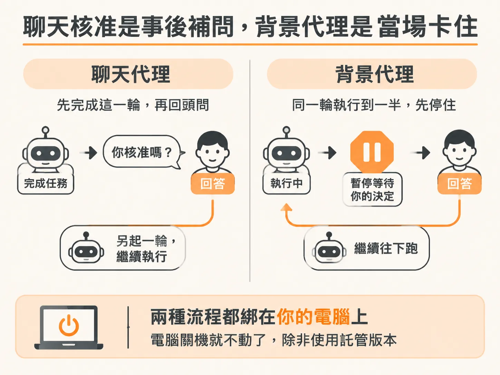
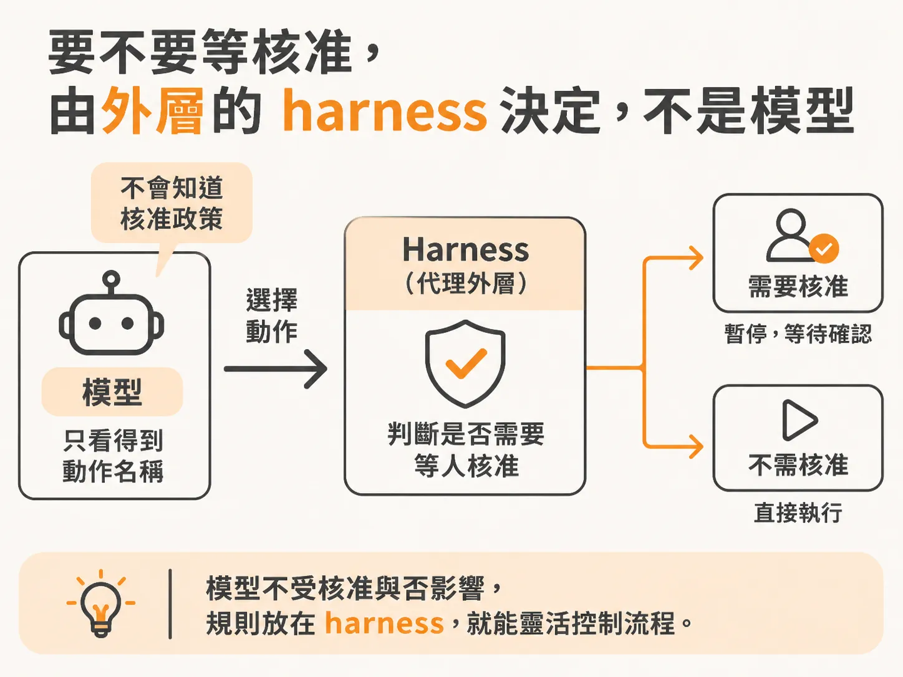
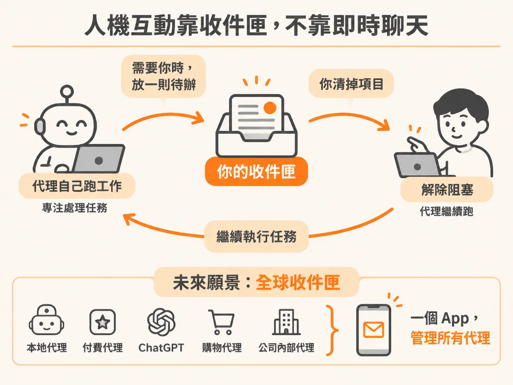

# 卡在 run 中間等你：背景代理的 HITL 和聊天核准差在哪

你叫代理去做一件事，它做到一半停了下來，等你點頭才繼續。這種「人要介入」的設計，有個術語叫 HITL（human-in-the-loop，人在迴圈裡）。但同樣是等你核准，聊天機器人的做法和背景代理的做法，其實是完全不同的兩回事。

## HITL 是什麼、不是什麼

講到 HITL，如果你去搜尋，會看到一大堆機器學習訓練、強化學習的資料。那些不是這裡要談的。這裡說的 HITL 很單純：一個 agent 正在做事，但它被人的判斷卡住了，不繼續等你動作，它就動不了。

而且這不是背景代理才有的事。你去 Claude 或 Codex 這類聊天代理，跟它說「跑這個指令之前要先問我」，它就會回你「我可以執行嗎？是或否」。這就是 HITL——你人在迴圈中間，它被暫停了，你不行動它就繼續不下去。

## 聊天代理的核准，其實你不在迴圈裡

那聊天代理的 HITL 和背景代理差在哪？一個寫程式的代理遇到需要核准的事，通常只有兩種情況：要嘛它還在跑、等著你回覆；要嘛它直接回你一句「你核准嗎？」，等你按了「是」才再啟動。而且這整件事綁在你的電腦上——電腦關機它就不動了，除非你用託管的版本。

聽起來很像，但關鍵差別在時機。如果一個寫程式的代理現在回你「這件事我做不了，要等你核准」，其實你已經不在迴圈裡了。迴圈已經跑完一輪，它是「結束之後」才回頭問你要東西。背景代理完全不同：它是直接停在迴圈的中間、暫停在那裡，根本還沒跑完這一輪。

## 迴圈中間暫停，而不是另開一輪

同樣的道理延續到恢復執行的方式。如果代理自己判斷「我需要幫忙」，然後停下來，你回覆之後它再開一個新的 run——這是最該避免的做法。理想的做法是留在原本那個 loop 裡面：卡住、等你、解除、繼續跑同一個 run，而不是結束之後重新起一輪。

## 代理自己不該知道哪件事需要核准

還有一個更根本的取捨：要不要讓代理知道「這個動作需要人核准」？答案是不要。

給它「可以求助」的能力沒問題——它已經學會自己喊出「我需要幫忙」，知道怎麼選那個動作。但「需要核准」這件事不該讓它知道，因為知道了會影響它決定要做什麼。想像一個聰明的代理心裡想：「我很想把這件事做完，但如果我選那個需要人核准的工具，你得拖好久才會回我，那我乾脆做別的。」它就會自己繞開核准機制。而它們確實夠聰明，會事後掰出一套說法：「我沒問你是因為不需要問，理由如下……」你聽完只能說好吧你講得好像有道理，但我明明就叫你問。

所以核准規則留在 harness（代理外圍的那層程式碼）裡就好。代理完全不知道它決定要做的事需不需要人核准。它不需要知道，為什麼要讓它知道？

## 收件匣，不是聊天視窗

講到這裡就會發現，跟背景代理互動的最佳介面其實不是聊天。整個系統沒有訊息歷史、不追蹤聊天紀錄，硬塞一個聊天介面根本行不通。它更像是一個收件匣（inbox）。

操作流程是：代理自己去忙它的事，需要你的時候，就丟一個東西到你的收件匣；你清掉收件匣裡的項目，它就被解除阻塞、繼續跑。這也是人心目中最理想的工作流，甚至希望有一天有人做出一個「全球收件匣」：手機上一個 app，不管你用哪家公司的代理——本地的、付費買的、OpenAI 的、幫你購物的、公司內部的——一律用同一個收件匣登入。代理需要幫忙時就來敲你的收件匣，你滑一滑清完，等著你核准的那些代理就繼續動起來。

收件匣裡的任務可能有兩種。一種是「幫我回答這個問題」，這是代理自己判斷它需要幫忙——它已經學會主動開口求助了。另一種是「我需要核准」，這可不是代理說的，是 harness 說的。代理不知道自己需要核准，這件事在 harness 裡是寫死的。

所以收到一個收件匣項目時，別以為它一定出自 LLM 的判斷。記住一件事：agent 等於 LLM 加上 harness，兩個合起來才叫代理。項目可能來自 harness，也可能來自 LLM，但都算是「來自代理」。有的時候不是代理決定的，而是 harness 裡某段確定性的程式碼決定的——這是一個很大的差別。

## 為什麼這種設計反而更可用

換個角度想：模型可以察覺「這次發版看起來有問題」，但察覺問題和使用者授權它回滾，是兩回事。理想狀態是代理替你把調查做完，一路走到真正需要你判斷的那個點才來找你。HITL 不是加在自動化系統上的失敗備援，對很多實用的代理來說，它本來就是工作流設定好的中間站。

一個好的收件匣項目，應該說清楚代理想做什麼、為什麼、它以為系統現在是什麼狀態、這個請求什麼時候過期。你可以在不開著即時聊天的情況下核准、拒絕，或補充資訊。它可以等你離開，你可以在有足夠脈絡的時候再回。代理等得起，你也回得了——這正是背景代理能放大產能、又不逼你交出控制權的原因。

介面確定是收件匣之後，下一個問題就是：放進收件匣的那個東西，到底長什麼樣子。
