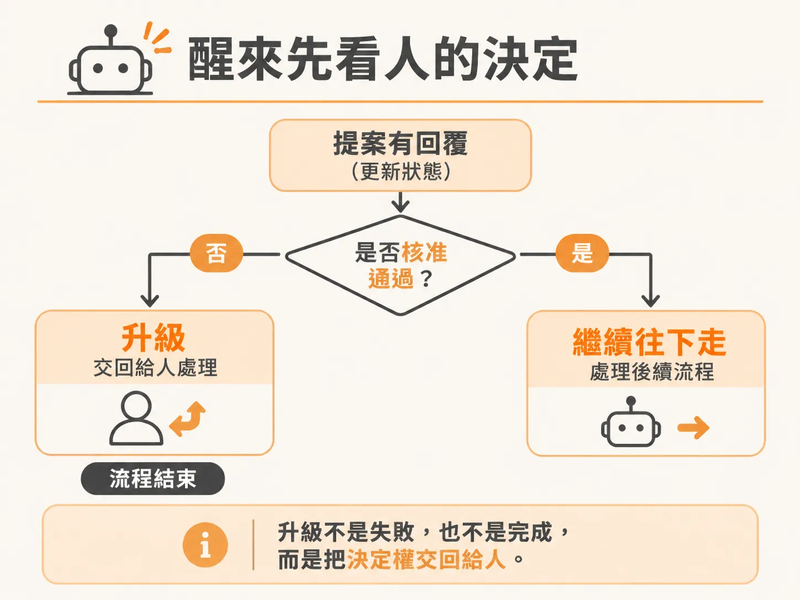
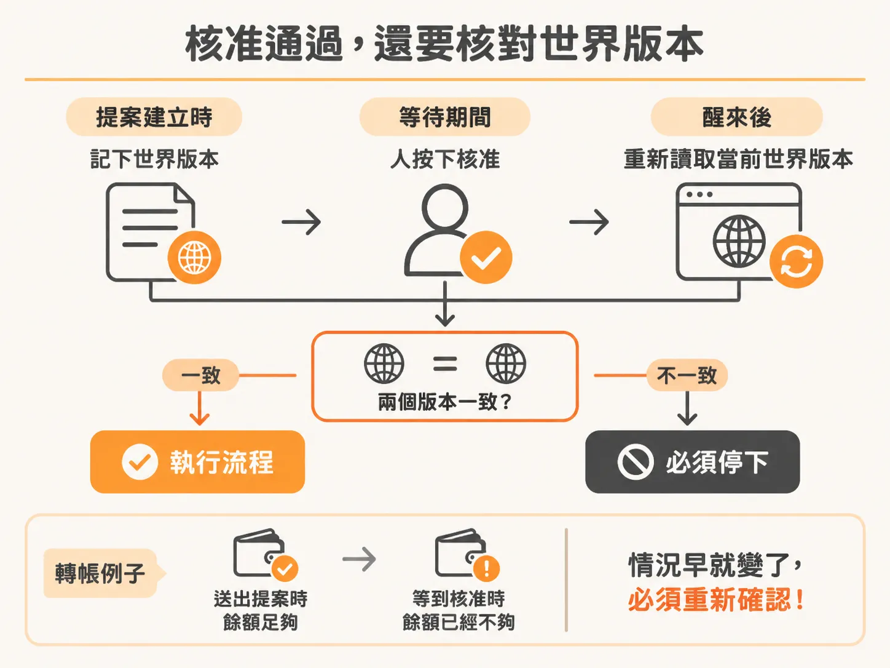
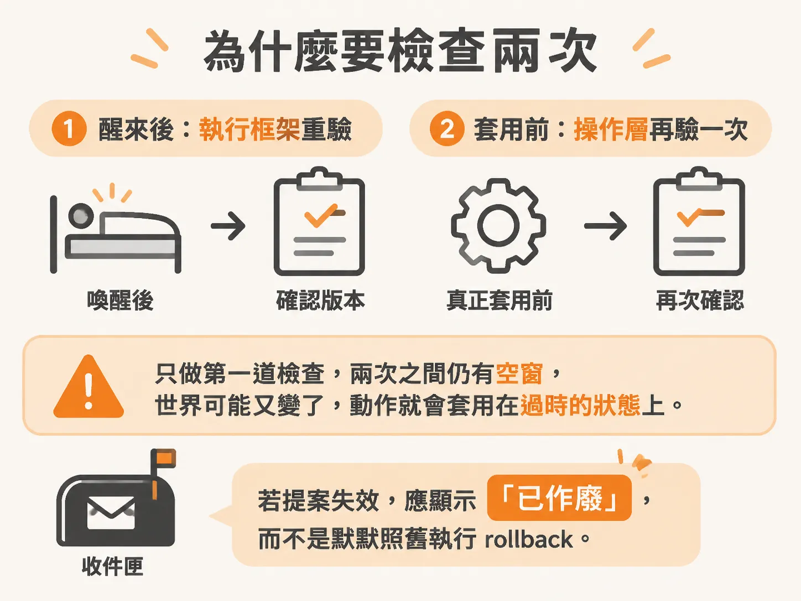

# 醒來之後先核對世界版本：核准通過不代表可以直接執行

核准事件確實對上這筆 proposal 之後，接下來才是真正棘手的部分。想像一個背景 agent 的處境：它需要一個危險動作的核准，於是送出提案、把 run 停下來等回覆。幾天之後人批覆了，agent 從暫停中醒來。這時最容易犯的錯，是看到「核准」兩個字就直接執行。人核准的是**當時**那個提案——幾天過去，世界可能早就變了。醒來之後需要一套判斷流程：被拒絕怎麼處理、核准了之後要先驗證什麼、以及版本不符時怎麼把舊提案標成 stale 再重跑一輪。

## 先看人說了什麼

流程本身的結構是：還在等待迴圈裡的時候，一旦提案有了回覆，我們就會把狀態更新成對應的 step（reconcile human、cycle check 這類名稱）。接著因為程式能跑到這裡，代表提案確實被更新過——雖然還不知道答案是同意還是拒絕，但可以先把最新的 proposal 撈出來，拿到 proposal ID。



離開等待迴圈之後，第一個判斷是提案狀態。如果 `proposal.status` 不等於 approved，表示人沒有核准，我們就喚醒一個 step，節奏上是「stop after human」，帶上目前的 cycle 編號。這個 step 要做的事只有一件：把 run 的狀態設成 **escalated**（已升級）。

為什麼是 escalated？因為我們正要關掉這個 run，得給它一個交代。它不是 completed——事情根本沒做成。它也不是 error——程式沒有出錯。也不是 superseded——沒有別的版本取代它。它是「我告訴你我需要做這件事，你說不行，那我也無能為力了」，剩下的事交給你。語意上大概就是這樣：狀態設成 escalated，因為想不出其他更好的歸類。

## 被拒絕之後，agent 可以有不同個性

這裡有個設計上的選擇題。有些 agent 被拒絕之後，會把「不行」解讀成「這條路不通，但事情還是得完成，我來找別的方法」。也有人採取另外一種策略：我說了我要做的是這件事，你不准我做，那我就什麼都不做。

這裡採用的是後者——**一被拒絕就放棄**。不是說前者不對，而是完全可以依照自己的需求，決定 agent 遇到拒絕時該怎麼反應。記錄上則把人的決定直接寫進去：decision 就是 `proposal.status`，人選了什麼就記什麼。然後記得從這裡 return 出去，結束這個 run。

## 核准了，也先別急著執行

如果人批准了提案，流程會走到下一個檢查點：重新撈一次最新的狀態。這裡用一個名為「recheck approved state」的 step，同樣帶上 cycle 編號，把 agent state 拿回來（帶入 environment ID 和 run ID），得到一份 fresh state。



這一步存在的理由很直白：人核准了，但在真正執行動作之前，狀態還跟當初一樣嗎？也許這個核准等了三個禮拜才下來，如果天真地看到「核准」就直接說「好，執行吧」，中間的變化就全部漏掉了。

用錢來想最清楚。假設這是一筆轉帳核准。提案送出去的時候，帳戶裡的錢綽綽有餘；等到人終於點下核准的那一刻，帳戶裡的錢已經不夠了。如果執行前不去查一下帳戶餘額，這筆轉帳就會直接透支。所以應該先檢查狀態——條件可能已經變了，這個核准可能已經不再適用。

## 版本不符：標 stale，然後重跑一輪

具體的判斷是拿 `fresh.world.version` 跟 input 比較——input 這邊記的是這個 workflow 啟動當下的世界版本。如果兩邊對不上，這個 step.run **不能執行**，前面講過應該讓它再迴圈一次，那就是接下來要做的事。

我們喚醒一個「invalidate approval」的 step，帶上 cycle 編號，去跑 stale proposal 函式。這個函式會拿 proposal ID 去更新資料庫，把這筆提案標成 **stale**。標了 stale 之後，這才是提案真正從收件匣被清掉的時刻——人下次打開收件匣，就不會再看到這筆已經過期的東西了。

<!-- source: sources/background-agent/20261109/supplement/server/agent-data.ts#L275-L288 -->

```typescript
export async function staleProposal(proposalId: string) {
  const proposal = await getProposal(proposalId)
  await db
    .update(approvals)
    .set({ status: 'stale', reason: 'State changed before this action ran', decidedAt: new Date() })
    .where(eq(approvals.id, proposalId))
  await logAgentActivity(
    proposal.environmentId,
    proposal.runId,
    'human',
    'Approved action became stale',
    { proposalId },
  )
}
```

標完 stale 之後就 `continue` 外層迴圈：回到最上面，重新撈一次最新狀態，看看現在該做什麼。整套流程變成：核准醒來 → 發現世界變了 → 舊核准作廢 → 回到起點根據新狀態重新規劃。核准不是一次放行，而是一次輪迴。

把兩個分支合起來看，程式碼大概長這樣：

<!-- source: sources/background-agent/20261109/supplement/server/agent-workflow.ts#L171-L185 -->

```typescript
        if (proposal.status !== 'approved') {
          await step.run(`stop-after-human-${cycle}`, () =>
            setRun(runId, 'escalated', `Human decision: ${proposal.status}`),
          )
          return
        }
        if (policy === 'help') continue
        const fresh = await step.run(`recheck-approved-state-${cycle}`, () =>
          agentState(environmentId, runId),
        )
        if (fresh.world.version !== input.expectedVersion) {
          await step.run(`invalidate-approval-${cycle}`, () => staleProposal(proposalId))
          continue
        }
      }
```

## 事後清掃之外，還有更主動的做法

上面這套是在「每次核准醒來」時才檢查版本，屬於事後清掃。其實也有更主動的做法：建立一個機制，讓每次狀態變動時，就去看一眼手上所有 pending 的提案，檢查它們還有沒有效；沒效的就把收件匣清掉。這樣人永遠只看得到還可以核准的有效動作，根本不會看到 stale 的提案。

主動式的版本是更值得蓋的選擇——一有狀態變化就把所有提案掃一遍，stale 的直接清掉。這套流程沒有做這一段，但它確實是可行方向：不要等到核准那一刻才發現過期，把檢查提前到狀態變動那一層，就能做到。

流程的最後一步是收尾調整：把先前某一個提前 return 的敘述拿掉。拿掉之後，邏輯變乾淨了——只要通過那兩道檢查（確實被核准、世界版本還沒變），流程就會走到執行的位置，把動作真正跑下去。

## 這個檢查為什麼不能省

補充一點背景：一份有用的核准其實是一個**範圍受限的能力**（scoped capability）——只針對這個 run、這個動作、這個預期的狀態版本，而且會過期。提案之所以要持久化保存，就是為了讓人可以在原始請求早已不在的情況下補上答覆。而核准之後重讀版本號，正是為了關閉一個「檢查時刻」與「使用時刻」之間的時間差：如果世界變了，舊的許可就已經無法描述即將執行的動作了。

還有一個容易漏掉的細節：這個版本檢查不只發生在 harness 這一層。operations API 在真正套用效果的時候，也會再驗一次版本——如果只有 harness 做重驗，兩者之間仍然存在競態。另外，收件匣在提案失效時應該清楚顯示「已作廢」，而不是默默照舊執行 rollback。



也要小心一個常見誤解：模型選了某個動作（例如 rollback_release），harness 把它轉成核准請求——**針對版本 1 的核准，並不是對之後任何版本的通用許可**。每次版本變動，都是一份新的、需要重新驗證的請求。

最後留一個可以自己動手驗證的觀察：留一筆核准 pending，只重啟 `dev:agent`，然後再去做決定，看看會發生什麼；換成重啟 checkout，確認舊提案會變成 stale。這兩種重啟的行為為什麼不同？親手跑一次，這套「醒來 → 重讀世界 → stale 重跑／拒絕升級」的循環就會變成你能自己推理的東西。
