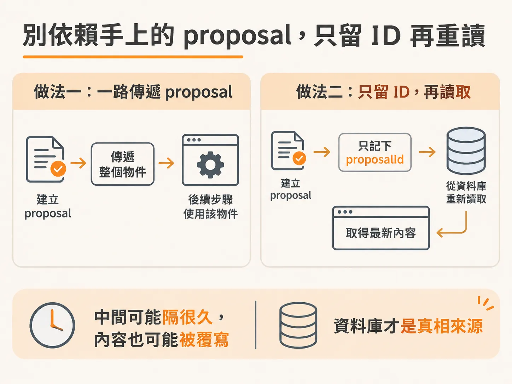
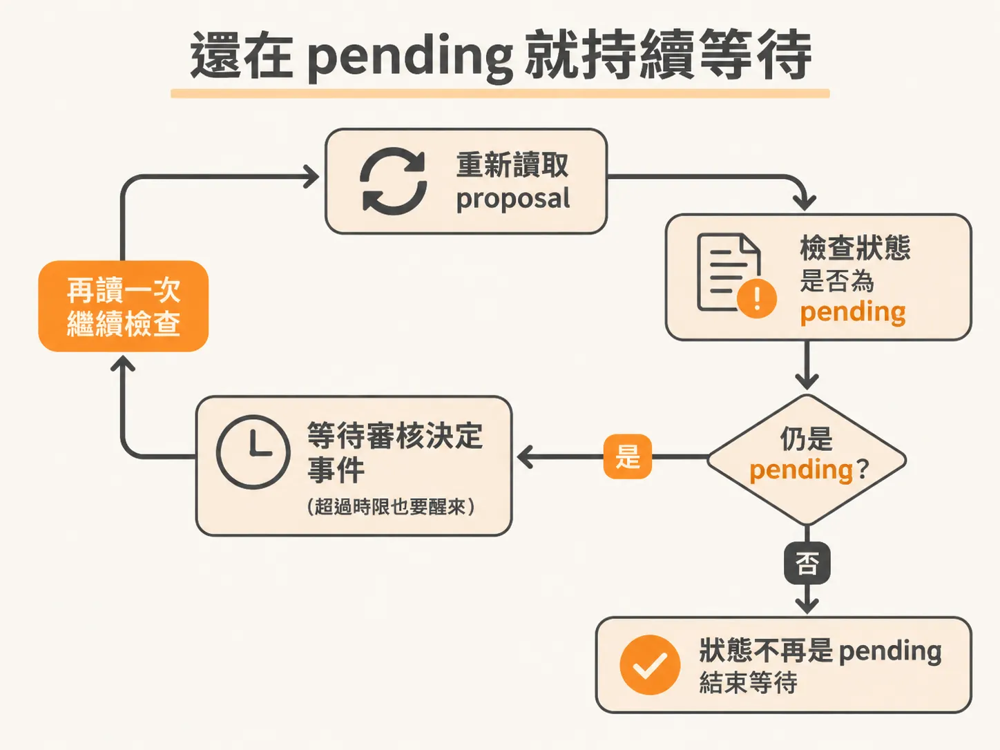
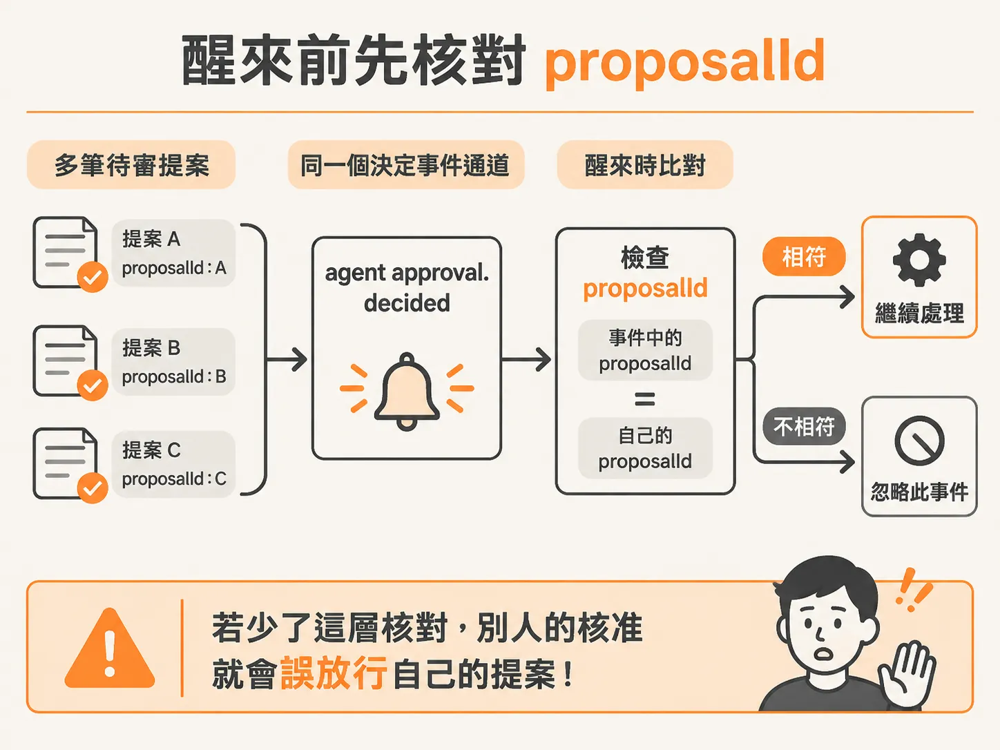

# 別相信手上的 proposal：把人工審核流程寫對

提案存好、也送進收件匣了，接著就是等回覆——而等待這件事比想像中容易寫錯。想像你的 agent 工作流程跑到了一個需要人類點頭的關卡：它先建立一筆審核請求，然後等有人去介面上按「同意」或「拒絕」。聽起來很簡單，但這裡有兩個很容易踩的坑：一是等了幾分鐘（甚至幾天）之後，你手上那筆資料早就不是當初建立的那筆了；二是任何一個人替**任何一筆**請求按了同意，結果把**所有**待審的任務都放行了。這裡要講的，就是怎麼把這兩個坑填掉。

## 只回傳 ID，下一步重新讀取

拿到 proposal 之後，下一步的做法看起來有點繞：先建立 proposal，但只回傳它的 `proposalId`；緊接著再開一個新的 step，用 `step.run` 去呼叫 `getProposal(proposalId)`，把這筆資料從資料庫讀回來。



你可能會問：為什麼不直接把剛建立好的 proposal 傳下去用，還要多花一個 step、多查一次資料庫？

答案是「可能被覆寫」。建立 proposal 這件事是非同步的，你完全不知道什麼時候會有人來處理它。所以你不希望任何東西被快取在中間——雖然 step 本身有快取機制，但你不要把這一行拿到的變數直接帶到下一行去用，而是要直接從資料庫拿。原因有兩個：

1. 你不知道資料庫會不會跟這筆寫入有衝突、有覆寫。
2. 這個工作流程如果之後重新執行，當時快取的值可能早就不存在，或已經不是現在的狀態。

所以結論很明確：**從資料庫拿，把資料庫當作唯一的真相來源**，不要用中間傳下來的那個值。因為從建立到讀取之間，它隨時可能變過——尤其當這個工作流程跑了很多次的時候。

## 這不是顯而易見的事，很多人親自踩過

這件事真的不直覺，你不會自己想到。這個陷阱是掉進去好幾次才會學會的：曾經卡了兩個小時解不開，還固執地不肯去問 Codex，堅持要自己搞清楚差在哪。

問題就出在拿到的是「過期的 proposal」。因為大概一天左右才碰一次課綱，從建立 proposal 到回頭處理它之間隔了很長的時間，等到真的要用的時候，那些 proposal 早就過時了。這時才會驚覺：一定要從資料庫重讀，才拿得到最新的。

再往深一層看：因為這是一個 `step.run`，這個服務可能在某一行停下來，之後又重新啟動。中間這段時間，可能早就有人上來把那筆請求處理掉、收拾乾淨了。也就是說，proposal 從建立那一刻到你讀到它的那一刻，長相可能已經不一樣；唯一能確定它「現在」長什麼樣的方法，就是直接去資料庫拿，不要相信手上傳過來的值。

如果你寫過資料庫交易，這其實就是同一件事。做交易做得正確的話，你幾乎不會直接拿手上的值去用——你會等到那次寫入正式定案之後，才去讀它。這裡完全一樣：不要相信手上那個值，因為你不知道建立的時候發生了什麼、撞到了哪些規則。要的就是直接從資料庫撈，把資料庫當真相來源。

## 進入等待迴圈：pending 就一直問

讀到最新的 proposal 之後，接著設一個檢查計數器 `check`，然後寫一個迴圈：**只要 `proposal.status` 還是 pending，就持續做這件事**——



1. 把 `check` 加一。
2. 呼叫 `step.waitForEvent`，等待人類做出決定的事件。
3. 事件到了之後，**再用 `proposalId` 重新呼叫 `getProposal`，把 proposal 再讀一次**。

為什麼這裡又得再讀一次？因為這段是在一個迴圈裡面，每檢查一次狀態都可能變過，所以每一次都得回資料庫拿最新的。整個流程就像在輪詢：「喂，你更新了嗎？你更新了嗎？」這個 while 迴圈不是必須的，放在這裡只是為了模擬實際會發生的情況，不一定要照抄。

（除錯時有個小插曲：TypeScript 一直對那段程式碼報錯，一開始很容易誤判成參數被當成 optional，後來才發現原因很單純——`waitForEvent` 需要第二個參數，也就是事件的設定物件本身。）

## 關鍵的過濾條件：proposalId一定要對上

事件設定裡最不能漏的，是過濾條件。這個服務發出的事件名稱是 `agent approval.decided`——就是有人在介面上按了是或否。但如果你只等這個事件，不過濾內容，會發生一件很糟糕的事：任何一個人替**別的**任務的 proposal 按了同意，你這個工作流程也會收到事件，然後心想「太好了，有人核准了」——核准的卻是另一個不相干的任務。



所以過濾條件要寫成：事件的 `proposalId` 必須等於**你手上這個** `proposalId`。不加這個過濾的話，整個系統裡只要有一個人核准了任何一個任務，所有任務就會全部被核准——那可不好，你會丟掉工作的。最後加上 `timeout` 設 10 秒：等到這個事件、套用這個過濾、超過 10 秒就放棄等待（時間到就交給下一輪檢查處理）。

把整段等待迴圈寫起來會像這樣：

<!-- source: sources/background-agent/20261109/supplement/server/agent-workflow.ts#L158-L170 -->

```typescript
        let proposal = await step.run(`read-human-${cycle}`, () => getProposal(proposalId))
        let check = 0
        while (proposal.status === 'pending') {
          check++
          await step.waitForEvent(`wait-for-human-${cycle}-${check}`, {
            event: 'agent/approval.decided',
            if: `async.data.proposalId == "${proposalId}"`,
            timeout: '10s',
          })
          proposal = await step.run(`reconcile-human-${cycle}-${check}`, () =>
            getProposal(proposalId),
          )
        }
```

## 重讀的動作放在哪裡

負責重讀的 `getProposal` 不只是單純查詢。它先依 `proposalId` 查那筆審核請求，查不到就直接丟錯；如果狀態還是 pending 但已經超過有效期限，它會直接把狀態更新成 expired 再回傳。這樣每次迴圈重讀時，拿到的永遠是資料庫裡此刻最真實的狀態，而不是「喚醒當下剛好手上有的那個舊值」。

<!-- source: sources/background-agent/20261109/supplement/server/agent-data.ts#L214-L226 -->

```typescript
export async function getProposal(proposalId: string) {
  const [proposal] = await db.select().from(approvals).where(eq(approvals.id, proposalId)).limit(1)
  if (!proposal) throw new Error('Approval request not found')
  if (proposal.status === 'pending' && proposal.expiresAt.getTime() < Date.now()) {
    const [expired] = await db
      .update(approvals)
      .set({ status: 'expired', decidedAt: new Date() })
      .where(eq(approvals.id, proposalId))
      .returning()
    return expired
  }
  return proposal
}
```

## 一句話總結這個模式

建立 proposal 之後只留下 ID；要用之前一律回資料庫重讀；等待審核事件時用 `proposalId` 過濾，確保收到的核准確實是針對**這一筆**請求。這就跟寫資料庫交易一樣——寫入定案之前，不要相信任何在手上的快取值。
